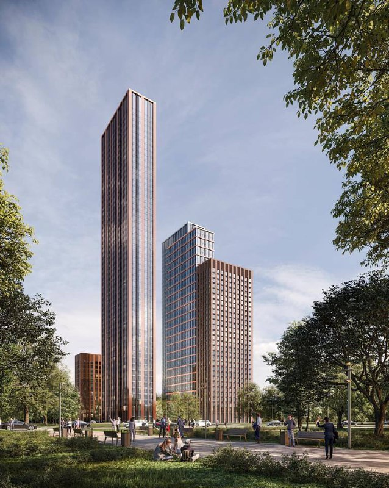
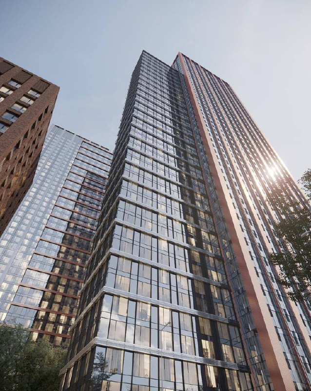

# Wave: как менялся проект на Борисовских прудах, 1 с 2021 по 2024

В марте 2021 года MR Group показала на Борисовских прудах четыре башни Wave на 14–52 этажа. С декабря 2021 года квартиры в них продаёт [ЛСР](/zastroyshchiki/lsr/), а к январю 2024 года проект вырос до 11 корпусов в двух очередях. Вторая часть истории — смена архитектуры очередей — по открытым источникам не подтвердилась.

## Коротко

- **Март 2021 года:** MR Group, четыре башни от 14 до 52 этажей, концепция бюро Speech.
- **Август 2021 года:** ФАС одобрила покупку ЛСР связанной с MR компании, владевшей участком 22 га.
- **Декабрь 2021 года:** ЛСР начала продажи: четыре корпуса Azure, Bondi, Indigo и Sapphire, в самом высоком, Azure, — 765 квартир.
- **Январь 2024 года:** первая очередь — четыре корпуса, вторая добавит ещё семь, всего 11.
- **Что не подтвердилось:** новая архитектура третьей и четвёртой очередей и цены на октябрь 2026 года.

Полная история проекта — в [досье «Wave»](/obekty/wave/). Район — [Москворечье-Сабурово](/novostroyki/moskvoreche-saburovo/).

## С чего начинали

Участок на улице Борисовские Пруды занимал Московский завод радиотехнической аппаратуры (МЗРТА). По данным «Ведомостей», весной 2020 года 100% завода купила «Бизнес актив», связанная с MR Group. Земля площадью 22 га обошлась MR Group в 2,36 млрд ₽.

В марте 2021 года «Москвич» описал проект бизнес-класса Wave: четыре башни разной высоты, от 14 до 52 этажей, и камерные дома малой и средней этажности на части территории. Архитектурную концепцию, по тому же изданию, разработало бюро Speech.

*Башни Wave в варианте MR Group. Визуализация: MR Group, 2021*

## Что меняли

**Застройщик.** В августе 2021 года «Ведомости» сообщили, что ФАС одобрила ходатайство ЛСР о покупке ООО «Оникс», через которое MR Group принадлежал МЗРТА с участком 22 га. Сумму сделки не раскрывали, в ЛСР говорили, что обсуждать детали проекта преждевременно. В публикации площадь проекта указана как 547 490 м²; это экспертная цифра из материала, а не данные проектной декларации.

**Старт продаж.** В декабре 2021 года ЛСР открыла продажи. Четыре корпуса получили названия Azure, Bondi, Indigo и Sapphire, этажность по-прежнему от 14 до 52. В Azure, самом высоком, — 765 квартир площадью примерно от 20 до 106 м², потолки 2,9 м и паркинг на 408 мест; старт цены — от 8,5 млн ₽.

**Следующие корпуса.** В феврале 2023 года ЛСР открыла продажи в Bondi и Sapphire: 14 и 29 этажей, студии от 23,6 м², от 8 млн ₽ по спецпредложению.

**Масштаб.** К январю 2024 года, по данным каталога, первая очередь состоит из четырёх корпусов, а во второй добавится ещё семь, всего 11. То есть мастер-план вырос почти втрое по числу домов. Какие архитекторы и какие решения стоят за новыми корпусами, проверенные источники не говорят.

Что нам называли в архиве о бюро Ariada для третьей и четвёртой очередей, о зубчатых фасадах второй очереди и об исходном плане с двумя бульварами, подтвердить не удалось. Эти версии мы не пересказываем.

*Остекление башни Wave. Визуализация: MR Group, 2021*

## Каким проект стал

По открытым данным, проект продаётся. Первая очередь — четыре корпуса, вторая — ещё семь. Цены, срок сдачи и этажность корпусов второй очереди на октябрь 2026 года по проверенным источникам мы не подтвердили: найденные страницы каталогов не датированы или не содержат этих данных. Актуальные цифры лучше взять в [проектной декларации](/slovar/proektnaya-deklaratsiya/) на наш.дом.рф.

На наш взгляд, главное в этой истории не архитектура, а масштаб: проект, показанный как четыре башни, у нового владельца превратился в большой квартал. Это обычно значит более долгую стройку и больше плотности на тот же участок. Но это предположение, не факт из источников.

## Было и стало

| Параметр | Март 2021 года (MR Group) | Декабрь 2021 года (старт продаж, ЛСР) | Январь 2024 года (ЛСР) |
|---|---|---|---|
| Застройщик | MR Group | ЛСР (сделку одобрила ФАС в августе 2021 года) | ЛСР |
| Корпуса | четыре башни | четыре: Azure, Bondi, Indigo, Sapphire | 4 в первой очереди + 7 во второй = 11 |
| Этажность | 14–52 | 14–52 | — |
| Площадь проекта | — | 547 490 м² (по публикации «Ведомостей», август 2021 года) | — |
| Квартиры | — | 765 в Azure | — |
| Архитектор | Speech | — | — |
| Старт цены | — | от 8,5 млн ₽ за лот | — |

## Карточка объекта

- **Название:** Wave (Борисовские пруды)
- **Адрес участка:** Борисовские пруды, 1, Москва, [Москворечье-Сабурово](/novostroyki/moskvoreche-saburovo/)
- **Застройщик:** [ЛСР](/zastroyshchiki/lsr/); ранее проект принадлежал MR Group
- **Класс:** бизнес
- **Корпуса:** 11 по плану двух очередей (на январь 2024 года)
- **Стадия:** продажи

## Вопросы и ответы

**Кто застройщик Wave на Борисовских прудах?**
Проект начинала MR Group, которой через «Бизнес актив» принадлежал МЗРТА с участком 22 га. В августе 2021 года ФАС одобрила покупку ЛСР связанного с MR ООО «Оникс», а с декабря 2021 года продажи ведёт ЛСР.

**Сколько этажей в Wave?**
В марте 2021 года и при старте продаж в декабре 2021 года для четырёх башен называли от 14 до 52 этажей. Для корпусов, открытых в феврале 2023 года, названы 14 и 29 этажей (Bondi и Sapphire).

**Сколько корпусов будет в Wave?**
По данным января 2024 года, в первой очереди четыре корпуса, во второй добавятся ещё семь, всего 11.

**Кто архитектор Wave?**
Концепцию, по данным «Москвича» (март 2021 года), разработало бюро Speech. Архитекторов более поздних очередей проверенные источники не называют.

## Источники

1. [Четыре башни высотой от 14 до 52 этажей построят на юге Москвы — «Москвич», 4 марта 2021 года](https://moskvichmag.ru/?p=150914)
2. [Сделка ЛСР по покупке связанной с MR Group компании — «Ведомости», 17 августа 2021 года](https://www.vedomosti.ru/realty/articles/2021/08/17/882336-mr-group)
3. [Группа ЛСР начала продажи в ЖК Wave — novostroy-m.ru, 21 декабря 2021 года](https://www.novostroy-m.ru/novosti/gruppa_lsr_nachala_prodaji)
4. [Продажи новых корпусов ЖК Wave — novostroy-m.ru, 8 февраля 2023 года](https://www.novostroy-m.ru/novosti/prodaji_novyh_korpusov_jk)
5. [ЛСР вывела в продажу — novostroy-m.ru, 10 января 2024 года](https://www.novostroy-m.ru/novosti/lsr_vyvela_v_prodaju)

Материал не является инвестиционной рекомендацией.
