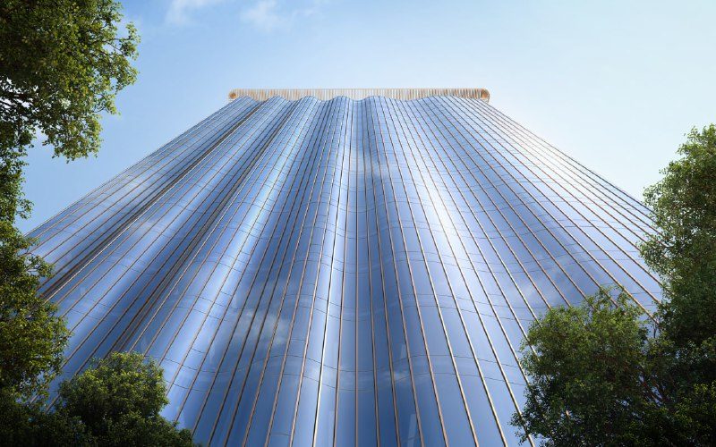
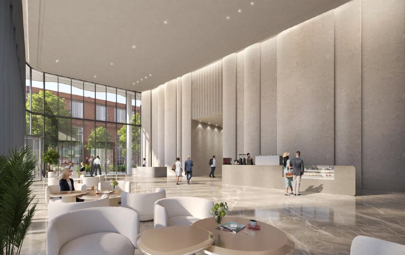

# KOBZON CITY на Бауманской, 11: офисы от October Group, ввод в 2028 году

October Group в январе 2025 года вывела в продажу офисы в KOBZON CITY (K-CITY) — многофункциональном центре площадью около 59,8 тыс. м² в Басманном районе. К июню 2026 года проект вышел на стадию строительства, ввод первого этапа планируют в 2028 году.

## Коротко

- Проект: KOBZON CITY на участке «Бауманская, 11», около 59,8 тыс. м², два этапа; первый — 18-этажная башня.
- Офисы начинаются с третьего этажа, площади — от 32,5 до 716 м².
- Концепцию первого этапа Москомархитектура согласила 18 марта 2025 года; автор концепции — бюро NIKKEN.
- На 10 июня 2026 года в первой очереди завершены котлован, шпунтовое ограждение, форшахта и стены в грунте; открытие намечено на 2028 год.

## Что такое KOBZON CITY

Проект реализует October Group вместе с культурным фондом «Кобзон»; финансовым партнёром выступает банк ДОМ.РФ. Участок находится в Басманном районе, примерно в 500 м от метро «Бауманская». Строительство на этом месте одобрили ещё в 2022 году.

Комплекс делится на два этапа. Первый — 18-этажная башня с волнообразным остеклением (в материалах мэрии она названа Melody Tower). Офисы там начинаются с третьего этажа, на нижних этажах разместятся кафе, магазины и рестораны, а лобби займёт около 215 м². Подземная часть — паркинг.

*Фасад первой башни KOBZON CITY. Визуализация: October Group*

Вторая очередь, показанная в апреле 2025 года, — два корпуса, соединённых скай-мостом, со стилобатом, где расположится арт-хаб имени Кобзона (ранее его называли Музыкальным театром будущего), и парком на кровле. Сроки второй очереди открытые источники не называют.

*Лобби бизнес-центра. Визуализация: October Group*

## Что с проектом сейчас

Состояние на 14 октября 2026 года.

**Стадия.** В апреле 2025 года девелопер ещё ожидал [разрешения на строительство](/slovar/razreshenie-na-stroitelstvo/). По данным М24 от 10 июня 2026 года, на Бауманской улице в первой очереди бизнес-центра завершены подготовительные работы: котлован, шпунтовое ограждение, форшахта и стены в грунте. Стройку контролирует Мосгосстройнадзор, который провёл вторую проверку качества работ и материалов.

**Срок.** Ввод первого этапа по-прежнему планируют в 2028 году.

**Площадь.** По данным М24, наземная часть первой очереди — около 60 тыс. м², подземная — более 22 тыс. м², офисы класса А займут свыше 13 тыс. м².

**Цены.** Цену офисов на дату проверки по открытым источникам подтвердить не удалось, поэтому мы её не приводим. Условия сделки (по данным брокерского обзора марта 2025 года) — договор купли-продажи будущей вещи, а не [ДДУ](/slovar/ddu/), который применяют для жилья.

**Застройщик.** Проект ведёт [October Group](/zastroyshchiki/october-group/); смены собственника не зафиксировано.

Полная история проекта — в [досье «KOBZON CITY»](/obekty/kobzon-city/).

## Что это значит для покупателя

Плюсы: близость к метро, выход проекта на стадию строительства, финансирование банком ДОМ.РФ и гибкие планировки офисов с возможностью объединения. Для [Басманного района](/novostroyki/basmannyy/) это заметный коммерческий проект.

Риски: срок 2028 года ещё далеко, сложный фасад и вторая очередь с арт-хабом повышают, на наш взгляд, риск удорожания и переноса сроков. Цена за метр на дату проверки неизвестна. На наш взгляд, покупателю офиса важно смотреть не на «сладкие условия», а на права по договору и график платежей.

## Карточка объекта

- Название: KOBZON CITY (K-CITY, Melody Tower)
- Адрес участка: Бауманская, 11, Басманный район, Москва
- Застройщик: October Group (вместе с культурным фондом «Кобзон»)
- Финансирование: банк ДОМ.РФ
- Архитектор концепции: NIKKEN
- Площадь: около 59,8 тыс. м²
- Этажность первой башни: 18
- Офисы: от 32,5 до 716 м²
- Стадия: строительство
- Ввод: 2028 год
- Метро: «Бауманская», около 500 м от участка

## Вопросы и ответы

**Что такое KOBZON CITY на Бауманской, 11?**
Многофункциональный центр общей площадью около 59,8 тыс. м² в Басманном районе: офисы, коммерция и арт-хаб имени Кобзона. Строится в два этапа, первый — 18-этажная башня.

**Кто застройщик KOBZON CITY?**
Проект реализует October Group вместе с культурным фондом «Кобзон»; финансовый партнёр — банк ДОМ.РФ.

**Когда сдадут KOBZON CITY?**
Ввод первого этапа планируют в 2028 году. К июню 2026 года в первой очереди завершены котлован, шпунтовое ограждение, форшахта и стены в грунте.

**Какие офисы продаёт October Group в K-CITY?**
Офисы начинаются с третьего этажа, площади — от 32,5 до 716 м² с возможностью объединения помещений.

## Источники

1. [Мэрия Москвы: согласована концепция KOBZON-CITY на Бауманской, 11, 18 марта 2025](https://www.mos.ru/news/item/151453073/)
2. [РБК Недвижимость, 13 мая 2024: проект на Бауманской, 11](https://realty.rbc.ru/news/6641c2129a794739fdbc2e95)
3. [РБК Недвижимость, 18 марта 2025: концепция Kobzon Center](https://realty.rbc.ru/news/67d934fe9a794700d3b5dccf)
4. [«Москвич Mag», 6 апреля 2025: вторая очередь «Кобзон-Сити»](https://moskvichmag.ru/?p=420638)
5. [М24, 10 июня 2026: начало строительства бизнес-центра на Бауманской](https://www.m24.ru/news/10062026/909236)
6. [Обзор отдела продаж, 21 марта 2025 (условия сделки; брокерский материал)](https://teletype.in/@sales-dep/v0-GkiXiOF4)

Материал не является инвестиционной рекомендацией.
