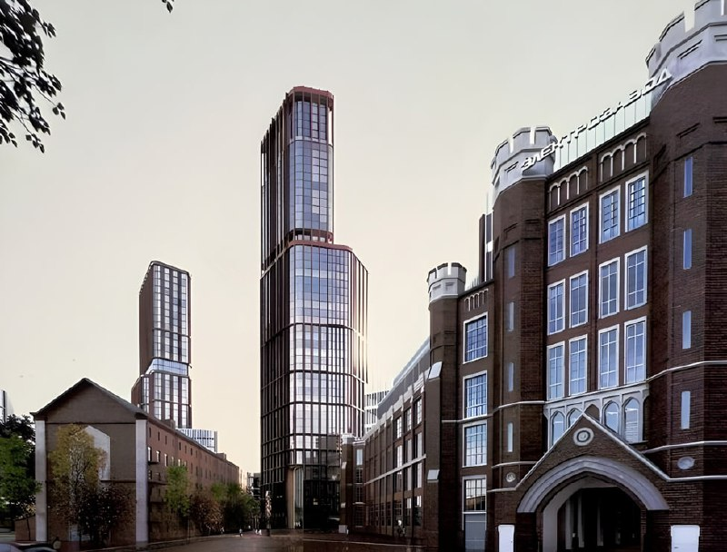
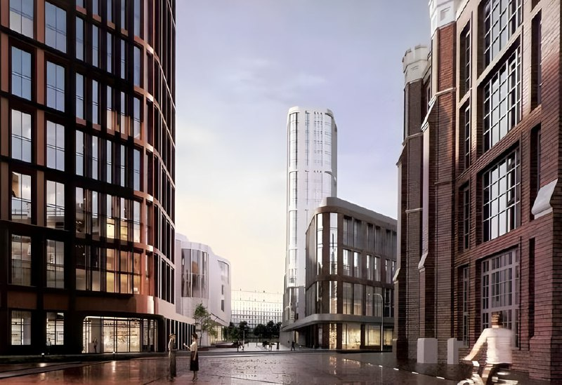

---
source:
  id: 27820
  date: '2025-02-10'
status: needs_review
skip_reason: null
type: object
region: moscow
title: 'Электрозавод Эталона: «Форт» на 800 тыс. м², а корпуса уже идут под снос'
title_alts:
- 'Электрозавод в Москве: Эталон строит «Форт», пока памятник теряет стены'
- 'Что будет на Электрозаводе: 287,8 тыс. м² жилья и фасады под честное слово'
slug: elektrozavod-etalon-kontseptsiya-fort-ploshchadi
lead: 'Эталон назвал свой проект на Электрозаводе «Фортом» и к июню 2026 года выдал цифры: более 800 тыс. м² общей поэтажной площади, из них 287,8 тыс. м² жилья. Пока крепость рисуют на визуализациях, настоящую стену разбирают: комплекс лишился охранного статуса, а часть построек, по сообщениям СМИ, уже снесена.'
developers:
- id: etalon
  name: Эталон
  role: main
objects:
- id: elektrozavod
  names:
  - Электрозавод
  - Форт
  - FORT
  zu: null
  main: true
  new: false
districts: []
topics:
- rynok
- regulirovanie
images:
- file: media/27820_3.jpg
  alt: 'Визуализация: высотная башня рядом с историческим кирпичным корпусом Электрозавода, Москва'
  caption: 'Визуализация проекта редевелопмента Электрозавода: новая башня рядом с историческим корпусом. Визуализация: Эталон'
  credit: Эталон
- file: media/27820_5.jpg
  alt: 'Визуализация: улица между историческим корпусом Электрозавода и новыми домами, Москва'
  caption: 'Визуализация проекта: пешеходная улица вдоль исторического корпуса. Визуализация: Эталон'
  credit: Эталон
factcheck:
- claim: Эталон развивает на Электрозаводе проект «Форт» (жильё, офисы, технопарк, общественные пространства)
  status: confirmed
  source: https://realty.rbc.ru/news/69ef69559a794766003250a7
  checked: '2026-10-13'
- claim: Общая поэтажная площадь проекта превысит 800 тыс. м²; жилая застройка 287,8 тыс. м²; офисы 17,6 тыс. м²; деловая инфраструктура 10,4 тыс. м²; участок 19,74 га; 491 машино-место (заявление застройщика, ТАСС, 26 июня 2026 года)
  status: confirmed
  source: https://investfuture.ru/articles/etalon-obyavlyaet-o-stroitelstve-tekhnoparka-na-territorii-elektrozavoda-37065598
  checked: '2026-10-13'
- claim: Мастер-план и сроки ввода не утверждены; максимальная доминанта формируется в глубине квартала, вдоль набережной этажность ниже
  status: confirmed
  source: https://investfuture.ru/articles/etalon-obyavlyaet-o-stroitelstve-tekhnoparka-na-territorii-elektrozavoda-37065598
  checked: '2026-10-13'
- claim: Высота доминант 200 м и «пара доминант» из заметки
  status: unverified
  source: нет числовых значений высоты в открытых источниках
  checked: '2026-10-13'
- claim: 8 февраля 2025 года на территории Электрозавода произошёл пожар; в конце марта арендаторы прекратили работу
  status: confirmed
  source: https://msk1.ru/text/realty/2025/04/10/75324044/
  checked: '2026-10-13'
- claim: 23 декабря 2020 года АФК «Система» объявила о покупке 64,4% АО «Электрозавод» и контроля над 100% ООО «Электрокомбинат» за 24,7 млрд ₽; площадка 19 га у метро «Электрозаводская»; «Система» — крупнейший акционер Эталона
  status: confirmed
  source: https://1prime.ru/20201224/832668377.html
  checked: '2026-10-13'
- claim: Эталон владеет территорией с 2020–2021 годов; в 2025 году комплекс потерял статус выявленного ОКН; построен по проекту Георгия Евланова
  status: confirmed
  source: https://finance.mail.ru/article/istoricheskie-stenyi-ustupyat-mesto-ofisam-69214057/
  checked: '2026-10-13'
- claim: '9 июля 2026 года суд оставил в силе исключение Электрозавода из списка выявленных объектов культурного наследия (закон: не прошедшие экспертизу до 1 июля 2025 года теряют статус)'
  status: confirmed
  source: https://theblueprint.ru/news/40684
  checked: '2026-10-13'
- claim: Около 21 июня 2026 года, по данным «Архи.ру» (через Ъ FM), ГЗК одобрила снос; окончательное решение за Мосгосстройнадзором; официального подтверждения и даты заседания нет
  status: confirmed
  source: https://finance.mail.ru/article/istoricheskie-stenyi-ustupyat-mesto-ofisam-69214057/
  checked: '2026-10-13'
- claim: '23–24 июня 2026 года Эталон заявил, что речь не о полном сносе: фасады и узнаваемые черты корпусов сохранят; итоговые параметры определят после согласований'
  status: confirmed
  source: https://theblueprint.ru/news/40411
  checked: '2026-10-13'
- claim: К 8 сентября 2026 года часть построек снесена (по словам очевидцев, снос начался в июле); «Архи.ру» собрало более 19 тыс. подписей за сохранение; застройщик не показал проект; по презентации застройщика в корпусах разместится офис Группы МТС
  status: confirmed
  source: https://meduza.io/feature/2026/09/08/v-moskve-snosyat-elektrozavod-fasady-obeschayut-sohranit-no-net-garantiy-chto-ih-ne-zamenyat-novodelom
  checked: '2026-10-13'
- claim: В рекламном материале Эталона на РБК Недвижимость (8 мая 2026 года) заявлены старт строительства в начале 2027 года и завершение к 2034 году; жильё почти 290 тыс. м²
  status: confirmed
  source: https://realty.rbc.ru/news/69ef69559a794766003250a7
  checked: '2026-10-13'
- claim: Эталон получил разрешение на строительство жилого и офисного комплекса (The Blueprint, 9 июля 2026 года)
  status: unverified
  source: единственное упоминание без деталей, противоречит сообщению ТАСС от 26 июня 2026 года о том, что разрешительная документация ещё предстоит
  checked: '2026-10-13'
- claim: Эталон пытается продать проект; город не даёт ТЭП; ожидается нарезка проекта и продажа частей Стране и Стоуну
  status: unverified
  source: слух; подтверждений сделки или продажи в открытых источниках на 13.10.2026 не найдено
  checked: '2026-10-13'
- claim: Экономика высотки требует цены старта 700+ тыс. ₽/м²; «Кристалл» на Самокатной, 4 не вышел в реализацию
  status: unverified
  source: не проверялось в рамках лимита запросов
  checked: '2026-10-13'
removed:
- 'Прогноз о нарезке проекта и продаже частей региональным и профильным игрокам: слух, не подтвердился (сделок не найдено).'
- 'Утверждения, что город требовал построить много доминант выше 200 м и не даёт ТЭП без реновации: не подтверждено.'
- 'Порог рентабельности высоток 700+ тыс. ₽/м² и сравнение с «Кристаллом»: непроверяемое мнение.'
- 'Высота «пары доминант по 200 м»: в источниках высоты не названы.'
- 'Разрешение на строительство (The Blueprint): единственное упоминание, противоречит ТАСС.'
- Оценочные фразы («частокол», «человечный проект», «со слезами на глазах»), сравнение с «Красной розой».
- 'Фото 27820_1, 27820_2 и 27820_4: не взяты — не удалось установить, к какой версии концепции относятся; 27820_3 и 27820_5 взяты без датировки.'
data_points: []
seo:
  main_query: электрозавод эталон проект застройки
  keywords:
  - электрозавод москва редевелопмент
  - проект форт эталон
  - электрозавод снос корпусов
  - электрозавод метро электрозаводская
  - электрозавод жилой комплекс
  frequency_checked: false
  title: 'Электрозавод Эталона: «Форт» на 800 тыс. м² и снос корпусов'
  description: 'Электрозавод: Эталон обещает более 800 тыс. м² и 287,8 тыс. м² жилья, а корпуса уже сносят. Что с фасадами, охранным статусом и сроками проекта «Форт».'
  canonical: https://шахматка.москва/novosti/elektrozavod-etalon-kontseptsiya-fort-ploshchadi/
internal_links:
- anchor: полная история проекта — в досье «Электрозавод»
  url: /obekty/elektrozavod/
- anchor: Эталон
  url: /zastroyshchiki/etalon/
- anchor: градостроительно-земельная комиссия (ГЗК)
  url: /slovar/gzk/
- anchor: подробнее о сносе корпусов и фасадах
  url: /novosti/elektrozavod-etalon-snos-sohranenie-fasadov/
- anchor: новостройки Москвы
  url: /novostroyki/moskva/
- anchor: регулирование
  url: /temy/regulirovanie/
faq:
- q: Что построят на месте Электрозавода?
  a: 'Эталон обещает проект «Форт»: 287,8 тыс. м² жилья, офисы, деловую инфраструктуру и парковку на 491 машино-место — всего более 800 тыс. м² общей поэтажной площади. Мастер-план пока не утверждён.'
- q: Кто застройщик Электрозавода?
  a: Группа «Эталон». В декабре 2020 года её крупнейший акционер, АФК «Система», объявила о покупке контроля над заводом за 24,7 млрд ₽.
- q: Снесут ли Электрозавод?
  a: 'Целиком — нет, уверяет Эталон: фасады и узнаваемые черты корпусов обещают сохранить. Но, по сообщениям СМИ, часть построек уже снесена, а ГЗК в июне 2026 года снос одобрила.'
- q: Электрозавод охраняется как памятник?
  a: 'Уже нет. Статус выявленного объекта культурного наследия комплекс потерял в 2025 году, а в июле 2026 года суд это решение оставил в силе.'
- q: Когда начнутся продажи квартир на Электрозаводе?
  a: Сроки продаж и цены не объявлены. Сначала нужны утверждённый мастер-план и разрешительная документация — только потом можно говорить о вводе.
date_published: '2025-02-10'
date_modified: '2026-10-13'
author: Редакция Шахматки
schema: '[{"@context": "https://schema.org", "@type": "Article", "headline": "Электрозавод Эталона: проект «Форт» на 800 тыс. м² и снос корпусов", "description": "Проект Эталона на Электрозаводе: более 800 тыс. м² площади, 287,8 тыс. м² жилья, снос части корпусов в 2026 году. Что известно о сроках и статусе площадки.", "datePublished": "2025-02-10", "dateModified": "2026-10-13", "author": {"@type": "Organization", "name": "Редакция Шахматки"}, "publisher": {"@type": "Organization", "name": "Шахматка"}, "about": [{"@type": "Place", "name": "Электрозавод, Москва"}, {"@type": "Organization", "name": "Эталон"}], "mainEntityOfPage": "https://шахматка.москва/novosti/elektrozavod-etalon-kontseptsiya-fort-ploshchadi/"}, {"@context": "https://schema.org", "@type": "FAQPage", "mainEntity": [{"@type": "Question", "name": "Что построят на месте Электрозавода?", "acceptedAnswer": {"@type": "Answer", "text": "Эталон заявляет о проекте «Форт»: жилая застройка 287,8 тыс. м², офисы, деловая инфраструктура и парковка на 491 машино-место при общей поэтажной площади более 800 тыс. м². Мастер-план ещё не утверждён."}}, {"@type": "Question", "name": "Кто застройщик Электрозавода?", "acceptedAnswer": {"@type": "Answer", "text": "Территорией занимается группа «Эталон». В декабре 2020 года АФК «Система», крупнейший акционер Эталона, объявила о покупке контроля над заводом за 24,7 млрд ₽."}}, {"@type": "Question", "name": "Снесут ли Электрозавод?", "acceptedAnswer": {"@type": "Answer", "text": "Полного сноса, по заявлению Эталона, не будет: фасады и узнаваемые черты корпусов обещают сохранить. По сообщениям СМИ, часть построек уже снесена, а ГЗК в июне 2026 года одобрила снос."}}, {"@type": "Question", "name": "Электрозавод охраняется как памятник?", "acceptedAnswer": {"@type": "Answer", "text": "Нет: до 2025 года у комплекса был статус выявленного объекта культурного наследия, в 2025 году он его потерял; в июле 2026 года суд оставил это решение в силе."}}, {"@type": "Question", "name": "Когда начнутся продажи квартир на Электрозаводе?", "acceptedAnswer": {"@type": "Answer", "text": "Сроки старта продаж и цены не объявлены. Ввод в эксплуатацию возможен после утверждения мастер-плана и получения разрешительной документации."}}]}]'
editor_notes: Решение ГЗК о сносе известно только из «Архи.ру» через Ъ FM, без официального документа и даты; проверьте mos.ru и решение Мосгосстройнадзора. Цифры проекта — заявление застройщика через ТАСС (InvestFuture); материал РБК от 8 мая — реклама, год на странице не указан (определён по идентификатору). Разрешение на строительство и покупателя/инвестора не подтвердил; цепочку «Система → Эталон» (переход участка) источниками не подтвердил, поэтому ownership_changes не заполнено. Район не указан (в источниках расходится), адреса ЗУ в досье нет. Фото 3 и 5 взяты из заметки; принадлежность визуализаций Эталону и версия концепции не подтверждены — уточнить у пресс-службы или заменить.
---

# Электрозавод Эталона: «Форт» на 800 тыс. м², а корпуса уже идут под снос

Эталон назвал свой проект на Электрозаводе «Фортом» и к июню 2026 года выдал цифры: более 800 тыс. м² общей поэтажной площади, из них 287,8 тыс. м² жилья. Пока крепость рисуют на визуализациях, настоящую стену разбирают: комплекс лишился охранного статуса, а часть построек, по сообщениям СМИ, уже снесена.

## Коротко

- **Масштаб:** у метро «Электрозаводская» обещают более 800 тыс. м² общей поэтажной площади, жильё — 287,8 тыс. м², участок — 19,74 га (заявление застройщика, июнь 2026 года).
- **Статус:** в 2025 году комплекс перестал быть выявленным объектом культурного наследия; 9 июля 2026 года суд это решение не тронул.
- **Снос:** около 21 июня 2026 года, по данным СМИ, [ГЗК](/slovar/gzk/) одобрила снос; Эталон уверяет, что полного сноса не будет.
- **Чего нет:** мастер-плана, сроков ввода, старта продаж и цен.

## Квартал вместо завода: что обещают

Цифры прозвучали 26 июня 2026 года в сообщении ТАСС со слов застройщика. Общая поэтажная площадь «превысит 800 тыс. м²». Из неё жильё — 287,8 тыс. м², офисы — 17,6 тыс. м², деловая инфраструктура — 10,4 тыс. м². Плюс 491 машино-место для сотрудников и гостей.

Жилья, обратите внимание, — заметно меньше половины. Остальное — офисы, технопарк и всё, что застройщик уложил в формулу «общая поэтажная».

Высоты в проекте разные: главная доминанта уходит в глубину квартала, а вдоль набережной и исторических корпусов дома ниже. Сколько именно метров у доминанты, застройщик не говорит.

*Визуализация проекта редевелопмента Электрозавода: новая башня рядом с историческим корпусом. Визуализация: Эталон*

Со сроками — две версии. В рекламном материале Эталона на РБК Недвижимость (8 мая 2026 года) стройка стартует в начале 2027 года и заканчивается к 2034 году. В сообщении ТАСС от 26 июня дат нет вовсе: ввод возможен только после утверждения мастер-плана и разрешительной документации. На наш вкус, верить стоит второй версии — она скромнее, но честнее.

*Визуализация проекта: пешеходная улица вдоль исторического корпуса. Визуализация: Эталон*

## От «Системы» к пожару: как завод дошёл до «Форта»

Территорией с 2020–2021 годов занимается группа [«Эталон»](/zastroyshchiki/etalon/). Началось всё 23 декабря 2020 года: АФК «Система» объявила, что покупает 64,4% АО «Электрозавод» и контроль над ООО «Электрокомбинат» за 24,7 млрд ₽. «Система» — крупнейший акционер Эталона. Участок тогда оценивали в 19 га у метро «Электрозаводская».

8 февраля 2025 года на заводе случился пожар, а к концу марта мастерские и студии-арендаторы свернули работу. В том же 2025 году комплекс потерял статус выявленного объекта культурного наследия (ОКН) — без драмы, по закону: здания, не прошедшие государственную историко-культурную экспертизу до 1 июля 2025 года, лишаются его автоматически.

Вся хронология — в [досье «Электрозавод»](/obekty/elektrozavod/). Про снос корпусов и обещания насчёт фасадов — в [отдельном материале](/novosti/elektrozavod-etalon-snos-sohranenie-fasadov/).

## Фасады обещают, корпуса разбирают

По состоянию на 13 октября 2026 года расклад такой:

- **Снос.** По данным «Архи.ру» (через Ъ FM, 21 июня 2026 года), [ГЗК](/slovar/gzk/) одобрила снос, последнее слово — за Мосгосстройнадзором. Официального документа и даты заседания город не публиковал. По словам очевидцев, снос начался в июле; к 8 сентября, как писала «Медуза», часть построек уже исчезла.
- **Что говорит застройщик.** 23–24 июня 2026 года Эталон заявил: полного сноса не будет, фасады и узнаваемые черты корпусов сохранят и встроят в новую застройку, а итоговые параметры определят после согласований.
- **Суд.** 9 июля 2026 года суд оставил в силе исключение Электрозавода из списка выявленных памятников. Оспаривали его градозащитники.
- **Общество.** «Архи.ру» собрало более 19 тыс. подписей за сохранение зданий. Главный аргумент: проекта застройщик так и не показал, поэтому неясно, останутся ли подлинные фасады или их заменит новодел.
- **МТС.** По презентации застройщика, в заводских корпусах разместится офис Группы МТС.

Нового владельца у проекта нет, о старте продаж квартир и ценах застройщик не объявлял.

## Что это значит для покупателя и инвестора

Купить здесь пока нечего: ни продаж, ни цен. Сейчас это история не про квадратные метры, а про то, как большой исторический участок застревает между согласованиями и общественным возмущением.

На наш взгляд, рисков три. Первый: мастер-план не утверждён — площади и высоты ещё могут поплыть. Второй: судьба фасадов зависит от решений, которых никто не видел. Третий: сроки ввода звучали только в рекламе, а в официальной версии их нет.

Если проект вам интересен, следите за решением Мосгосстройнадзора, мастер-планом, разрешением на строительство и проектной декларацией. Только после них появятся срок ввода и цены — до этого любые обещания остаются визуализацией.

## Карточка объекта

- **Название:** Электрозавод (проект «Форт», FORT)
- **Застройщик:** [Эталон](/zastroyshchiki/etalon/)
- **Регион:** Москва, у метро «Электрозаводская»
- **Участок:** 19,74 га в границах застройки
- **Общая поэтажная площадь:** более 800 тыс. м²
- **Жилая застройка:** 287,8 тыс. м²
- **Стадия:** согласования, частичный снос
- **Ввод и цены:** не объявлены

Все новостройки города — в подборке [«Новостройки Москвы»](/novostroyki/moskva/); другие решения города — в теме [«Регулирование»](/temy/regulirovanie/).

## Вопросы и ответы

**Что построят на месте Электрозавода?**
Эталон обещает проект «Форт»: 287,8 тыс. м² жилья, офисы, деловую инфраструктуру и парковку на 491 машино-место — всего более 800 тыс. м² общей поэтажной площади. Мастер-план пока не утверждён.

**Кто застройщик Электрозавода?**
Группа «Эталон». В декабре 2020 года её крупнейший акционер, АФК «Система», объявила о покупке контроля над заводом за 24,7 млрд ₽.

**Снесут ли Электрозавод?**
Целиком — нет, уверяет Эталон: фасады и узнаваемые черты корпусов обещают сохранить. Но, по сообщениям СМИ, часть построек уже снесена, а ГЗК в июне 2026 года снос одобрила.

**Электрозавод охраняется как памятник?**
Уже нет. Статус выявленного объекта культурного наследия комплекс потерял в 2025 году, а в июле 2026 года суд это решение оставил в силе.

**Когда начнутся продажи квартир на Электрозаводе?**
Сроки продаж и цены не объявлены. Сначала нужны утверждённый мастер-план и разрешительная документация — только потом можно говорить о вводе.

## Источники

1. [InvestFuture (со ссылкой на ТАСС): Эталон объявляет о строительстве технопарка на территории Электрозавода, 26 июня 2026](https://investfuture.ru/articles/etalon-obyavlyaet-o-stroitelstve-tekhnoparka-na-territorii-elektrozavoda-37065598)
2. [ПРАЙМ: АФК «Система» купит Электрозавод, 24 декабря 2020](https://1prime.ru/20201224/832668377.html)
3. [Ъ FM на Finance Mail.ru: Исторические стены уступят место офисам, 21 июня 2026](https://finance.mail.ru/article/istoricheskie-stenyi-ustupyat-mesto-ofisam-69214057/)
4. [The Blueprint: заявление Эталона о сохранении фасадов, 24 июня 2026](https://theblueprint.ru/news/40411)
5. [The Blueprint: суд оставил в силе исключение Электрозавода из списка выявленных памятников, 9 июля 2026](https://theblueprint.ru/news/40684)
6. [«Медуза»: в Москве сносят Электрозавод, 8 сентября 2026](https://meduza.io/feature/2026/09/08/v-moskve-snosyat-elektrozavod-fasady-obeschayut-sohranit-no-net-garantiy-chto-ih-ne-zamenyat-novodelom)
7. [msk1.ru: реконструкция Электрозавода после пожара, 10 апреля 2025](https://msk1.ru/text/realty/2025/04/10/75324044/)
8. [РБК Недвижимость: материал о проекте «Форт» (на правах рекламы), 8 мая 2026](https://realty.rbc.ru/news/69ef69559a794766003250a7)

Материал не является инвестиционной рекомендацией.
