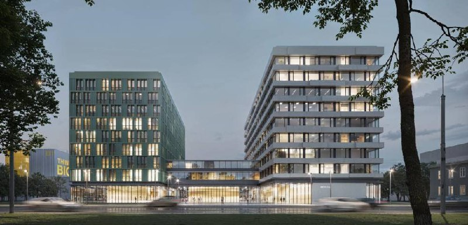
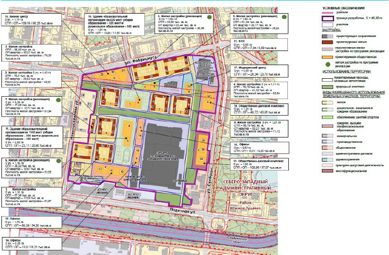

---
source:
  id: 27992
  date: '2025-02-18'
status: ready
skip_reason: null
type: object
region: moscow
title: 'Level work Свободы: на месте Тушинского завода сначала продают лайт-индастриал'
title_alts:
- 'Свободы, 35 в Южном Тушине: Level Group начала КРТ с цехов, а не с квартир'
- 'Тушинский завод: лайт-индастриал от 55,5 млн ₽ уже в продаже, жильё «Скоро!»'
slug: level-work-svobody-light-industrial-tushino
lead: 'Level Group превращает Тушинский машиностроительный завод на Свободы, 35 не только в жилой район, но и в коммерческий квартал Level work Свободы с лайт-индастриалом. И очередь тут показательная: на 13 октября 2026 года помещения для бизнеса уже продаются, а квартиры — ещё нет.'
developers:
- id: level-group
  name: Level Group
  role: main
objects:
- id: tushinskiy-mashinostroitelnyy-zavod
  names:
  - Тушинский машиностроительный завод
  - Свободы, 35
  - Левел Свободы
  - Level work Свободы
  zu: Свободы, 35
  main: true
  new: false
districts: []
topics:
- krt
- rynok
images:
- file: media/27992_1.jpg
  alt: Визуализация двух корпусов со стеклянными первыми этажами, проект на Свободы, 35, Южное Тушино, Москва
  caption: Визуализация корпусов проекта на Свободы, 35 в Южном Тушине.
  credit: 'Визуализация: Level Group'
- file: media/27992_2.jpg
  alt: Схема планировки территории КРТ на Свободы, 35 между улицами Фабрициуса, Свободы, Лодочной и Новопоселковой
  caption: 'Схема планировки территории КРТ «Свободы, 35»: жильё, офисы, общественно-деловые комплексы и социальные объекты.'
  credit: Проект планировки территории (официальный документ)
factcheck:
- claim: Договор о КРТ на 46,3 га между улицами Лодочная, Фабрициуса, Свободы и Новопоселковая заключён с ООО «Адмаер» из Level Group по итогам аукциона; срок 14 лет
  status: confirmed
  source: https://www.novostroy-m.ru/novosti/novyy_gorodskoy_kvartal_na
  checked: '2026-10-13'
- claim: 'Объём КРТ: 1,1 млн м², в том числе 550 тыс. м² жилья (175,5 тыс. м² — реновация и другие городские нужды) и 550 тыс. м² нежилья'
  status: confirmed
  source: https://www.novostroy-m.ru/novosti/novyy_gorodskoy_kvartal_na
  checked: '2026-10-13'
- claim: 'Проект решения о КРТ в промзоне «Тушино» опубликован в мае 2023 года: 46,3 га, 1,1 млн м², около 550 тыс. м² жилья'
  status: confirmed
  source: https://www.novostroy-m.ru/novosti/v_promzone_tushino_postroyat
  checked: '2026-10-13'
- claim: 'Level Group заявила лайт-индастриал на участке: коммерческий проект Level work Свободы, ул. Свободы, 35, стадия «Продажа», лайт-индастриал от 55,5 млн ₽, помещения от 56,7 млн ₽, сдача II кв. 2028'
  status: confirmed
  source: https://level.ru/
  checked: '2026-10-13'
- claim: 'Level work Свободы: адрес ул. Свободы, 35, Южное Тушино, СЗАО; 8 этажей; застройщик Level Group; стадия — котлован/фундамент'
  status: confirmed
  source: https://www.novostroy-m.ru/baza/biznestsentr_level_work_svobody
  checked: '2026-10-13'
- claim: Сроки сдачи Level work Свободы у агрегатора (4 кв. 2028, корпус Г1) отличаются от сайта застройщика (II кв. 2028)
  status: changed
  source: https://www.novostroy-m.ru/baza/biznestsentr_level_work_svobody
  checked: '2026-10-13'
- claim: 'Сентябрь 2025: в Южном Тушине объявили индустриальный парк — 8 этажей, более 100 тыс. м², более 1000 рабочих мест, у метро «Сходненская»; квартал называется «Level work Свободы», проект комментировала Level Group'
  status: confirmed
  source: https://riamo.ru/news/nedvizhimost/liksutov-v-juzhnom-tushine-pojavitsja-vysokotehnologichnyj-industrialnyj-park/
  checked: '2026-10-13'
- claim: 'Жилой проект «Левел Свободы»: статус «Скоро!», цен и сроков нет; метро «Сходненская» 5 минут пешком'
  status: confirmed
  source: https://level.ru/
  checked: '2026-10-13'
- claim: Level заявила 250 тыс. м² лайт-индастриал
  status: unverified
  source: в открытых источниках общей цифры нет; публичная цифра по индустриальному парку — более 100 тыс. м²
  checked: '2026-10-13'
- claim: Цена права на КРТ — 468 млн ₽
  status: unverified
  source: независимого источника не открыто
  checked: '2026-10-13'
- claim: Прогноз о роли мастер-девелопера и продаже частей проекта другим застройщикам
  status: unverified
  source: мнение без источника
  checked: '2026-10-13'
- claim: Ранее проект приписывали ПИКу; завод продавали на «Авито» за 10 млрд ₽
  status: unverified
  source: не проверялось в рамках бюджета; к событию не относится
  checked: '2026-10-13'
removed:
- 250 тыс. м² лайт-индастриал — цифру подтвердить не удалось, в тексте нет.
- Цена права на КРТ (468 млн ₽) — независимого источника не найдено.
- Прогноз про «мастер-девелопера» и продажу кусков проекта — оценка без источника.
- Истории про ПИК и продажу завода на «Авито» — не проверены, к событию не относятся.
- Фото 3 (схема с числами площадей без источника) и фото 4 (слайд студенческого кейса с пометкой «?») — не используются.
- Грубые и жаргонные выражения заметки.
data_points:
- metric: krt_area_ha
  object: tushinskiy-mashinostroitelnyy-zavod
  value: 46.3
  date: '2026-10-13'
- metric: light_industrial_min_price
  object: tushinskiy-mashinostroitelnyy-zavod
  value: 55500000
  unit: RUB
  date: '2026-10-13'
seo:
  main_query: level work свободы
  keywords:
  - лайт-индастриал свободы 35
  - level group южное тушино
  - тушинский машиностроительный завод крт
  - level work свободы цены
  - сходненская лайт индастриал
  frequency_checked: false
  title: 'Level work Свободы: лайт-индастриал от 55,5 млн ₽ в Тушине'
  description: 'На месте Тушинского завода Level Group продаёт лайт-индастриал от 55,5 млн ₽, а квартиры — «Скоро!». Что с КРТ на 1,1 млн м², сроки и риски для бизнеса.'
  canonical: https://шахматка.москва/novosti/level-work-svobody-light-industrial-tushino/
internal_links:
- anchor: досье «Тушинский машиностроительный завод»
  url: /obekty/tushinskiy-mashinostroitelnyy-zavod/
- anchor: Level Group
  url: /zastroyshchiki/level-group/
- anchor: комплексного развития территории (КРТ)
  url: /slovar/krt/
- anchor: разбор КРТ на Свободы, 35
  url: /novosti/level-svobody-35-tushino-krt/
- anchor: новостройки Москвы
  url: /novostroyki/moskva/
- anchor: тема КРТ
  url: /temy/krt/
faq:
- q: Что такое Level work Свободы?
  a: 'Коммерческий квартал Level Group с лайт-индастриалом на ул. Свободы, 35 в Южном Тушине. На 13 октября 2026 года он в продаже: лайт-индастриал — от 55,5 млн ₽, помещения — от 56,7 млн ₽ (данные застройщика).'
- q: Когда сдадут Level work Свободы?
  a: По сайту застройщика — во II квартале 2028 года. Агрегатор для корпуса Г1 называет 4 квартал 2028 года, так что точный срок ищите в проектной декларации.
- q: Сколько жилья и нежилья планируют на Свободы, 35?
  a: 'По данным города на май 2024 года — 1,1 млн м² на 46,3 га: около 550 тыс. м² жилья (из них около 175,5 тыс. м² — реновация и другие городские нужды) и около 550 тыс. м² нежилья.'
- q: Можно ли купить квартиру в «Левел Свободы»?
  a: 'Пока нет: на 13 октября 2026 года жилой проект на сайте застройщика помечен «Скоро!», цен и сроков нет.'
date_published: '2025-02-18'
date_modified: '2026-10-13'
author: Редакция Шахматки
editor_notes: 'Цифра 250 тыс. м² лайт-индастриал из исходной заметки не подтверждена: проверьте проектную декларацию на наш.дом.рф и страницу business.level.ru. Бюджет проверки исчерпан, наш.дом.рф и mos.ru не открывались. Авторство и права на визуализацию (фото 1) уточнить в пресс-службе Level; схема (фото 2) взята из заметки как фрагмент ППТ, оригинал на mos.ru не сверялся. Сроки сдачи у застройщика и агрегатора расходятся. Рядом есть статья о том же досье: /novosti/level-svobody-35-tushino-krt/.'
schema: "[\n {\n  \"@context\": \"https://schema.org\",\n  \"@type\": \"Article\",\n  \"headline\": \"Level work Свободы: лайт-индастриал на месте Тушинского завода\",\n  \"description\": \"Level Group продаёт лайт-индастриал на месте Тушинского завода: от 56,7 млн ₽, сдача 2028. Что с КРТ на 1,1 млн м² на октябрь 2026 года и что учесть покупателю.\",\n  \"datePublished\": \"2025-02-18\",\n  \"dateModified\": \"2026-10-13\",\n  \"author\": {\n   \"@type\": \"Organization\",\n   \"name\": \"Редакция Шахматки\"\n  },\n  \"publisher\": {\n   \"@type\": \"Organization\",\n   \"name\": \"Шахматка\"\n  },\n  \"about\": {\n   \"@type\": \"Place\",\n   \"name\": \"Тушинский машиностроительный завод, Свободы, 35\",\n   \"address\": \"Москва, Южное Тушино, ул. Свободы, 35\"\n  },\n  \"mainEntityOfPage\": \"https://шахматка.москва/novosti/level-work-svobody-light-industrial-tushino/\"\n },\n {\n  \"@context\": \"https://schema.org\",\n  \"@type\": \"FAQPage\",\n  \"mainEntity\": [\n   {\n    \"@type\": \"Question\",\n    \"name\": \"Что такое Level work Свободы?\",\n    \"acceptedAnswer\": {\n     \"@type\": \"Answer\",\n     \"text\": \"Коммерческий квартал Level Group на ул. Свободы, 35 в Южном Тушине с лайт-индастриалом: на 13 октября 2026 года он в продаже, лайт-индастриал — от 55,5 млн ₽, помещения — от 56,7 млн ₽ (данные застройщика).\"\n    }\n   },\n   {\n    \"@type\": \"Question\",\n    \"name\": \"Когда сдадут Level work Свободы?\",\n    \"acceptedAnswer\": {\n     \"@type\": \"Answer\",\n     \"text\": \"По данным сайта застройщика, во II квартале 2028 года. В карточке на агрегаторе указан 4 квартал 2028 года для корпуса Г1, поэтому срок стоит уточнять в проектной декларации.\"\n    }\n   },\n   {\n    \"@type\": \"Question\",\n    \"name\": \"Сколько жилья и нежилья планируют на Свободы, 35?\",\n    \"acceptedAnswer\": {\n     \"@type\": \"Answer\",\n     \"text\": \"По данным города на май 2024 года, 1,1 млн м² на 46,3 га: около 550 тыс. м² жилья (из них около 175,5 тыс. м² — реновация и другие городские нужды) и около 550 тыс. м² нежилья.\"\n    }\n   },\n   {\n    \"@type\": \"Question\",\n    \"name\": \"Можно ли купить квартиру в «Левел Свободы»?\",\n    \"acceptedAnswer\": {\n     \"@type\": \"Answer\",\n     \"text\": \"Нет: на 13 октября 2026 года у жилого проекта на сайте застройщика статус «Скоро!», цен и сроков нет.\"\n    }\n   }\n  ]\n }\n]"
---

# Level work Свободы: на месте Тушинского завода сначала продают лайт-индастриал

Level Group превращает Тушинский машиностроительный завод на Свободы, 35 не только в жилой район, но и в коммерческий квартал Level work Свободы с лайт-индастриалом. И очередь тут показательная: на 13 октября 2026 года помещения для бизнеса уже продаются, а квартиры — ещё нет.

## Коротко

- **Территория:** [комплексное развитие (КРТ)](/slovar/krt/) на 46,3 га в Южном Тушине; по данным города, до 1,1 млн м² — около 550 тыс. м² жилья и столько же нежилья.
- **Что продают:** Level work Свободы — лайт-индастриал от 55,5 млн ₽, помещения от 56,7 млн ₽, сдача во II квартале 2028 года (данные застройщика).
- **Чего ждать:** жилой «Левел Свободы» на сайте застройщика висит со статусом «Скоро!» — без цен и сроков.

## Цех, склад и офис под одной крышей

Лайт-индастриал — это небольшие производственные, складские и офисные помещения в одном здании. Для бывшего завода формат почти напрашивается: по данным города, нежилья здесь запланировано ровно столько же, сколько жилья. Промзона остаётся промзоной — просто становится аккуратнее.

Коммерческая часть называется Level work Свободы. На сайте Level Group у неё статус «Продажа»: лайт-индастриал — от 55,5 млн ₽, помещения — от 56,7 млн ₽, срок — II квартал 2028 года, до метро «Сходненская» — 12 минут пешком (данные застройщика). По данным агрегатора Novostroy-M, комплекс восьмиэтажный, а на площадке пока котлован и фундамент.

*Визуализация корпусов проекта на Свободы, 35 в Южном Тушине. Визуализация: Level Group.*

Город к этой истории приложил руку ещё в сентябре 2025 года, объявив о многоэтажном индустриальном парке в Южном Тушине: восемь этажей, более 100 тыс. м², больше тысячи рабочих мест, рядом с метро «Сходненская». Квартал назвали «Level work Свободы», проект комментировала представитель Level Group. Резидентам парка, как сообщалось, обещают городские меры поддержки.

## От проекта решения до договора на 14 лет

Проект решения о КРТ в промзоне «Тушино» опубликовали в мае 2023 года. Через год, в мае 2024-го, заммэра Владимир Ефимов сообщил, что аукцион выиграло ООО «Адмаер» из Level Group, а договор подписан на 14 лет. Территория — 46,3 га между улицами Лодочная, Фабрициуса, Свободы и Новопоселковая.

*Схема планировки территории КРТ «Свободы, 35». Проект планировки территории (официальный документ).*

Вся история площадки — в [досье «Тушинский машиностроительный завод»](/obekty/tushinskiy-mashinostroitelnyy-zavod/). Про сам договор — в [нашем разборе КРТ на Свободы, 35](/novosti/level-svobody-35-tushino-krt/).

## Коммерция едет, жильё ждёт

На 13 октября 2026 года у проекта две скорости.

**Коммерция.** Level work Свободы продаётся. Со сроком сдачи пока разнобой: сайт застройщика называет II квартал 2028 года, агрегатор — 4 квартал 2028 года для корпуса Г1. Последнее слово за проектной декларацией.

**Жильё.** Страница «Левел Свободы» помечена «Скоро!»: до метро — 5 минут пешком, а вот цен и сроков нет.

## Что это значит для покупателя и инвестора

Лайт-индастриал — продукт для бизнеса, а не для жизни. Его ценность решают арендаторы, подъезд для машин и стоимость площади у соседей. Арендных ставок и данных о спросе застройщик не публикует, так что посчитать доходность пока не из чего — считайте на собственных цифрах, а не на рендерах.

Риски тоже понятны: стройка только набирает ход, срок ввода расходится между источниками, а жилую часть того же квартала застройщик в продажу пока не вывел. На наш взгляд, спешить некуда: дождитесь разрешения на строительство и сверьте параметры лотов с проектной декларацией на наш.дом.рф.

## Карточка объекта

- **Адрес ЗУ:** Свободы, 35 (Южное Тушино, СЗАО, Москва)
- **Названия:** Тушинский машиностроительный завод; «Левел Свободы»; Level work Свободы
- **Застройщик:** [Level Group](/zastroyshchiki/level-group/) (ООО «Адмаер»)
- **Территория КРТ:** 46,3 га; до 1,1 млн м² (жильё около 550 тыс. м², нежилое около 550 тыс. м²)
- **Стадия:** лайт-индастриал в продаже, жильё — «Скоро!»
- **Срок сдачи Level work Свободы:** II квартал 2028 года (по данным застройщика)
- **Цена:** лайт-индастриал от 55,5 млн ₽, помещения от 56,7 млн ₽

## Вопросы и ответы

**Что такое Level work Свободы?**

Коммерческий квартал Level Group с лайт-индастриалом на ул. Свободы, 35 в Южном Тушине. На 13 октября 2026 года он в продаже: лайт-индастриал — от 55,5 млн ₽, помещения — от 56,7 млн ₽ (данные застройщика).

**Когда сдадут Level work Свободы?**

По сайту застройщика — во II квартале 2028 года. Агрегатор для корпуса Г1 называет 4 квартал 2028 года, так что точный срок ищите в проектной декларации.

**Сколько жилья и нежилья планируют на Свободы, 35?**

По данным города на май 2024 года — 1,1 млн м² на 46,3 га: около 550 тыс. м² жилья (из них около 175,5 тыс. м² — реновация и другие городские нужды) и около 550 тыс. м² нежилья.

**Можно ли купить квартиру в «Левел Свободы»?**

Пока нет: на 13 октября 2026 года жилой проект на сайте застройщика помечен «Скоро!», цен и сроков нет.

## Источники

1. [Level Group, сайт застройщика (проекты «Левел Свободы» и Level work Свободы)](https://level.ru/)
2. [Новый городской квартал на месте промзоны «Тушино», Novostroy-M, 19.05.2024](https://www.novostroy-m.ru/novosti/novyy_gorodskoy_kvartal_na)
3. [В промзоне «Тушино» построят…, Novostroy-M, 29.05.2023](https://www.novostroy-m.ru/novosti/v_promzone_tushino_postroyat)
4. [Level work Свободы, карточка проекта, Novostroy-M](https://www.novostroy-m.ru/baza/biznestsentr_level_work_svobody)
5. [В Южном Тушине появится многоэтажный индустриальный парк, РИАМО, 25.09.2025](https://riamo.ru/news/nedvizhimost/liksutov-v-juzhnom-tushine-pojavitsja-vysokotehnologichnyj-industrialnyj-park/)

Материал не является инвестиционной рекомендацией.
