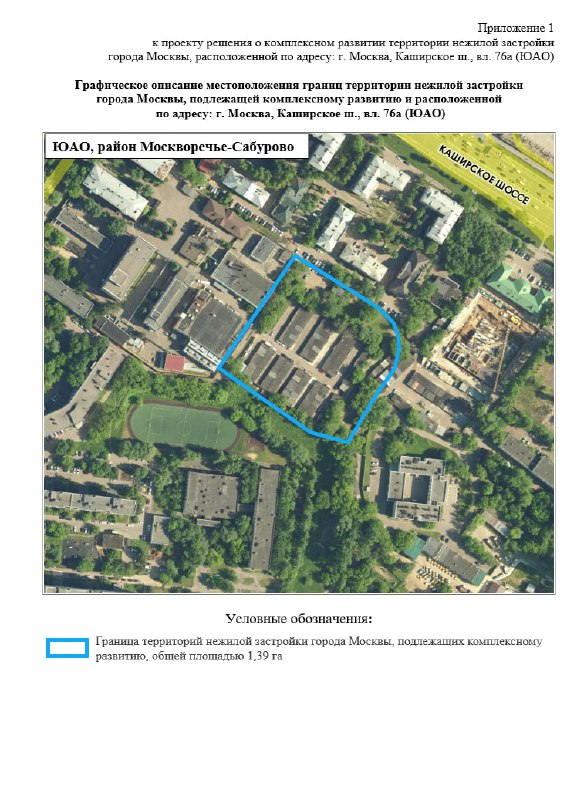
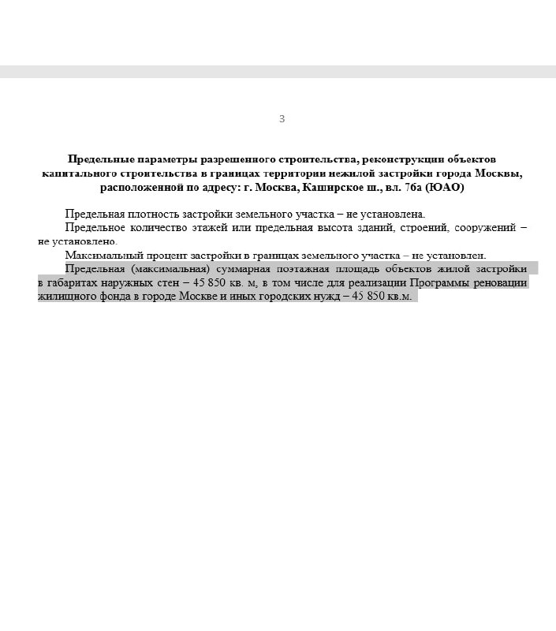

# КРТ на Каширском шоссе, 76а: та же земля, реновации — 45,9 тыс. м² вместо 37

Город переписал проект решения о комплексном развитии территории (КРТ) на Каширском шоссе, вл. 76а, — и жилья для реновации в нём стало больше. В июле 2024 года называли «более 37 тыс. м²», в феврале 2025 года — уже 45 850 м². Участок при этом не вырос ни на метр: те же 1,39 га в Москворечье-Сабурове на юге Москвы.

## Коротко

- **Было:** «более 37 тыс. м²» жилья для реновации (проект решения, июль 2024 года).
- **Стало:** 45 850 м² в габаритах наружных стен — и всё под программу реновации и иные городские нужды (проект решения, февраль 2025 года).
- **Где:** 1,39 га на Каширском шоссе, рядом станция МЦД-2 «Москворечье» и МКАД.
- **Статус:** на 13 октября 2026 года — всё ещё проект, об утверждении город не сообщал.

## Тот же участок, на четверть больше жилья

[КРТ](/slovar/krt/) позволяет городу пересобрать участок целиком: снести нежилые здания и построить на их месте новые. Здесь город с самого начала рисовал жилой квартал под переселение по реновации.

В июле 2024 года [проект решения](https://www.m24.ru/news/05072024/705889) предполагал более 37 тыс. м² жилья. Через полгода, в феврале 2025 года, [параметры обновили](https://riamo.ru/news/nedvizhimost/efimov-zhilye-doma-dlja-tselej-programmy-renovatsii-vozvedut-v-juao-po-programme-krt/): предельная площадь жилой застройки — 45 850 м², и вся она в документе отнесена к реновации. Прибавка — около 8,9 тыс. м², или примерно 24%. Земли не прибавилось — значит, застраивать её будут плотнее.

*Границы территории нежилой застройки на Каширском шоссе, вл. 76а (приложение 1 к проекту решения о КРТ), 1,39 га. Источник: проект решения о КРТ, Правительство Москвы*

Насколько плотнее и выше — пока загадка. Предельную плотность, этажность и процент застройки проект не устанавливает, так что высотность решат дальнейшие согласования, а [ТЭП](/slovar/tep/) ещё могут поменяться.

*Предельные параметры застройки в проекте решения: 45 850 м² жилья, весь объём для программы реновации. Источник: проект решения о КРТ, Правительство Москвы*

## Проект есть, решения нет

На 13 октября 2026 года город не объявлял, что решение по участку утверждено. В сообщении о принятых решениях КРТ, которое [опубликовали 25 декабря 2025 года](https://www.novostroy-m.ru/novosti/prinyaty_resheniya_o_kompleksnom), этого адреса нет. Последняя официальная стадия — «проект решения».

## Что это значит для покупателя и инвестора

Если вы ждёте отсюда новых квартир в продаже — не ждите. Весь жилой объём по проекту уходит под реновацию, на открытый рынок он не попадёт. Для тех, кто считает будущее предложение на Каширском шоссе, это важная разница: КРТ под городскую реновацию и коммерческие проекты — разные истории.

На наш взгляд, рост реновационного объёма больше говорит о приоритетах города, чем о новом конкуренте для частных застройщиков. Город решил за всех — и решил в пользу переселенцев.

Следить стоит за тремя вещами: утверждением решения о КРТ, именем застройщика и итоговыми ТЭП.

## А рядом продают: BeLuck Коломенское

Для сравнения с коммерческим предложением на той же магистрали: проект [«Каширский двор-2»](/obekty/kashirskiy-dvor-2/) на Каширском шоссе, 1 продаётся как BeLuck Коломенское, ведёт его [«Гранель»](/zastroyshchiki/granel/). По данным [агрегаторов](https://www.novostroy.ru/buildings/na-kashirskom-shosse-1/), это комфорт-класс, первый корпус сдают во II квартале 2027 года. Цены в объявлениях на август 2026 года начинаются от 402 тыс. ₽/м² (трёхкомнатные), а по [объявлениям на Циан](https://www.cian.ru/kupit-kvartiru-studiu-zhiloy-kompleks-granel-kolomenskoe-4847827/) минимум — около 482 тыс. ₽/м², в среднем — около 526 тыс. ₽/м². Вся история проекта — в досье «Каширский двор-2», другие проекты города — в разделе [новостроек Москвы](/novostroyki/moskva/).

## Карточка объекта

- Адрес: Каширское шоссе, вл. 76а, Москворечье-Сабурово, ЮАО, Москва
- Тип: проект КРТ (нежилая застройка), жильё для реновации
- Площадь участка: 1,39 га
- Жилая застройка по проекту решения: 45 850 м² (февраль 2025 года)
- Стадия: проект решения; утверждение не подтверждено

## Вопросы и ответы

**Что такое КРТ на Каширском шоссе, 76а?**
Проект комплексного развития территории нежилой застройки на 1,39 га в районе Москворечье-Сабурово (ЮАО). Всё жильё в проекте решения отдано под программу реновации.

**Сколько жилья планируют построить на Каширском шоссе, 76а?**
По проекту решения, опубликованному в феврале 2025 года, — до 45 850 м². В июле 2024 года речь шла о «более 37 тыс. м²».

**Будут ли на участке продавать квартиры на рынке?**
Нет: по проекту решения весь жилой объём предназначен для реновации и иных городских нужд, коммерческого жилья здесь не предусмотрено.

**Принято ли итоговое решение по КРТ на Каширском шоссе, 76а?**
Город об этом не объявлял: в сообщении о принятых решениях КРТ от 25 декабря 2025 года этого участка нет. Свежий статус ищите на mos.ru.

## Источники

1. [РИАМО: жилые дома для реновации возведут в ЮАО по программе КРТ, 13 февраля 2025 года](https://riamo.ru/news/nedvizhimost/efimov-zhilye-doma-dlja-tselej-programmy-renovatsii-vozvedut-v-juao-po-programme-krt/)
2. [Москва 24: КРТ на Каширском шоссе, 5 июля 2024 года](https://www.m24.ru/news/05072024/705889)
3. [АиФ: в Москворечье-Сабурове построят дома по реновации в рамках КРТ, 5 июля 2024 года](https://aif.ru/moscow/efimov-v-moskvoreche-saburove-postroyat-doma-po-renovacii-v-ramkah-krt)
4. [Новостройки Москвы: принятые решения о КРТ, 25 декабря 2025 года](https://www.novostroy-m.ru/novosti/prinyaty_resheniya_o_kompleksnom)
5. [Novostroy.ru: ЖК на Каширском шоссе, 1](https://www.novostroy.ru/buildings/na-kashirskom-shosse-1/)
6. [Циан: ЖК «Гранель Коломенское»](https://www.cian.ru/kupit-kvartiru-studiu-zhiloy-kompleks-granel-kolomenskoe-4847827/)

Материал не является инвестиционной рекомендацией.
