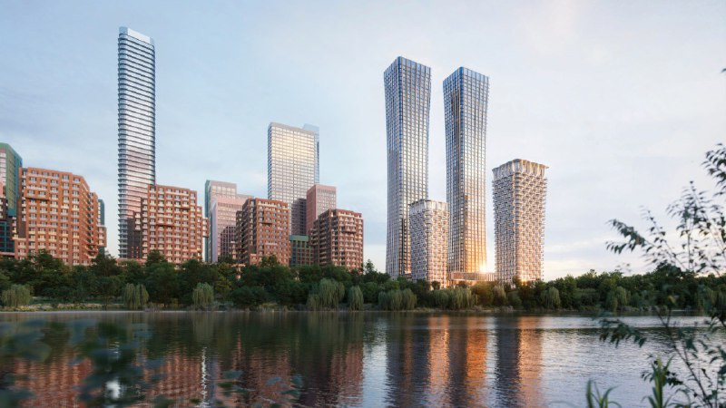
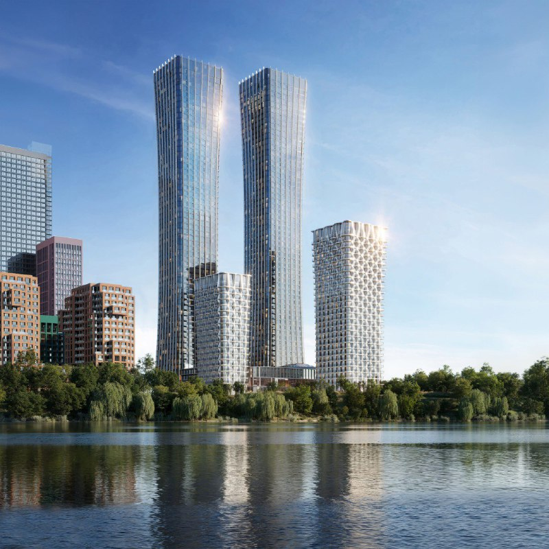

# City Bay от MR Group: финальный квартал Pacific — две башни по 59 этажей у воды

MR Group вывела на рынок последнюю, шестую очередь ЖК City Bay на Волоколамском шоссе — квартал Pacific. Финал решили сделать громким: две башни по 59 этажей и около 1450 квартир. К октябрю 2026 года на площадке пока котлован и фундамент, сдача заявлена на IV квартал 2028 года.

## Коротко

- **Что:** Pacific — шестой, завершающий квартал City Bay: две башни по 59 этажей (200 м) и корпуса в 18 и 27 этажей. Девелопер — [MR Group](/zastroyshchiki/mr-group/).
- **Документы:** первая [проектная декларация](/slovar/proektnaya-deklaratsiya/) по Pacific — от 19 марта 2025 года, следующие — от 15 января и 10 августа 2026 года.
- **Цены:** на 13 октября 2026 года по комплексу — от 16,6 до 56,1 млн ₽; отдельный прайс на Pacific публично не выделяют.
- **Сдача:** Pacific 1 и 4 — IV квартал 2028 года.

*Визуализация высотной части City Bay на Волоколамском шоссе (1). Визуализация: MR Group.*

## Двести метров на финал

City Bay занимает 11 га на берегу Спасского затона Москвы-реки в Покровском-Стрешневе (СЗАО). В базах адрес комплекса — Волоколамское шоссе, 95-97, класс — [бизнес](/novostroyki/biznes-klass/). Застройщиками значатся СЗ «Транспортно-пересадочный узел Лесопарковая» и MR Group.

Pacific, по данным «Метриума», ставит в комплексе точку — и точку высотную: две башни по 59 этажей и 200 м плюс корпуса в 18 и 27 этажей. Всего 1450 квартир площадью от 25 до 132,9 м². На выходе очереди вход стоил от 11,8 млн ₽ за 25,3 м². Свой материал «Метриум» датировал 23 марта, не указав год, — по соседству с декларацией от 19 марта 2025 года понятно, о какой весне речь.

*Визуализация двух башен City Bay и соседних корпусов (2). Визуализация: MR Group.*

## Океаны уже сданы, Тихий — в котловане

Очереди здесь названы по океанам, и большая часть «акватории» уже заселена. По базе «Новострой-М», корпуса Atlantic Ocean 1 и 2 и Indian Ocean 1–8 сданы, Atlantic Ocean 3 ждут в IV квартале 2026 года, North Ocean 1–12 — в I квартале 2027 года. Первые декларации по кварталу Indian датированы сентябрём и октябрём 2020 года. Вся история проекта — в [досье «City Bay»](/obekty/city-bay/).

## Что с проектом сейчас

На 14 октября 2026 года:

- **Стадия Pacific.** У Pacific 1 и 4 — «котлован/фундамент».
- **Сроки.** IV квартал 2028 года по базе «Новострой-М». В одном из объявлений на ЦИАН для корпуса Pacific 6-й очереди стоит II квартал 2028 года — верить стоит последней декларации, а не объявлению.
- **Цены.** По комплексу — от 16,6 до 56,1 млн ₽ (данные застройщика на 13 октября). Самая дешёвая студия, 25,9 м², стоит 16,57 млн ₽ — около 640 тыс. ₽/м² (наш расчёт). Средняя цена по ЦИАН — 498,9 тыс. ₽/м²: маленький метраж, как обычно, обходится дороже за метр.
- **Застройщик.** Тот же — MR Group.

## Что это значит для покупателя

Pacific — последняя очередь, которая достроит комплекс. К моменту её сдачи соседние Atlantic, Indian и North по заявленным срокам должны быть уже введены: жить в башнях предстоит не на стройке, а в обжитом районе. Но сами башни пока в котловане, а до IV квартала 2028 года ещё далеко.

Для ориентира: на выходе Pacific вход был от 11,8 млн ₽, сегодня самая дешёвая студия комплекса — 16,57 млн ₽. Это цена по всему City Bay, а не именно по Pacific, но направление понятно.

Вот где подвох. Сколько [машино-мест](/slovar/mashino-mesto/) придётся на квартиру в двух 59-этажных башнях, публично не называли. Если присматриваетесь к Pacific, ищите эту цифру в декларации до сделки. И цену конкретной квартиры сверяйте с прайсом застройщика: агрегаторы — ориентир, а не договор.

## Карточка объекта

- **Адрес ЗУ:** Волоколамское шоссе, 95-97, Москва.
- **Название:** City Bay (Сити Бэй).
- **Застройщик:** [MR Group](/zastroyshchiki/mr-group/), СЗ «Транспортно-пересадочный узел Лесопарковая».
- **Район:** Покровское-Стрешнево, СЗАО.
- **Класс:** бизнес-класс.
- **Площадь комплекса:** 11 га.
- **Pacific:** две башни по 59 этажей, корпуса в 18 и 27 этажей, около 1450 квартир.
- **Стадия Pacific:** котлован/фундамент.
- **Ввод Pacific:** IV квартал 2028 года (корпуса 1 и 4).
- **Цена:** по комплексу от 16,6 млн ₽ (на 13 октября 2026 года).

## Вопросы и ответы

**Что такое квартал Pacific в City Bay?**
Шестой, финальный квартал комплекса на Волоколамском шоссе: две башни по 59 этажей (200 м) и корпуса в 18 и 27 этажей — всего около 1450 квартир, по данным «Метриума».

**Когда сдадут Pacific в City Bay?**
Для корпусов Pacific 1 и 4 база «Новострой-М» называет IV квартал 2028 года. На октябрь 2026 года на площадке котлован и фундамент.

**Сколько стоят квартиры в City Bay?**
На 13 октября 2026 года — от 16,6 до 56,1 млн ₽ по комплексу, средняя цена по ЦИАН — 498,9 тыс. ₽/м². Отдельный прайс на Pacific публично не выделяют.

**Кто застройщик City Bay?**
MR Group; проект ведёт СЗ «Транспортно-пересадочный узел Лесопарковая».

## Источники

1. «Метриум» (через «Бизон»), публикация о выходе квартала Pacific в City Bay (23 марта, год не указан): https://www.bizon.ru/news/print/id/734432/format/smoothbox
2. «Новострой-М», карточка ЖК «Сити Бэй» (застройщики, сроки, декларации, цены на 13 октября): https://www.novostroy-m.ru/baza/jk_na_volokolamskom_shosse
3. ЦИАН, страница ЖК City Bay (корпуса, сроки, средняя цена): https://www.cian.ru/kupit-kvartiru-zhiloy-kompleks-city-bay-1721051/

Материал не является инвестиционной рекомендацией.
