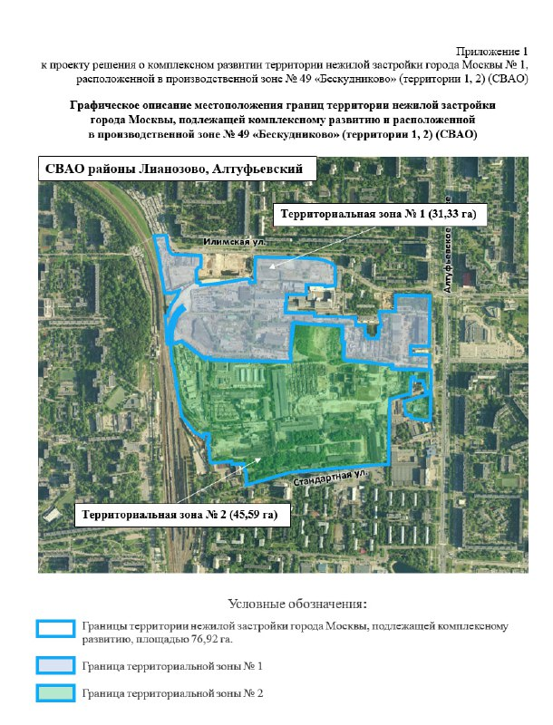

# КРТ «Бескудниково» у Илимской: 77 га промзоны превращают в 744 тыс. м² жилья

В марте 2025 года город показал проект комплексного развития территории (КРТ) на бывшей промзоне «Бескудниково» в [Лианозове](/novostroyki/lianozovo/) и Алтуфьевском районе: почти 77 га и около 744 тыс. м² жилья. В октябре 2025 года правительство Москвы проект утвердило. Масштаб — целый новый район, а вот кто будет его строить, город так и не сказал.

**Коротко**

- **Где:** почти 77 га между Алтуфьевским шоссе, Илимской и Стандартной улицами и путями МЦД-1 (СВАО).
- **Сколько:** около 744 тыс. м² жилья из более чем 1,2 млн м² недвижимости; свыше 160 тыс. м² — под реновацию.
- **Деньги:** инвестиции — 229,2 млрд ₽, бюджетный эффект — 6,8 млрд ₽ в год.
- **Статус:** утверждён в октябре 2025 года как крупнейший из пяти проектов КРТ того месяца; оператора не назвали.

## Две зоны и чемпионство по объёму

Проект решения о [КРТ](/slovar/krt/) город опубликовал 3 марта 2025 года. Территорию поделили на две зоны: зона 1 — 31,33 га вдоль Илимской улицы, зона 2 — 45,59 га вдоль Стандартной. Вместе — 76,92 га.

*Границы территории КРТ в промзоне «Бескудниково»: зона 1 (31,33 га) и зона 2 (45,59 га), приложение к проекту решения правительства Москвы (1)*

По приложению к проекту решения, в зоне 1 можно построить до 221,47 тыс. м² жилья (из них 65,89 тыс. м² — для реновации), в зоне 2 — до 522,48 тыс. м² (из них 95 тыс. м²). В сумме около 744 тыс. м² жилья и около 161 тыс. м² реновации. Это потолок, а не обещание: параметры считают по [ТЭП](/slovar/tep/) проекта, и отдельными решениями их ещё могут поправить.

Кроме квартир, в проекте две школы на 2 тыс. учеников, три детских сада на 950 мест, физкультурно-оздоровительный комплекс, здания для городских служб и многоуровневый паркинг на 735 мест.

В октябре 2025 года правительство Москвы проект утвердило — и он оказался самым крупным по объёму застройки из пяти КРТ, принятых в тот месяц. В городском сообщении — более 1,2 млн м² недвижимости, около 740 тыс. м² жилья и более 160 тыс. м² для реновации.

## Илимская, 3: первая очередь уже стоит

Участок на [Илимской, 3](/obekty/stremlenie-k-svetu/) — часть той же промзоны № 49. Ещё в августе 2017 года на 26,5 га её неиспользуемой части заявляли два жилых комплекса, инвестором тогда называли АО «Эверест-Трейд». Первую очередь «В стремлении к свету» построил [«Севен санс»](/zastroyshchiki/seven-sans/): по карточке на «Новострой-М», три корпуса по 25 этажей сданы, квартиры от застройщика распроданы.

Что КРТ сделает с остальной частью участка, пока непонятно: перечня земельных участков и оператора КРТ город не публиковал. Вся история площадки — в [досье «Стремление к свету»](/obekty/stremlenie-k-svetu/).

## Что это значит для покупателя и инвестора

На наш взгляд, КРТ такого размера — это годы согласований и торгов за право стать оператором. Квартир по ДДУ здесь в ближайшее время не будет, и ждать их у ворот промзоны бессмысленно.

Важно другое — для тех, кто уже живёт рядом. 744 тыс. м² жилья в одном месте заметно поменяют плотность района и нагрузку на транспорт. Если присматриваетесь к квартире по соседству, закладывайте, что рано или поздно за окном начнётся большая стройка, а потом появится новый район с новыми соседями.

Следить стоит за итогами торгов или назначением оператора КРТ, графиком реновационных домов и разрешениями на строительство первых корпусов.

## Утвердили и затихли

На 15 октября 2026 года последнее официальное событие по проекту — утверждение КРТ в октябре 2025 года. Застройщика, начала работ и старта продаж город с тех пор не объявлял.

## Карточка объекта

- **Территория КРТ:** промзона № 49 «Бескудниково», 76,92 га, Лианозово и Алтуфьевский район, СВАО
- **Участок досье:** Илимская, 3 (проект «Стремление к свету»)
- **Жильё:** около 744 тыс. м², в том числе более 160 тыс. м² реновации
- **Всего недвижимости:** более 1,2 млн м²
- **Стадия:** КРТ утверждено в октябре 2025 года, оператор не назван
- **Инвестиции:** 229,2 млрд ₽ (оценка города, март 2025 года)

## Вопросы и ответы

**Что такое КРТ «Бескудниково»?**
Проект комплексного развития бывшей промзоны № 49 на почти 77 га в Лианозове и Алтуфьевском районе: около 740 тыс. м² жилья из более чем 1,2 млн м² недвижимости. Правительство Москвы утвердило его в октябре 2025 года.

**Сколько жилья в КРТ пойдёт на реновацию?**
Более 160 тыс. м² из примерно 740 тыс. м² жилья отдано под программу реновации.

**Кто застройщик КРТ «Бескудниково»?**
Город застройщика пока не называл — ни в проекте решения, ни в сообщении об утверждении.

**Что построят кроме жилья?**
Две школы на 2 тыс. учеников, три детских сада на 950 мест, физкультурно-оздоровительный комплекс и два паркинга. В проекте решения есть и нежилые здания для городских служб.

## Источники

1. [Новострой-М: на территории промзоны Бескудниково, 3 марта 2025 года](https://www.novostroy-m.ru/novosti/na_territorii_promzony_beskudnikovo)
2. [mos.ru: утверждены пять проектов КРТ, октябрь 2025 года](https://mos.ru/news/item/162084073/)
3. [Финмаркет: КРТ «Бескудниково» утвердили, 9 ноября 2025 года](https://www.finmarket.ru/news/6506908)
4. [Новострой-М: в промзоне Бескудниково построят, 3 августа 2017 года](https://www.novostroy-m.ru/novosti/v_promzone_beskudnikovo_postroyat)
5. [Новострой-М: карточка ЖК «В стремлении к свету»](https://www.novostroy-m.ru/baza/jk_na_ul_ilimskaya)

Материал не является инвестиционной рекомендацией.
