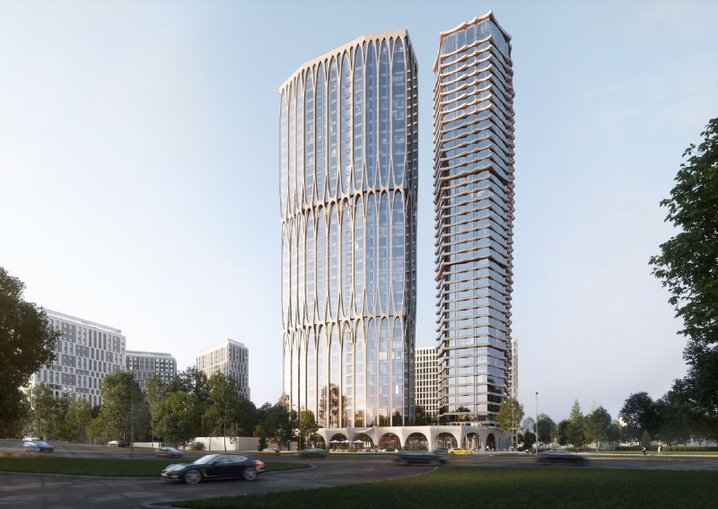
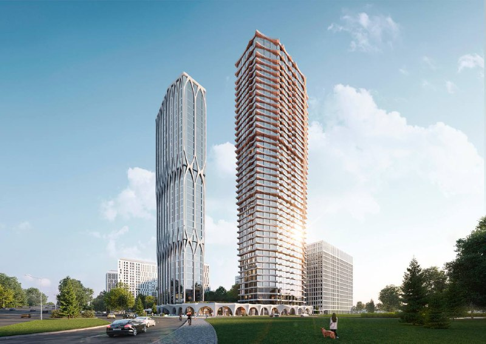

# ЖК А22 на Автозаводской, 22 стал «Даниловским от Гранель»: ввод — в 2030-м

Весной 2025 года региональный девелопер ГК «Консоль» вышел на московский рынок с ЖК «А22» на Автозаводской, 22 в Даниловском районе: две башни, 907 квартир, цены от 15,1 млн ₽. К октябрю 2026 года вывеска уже другая — «Даниловский от Гранель», а ввод переехал с 2028 года на I квартал 2030-го.

## Коротко

- Весна 2025 года: старт продаж ЖК «А22», к 11 мая — цены от 15,1 до 46,3 млн ₽.
- 907 квартир, две башни в 35 и 43 этажа; в феврале 2026 года — уже 34 и 42.
- 13 октября 2026 года: проект продаёт [Гранель](/zastroyshchiki/granel/), от 17,6 млн ₽, ввод — I квартал 2030 года.
- Как проект переходил из рук в руки, компании публично не рассказывали.

## Две башни у ТТК

Адрес — Автозаводская улица, 22, [Даниловский район](/novostroyki/danilovskiy/) Южного округа Москвы. Гранель обещает до ТТК от 1 минуты, до метро «Тульская» — от 13 минут. Класс — бизнес.

*Визуализация башен проекта на Автозаводской, 22 (1). Визуализация: ГК «Консоль»*

*Другой ракурс башен проекта на Автозаводской, 22 (2). Визуализация: ГК «Консоль»*

## Как «Консоль» стартовала

В публикации от 11 мая 2025 года застройщиком ЖК «А22» названа ГК «Консоль». Обещания на тот момент: 907 квартир — от студий 28,7 м² до пентхаусов, две башни в 35 и 43 этажа на одноэтажном стилобате, цены от 15,1 до 46,3 млн ₽, ввод в 2028 году.

К 11 февраля 2026 года башни стали ниже на этаж — 34 и 42, а в описании появился двухуровневый подземный паркинг на 236 [машино-мест](/slovar/mashino-mesto/). Делим 236 на 907 квартир — около 26%. Для бизнес-класса, на наш взгляд, парковки маловато: место достанется примерно каждой четвёртой квартире.

## Было «А22» — стало «Даниловский»

Что изменилось к 13 октября 2026 года:

- **Название и продавец.** Проект продаётся на сайте Гранели как «Даниловский от Гранель», о «Консоли» там ни слова. Зато на сайте самой «Консоли» участок по-прежнему висит среди её проектов (ЖК «Автозаводская», ул. Автозаводская, 22).
- **Срок.** Было: ввод в 2028 году (IV квартал 2028 года по описанию февраля 2026 года). Стало: I квартал 2030 года.
- **Этажность.** Было: 35 и 43 этажа (май 2025 года). Сейчас в карточках квартир Гранели — 34 этажа.
- **Цена.** Было: от 15,1 млн ₽ (май 2025 года). Стало: от 17,6 млн ₽ (студия 28,7 м² — 17 561 128 ₽ на сайте Гранели).

Последняя проектная декларация, по данным «Новострой-М», датирована 8 октября 2026 года. Подробности нового этапа — в [отдельной статье о перезапуске продаж](/novosti/danilovskiy-ot-granel-ceny-sroki-sdachi/), вся история — в [карточке проекта «Даниловский от Гранель»](/obekty/danilovskiy-ot-granel/).

## Что это значит для покупателя

Проект прошёл путь от регионального дебютанта до перезапуска под федеральным брендом — и по дороге потерял почти полтора года срока. [Цены](/temy/ceny/) и условия за это время менялись, так что сравнивать предложения честно можно только на одну дату и по одному корпусу.

До сделки выясните главное: кто юридически застройщик по проектной декларации и на каком основании продажи ведёт Гранель, какой срок стоит в договоре и что стало с этажностью. Кто и на каких условиях владеет проектом, публично не раскрывали — поэтому судить о рисках пока рано.

## Карточка объекта

- **Адрес участка:** Автозаводская, 22, Москва, Даниловский район, ЮАО.
- **Названия:** «Даниловский от Гранель», бывший «А22».
- **Застройщик:** ГК «Гранель» (на 13.10.2026); ранее проект продавала ГК «Консоль».
- **Класс:** бизнес.
- **Квартиры:** 907 (по данным 2025 года).
- **Машино-места:** 236 (по описанию февраля 2026 года).
- **Ввод:** I квартал 2030 года.
- **Цена:** от 17,6 млн ₽ (на 13.10.2026).

## Вопросы и ответы

**Кто застройщик ЖК А22 на Автозаводской, 22?**
В 2025 году проект продавала ГК «Консоль». К октябрю 2026 года на сайте Гранели он продаётся как «Даниловский от Гранель». Публично о сделке между компаниями не объявляли.

**Сколько квартир в ЖК А22?**
В 2025 году заявляли 907 квартир в двух башнях: от студий 28,7 м² до пентхаусов.

**Когда сдадут проект на Автозаводской, 22?**
В 2025 году обещали 2028 год. На сайте Гранели на октябрь 2026 года — I квартал 2030 года.

**Сколько стоят квартиры в проекте?**
В мае 2025 года — от 15,1 до 46,3 млн ₽. На 13 октября 2026 года на сайте Гранели цены начинаются от 17,6 млн ₽.

## Источники

1. Новострой-М, новость о старте продаж ЖК «А22» (11 мая 2025 года): https://www.novostroy-m.ru/novosti/jk_a22_i_buduschiy
2. Rusdevelopers, «Жилой комплекс „А22“ — проект бизнес-класса по адресу: улица Автозаводская, 22» (11 февраля 2026 года): https://rusdevelopers.ru/lenta_novostej/zhiloi-kompleks-a22-proekt-biznes-klassa-po-adresu-ulica-avtozavodskaya-22
3. ГК «Гранель», страница проекта «Даниловский от Гранель»: https://granelle.ru/objects/danilovskij-ot-granel/
4. Новострой-М, двухкомнатная квартира в ЖК «Даниловский от Гранель» (адрес, район, округ, дата декларации): https://www.novostroy-m.ru/kvartiry/dvuhkomnatnaya-kvartira-v-zhk-danilovskii-ot-granel-f44690fd7d5ab5fdaa6b524445bbfa
5. ГК «Консоль», страница ЖК «Автозаводская»: https://konsole.ru/zhk-yug/

Дата публикации: 19 марта 2025 года. Дата проверки фактов: 13 октября 2026 года. Автор: Редакция Шахматки.

Материал не является инвестиционной рекомендацией.
