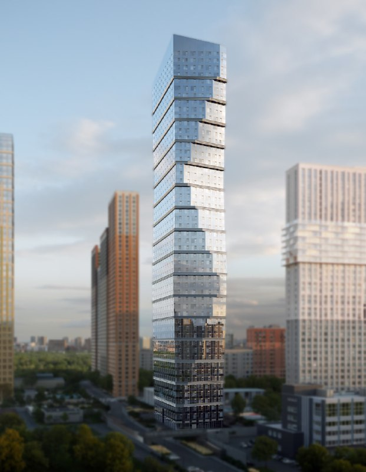
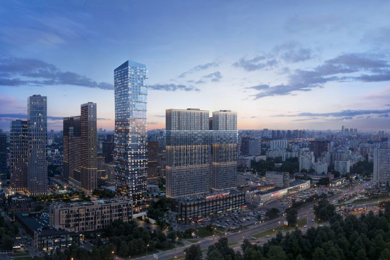

# ЖК «Свет» от Dominanta: башня 180 м и 99 машино-мест на 662 квартиры

Dominanta строит ЖК «Свет» на Дмитровском шоссе, вл. 83а, в Западном Дегунине: одну башню высотой около 180 м на 662 квартиры. На октябрь 2026 года квартиры продаются от 19 млн ₽. А вот машино-мест на всю эту вертикаль — 99.

## Коротко

- Застройщик — [Dominanta](/zastroyshchiki/dominanta/), архитектор — бюро SPEECH.
- Башня около 180 м (51–52 этажа, источники расходятся), 662 квартиры.
- Паркинг: 99 [машино-мест](/slovar/mashino-mesto/) — около 15% от числа квартир.
- 8 октября 2026 года: от 19 до 36,4 млн ₽; сдача по декларации — 1 квартал 2028 года.

## Одна башня у двух станций метро

ЖК «Свет» стоит на Дмитровском шоссе, вл. 83а, в [Западном Дегунине](/novostroyki/zapadnoe-degunino/) на севере Москвы. Рядом метро «Селигерская» и «Верхние Лихоборы».

Весь проект — одна башня высотой около 180 м. Документы собрали заранее: разрешение на строительство датировано 13 января 2025 года, а по публикации от 15 января 2025 года у проекта было и положительное заключение госэкспертизы. Архитектор — бюро SPEECH.

*Башня ЖК «Свет» на визуализации (1). Визуализация: Dominanta*

*Башня «Света» в окружении соседних проектов на визуализации (2). Визуализация: Dominanta*

## Сколько стоят квартиры в «Свете»

На 8 октября 2026 года каталог новостроек называет цены от 19 до 36,4 млн ₽. Цену за квадратный метр источники не приводят, а стартовый прайс официально не публиковали — так что показать, как росла цена, не выйдет. Полная история проекта — в [досье «Свет»](/obekty/svet/).

## Парковка: одно место на семь квартир

В двухуровневом подземном паркинге 99 машино-мест на 662 квартиры. Около 15%, то есть примерно одно место на семь квартир.

На наш взгляд, это главный вопрос к проекту. Участок небольшой, башня высокая, квартир много — двор и парковку придётся делить на всех. Для покупателя с машиной это риск. Для покупателя без неё — повод порадоваться двум станциям метро рядом.

## Что со стройкой сейчас

На 14 октября 2026 года стройка идёт: по данным каталога, монтируют нижние этажи, график обновлён 1 октября 2026 года. Последняя [проектная декларация](/slovar/proektnaya-deklaratsiya/) — от 2 октября 2026 года, до неё были декларации от 18 февраля 2025 года и 3 августа 2026 года.

Со сроком разнобой. В данных каталога корпус 1 сдают в 1 квартале 2028 года, на другой площадке выдачу ключей обещают в марте 2029 года. С этажностью то же самое: 51 этаж в характеристиках, 52 — в описании и в публикации января 2025 года. Верить стоит последней декларации.

## Что это значит для покупателя и инвестора

- **Цена.** От 19 до 36,4 млн ₽ — это [цена новостройки](/temy/ceny/), где главный козырь проекта — высота. Проверенных цен соседей для сравнения нет, так что считать придётся самостоятельно.
- **Парковка.** 15% — мало. Если без машины никак, условия покупки места выясняйте до сделки, а не после.
- **Сроки.** 1 квартал 2028 года против марта 2029 года — повод попросить у застройщика актуальную декларацию.
- **Что отслеживать.** Обновления декларации, график строительства и цены в каталоге.

## Карточка объекта

- **Название:** ЖК «Свет»
- **Адрес участка:** Москва, Дмитровское шоссе, вл. 83а (Западное Дегунино, САО)
- **Застройщик:** Dominanta
- **Архитектор:** бюро SPEECH
- **Высота и этажность:** около 180 м, 51–52 этажа
- **Квартиры:** 662
- **Паркинг:** 99 машино-мест, два подземных уровня
- **Стадия:** строительство, монтаж нижних этажей
- **Срок сдачи:** 1 квартал 2028 года (по декларации в каталоге)
- **Цены на 8 октября 2026 года:** от 19 до 36,4 млн ₽

## Вопросы и ответы

**Кто застройщик ЖК «Свет» на Дмитровском шоссе?**
Dominanta. В карточках проекта также указана компания СЗ «Лазурит».

**Когда сдадут ЖК «Свет»?**
В проектной декларации — 1 квартал 2028 года. На Яндекс Недвижимости выдача ключей названа в марте 2029 года, поэтому дату стоит уточнить в последней декларации.

**Сколько стоят квартиры в ЖК «Свет»?**
На 8 октября 2026 года, по данным каталога, — от 19 до 36,4 млн ₽. Цену за квадратный метр источники не называют.

**Сколько машино-мест в ЖК «Свет»?**
В двухуровневом подземном паркинге 99 машино-мест на 662 квартиры, то есть около 15%.

## Источники

1. [Новостройки Москвы: карточка ЖК «Свет», Дмитровское шоссе, 83а](https://www.novostroy-m.ru/baza/arhitekturnyy_proekt_na_dmitrovskom), данные на 8 октября 2026 года.
2. [«Стартует строительство ЖК «Свет» на севере Москвы»](https://d-a.ru/en/news/startuet-stroitelstvo-zhk-svet-na-severe-moskvy-), 15 января 2025 года.
3. [Яндекс Недвижимость: ЖК «Свет»](https://realty.yandex.ru/moskva_i_moskovskaya_oblast/kupit/novostrojka/svet-4080309/)

Материал не является инвестиционной рекомендацией.
