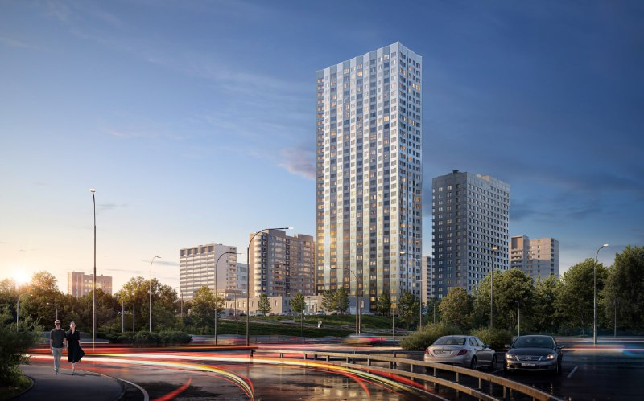
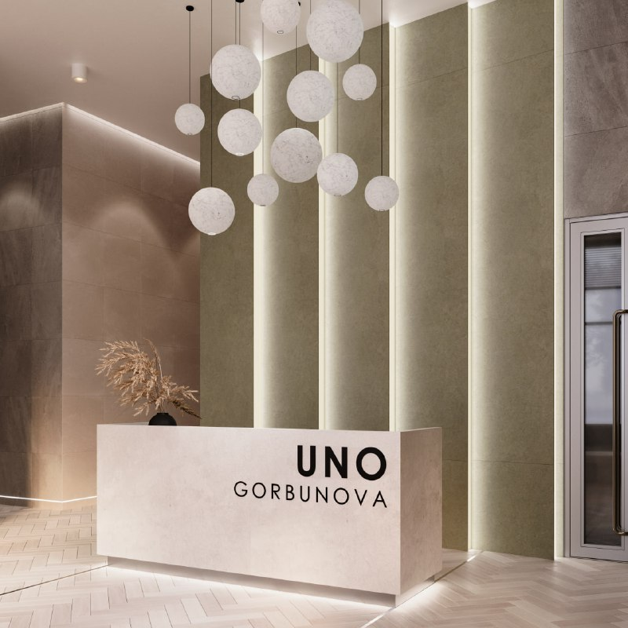

# UNO.Горбунова от «Основы»: 35 этажей у МЦД «Сетунь», цены от 14,5 млн ₽

«Основа» строит ЖК UNO.Горбунова на улице Горбунова, вл. 27, в Можайском районе: первая башня — 35 этажей и 405 квартир. На октябрь 2026 года квартиры продаются от 14,5 млн ₽, сдать обещают в 1 квартале 2028 года. И, что приятно, с паркингом, которого хватит не только на избранных.

## Коротко

- Застройщик — [«Основа»](/zastroyshchiki/osnova/), проект выходит под зонтичным брендом UNO.
- Башня — 35 этажей, 405 квартир от 28 до 95 м²; всего в проекте 544 квартиры.
- Подземный паркинг на 165 [машино-мест](/slovar/mashino-mesto/), 56 кладовых.
- 13 октября 2026 года: от около 14,5 млн ₽, сдача — 1 квартал 2028 года.

## Башня у станции «Сетунь»

Участок — улица Горбунова, вл. 27, Можайский район на западе Москвы. Ближайшая станция МЦД-1 «Сетунь» — в 900 м.

В первой очереди — 35-этажная башня на 405 квартир площадью от 28 до 95 м². Паркинг двухуровневый, на 165 машино-мест, плюс 34 гостевых места; в корпусе 56 кладовых. Второй корпус скромнее — 19–20 этажей; вместе в проекте 544 квартиры.

*Башня UNO.Горбунова на визуализации (1). Визуализация: «Основа»*

*Вестибюль UNO.Горбунова на визуализации (2). Визуализация: «Основа»*

## Сколько стоят квартиры в UNO.Горбунова

По каталогу на 13 октября 2026 года квартиры продаются от около 14,5 млн ₽. Цену за квадратный метр на странице проекта не показывают.

Стартовый прайс весны 2025 года официально не публиковали, так что честного «было — стало» не получится. Полная история проекта — в [досье «UNO.Горбунова»](/obekty/uno-gorbunova/).

## Когда сдадут UNO.Горбунова

По каталогу оба корпуса сдают в 1 квартале 2028 года. Стройка идёт, монтируют нижние этажи; данные о ходе работ — от 26 сентября 2026 года.

В карточке проекта семь [проектных деклараций](/slovar/proektnaya-deklaratsiya/): первая от 31 марта 2025 года, последняя от 4 сентября 2026 года. Разрешение на строительство в карточке тоже есть, но без даты.

## Что это значит для покупателя и инвестора

- **Паркинг.** 165 мест на 405 квартир высотного корпуса — около 41%. Неплохо, но места делятся на весь проект, так что условия покупки уточняйте заранее.
- **Сроки.** Сдача в 1 квартале 2028 года; сверяйте её с последней декларацией, а не с рекламой.
- **Окружение.** Что построят по соседству, пока никто официально не объявлял — оценивайте локацию по факту: ногами и по транспорту.
- **Что отслеживать.** Новые декларации, график строительства и цены на новостройки в [Москве](/novostroyki/moskva/).

## Карточка объекта

- **Название:** UNO.Горбунова
- **Адрес участка:** Москва, ул. Горбунова, вл. 27 (Можайский район, ЗАО)
- **Застройщик:** «Основа»
- **Корпуса:** 35-этажная башня (405 квартир) и корпус 19–20 этажей; всего 544 квартиры
- **Паркинг:** 165 машино-мест, два подземных уровня; 56 кладовых
- **Стадия:** строительство, монтаж нижних этажей
- **Срок сдачи:** 1 квартал 2028 года
- **Цены на 13 октября 2026 года:** от около 14,5 млн ₽

## Вопросы и ответы

**Кто застройщик UNO.Горбунова?**
Проект ведёт ГК «Основа»; в карточках также указана компания СЗ «Гермесстрой».

**Когда сдадут UNO.Горбунова?**
По каталогу на октябрь 2026 года, оба корпуса сдают в 1 квартале 2028 года.

**Сколько стоят квартиры в UNO.Горбунова?**
На 13 октября 2026 года — от около 14,5 млн ₽. Цену за квадратный метр источник не называет.

**Сколько машино-мест в UNO.Горбунова?**
В подземном паркинге 165 машино-мест на 405 квартир высотного корпуса, плюс 34 гостевых места.

## Источники

1. [Новостройки Москвы: карточка ЖК «УНО.Горбунова»](https://www.novostroy-m.ru/baza/arhitekturnyy_proekt_uno_v), данные на 13 октября 2026 года.
2. [РБК Недвижимость: два новых ЖК формата UNO от «Основы»](https://realty.rbc.ru/news/680f1a599a794704452f7c25), 13 мая 2025 года (рекламный материал).

Материал не является инвестиционной рекомендацией.
