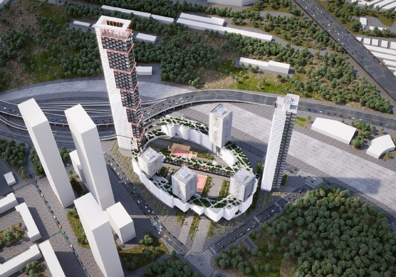
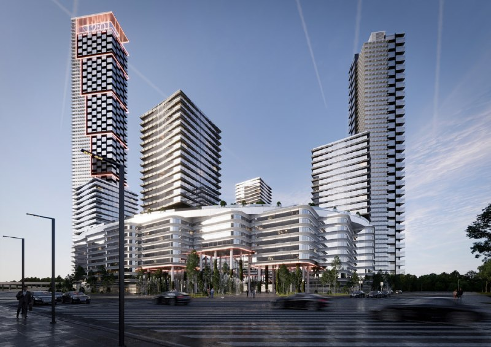

# Рижский грузовой двор: KAMEN нарисовало «Колизей» и башню на 240 м

У Рижского грузового двора — проекта, который раньше называли РЖД-Сити, — очередная концепция. В апреле 2025 года бюро KAMEN показало жилую часть: кольцевой корпус, похожий на «Колизей», и башню порядка 240 м. Картинка эффектная, но на конец 2025 года разрешения на строительство у проекта не было.

## Коротко

- **Автор:** бюро KAMEN, доминанта — порядка 240 м.
- **Площадка:** более 43 га бывшего грузового двора, участок принадлежит РЖД.
- **Предыстория:** площадку уже рисовали другие бюро, конкурс РЖД и ДОМ.РФ выиграло японское.
- **Статус на октябрь 2026-го:** «Скоро старт», сроков строительства нет.

## Жилой «Колизей» у Рижского вокзала

По данным городского издания от 16 апреля 2025 года, KAMEN предлагает отдельно стоящий комплекс. Самая высокая жилая башня — порядка 240 м. Кольцевой корпус, напоминающий «Колизей», судя по рендерам, тоже жилой: римский амфитеатр, переосмысленный под квартиры.

*Кольцевой корпус и высотная доминанта в концепции бюро KAMEN (1). Визуализация: бюро KAMEN*

*Жилые башни над общим стилобатом в концепции бюро KAMEN (2). Визуализация: бюро KAMEN*

Площадь жилой части, ТЭП (технико-экономические показатели) и решение градостроительно-земельной комиссии официально пока не публиковали — так что считать квадратные метры рано.

## Площадку рисуют не впервые

Рижский грузовой двор — это более 43 га у Рижского вокзала, и принадлежат они РЖД. Концепции сюда уже предлагали бюро Сергея Киселёва, UNK и другие; конкурс РЖД и ДОМ.РФ выиграло японское бюро. Изначально РЖД собиралась поставить здесь собственную штаб-квартиру, но, по данным МСК1, в 2024 году купила небоскрёб в «Москва-Сити» и переедет в Moscow Towers. Штаб-квартира уехала в Сити — а на освободившейся площадке теперь рисуют жильё.

По соседству уже строится ЖК MOD от MR Group — он занимает лишь часть территории. Полная история проекта — в [досье «Рижский грузовой двор»](/obekty/rizhskiy-gruzovoy-dvor/).

## Два имени у застройщика

Проектом занимается «РГ-Девелопмент»: так компанию называет «Коммерсантъ» в декабре 2023 года и так она указана на странице проекта. В досье «Шахматки» застройщиком значится [«Страна Девелопмент»](/zastroyshchiki/strana/). Одна ли это структура, публично не объясняли.

## Что с проектом сейчас

На 14 октября 2026 года проект висит в статусе «Скоро старт», цены на квартиры не раскрыты. Эксперт на странице проекта 26 декабря 2025 года ответил прямо: разрешительной документации на строительство нет. Когда начнутся работы, никто не называл.

## Что это значит для покупателя и инвестора

Это история на несколько лет вперёд: сначала разрешение на строительство и проектная декларация, потом — разговор о цене. На наш взгляд, концепция — ещё не продукт: авторы здесь уже менялись, и нынешний «Колизей» вполне может уступить место следующему рендеру. Следите за появлением декларации на наш.дом.рф и за подборкой [будущих проектов](/novostroyki/budushchie-proekty/). Что продаётся уже сейчас — на странице [новостроек Москвы](/novostroyki/moskva/).

## Вопросы и ответы

**Кто автор концепции Рижского грузового двора?**
Жилую часть в апреле 2025 года показало бюро KAMEN: кольцевой корпус и башня порядка 240 м. До него площадку уже рисовали другие бюро.

**Кто застройщик Рижского грузового двора?**
Участок принадлежит РЖД. Проектом занимается «РГ-Девелопмент»; в досье «Шахматки» застройщиком указана «Страна Девелопмент».

**Когда начнут строить Рижский грузовой двор?**
Сроков пока никто не назвал. На конец 2025 года разрешения на строительство не было, а продажи значились как «скоро старт».

**Какая площадь Рижского грузового двора?**
Территория бывшей промзоны — более 43 га. Площадь жилой части официально пока не публиковали.

## Источники

1. [Москвич Mag: на территории Рижского грузового двора построят «Колизей» с 240-метровым небоскрёбом, 16 апреля 2025](https://moskvichmag.ru/?p=422928)
2. [МСК1: как в Москве застроят восемь бывших грузовых дворов, 2 ноября 2025](https://msk1.ru/text/gorod/2025/11/02/76047321/)
3. [Страница проекта РЖД-Сити на novostroy-m.ru](https://www.novostroy-m.ru/baza/jk_rjd_siti)
4. [Коммерсантъ, 5 декабря 2023 года](https://www.kommersant.ru/doc/6379789)

Материал не является инвестиционной рекомендацией.
