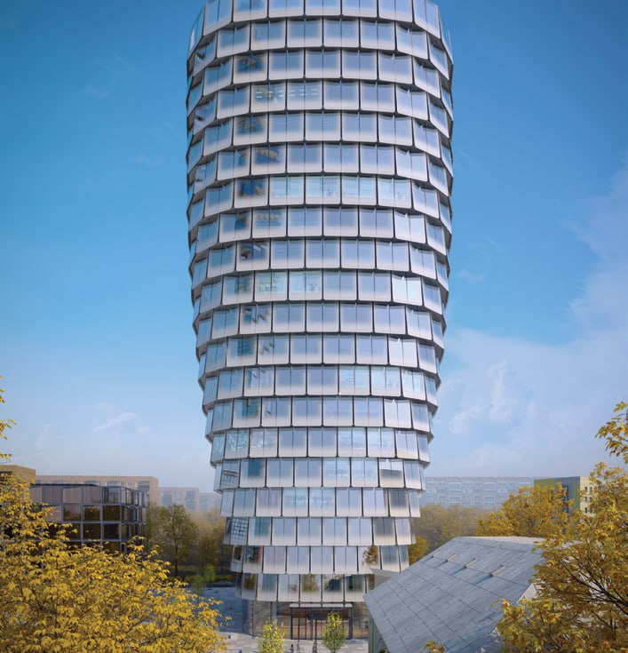

---
source:
  id: 28889
  date: 2025-04-16
status: needs_review
skip_reason: null
type: object
region: moscow
title: 'MIND на Серегина: офисная башня MR Group на 33 тыс. м² у «Динамо»'
title_alts:
- 'MR Group добавила к жилью на Серегина офисы: MIND на 33 тыс. м²'
- 'Офисный MIND у «Динамо»: 17 этажей, сдача в 2029 году'
slug: mind-seregina-5-7-mr-group-ofisy
lead: 'К жилому проекту MR Group на Серегина добавился офис: в апреле 2025 года MR Office показала MIND на 33 тыс. м² рядом с «Динамо». Микст-юз у Ленинградки получил вторую ногу, а Москва — очередную башню в стекле и «чешуе».'
developers:
- id: mr-group
  name: MR Group
  role: main
objects:
- id: mind
  names:
  - MIND
  - Серегина, 5
  zu: Серегина, 5–7
  main: true
  new: false
districts:
- aeroport
topics:
- rynok
images:
- file: media/28889_2.jpg
  alt: Визуализация офисной башни MIND с фасадом из изогнутых стеклянных панелей, Серегина, 5–7, район Аэропорт
  caption: 'Офисная башня MIND: фасад из изогнутых стеклянных панелей, расширяющийся кверху силуэт.'
  credit: 'Визуализация: MR Group'
- file: media/28889_3.jpg
  alt: Визуализация офисного здания MIND, вид с улицы, Серегина, 5–7, район Аэропорт, Москва
  caption: 'MIND с улицы: вход в здание и стеклянная «чешуя» верхних этажей.'
  credit: 'Визуализация: MR Group'
factcheck:
- claim: MR Office представила офисный проект MIND площадью более 33 тыс. м² у метро «Динамо» на Ленинградском проспекте, рядом с жилым комплексом (пресс-релиз от 17 апреля 2025 года)
  status: confirmed
  source: https://snob.ru/news/mr-predstavila-mr-office-novyi-brend-ofisnoi-nedvizhimosti-s-portfelem-iz-25-proektov/
  checked: 2026-10-15
- claim: Участок — Серегина, вл. 5–7, район Аэропорт, САО; застройщик MR Group; концепция ADM; 17 этажей, 74,3 м, 33 289 м² общей и 25 692 м² офисной площади, паркинг на 128 машин
  status: confirmed
  source: https://www.novostroy-m.ru/baza/biznestsentr_mind_maynd
  checked: 2026-10-15
- claim: Сдача — II квартал 2029 года, стадия — котлован; цены офисов от 71,1 млн до 1,2 млрд ₽ (данные официального сайта на 12 октября 2026 года)
  status: changed
  source: https://www.novostroy-m.ru/baza/biznestsentr_mind_maynd
  checked: 2026-10-15
- claim: 'Жилая часть — ЖК «С5» на Серегина, 5: три башни 25–48 этажей, три клубных дома 4–6 этажей, 17-этажный бизнес-центр, архитектор ADM, сдача I квартал 2030 года, котлован, цены от 33,9 млн ₽'
  status: changed
  source: https://www.novostroy-m.ru/baza/jk_na_ul_seregina
  checked: 2026-10-15
- claim: Башни жилой части 25, 33 и 48 этажей, 761 квартира, 608 машино-мест, шесть пентхаусов
  status: confirmed
  source: https://www.novostroy-m.ru/novosti/novoe_na_rynke_premialnyy
  checked: 2026-10-15
- claim: MR быстро согласовала офисы, хотя по жилью уже три круга заходов в город
  status: unverified
  source: ''
  checked: 2026-10-15
- claim: Раньше три башни расширялись кверху, теперь все объёмы разные
  status: unverified
  source: ''
  checked: 2026-10-15
removed:
- 'Утверждение о «трёх кругах» согласований жилья и быстрой защите офисов: мнение, источников нет'
- 'Сравнение прежней версии жилых башен с нынешней: без публичных материалов по прежней версии'
- 'Прогноз 600–700 тыс. ₽/м² из предыдущей заметки: прогноз, в статью не вошёл'
- Метафоры про «шишку» и «чешую» как оценка архитектуры оставлены только как авторская ирония по визуализации
data_points: []
seo:
  main_query: mind серегина 5-7 mr group офисы
  keywords:
  - бизнес-центр MIND MR Group
  - mr office mind динамо
  - серегина 5 аэропорт офисы
  - жк с5 mr group серегина
  - офисы у метро динамо купить
  frequency_checked: false
  title: 'MIND на Серегина от MR Group: офисы у метро «Динамо»'
  description: 'Офисный MIND от MR Group на Серегина, 5–7: 33 тыс. м², 17 этажей, сдача в 2029 году, офисы от 71 млн ₽. Что построят рядом с ЖК «С5» у Ленинградки.'
  canonical: https://шахматка.москва/novosti/mind-seregina-5-7-mr-group-ofisy/
internal_links:
- anchor: досье «MIND»
  url: /obekty/mind/
- anchor: MR Group
  url: /zastroyshchiki/mr-group/
- anchor: новостройки Москвы
  url: /novostroyki/moskva/
- anchor: ЖК «С5» от MR Group
  url: /novosti/s5-mr-group-seregina-start-prodazh-2026/
- anchor: ТЭП
  url: /slovar/tep/
faq:
- q: Где строят офисную башню MIND?
  a: На участке Серегина, 5–7 в районе Аэропорт Москвы, рядом с ЖК «С5». В пресс-релизе MR Office здание описано как расположенное у метро «Динамо» на Ленинградском проспекте.
- q: Сколько метров в MIND и сколько этажей?
  a: По каталогу «Новострой-М» — 33,3 тыс. м² общей площади, из них 25,7 тыс. м² офисов, 17 этажей и 74,3 м высоты.
- q: Когда сдадут MIND?
  a: Каталог называет II квартал 2029 года. По состоянию на октябрь 2026 года стройка на стадии котлована.
- q: Сколько стоят офисы в MIND?
  a: По данным каталога «Новострой-М» со ссылкой на официальный сайт проекта на 12 октября 2026 года — от 71,1 млн до 1,2 млрд ₽ за помещение.
date_published: 2025-04-16
date_modified: 2026-10-15
author: Редакция Шахматки
editor_notes: 'Основной источник по цифрам MIND и С5 — агрегатор «Новострой-М» (наш.дом.рф и сайт MR Group не открывались), отсюда needs_review. Проверить по проектной декларации: этажность, площади и срок сдачи офисной части. Фото 1 из заметки (с красными стрелками) не использовано; фото 4–5 — детали фасада, не взяты. Метро: пресс-релиз пишет «Динамо», в карточке «Новострой-М» — только район Аэропорт; в статье оба факта разведены.'
schema: '{"@context": "https://schema.org", "@graph": [{"@type": "NewsArticle", "headline": "MIND на Серегина: офисная башня MR Group на 33 тыс. м² у «Динамо»", "description": "Офисный MIND от MR Group на Серегина, 5–7: 33 тыс. м², 17 этажей, сдача в 2029 году, офисы от 71 млн ₽. Что построят рядом с ЖК «С5» у Ленинградки.", "datePublished": "2025-04-16", "dateModified": "2026-10-15", "author": {"@type": "Organization", "name": "Редакция Шахматки"}, "publisher": {"@type": "Organization", "name": "Шахматка"}, "about": [{"@type": "Place", "name": "MIND, Серегина, 5–7, район Аэропорт, Москва"}, {"@type": "Organization", "name": "MR Group"}], "mainEntityOfPage": "https://шахматка.москва/novosti/mind-seregina-5-7-mr-group-ofisy/"}, {"@type": "FAQPage", "mainEntity": [{"@type": "Question", "name": "Где строят офисную башню MIND?", "acceptedAnswer": {"@type": "Answer", "text": "На участке Серегина, 5–7 в районе Аэропорт Москвы, рядом с ЖК «С5». В пресс-релизе MR Office здание описано как расположенное у метро «Динамо» на Ленинградском проспекте."}}, {"@type": "Question", "name": "Сколько метров в MIND и сколько этажей?", "acceptedAnswer": {"@type": "Answer", "text": "По каталогу «Новострой-М» — 33,3 тыс. м² общей площади, из них 25,7 тыс. м² офисов, 17 этажей и 74,3 м высоты."}}, {"@type": "Question", "name": "Когда сдадут MIND?", "acceptedAnswer": {"@type": "Answer", "text": "Каталог называет II квартал 2029 года. По состоянию на октябрь 2026 года стройка на стадии котлована."}}, {"@type": "Question", "name": "Сколько стоят офисы в MIND?", "acceptedAnswer": {"@type": "Answer", "text": "По данным каталога «Новострой-М» со ссылкой на официальный сайт проекта на 12 октября 2026 года — от 71,1 млн до 1,2 млрд ₽ за помещение."}}]}]}'
---

# MIND на Серегина: офисная башня MR Group на 33 тыс. м² у «Динамо»

К жилому проекту [MR Group](/zastroyshchiki/mr-group/) на Серегина добавился офис: в апреле 2025 года MR Office показала MIND на 33 тыс. м² у метро «Динамо». Ленинградский деловой коридор такой объём переварит без заметных усилий, а MR получает редкий для Москвы живой микст-юз: жильё и офисы на одном участке.

## Коротко

- **Что:** офисное здание MIND на участке Серегина, 5–7 в районе Аэропорт; общая площадь — 33,3 тыс. м², из них 25,7 тыс. м² офисов.
- **Параметры:** 17 этажей, 74,3 м, подземный паркинг на 128 машин, концепция бюро ADM.
- **Сроки:** по каталогу «Новострой-М» — II квартал 2029 года; на октябрь 2026-го стройка на стадии котлована.
- **Цена:** офисы — от 71,1 млн до 1,2 млрд ₽ за помещение (данные на 12 октября 2026 года).

## Что за офисный проект MIND у «Динамо»

MR Office — бренд офисной недвижимости MR Group. В пресс-релизе от 17 апреля 2025 года MIND описан как премиальное офисное здание площадью более 33 тыс. м² рядом с метро «Динамо» на Ленинградском проспекте, в трёх минутах пешком от Петровского парка. Застройщик делает ставку на приватность, масштабируемость и транспортную доступность.

Здание — не небоскрёб, а тот самый «средний этаж» московской офисной архитектуры: 17 этажей и 74 метра. Фасад собран из изогнутых стеклянных панелей, силуэт расширяется кверху. На наш взгляд, получилась симпатичная «шишка» в стекле: образ узнаваемый, а вот новизны в нём меньше, чем в рендерах.

*Офисная башня MIND: фасад из изогнутых стеклянных панелей. Визуализация: MR Group.*

По данным каталога, в офисах свободная планировка, потолки 3,7 м и панорамное остекление. Площади помещений в карточке указаны с расхождениями, так что точные лоты лучше сверять с прайсом застройщика.

## Контекст: жильё и офисы на одном участке

Рядом с MIND — жилой комплекс «С5» от MR Group на Серегина, 5: три башни от 25 до 48 этажей, три клубных дома по 4–6 этажей и 761 квартира. Проектировало его то же бюро ADM. Продажи жилья, по каталогу, идут с лета 2026 года, вход — от 33,9 млн ₽, сдача — I квартал 2030 года. Подробнее — в материале про [«С5» от MR Group](/novosti/s5-mr-group-seregina-start-prodazh-2026/). Полная история участка — в [досье «MIND»](/obekty/mind/).

Весь комплекс сейчас — это общая строительная площадка: и жилые корпуса, и офисы на стадии котлована.

## Что с проектом сейчас

По состоянию на 15 октября 2026 года MIND — на стадии котлована. Сдача — II квартал 2029 года, то есть на три квартала раньше жилой части (I квартал 2030-го). Офисы продаются: каталог ссылается на цены с официального сайта проекта — от 71,1 млн ₽ за помещение.

## Что это значит для покупателя и инвестора

Офисы в таком проекте покупают чаще как актив, чем «для себя». Ставка тут на локацию: [район Аэропорт](/novostroyki/moskva/) с метро и Петровским парком рядом. Риски понятные: срок 2029 года ещё впереди, а стройка на ранней стадии. Ликвидность офисного лота зависит от того, кто станет арендатором, а не от красоты фасада. Смотрите на планировки, [ТЭП](/slovar/tep/) и условия договора, а не на рендеры.

## Карточка объекта

- Названия: MIND, Серегина, 5–7.
- Адрес ЗУ: Серегина, 5–7, район Аэропорт, САО, Москва.
- Застройщик: MR Group (бренд MR Office).
- Архитектор: ADM.
- Этажность: 17 этажей, 74,3 м.
- Площадь: 33,3 тыс. м², из них офисы 25,7 тыс. м².
- Стадия: котлован (октябрь 2026).
- Сдача: II квартал 2029 года.
- Цена: от 71,1 млн до 1,2 млрд ₽.

## Вопросы и ответы

**Где строят офисную башню MIND?**
На участке Серегина, 5–7 в районе Аэропорт Москвы, рядом с ЖК «С5». В пресс-релизе MR Office здание описано как расположенное у метро «Динамо» на Ленинградском проспекте.

**Сколько метров в MIND и сколько этажей?**
По каталогу «Новострой-М» — 33,3 тыс. м² общей площади, из них 25,7 тыс. м² офисов, 17 этажей и 74,3 м высоты.

**Когда сдадут MIND?**
Каталог называет II квартал 2029 года. По состоянию на октябрь 2026 года стройка на стадии котлована.

**Сколько стоят офисы в MIND?**
По данным каталога «Новострой-М» со ссылкой на официальный сайт проекта на 12 октября 2026 года — от 71,1 млн до 1,2 млрд ₽ за помещение.

## Источники

1. [MR представила MR Office — новый бренд офисной недвижимости, пресс-релиз, Сноб, 17 апреля 2025](https://snob.ru/news/mr-predstavila-mr-office-novyi-brend-ofisnoi-nedvizhimosti-s-portfelem-iz-25-proektov/)
2. [Бизнес-центр MIND, каталог «Новострой-М», данные на октябрь 2026](https://www.novostroy-m.ru/baza/biznestsentr_mind_maynd)
3. [ЖК «С5» на Серегина, каталог «Новострой-М», данные на октябрь 2026](https://www.novostroy-m.ru/baza/jk_na_ul_seregina)
4. [Новое на рынке: премиальный проект «С5», «Новострой-М»](https://www.novostroy-m.ru/novosti/novoe_na_rynke_premialnyy)

Материал не является инвестиционной рекомендацией.
