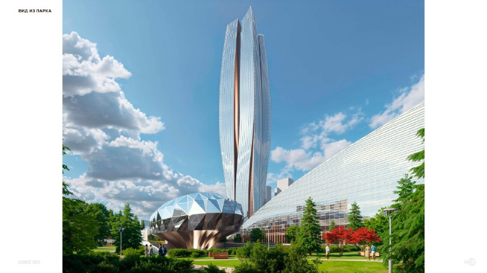
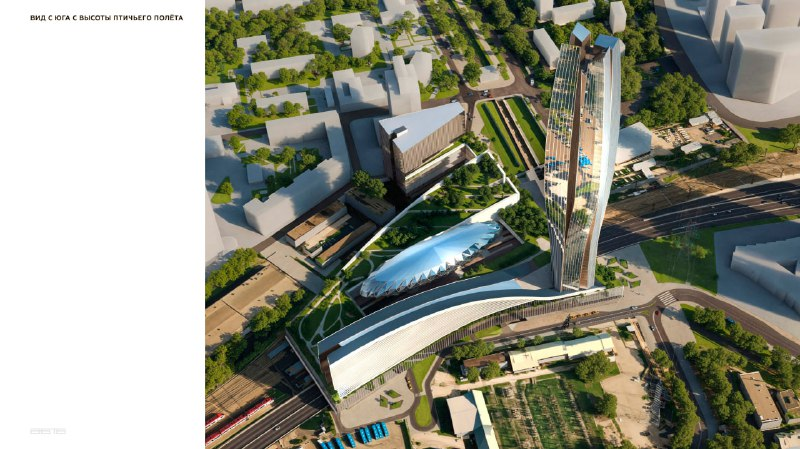

# ТПУ «Фили»: конкурс выиграл проект «Филёвские сады» Башкаева и RRG

22 апреля 2025 года стал известен победитель международного конкурса на транспортно-пересадочный узел (ТПУ) «Фили»: проект «Филёвские сады» бюро Тимура Башкаева и группы компаний RRG. Узел у Москвы-Сити должен связать МЦД-1 и метро и получить небоскрёб над железнодорожными путями.

## Коротко

- Победитель конкурса на ТПУ «Фили» объявлен 22 апреля 2025 года: проект бюро Тимура Башкаева и RRG.
- На конкурс подали 31 заявку, в финал вышли восемь команд.
- В концепции: крытый переход, небоскрёб и сады над путями, общий стилобат.
- Прогноз пассажиропотока: около 110 тыс. человек в сутки к 2030 году.
- Высота, площади и сроки в открытых источниках не названы (по состоянию на 14 октября 2026 года).

## Кто победил в конкурсе на ТПУ «Фили»

По данным [РБК Недвижимости](https://realty.rbc.ru/amp/news/6807717c9a79477a19719f74), конкурс на лучшую концепцию общественно-делового комплекса организовала Москомархитектура. Победил проект бюро Тимура Башкаева и группы компаний RRG. Главный архитектор Москвы Сергей Кузнецов отметил, что в проекте реализован принцип «триединства»: функциональности, современности и заботы о пешеходе.

Заявки прислали бюро из 11 российских городов, а также из Белоруссии, Сербии, Ирана, Турции и Италии. Среди финалистов были «Камень», «Маркс», «А-Га», Asadov, Steel и мастерская Алексея Ильина ([msk1.ru](https://msk1.ru/text/transport/2025/04/22/75372014/)).

## Что предусмотрено в концепции «Филёвские сады»

Проект предполагает крытый переход между станциями, небоскрёб и сады на крыше над железнодорожными путями. Здания объединит стилобат с общедоступными озеленёнными пространствами. Рядом с башней появится объект необычной формы. В центре комплекса — общественный центр, где возможны детский центр, концертный зал и музей.

*Вид из парка. Концепция «Филёвские сады» для ТПУ «Фили». Визуализация: бюро Тимура Башкаева и RRG*

*Вид с юга с высоты птичьего полёта. Концепция «Филёвские сады». Визуализация: бюро Тимура Башкаева и RRG*

Транспортная задача — объединить МЦД-1 и станцию метро «Фили», которые сейчас связаны только наземной пересадкой. По прогнозу, к 2030 году узлом будут пользоваться около 110 тыс. пассажиров в сутки, в час пик — до 25 тыс. человек. Станцию метро по концепции менять не планируют.

## Контекст: ТПУ в Филёвском Парке

Узел расположен в районе [Филёвский Парк](/novostroyki/filevskiy-park/) рядом с Москвой-Сити. Полная история проекта — в [досье «ТПУ «Фили»»](/obekty/tpu-fili/).

## Что с проектом сейчас

По состоянию на 14 октября 2026 года мы не нашли в проверенных источниках публикации о градостроительном плане земельного участка ([ГПЗУ](/slovar/gpzu/)), проекте планировки, начале строительства или сроках. Высота башни, площади и состав функций в цифрах не раскрыты. Заказчик в сообщениях об итогах конкурса прямо не назван.

## Что это значит для читателя

Это победа концепции, а не согласованный проект: в таких случаях конкурсная картинка обычно дорабатывается. На наш взгляд, ключевые вопросы к проекту — доля офисов, стоимость строительства над действующими путями и график; ответов на них пока нет. Тем, кто следит за рынком офисов у Москвы-Сити, стоит ждать документов, а не визуализаций.

## Вопросы и ответы

**Кто выиграл конкурс на ТПУ «Фили»?**
Проект «Филёвские сады» бюро Тимура Башкаева и группы компаний RRG. Итог объявлен 22 апреля 2025 года.

**Что предусмотрено в проекте ТПУ «Фили»?**
Крытый переход между МЦД-1 и метро, небоскрёб и сады на крыше над железнодорожными путями, общий стилобат и общественный центр.

**Сколько пассажиров будет пользоваться узлом?**
По прогнозу, к 2030 году около 110 тыс. человек в сутки и до 25 тыс. человек в час в пик.

**Когда построят ТПУ «Фили»?**
Сроки в открытых источниках не названы. По состоянию на 14 октября 2026 года мы не нашли решений о ГПЗУ или начале строительства.

## Источники

1. [РБК Недвижимость, 22 апреля 2025 года: итоги конкурса на ТПУ «Фили»](https://realty.rbc.ru/amp/news/6807717c9a79477a19719f74)
2. [msk1.ru, 22 апреля 2025 года: проект «Филёвские сады» и финалисты](https://msk1.ru/text/transport/2025/04/22/75372014/)
3. [Moskvich Mag, 22 апреля 2025 года: небоскрёб с садами над путями у станции «Фили»](https://moskvichmag.ru/?p=423878)

Материал не является инвестиционной рекомендацией.
