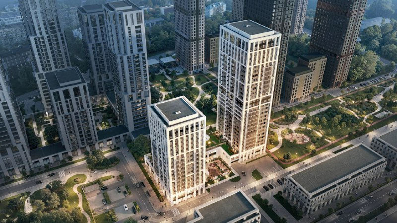
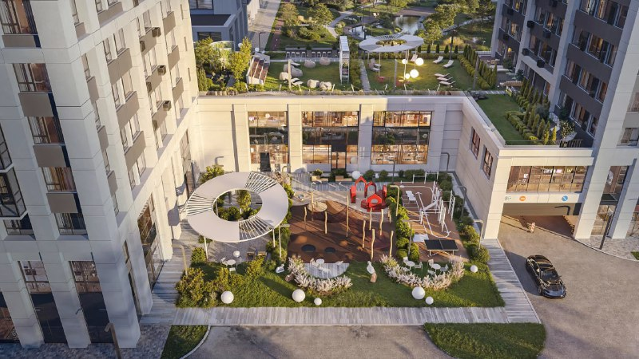
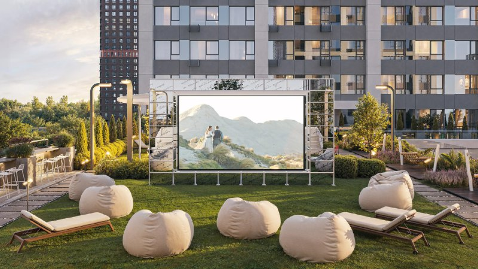

# ЖК «Бестселлер» от BAZA на Перовском шоссе: презентация и сдача в 2028-м

Региональная BAZA Development вышла в Москву с «Бестселлером» на Перовском шоссе, 21 — и вложилась в картинки: открытый кинотеатр на кровле, зимний сад на паркинге. За четыре месяца до официального старта, по словам застройщика, разошлись 30% квартир — в основном в рассрочку. Сдача корпуса 1 — в I квартале 2028 года.

## Коротко

- **Кто:** ООО «BAZA Development», офис в Екатеринбурге; «Бестселлер» — её первый московский проект, презентация прошла 23 апреля 2025 года.
- **Что:** две башни в 16 и 29 этажей на общем стилобате, 391 квартира от 28 до 110 м², класс комфорт-плюс.
- **Когда:** сдача корпуса 1 — I квартал 2028 года.
- **Сколько:** на старте — от 12,3 млн ₽, на 13 октября 2026 года — от 19,1 млн ₽.

## Что показали на презентации «Бестселлера»

Пресс-завтрак 23 апреля 2025 года стал для BAZA московским дебютом. Участок — Перовское шоссе, 21, Нижегородский район ЮВАО, до метро «Нижегородская» около 15 минут пешком. Общая площадь комплекса около 35 тыс. м², из них 20,3 тыс. м² — квартиры, от студий до четырёхкомнатных. Под землёй — паркинг на 110 машино-мест, 52 из них сдвоенные. Рядом парк на 2,4 га.

*Две башни «Бестселлера» на визуализации застройщика, вид сверху. Визуализация: BAZA Development*

Фасады, если честно, из золотой середины комфорт-плюса: светлые башни с вертикальным ритмом окон. Вся энергия ушла в общие зоны. Во дворе на кровле стилобата — детские площадки и воркаут, на визуализациях ещё и кинотеатр под открытым небом. Паркинг украсили галереей с зимним садом: машину здесь оставляют, как в оранжерее.

*Двор на стилобате с детской площадкой на визуализации застройщика. Визуализация: BAZA Development*

*Открытый кинотеатр на кровле стилобата на визуализации застройщика. Визуализация: BAZA Development*

Рисунки — пока рисунки. Что из этого доедет до сдачи, станет видно к 2028 году.

## Продажи до старта: 30% за четыре месяца

Главная цифра презентации — 30% квартир, проданных за четыре месяца до официального старта. Застройщик объяснил это просто: покупали в основном в рассрочку на два года с крупным первым взносом. После получения разрешения на строительство BAZA собиралась сокращать рассрочки и переходить к ипотеке.

Такая схема знакома рынку: рассрочка делает дом дешевле на входе, но ровно до тех пор, пока не пора платить по графику. Сколько продано на самом деле, смотрите в [проектной декларации](/slovar/proektnaya-deklaratsiya/), а не в пресс-завтраке.

## Что с проектом сейчас

Продажи открыли в конце апреля 2025 года: 391 квартира, цены от 12,3 млн ₽. С тех пор вход заметно подорожал. На 13 октября 2026 года, по данным агрегатора «Новострой-М», однокомнатная 34,4 м² стоит от 19,1 млн ₽, двухкомнатная 54,7 м² — от 24,3 млн ₽, трёхкомнатная 67,8 м² — от 28,7 млн ₽. Корпус 1 по-прежнему обещан к I кварталу 2028 года.

Сравнение «от 12,3 до 19,1» не вполне честное: минимальная цена привязана к самому дешёвому лоту, а дешёвые лоты первыми и уходят. Но направление ясно. Подробнее о ценах и сроках — в материале про [«Бестселлер» на октябрь 2026 года](/novosti/bestseller-baza-perovskoe-shosse-21-ceny-sroki/); полная история проекта — в [досье «Бестселлер»](/obekty/bestseller/).

## Что это значит для покупателя

**Застройщик.** Это первый московский дом [BAZA Development](/zastroyshchiki/baza/): столичной истории сдачи у компании нет, а до Москвы она работала на Урале. Опыт регионального девелопера не плох и не хорош сам по себе, но проверять его придётся по стройке, а не по визуализациям.

**Рассрочка.** Если вы брали или берёте квартиру в рассрочку, посчитайте график платежей и ставку по ипотеке на момент, когда рассрочка закончится: переход на кредит может выйти дороже, чем кажется сегодня.

**Рынок.** Проект заявлен как комфорт-плюс, но вход стоит от 19 млн ₽ за однушку. Прежде чем решать, сравните его с другими новостройками [комфорт-класса](/novostroyki/komfort-klass/) в Москве. Общая картина — в разделе [«Рынок»](/temy/rynok/).

## Карточка объекта

- **Адрес ЗУ:** Москва, Перовское шоссе, 21
- **Названия:** «Бестселлер»; прежнее название участка — «Станкоагрегат»
- **Застройщик:** ООО «BAZA Development»
- **Район:** Нижегородский (ЮВАО), метро «Нижегородская»
- **Класс:** комфорт-плюс
- **Корпуса:** два, 16 и 29 этажей, 391 квартира, от 28 до 110 м²
- **Паркинг:** подземный, 110 машино-мест
- **Ввод:** I квартал 2028 года (корпус 1)
- **Цена:** от 19,1 млн ₽ на 13 октября 2026 года

## Вопросы и ответы

**Кто застройщик ЖК «Бестселлер» на Перовском шоссе?**
ООО «BAZA Development» — застройщик с офисом в Екатеринбурге, «Бестселлер» стал его первым проектом в Москве. Проект презентовали 23 апреля 2025 года.

**Когда сдадут «Бестселлер»?**
Корпус 1 — в I квартале 2028 года, такой срок указан на странице проекта на 13 октября 2026 года.

**Сколько стоят квартиры в «Бестселлере»?**
На 13 октября 2026 года — от 19,1 млн ₽ за однокомнатную 34,4 м². Двухкомнатные начинаются от 24,3 млн ₽, трёхкомнатные — от 28,7 млн ₽.

**Сколько квартир и этажей в «Бестселлере»?**
Две башни в 16 и 29 этажей, 391 квартира площадью от 28 до 110 м², подземный паркинг на 110 машино-мест.

## Источники

1. «Новострой-М», презентация BAZA Development, 23 апреля 2025 года: https://www.novostroy-m.ru/kompanii/ooo_baza_development/news/kompaniya_baza_development_prezentovala
2. «Новострой-М», ЖК «Бестселлер» и «Будущий», 30 апреля 2025 года: https://www.novostroy-m.ru/novosti/jk_bestseller_i_buduschiy
3. «Новострой-М», страница ЖК «Бестселлер», данные на 13 октября 2026 года: https://www.novostroy-m.ru/baza/jk_bestseller
4. «Новострой-М», о компании BAZA Development: https://www.novostroy-m.ru/kompanii/ooo_baza_development

Материал не является инвестиционной рекомендацией.
