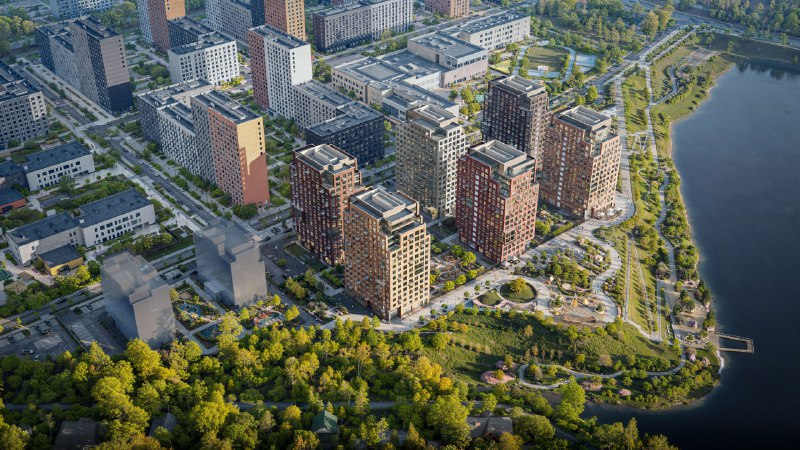
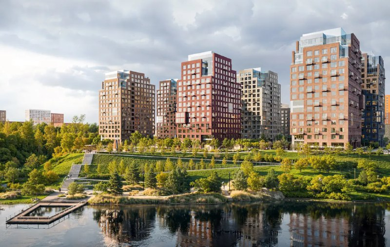

# «Бунинская набережная» от ПИК: квартиры у пруда от 12,1 млн ₽, сдача в 2027-м

[ПИК](/zastroyshchiki/pik/) вывел «Бунинскую набережную» в Коммунарке в продажу в конце апреля 2025 года. Полтора года спустя квартиры в каталогах стоят от 12,1 млн ₽, а сдать корпуса обещают в IV квартале 2027 года. Главный козырь проекта — пруд под окнами первой линии, и в цене это видно.

*(1) Квартал «Бунинской набережной» с высоты. Визуализация: ПИК*

## Коротко

- **Старт:** конец апреля 2025 года, бренд ПИК «Серия плюс».
- **Где:** Коммунарка, Новомосковский округ; до метро «Потапово» — 18 минут пешком.
- **Цены на октябрь 2026-го:** от 12,1 млн ₽, на Яндекс Недвижимости — 287 730–643 000 ₽/м².
- **Сдача:** корпуса 2.6/1.1–2.6/1.5 — IV квартал 2027 года.

## ПИК у воды

Застройщик — ПИК: проект ведёт СЗ «СТРОЙКОМ», квартиры продаёт ПАО «ПИК СЗ». Адрес в каталоге — квартал 183, посёлок Коммунарка, Новомосковский административный округ; сайт относит проект к району [Сосенское](/novostroyki/sosenskoe/). Ближайшее метро — «Потапово», 18 минут пешком. До «Бунинской аллеи» — около 12 минут на машине.

Шесть 16-этажных домов, квартиры от 19 до 97 м², архитектор — бюро «КК» (так в карточке комплекса). Квартал стоит на берегу пруда, и визуализации старательно это показывают: первая линия домов смотрит прямо на воду.

*(2) Дома первой линии со стороны воды. Визуализация: ПИК*

## Старт без громких цифр

По данным novostroy-m.ru, продажи открылись в конце апреля 2025 года, дальше ПИК выводил новые секции. С какой цены метра всё начиналось, официально не раскрывали — так что честно посчитать, насколько квартиры подорожали со старта, не получится.

## Что с проектом сейчас

Положение дел на 15 октября 2026 года:

- **Цены.** На novostroy-m.ru — от 12,1 млн до 35,7 млн ₽. На Яндекс Недвижимости метр в объявлениях стоит от 287 730 до 643 000 ₽. Разница больше чем вдвое — на наш взгляд, внизу малые лоты и нижние этажи, вверху квартиры с видом на воду.
- **Сроки.** Для корпусов 2.6/1.1, 2.6/1.2, 2.6/1.3, 2.6/1.4 и 2.6/1.5 в каталоге указан IV квартал 2027 года.
- **Продажи.** Идут. Каталоги обновляют цены каждый в своём темпе, так что сверяйтесь в день сделки.

Полная история проекта — в [досье «Бунинская набережная»](/obekty/buninskaya-naberezhnaya/).

## Что это значит для покупателя

Дом строится, до заявленного срока — чуть больше года. Даты сверяйте не по каталогам, а по [проектной декларации](/slovar/proektnaya-deklaratsiya/) на наш.дом.рф: агрегаторы любят отставать. И не гипнотизируйте себя «ценой от»: метр здесь зависит от корпуса, этажа и вида, поэтому сравнивайте конкретные лоты. Вид на пруд стоит денег — решите заранее, готовы ли вы за него платить.

Каким был темп продаж и по каким ценам проходят реальные сделки, публично не раскрывают, поэтому рассуждать о динамике цены со старта мы не будем. Фон по рынку — в теме [цены на новостройки](/temy/ceny/), другие запуски — в подборке [стартов продаж](/novostroyki/start-prodazh/).

## Карточка объекта

- **Название:** Бунинская набережная (бренд «Серия плюс»).
- **Адрес:** квартал 183, посёлок Коммунарка, Новомосковский АО, Москва.
- **Застройщик:** ПИК (СЗ «СТРОЙКОМ», ПАО «ПИК СЗ»).
- **Архитектор:** бюро «КК».
- **Корпуса:** шесть 16-этажных домов (в карточке перечислено пять корпусов).
- **Квартиры:** 19–97 м².
- **Метро:** «Потапово», 18 минут пешком.
- **Срок:** IV квартал 2027 года (корпуса 2.6/1.1–2.6/1.5).
- **Цена:** от 12,1 млн ₽; 287 730–643 000 ₽/м².

## Вопросы и ответы

**Кто застройщик ЖК «Бунинская набережная»?**
ПИК: проект ведёт СЗ «СТРОЙКОМ», квартиры продаёт ПАО «ПИК СЗ». Бренд — «Серия плюс».

**Когда начались продажи в «Бунинской набережной»?**
В конце апреля 2025 года — так указано в карточке комплекса на novostroy-m.ru.

**Сколько стоят квартиры в «Бунинской набережной»?**
На середину октября 2026 года в каталогах — от 12,1 млн до 35,7 млн ₽. На Яндекс Недвижимости метр стоит от 287 730 до 643 000 ₽.

**Когда сдадут «Бунинскую набережную»?**
Для корпусов 2.6/1.1–2.6/1.5 в каталоге novostroy-m.ru указан IV квартал 2027 года. Точный срок по своему корпусу проверьте в проектной декларации.

## Источники

1. [ЖК «Бунинская набережная» — Novostroy-M](https://www.novostroy-m.ru/baza/buninskaya_naberejnaya) — застройщик, адрес, метро, сроки, цена, старт продаж, архитектор.
2. [Новые квартиры в Бунинской — Novostroy-M](https://www.novostroy-m.ru/novosti/novye_kvartiry_v_buninskoy) — шесть 16-этажных домов, площади квартир.
3. [ЖК «Бунинская набережная» на Яндекс Недвижимости](https://realty.yandex.ru/moskva_i_moskovskaya_oblast/kupit/kvartira/zhk-buninskaya-naberezhnaya-4126714/monolit/) — цена за квадратный метр, цена квартир, срок.

Материал не является инвестиционной рекомендацией.
