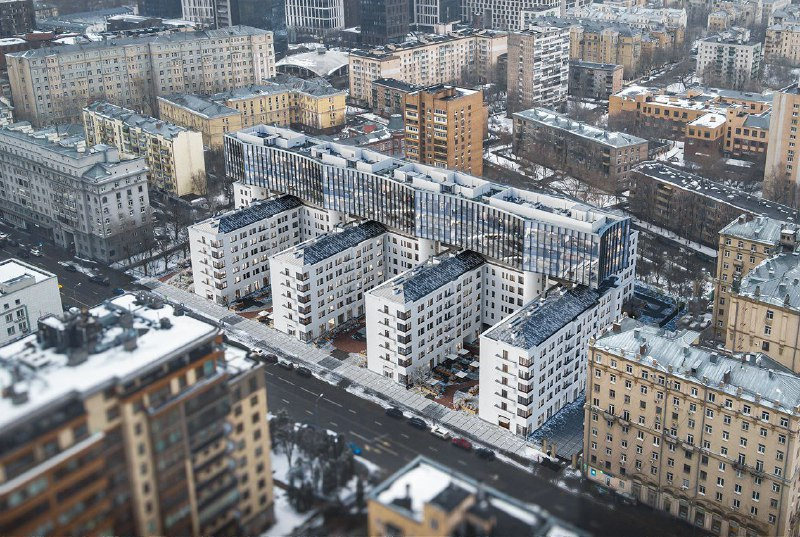
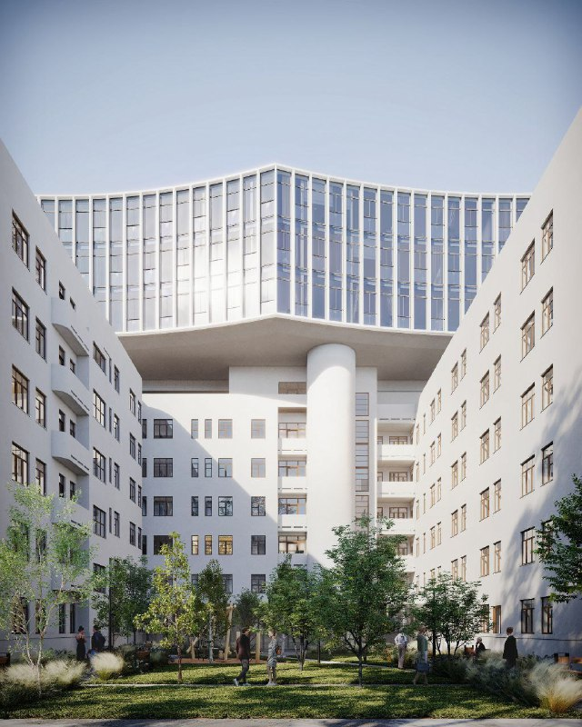

---
source:
  id: 29260
  date: '2025-05-07'
status: needs_review
skip_reason: null
type: object
region: moscow
title: 'Общежития красной профессуры на Большой Пироговской: вместо сноса — надстройка'
title_alts:
- 'Большая Пироговская, 51: общежития красной профессуры перерисовали в третий раз'
- 'Хамовники: конструктивистские общежития вместо сноса получат жилые «капсулы» на крышах'
slug: obshchezhitiya-krasnoy-professury-nadstroyka
lead: 'Общежития Института красной профессуры на Большой Пироговской, 51 за полтора года успели и «снести», и «спасти» — пока только на картинках. В 2025 году Ginzburg Architects предложило вместо сноса стеклянную балку над корпусами, к концу сентября 2026 года речь уже о реконструкции с жилыми надстройками. Утверждённого проекта нет.'
developers: []
objects:
- id: kompleks-obshchezhitiy-krasnoy-professury
  names:
  - Комплекс общежитий красной профессуры
  - общежития Института красной профессуры
  - Большая Пироговская
  zu: Большая Пироговская, 51
  main: true
  new: false
districts:
- khamovniki
topics:
- rynok
- regulirovanie
images:
- file: media/29260_1.jpg
  alt: Комплекс общежитий на Большой Пироговской с трёхэтажной стеклянной балкой над шестиэтажными корпусами, Хамовники
  caption: Общий вид концепции надстройки с трёхэтажной стеклянной балкой над шестиэтажными корпусами
  credit: 'Визуализация: Ginzburg Architects (концепция надстройки, 2025; проект не утверждён)'
- file: media/29260_2.jpg
  alt: Двор общежитий красной профессуры на Большой Пироговской с надстройкой-балкой на круглой опоре, визуализация, Хамовники
  caption: 'Двор комплекса: надстройка опирается на круглую колонну между корпусами'
  credit: 'Визуализация: Ginzburg Architects (концепция надстройки, 2025; проект не утверждён)'
factcheck:
- claim: Бюро Ginzburg Architects (GA) предложило сохранить и отреставрировать комплекс, добавив трёхэтажную стеклянную балку над шестиэтажными корпусами; материал от 05.05.2025; концепция, не утверждена
  status: confirmed
  source: https://moskvichmag.ru/?p=426106
  checked: '2026-10-13'
- claim: По градостроительному плану участка допускается около 30 тыс. м² жилья (СМИ, 05.05.2025)
  status: confirmed
  source: https://moskvichmag.ru/?p=426106
  checked: '2026-10-13'
- claim: 'Мартовский вариант 2025 года (бюро Buro 2+2): восемь корпусов по 12–13 этажей, снос исторических зданий; публикация 18.03.2025'
  status: confirmed
  source: https://moskvichmag.ru/?p=417140
  checked: '2026-10-13'
- claim: Комплекс построен в 1929–1932 годах, авторы — Дмитрий Осипов и Алексей Рухлядев
  status: confirmed
  source: https://moskvichmag.ru/?p=401538
  checked: '2026-10-13'
- claim: Статус объекта культурного наследия комплекс получил после ремонта 1974 года и утратил в 2000-х; утверждение заметки «охранный статус есть» устарело/неверно
  status: changed
  source: https://moskvichmag.ru/?p=401538
  checked: '2026-10-13'
- claim: '30.09.2026: вместо сноса планируют реконструкцию и надстройку округлыми жилыми объёмами; автор нового проекта и застройщик не названы; 8 шестиэтажных зданий'
  status: changed
  source: https://moskvichmag.ru/?p=526557
  checked: '2026-10-13'
- claim: Участок в 2023 году выкупил московский девелопер (название в СМИ не приводится)
  status: confirmed
  source: https://moskvichmag.ru/?p=426106
  checked: '2026-10-13'
- claim: «Охранный статус есть сегодня» (заметка)
  status: refuted
  source: https://moskvichmag.ru/?p=401538
  checked: '2026-10-13'
- claim: Vesper входит в проект вместо Capital Group; «Эйва» объявила тендер на снос (июнь 2026); 348 квартир и 200 машино-мест
  status: unverified
  source: null
  checked: '2026-10-13'
- claim: ГПЗУ с ТЭП на 30 тыс. м² выпущен (март 2025)
  status: unverified
  source: null
  checked: '2026-10-13'
- claim: Площадь участка 1,5 га; Интеко в нулевые собиралась застроить участок
  status: unverified
  source: null
  checked: '2026-10-13'
- claim: Концепция NOWADAYS office (декабрь 2025) и её отклонение
  status: unverified
  source: null
  checked: '2026-10-13'
removed:
- Площадь участка 1,5 га и история с «Интеко» — не подтверждены
- Сравнения с надстройками над АТС на Бауманской, «Космосом», институтом Кржижановского, Бадаевским — не проверялись, удалены
- Названия застройщиков (Capital Group, Vesper, ПИК), тендер на снос, 348 квартир и 200 машино-мест — только слухи и сообщения Telegram-каналов, удалены
- Концепция NOWADAYS office (досье, декабрь 2025) — не подтверждена
- 'Тезис об охранном статусе — опровергнут: статус утрачен в 2000-х'
- Оценки заметки об «ушатанном» состоянии и «трущобах» — убраны как эмоциональные
data_points: []
seo:
  main_query: общежития красной профессуры большая пироговская 51 надстройка
  keywords:
  - общежития института красной профессуры
  - большая пироговская 51 хамовники
  - красная профессура снос или реконструкция
  - ginzburg architects надстройка
  - конструктивизм хамовники новостройка
  frequency_checked: false
  title: 'Общежития красной профессуры, Пироговская, 51: надстройка'
  description: 'Общежития красной профессуры в Хамовниках: снос, стеклянная балка, жилые «капсулы» — три варианта за полтора года. Что известно на октябрь 2026 года и риски.'
  canonical: https://шахматка.москва/novosti/obshchezhitiya-krasnoy-professury-nadstroyka/
internal_links:
- anchor: досье «Комплекс общежитий красной профессуры»
  url: /obekty/kompleks-obshchezhitiy-krasnoy-professury/
- anchor: новостройки Хамовников
  url: /novostroyki/khamovniki/
- anchor: ГПЗУ
  url: /slovar/gpzu/
- anchor: технико-экономические показатели (ТЭП)
  url: /slovar/tep/
- anchor: будущие проекты Москвы
  url: /novostroyki/budushchie-proekty/
faq:
- q: Что будет с общежитиями Института красной профессуры на Большой Пироговской?
  a: 'В 2025 году предлагали и снести их ради 12–13-этажных корпусов, и сохранить с надстройкой. По сообщению «Москвич Mag» от 30 сентября 2026 года, теперь речь о реконструкции и жилых надстройках, но утверждённого проекта нет.'
- q: Кто автор проекта надстройки над общежитиями красной профессуры?
  a: Вариант с трёхэтажной стеклянной балкой весной 2025 года показало бюро Ginzburg Architects. Кто автор нового, осеннего варианта, не сообщалось.
- q: Охраняются ли общежития красной профессуры как памятник?
  a: Нет. По данным «Москвич Mag», статус объекта культурного наследия комплекс получил после ремонта 1974 года, но потерял его в 2000-х годах.
- q: Когда построили общежития красной профессуры?
  a: Комплекс строили с 1929 года, заселили в 1932 году; архитекторы — Дмитрий Осипов и Алексей Рухлядев.
- q: Можно ли купить квартиру в проекте на Большой Пироговской, 51?
  a: 'Нет: продаж нет, проект пока на стадии архитектурных концепций, а застройщика официально не называли.'
date_published: '2025-05-07'
date_modified: '2026-10-13'
author: Редакция Шахматки
editor_notes: 'needs_review: основные сведения — из «Москвич Mag» и msk1.ru (СМИ), документов (ГПЗУ, решения Мосгорнаследия, ГЗК) в лимите проверки открыть не удалось. Проверить: кто сейчас владелец и застройщик (в архиве редакции — слухи про Capital Group, Vesper, тендер на снос «Эйвы», 348 квартир и 200 машино-мест), точную дату потери охранного статуса (СМИ: «в 2000-х»), статус «ценного градоформирующего объекта». В developers пусто намеренно. Фото 3 из заметки (ночной вид) не взято.'
schema: "[\n  {\n    \"@context\": \"https://schema.org\",\n    \"@type\": \"Article\",\n    \"headline\": \"Общежития красной профессуры на Большой Пироговской: надстройка вместо сноса\",\n    \"description\": \"Общежития Института красной профессуры в Хамовниках: надстройку предложили вместо сноса. Что известно к октябрю 2026 года, статус зданий и риски проекта.\",\n    \"datePublished\": \"2025-05-07\",\n    \"dateModified\": \"2026-10-13\",\n    \"inLanguage\": \"ru\",\n    \"author\": {\n      \"@type\": \"Organization\",\n      \"name\": \"Редакция Шахматки\"\n    },\n    \"publisher\": {\n      \"@type\": \"Organization\",\n      \"name\": \"Шахматка\",\n      \"url\": \"https://шахматка.москва/\"\n    },\n    \"about\": {\n      \"@type\": \"Place\",\n      \"name\": \"Комплекс общежитий Института красной профессуры\",\n      \"address\": \"Москва, Большая Пироговская, 51\"\n    },\n    \"mainEntityOfPage\": {\n      \"@type\": \"WebPage\",\n      \"@id\": \"https://шахматка.москва/novosti/obshchezhitiya-krasnoy-professury-nadstroyka/\"\n    },\n    \"image\": [\n      \"https://шахматка.москва/media/29260_1.jpg\",\n      \"https://шахматка.москва/media/29260_2.jpg\"\n    ]\n  },\n  {\n    \"@context\": \"https://schema.org\",\n    \"@type\": \"FAQPage\",\n    \"mainEntity\": [\n      {\n        \"@type\": \"Question\",\n        \"name\": \"Что будет с общежитиями Института красной профессуры на Большой Пироговской?\",\n        \"acceptedAnswer\": {\n          \"@type\": \"Answer\",\n          \"text\": \"В 2025 году предлагали и снос с застройкой 12–13-этажными корпусами, и сохранение с надстройкой. По сообщению «Москвич Mag» от 30 сентября 2026 года, сейчас говорят о реконструкции и жилых надстройках, но утверждённого проекта нет.\"\n        }\n      },\n      {\n        \"@type\": \"Question\",\n        \"name\": \"Кто автор проекта надстройки над общежитиями красной профессуры?\",\n        \"acceptedAnswer\": {\n          \"@type\": \"Answer\",\n          \"text\": \"Весной 2025 года вариант с трёхэтажной стеклянной балкой представило бюро Ginzburg Architects. Автор нового, осеннего варианта в СМИ не назван.\"\n        }\n      },\n      {\n        \"@type\": \"Question\",\n        \"name\": \"Охраняются ли общежития красной профессуры как памятник?\",\n        \"acceptedAnswer\": {\n          \"@type\": \"Answer\",\n          \"text\": \"Нет. По данным «Москвич Mag», комплекс получил статус объекта культурного наследия после ремонта 1974 года, но утратил его в 2000-х годах.\"\n        }\n      },\n      {\n        \"@type\": \"Question\",\n        \"name\": \"Когда построили общежития красной профессуры?\",\n        \"acceptedAnswer\": {\n          \"@type\": \"Answer\",\n          \"text\": \"Комплекс строили с 1929 года, заселили в 1932 году; архитекторы — Дмитрий Осипов и Алексей Рухлядев.\"\n        }\n      },\n      {\n        \"@type\": \"Question\",\n        \"name\": \"Можно ли купить квартиру в проекте на Большой Пироговской, 51?\",\n        \"acceptedAnswer\": {\n          \"@type\": \"Answer\",\n          \"text\": \"Нет: продаж нет, проект находится на стадии архитектурных концепций, застройщик в открытых источниках официально не назван.\"\n        }\n      }\n    ]\n  }\n]"
---

# Общежития красной профессуры на Большой Пироговской: вместо сноса — надстройка

Конструктивистские общежития Института красной профессуры на Большой Пироговской, 51 за полтора года успели и «снести», и «спасти» — пока только на картинках. В 2025 году бюро Ginzburg Architects предложило не трогать корпуса, а положить над ними стеклянную балку. К концу сентября 2026 года речь уже о другом: реконструкция и жилые надстройки. Утверждённого проекта по-прежнему нет.

**Коротко**

- **Март 2025-го:** снос и восемь корпусов по 12–13 этажей.
- **5 мая 2025-го:** концепция Ginzburg Architects — трёхэтажная стеклянная балка над шестиэтажными корпусами.
- **30 сентября 2026-го:** реконструкция и округлые жилые объёмы на крышах.
- **Охранного статуса нет:** его сняли в 2000-х годах.

## От сноса к стеклянной балке

Комплекс в Хамовниках давно манил девелоперов: исторические здания в плохом состоянии, участок в центре. Весной 2025 года всерьёз говорили о сносе. 18 марта 2025 года «Москвич Mag» показал проект бюро Buro 2+2: восемь корпусов по 12–13 этажей на общем подиуме, фасады из светлого натурального камня — и никаких исторических зданий. Сами журналисты тогда оговаривались, что построят ли именно это, «ещё большой вопрос».

В мае маятник качнулся обратно. 5 мая 2025 года издание рассказало о концепции Ginzburg Architects (GA): комплекс сохранить и отреставрировать, а над шестиэтажными корпусами повесить трёхэтажную стеклянную балку. Это была концепция, а не согласованный проект, — какой вариант победит, никто не говорил.

*Общий вид концепции надстройки с трёхэтажной стеклянной балкой над шестиэтажными корпусами. Визуализация: Ginzburg Architects (концепция 2025 года; проект не утверждён)*

## Теперь — «капсулы» на крышах

На 13 октября 2026 года официального решения по участку нет. 30 сентября 2026 года «Москвич Mag» сообщил: вместо сноса восемь шестиэтажных зданий хотят реконструировать и надстроить округлыми жилыми объёмами на крышах — и превратить комплекс в дорогой жилой проект. Кто автор нового варианта и кто застройщик, в публикации не сказано, документов издание не приводит.

Имя застройщика, число квартир и машино-мест, сроки — всё это официально пока не раскрывали. Известно только, что в 2023 году участок выкупил московский девелопер, а позже, по данным издания, площадка перешла к другому.

Полная история проекта и участка — в [досье «Комплекс общежитий красной профессуры»](/obekty/kompleks-obshchezhitiy-krasnoy-professury/).

## Конструктивизм без охранной грамоты

Общежития строили с 1929 года, заселили в 1932 году. Авторы — архитекторы Дмитрий Осипов и Алексей Рухлядев. Институт расформировали в 1930-х годах, и здания перешли Министерству обороны и Военно-политической академии. В августе 2008 года в шестом корпусе был пожар.

Памятником комплекс сегодня не считается. По данным «Москвич Mag», статус объекта культурного наследия он получил после ремонта 1974 года и потерял в середине 2000-х. Формально это снимает большую часть ограничений — но не общественный интерес: вокруг конструктивистских общежитий Москвы споры о наследии не утихают.

*Двор комплекса: надстройка опирается на круглую колонну между корпусами. Визуализация: Ginzburg Architects (концепция 2025 года; проект не утверждён)*

## Сколько можно построить

По данным «Москвич Mag» от 5 мая 2025 года, градостроительный план участка ([ГПЗУ](/slovar/gpzu/)) разрешает около 30 тыс. м² жилья. Точных [технико-экономических показателей (ТЭП)](/slovar/tep/) ни по одному из вариантов официально не публиковали.

## Что это значит для покупателя и инвестора

Купить здесь квартиру сейчас нельзя: продаж нет, на руках только концепции, застройщик официально не назван. Без цен и сроков считать доходность — гадание.

На наш взгляд, надстройка вместо сноса — разумный компромисс для площадки с историей: узнаваемый силуэт остаётся, девелопер получает свои метры. Но три подхода за полтора года — снос, стеклянная балка и круглые жилые «капсулы» — лучше любых слов говорят, что решения нет.

Что отслеживать: утверждение проекта и градостроительные решения по участку, имя застройщика, проектную декларацию и разрешение на строительство. Такие проекты мы собираем в подборке [будущих проектов Москвы](/novostroyki/budushchie-proekty/).

## Карточка объекта

- **Название:** комплекс общежитий Института красной профессуры
- **Участок (ЗУ):** Большая Пироговская, 51
- **Район:** [Хамовники](/novostroyki/khamovniki/), Москва
- **Застройщик:** официально не назван
- **Стадия:** архитектурные концепции
- **Исторические здания:** восемь шестиэтажных корпусов, 1929–1932 годы
- **Охранный статус:** утрачен в 2000-х годах
- **Цена и сроки:** не объявлены

## Вопросы и ответы

**Что будет с общежитиями Института красной профессуры на Большой Пироговской?**

В 2025 году предлагали и снести их ради 12–13-этажных корпусов, и сохранить с надстройкой. По сообщению «Москвич Mag» от 30 сентября 2026 года, теперь речь о реконструкции и жилых надстройках, но утверждённого проекта нет.

**Кто автор проекта надстройки над общежитиями красной профессуры?**

Вариант с трёхэтажной стеклянной балкой весной 2025 года показало бюро Ginzburg Architects. Кто автор нового, осеннего варианта, не сообщалось.

**Охраняются ли общежития красной профессуры как памятник?**

Нет. По данным «Москвич Mag», статус объекта культурного наследия комплекс получил после ремонта 1974 года, но потерял его в 2000-х годах.

**Когда построили общежития красной профессуры?**

Комплекс строили с 1929 года, заселили в 1932 году; архитекторы — Дмитрий Осипов и Алексей Рухлядев.

**Можно ли купить квартиру в проекте на Большой Пироговской, 51?**

Нет: продаж нет, проект пока на стадии архитектурных концепций, а застройщика официально не называли.

## Источники

1. «Москвич Mag», «Над зданиями Института красной профессуры в Хамовниках надстроят трёхэтажную стеклянную балку» (05.05.2025): https://moskvichmag.ru/?p=426106
2. «Москвич Mag», «Появился проект застройки общежитий Института красной профессуры в Хамовниках» (18.03.2025): https://moskvichmag.ru/?p=417140
3. «Москвич Mag», «Конструктивистские общежития у Новодевичьих надстроят округлыми жилыми «капсулами» на крышах» (30.09.2026): https://moskvichmag.ru/?p=526557
4. «Москвич Mag», «Дом недели: общежитие Института красной профессуры на Большой Пироговской» (13.12.2024): https://moskvichmag.ru/?p=401538
5. МСК1, «Здесь жил Юрий Гагарин. Появились фото, как будет выглядеть ЖК на месте бывших общежитий в Хамовниках» (01.10.2026): https://msk1.ru/text/gorod/2026/10/01/76671632/

Дата публикации исходной заметки: 7 мая 2025 года. Дата проверки фактов: 13 октября 2026 года. Автор: Редакция Шахматки.

Материал не является инвестиционной рекомендацией.
