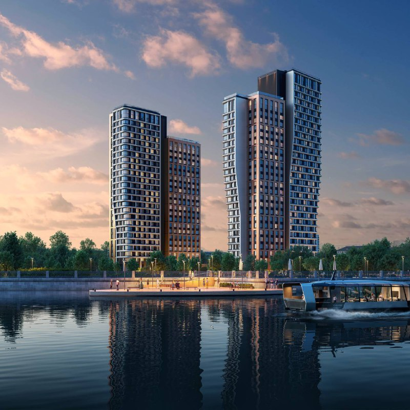
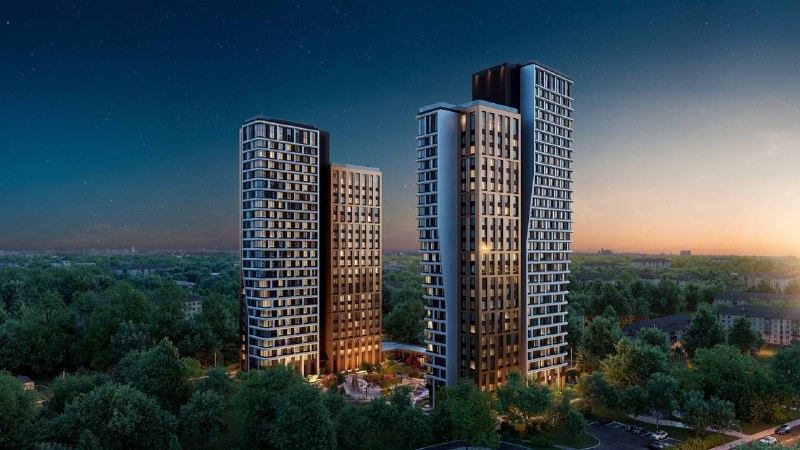

# U2 на Лодочной, 27/2: студии от 16,9 млн ₽, сдача в I квартале 2028 года

Продажи ЖК U2 на Лодочной, 27/2 в Южном Тушине открылись в мае 2025 года. К октябрю 2026-го две башни дорастают до средних этажей, а проект в каталогах всё чаще значится как «ЮТУ». Дешёвой студию уже не назвать: от 16,9 млн ₽ за 28 м².

## Коротко

- **Что:** две башни до 29 этажей, 498 квартир, архитектор — бюро ATRIUM.
- **Кто:** застройщик по каталогам — краснодарская ГК «Точно».
- **Цена на 15 октября 2026 года:** от 16,9 млн ₽ до 107 млн ₽; студия 28,1 м² — около 602 тыс. ₽/м².
- **Срок:** сдача в I квартале 2028 года, сейчас монтируют средние этажи.

*Визуализация: ТОЧНО. Две башни U2 со стороны воды.*

## Что такое U2 на Лодочной

Участок на Лодочной, 27/2 — Южное Тушино, СЗАО. В каталогах проект идёт и как U2, и как «ЮТУ». Если ищете его по прежнему названию «Атлас Флоу», адрес тот же.

Проект застраивают две башни переменной высоты до 29 этажей, их соединяет стилобат с торговой галереей. Квартиры — от студий в 28 м² до четырёхкомнатных больше 100 м². Продажи начались в мае 2025 года: первая [проектная декларация](/slovar/proektnaya-deklaratsiya/) датирована 22 мая 2025 года, вторая — 10 сентября 2025-го.

Полная история участка и смены партнёров — в [досье «Лодочная, 27, к. 2»](/obekty/lodochnaya-27-k-2/).

*Визуализация: ТОЧНО. Вид на комплекс сверху.*

## Сколько стоят квартиры в U2

По каталогу Novostroy-M, на 15 октября 2026 года цены начинаются с 16,9 млн ₽ и доходят до 107 млн ₽. Для примера, одна из студий на втором этаже — 28,1 м² за 16 926 000 ₽, то есть около 602 тыс. ₽/м². С 1 августа по 7 сентября 2026 года эта студия подешевела на 806 тыс. ₽ — цены в проекте не стоят на месте.

В объявлениях встречаются и другие ориентиры: двухкомнатные от 28 до 34 млн ₽, трёхкомнатные примерно от 34,5 до 39,4 млн ₽. До 31 октября в каталоге висят акции: кладовая в подарок, трейд-ин, рассрочка.

Читайте цену как «около 600 тыс. ₽/м² в небольших форматах». На наш взгляд, платить такое за студию стоит, только сверив её с соседними стройками: общий фон — в разделе про [цены на новостройки](/temy/ceny/).

## Когда сдадут U2

Срок сдачи обеих башен — I квартал 2028 года. По данным каталога, на 26 сентября 2026 года на стройке монтировали средние этажи. Запас по времени ещё есть, но обещание «в срок» проверяйте по стройке и по свежим данным в проектной декларации, а не по рендерам.

## Что с проектом сейчас

На октябрь 2026 года проект в продаже и в стройке. За полтора года комплекс получил в каталогах второе имя, а стройка дошла до средних этажей. В каталоге значатся две проектные декларации и разрешение на строительство.

Опыт застройщика важен: в каталоге у ГК «Точно» значится один строящийся проект и ни одного сданного, и это то самое место, где стоит слушать не рекламу, а ход работ.

## Что это значит для покупателя

Стройка идёт, цена не дешёвая. Если присматриваетесь к студии, считайте не только квадратные метры, но и скидочный график: в 2026 году цена на лот уже опускалась.

Следите за тремя вещами: темпами монтажа к весне 2027 года, новой редакцией декларации и ценой на сопоставимые лоты у соседей — например, [проектами Level в Южном Тушине](/novosti/level-svobody-tushino-list-ozhidaniya/). Другие варианты — в подборке [новостроек Москвы](/novostroyki/moskva/).

## Карточка объекта

- Названия: U2, ЮТУ, «Атлас Флоу».
- Адрес: Лодочная, 27/2, Южное Тушино, СЗАО, Москва.
- Застройщик: ГК «Точно» (по каталогам).
- Архитектор: бюро ATRIUM.
- Башни: 2, до 29 этажей, 498 квартир.
- Стадия: монтаж средних этажей (по данным на 26 сентября 2026 года).
- Сдача: I квартал 2028 года.
- Цены: от 16,9 млн ₽ (на 15 октября 2026 года).

## Вопросы и ответы

**Кто застройщик ЖК U2 на Лодочной, 27/2?**
В каталоге Novostroy-M и Яндекс Недвижимости указана краснодарская ГК «Точно»; архитектор — бюро ATRIUM.

**Сколько стоят квартиры в U2 (ЮТУ)?**
На 15 октября 2026 года каталог показывает цены от 16,9 млн ₽ до 107 млн ₽. Студия 28,1 м² в одном из объявлений — около 602 тыс. ₽/м².

**Когда сдадут U2 на Лодочной?**
Срок сдачи обеих башен — I квартал 2028 года; в сентябре 2026 года монтировали средние этажи.

**Сколько квартир в проекте?**
По данным каталога Novostroy-M, 498 квартир в двух башнях до 29 этажей.

## Источники

1. Novostroy-M, карточка ЖК «ЮТУ» (U2), данные на 15 октября 2026 года: https://novostroy-m.ru/baza/jk_u2_yutu
2. Novostroy-M, объявление о студии в ЖК «ЮТУ», история цены: https://www.novostroy-m.ru/kvartiry/studiya-v-zhk-yutu-832b43d25b7b253ad55f294e0ead3e
3. Яндекс Недвижимость, ЖК «ЮТУ»: https://realty.yandex.ru/moskva_i_moskovskaya_oblast/kupit/kvartira/dvuhkomnatnaya/zhk-yutu-4098306/

Материал не является инвестиционной рекомендацией.
