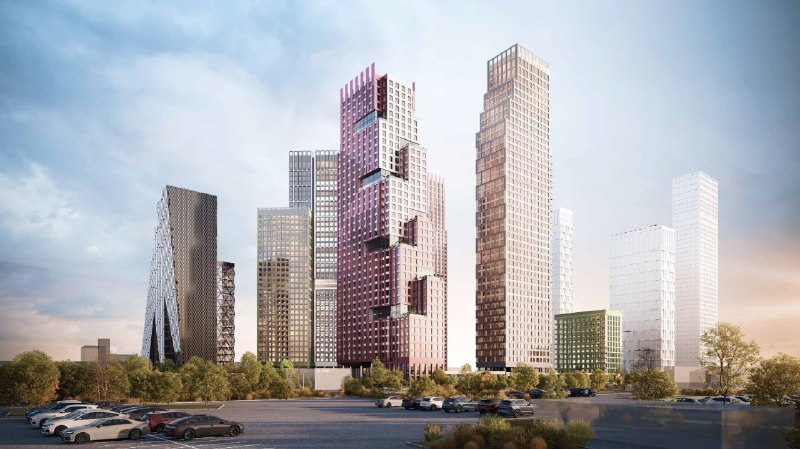
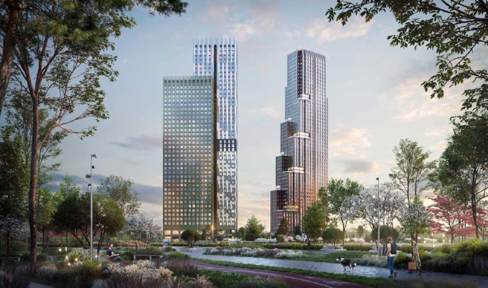
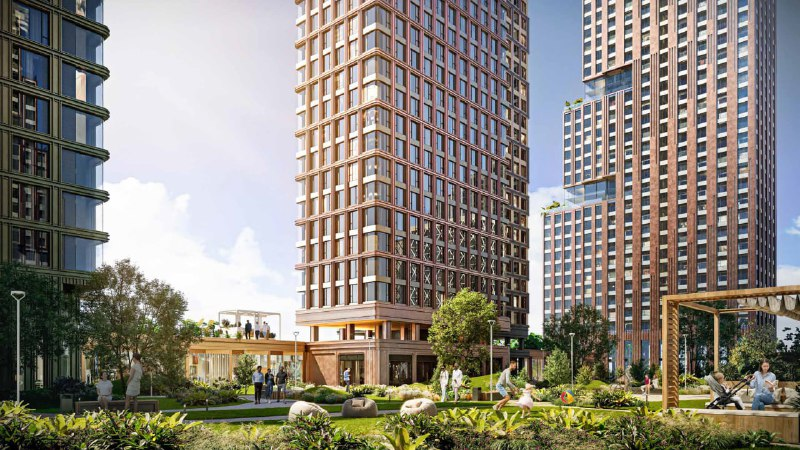

# Ultima City от Кортроса в Печатниках: цены от 19,1 млн ₽, сдача 2029

Кортрос в мае 2025 года начал продажи первой очереди Ultima City на Южнопортовой, 21 в Печатниках: две башни на 1 079 квартир без отделки. За полтора года минимальная цена выросла с 11,3 до 19,1 млн ₽, а срок сдачи в открытых источниках назван по-разному.

**Коротко**

- Продажи первой очереди начались в мае 2025 года; всего в проекте девять корпусов, в продаже — два, на 52 и 45 этажей.
- В двух башнях 1 079 квартир — от студий около 28 м² до четырёхкомнатных около 115 м². Отделки нет.
- Минимальная цена: 11,3 млн ₽ при старте → 19,1 млн ₽ по состоянию на 13 октября 2026 года.
- Ключи — 2029 год по сайту застройщика; в карточках корпусов на агрегаторе указан III квартал 2028 года.

## Что такое Ultima City на Южнопортовой, 21

Ultima City — квартал [бизнес-класса](/novostroyki/biznes-klass/) на территории бывшей промзоны «Южный порт» в районе [Печатники](/novostroyki/pechatniki/) на юго-востоке Москвы. Проект ведёт [ГК «Кортрос»](/zastroyshchiki/kortros/); по данным агрегатора «Новострой-М», юридический застройщик — специализированный застройщик «ЛИДЕР», брендом указан «Кортрос». Разрешение на строительство корпусов 1 и 2 датировано 18 апреля 2025 года.

Рядом, по данным того же источника, планируется станция метро «Южный порт» со сроком 2028 год.

*Визуализация: Кортрос*

## Что строят в первой очереди

В первую очередь входят два корпуса — на 52 и 45 этажей. Всего в них 1 079 квартир: студии от 28,2 м², четырёхкомнатные до 115 м², отдельно — двухуровневые квартиры площадью 77,7–141,9 м². Квартиры продаются без отделки. В проекте заявлены двухуровневый подземный паркинг на 473 машино-места, кладовые, автомойка, детские и спортивные площадки, амфитеатр и теплицы; запланированы школа и детский сад.

Если соотнести 473 места с 1 079 квартирами первой очереди, получится около 0,44 места на квартиру — это расчёт редакции, а не заявленный застройщиком норматив.

*Визуализация: Кортрос*

## Сколько стоят квартиры в Ultima City

При старте продаж в мае 2025 года цены начинались от 11,3 млн ₽. Сейчас на сайте застройщика указана цена от 19,1 млн ₽: по данным «Новострой-М», это однокомнатная квартира 28,34 м² за 19 084 156 ₽ (около 673 тыс. ₽/м², расчёт редакции). Для сравнения: студия 28,28 м² за 11,3 млн ₽ в мае 2025 года — около 400 тыс. ₽/м².

Лоты не идентичны, поэтому точный рост цены метра по ним не посчитать. Но разница в минимальном чеке — в 1,7 раза за полтора года — говорит, на наш взгляд, о том, что дешёвый этап старта продаж закрыт.

## Когда сдадут Ultima City

Срок — самое неоднозначное место. При старте продаж в мае 2025 года называли II квартал 2029 года. Сайт Кортроса сейчас указывает 2029 год. В карточках корпусов на «Новострой-М» стоит III квартал 2028 года, и тот же источник приводит расходящиеся данные по этажности и числу квартир.

Мы не смогли открыть ЕИСЖС (наш.дом.рф), поэтому перед сделкой срок нужно сверить по [проектной декларации](/slovar/proektnaya-deklaratsiya/) и условиям договора долевого участия.

*Визуализация: Кортрос*

## Контекст: проект и участок

Участок «Южнопортовая, 21» — часть территории «Южного порта», где идёт редевелопмент промзоны. Разрешение на строительство первых корпусов получено в апреле 2025 года, продажи стартовали в мае 2025-го. Полная история проекта — в [досье «Южный порт»](/obekty/yuzhnyy-port/).

## Что это значит для покупателя и инвестора

**Цена.** Вход подорожал в 1,7 раза, а квартиры продаются без отделки: к цене метра нужно добавить ремонт. Сравнивать стоит чек с учётом отделки, а не только цену из рекламы. Больше о динамике — в теме [цены на новостройки](/temy/ceny/).

**Сроки.** Расхождение в источниках — повод читать декларацию, а не рекламный буклет. Метро «Южный порт» заявлено на 2028 год; без него транспортная доступность проекта ограничена.

**Среда.** Ключи ожидаются в 2029 году, окружение вокруг — стройплощадка. На наш взгляд, это сделка на длинный горизонт.

**Что отслеживать:** изменения срока в декларации, динамику цен у застройщика, ввод метро.

## Карточка объекта

- **Адрес участка:** Южнопортовая, 21, Москва
- **Названия:** Ultima City, UltimaCity, «УЛЬТИМА Сити», проект «Южный порт»
- **Застройщик:** ГК «Кортрос» (юрлицо по данным агрегатора — СЗ «ЛИДЕР»)
- **Район:** Печатники, ЮВАО
- **Класс:** бизнес (по данным агрегатора)
- **Первая очередь:** 2 корпуса, 52 и 45 этажей, 1 079 квартир
- **Отделка:** без отделки
- **Паркинг:** 473 машино-места
- **Стадия:** строительство, продажи
- **Ввод:** 2029 год (сайт застройщика); данные источников расходятся
- **Цена:** от 19,1 млн ₽ (13 октября 2026 года)

## Вопросы и ответы

**Кто застройщик Ultima City на Южнопортовой, 21?**
Проект выводит на рынок ГК «Кортрос»; по данным агрегатора, юридический застройщик — СЗ «ЛИДЕР».

**Сколько стоят квартиры в Ultima City?**
По состоянию на 13 октября 2026 года минимальная цена — от 19,1 млн ₽ (однокомнатная 28,34 м²). При старте продаж в мае 2025 года цены начинались от 11,3 млн ₽.

**Когда сдадут Ultima City?**
Сайт застройщика называет 2029 год. В карточках корпусов на агрегаторе указан III квартал 2028 года, при старте продаж говорили о II квартале 2029 года; точный срок — в проектной декларации.

**Квартиры в Ultima City продаются с отделкой?**
Нет, квартиры продаются без отделки.

## Источники

1. [ЖК «УЛЬТИМА Сити» — карточка проекта, Новострой-М](https://www.novostroy-m.ru/baza/jk_yujnoportovaya_21)
2. [Квартал Ultima City: старт продаж, Новострой-М, 22 мая 2025 года](https://www.novostroy-m.ru/novosti/kvartal_ultima_city_i)
3. [Старты продаж, май 2025 года, Новострой-М](https://www.novostroy-m.ru/analitika/starty_prodaj_may_2025)
4. [Сайт ГК «Кортрос»](https://kortros.ru/)

Материал не является инвестиционной рекомендацией.
