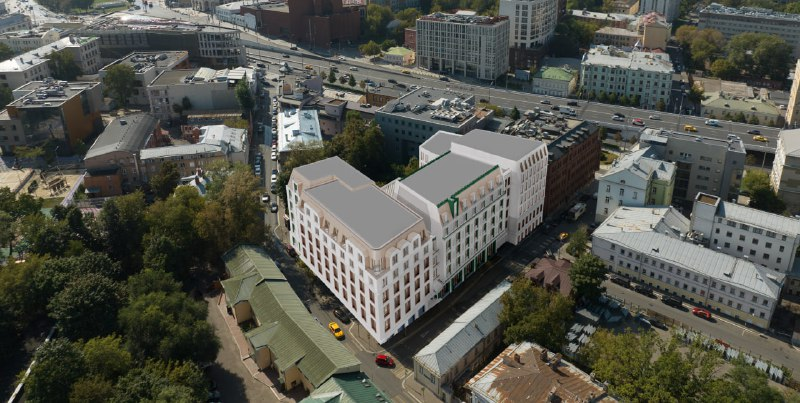
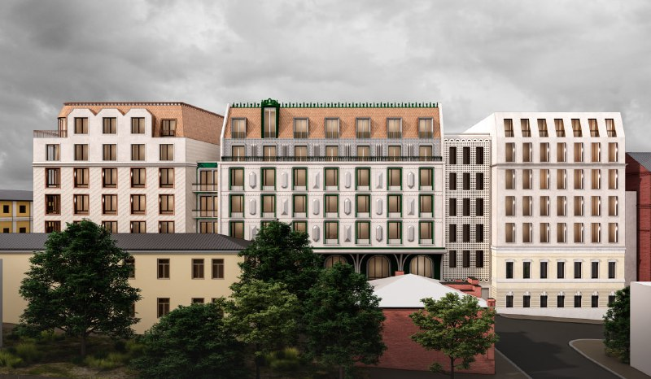
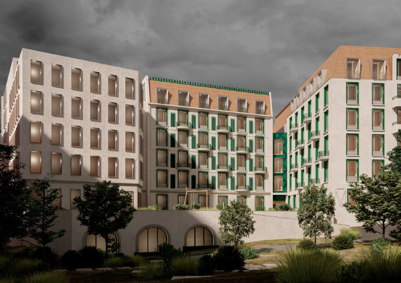

# Аристарховский переулок, 6: Megabudka перерисовала клубный дом на Таганке

В начале июня 2025 года для участка на Аристарховском, 6 в [Таганском районе](/novostroyki/taganskiy/) показали вторую концепцию клубного дома с досуговым центром. Автор — бюро Megabudka; до него переулок рисовало бюро White Stones. Две концепции за два года и ни одного объявленного застройщика — хороший повод присмотреться.

## Коротко

- **Кто рисует:** бюро Megabudka, публикация Moskvich Mag — 3 июня 2025 года.
- **Сколько:** около 12 тыс. м², треть — досуговый центр, остальное — клубный дом.
- **Что было до:** версия White Stones 2023 года с жилым корпусом не выше пяти этажей.
- **Чего нет:** официально названного застройщика и понятной стадии проекта.

*Концепция Megabudka: вид сверху на корпуса клубного дома в Аристарховском переулке в Таганском районе Москвы. Визуализация: Megabudka.*

## Купеческий дом, версия вторая

По публикации Moskvich Mag от 3 июня 2025 года, Megabudka подготовило концепцию клубного дома с досуговым центром. Из примерно 12 тыс. м² треть отдана досуговому центру, остальное — клубному дому. То есть главный здесь всё-таки жилой продукт, а досуг — приятное дополнение.

На участке сохранился фасад дореволюционного особняка. Издание отмечает его плохое состояние и считает, что фасад можно было сохранить, пристроив к нему новый объём. Этажность и число квартир в публикации не назвали.

*Концепция Megabudka: фасад со стороны переулка — светлая штукатурка, зелёные рамы, медные мансарды. Визуализация: Megabudka.*

На рендерах — мансардные крыши, зелёные оконные рамы и арки внизу. Всё очень мило и очень по-московски. Выносить приговор архитектуре пока рано: это концепция, а не согласованный проект. На наш взгляд, говорить всерьёз можно будет, когда появятся градостроительные решения.

## От досугового центра к клубному дому

Вариант Megabudka — не первый. В апреле 2023 года Moskvich Mag писал о визуализациях бюро White Stones: жилой корпус не выше пяти этажей. По данным издания, участок площадью 0,20 га тогда предоставили ООО «Ракета Лимитед» на пять лет, а саму компанию издание связывало с рэпером Тимати. Речь тогда шла об объекте культуры и образования, а согласованного проекта не было.

Вся хронология — в [досье «Дом на Аристарховском»](/obekty/dom-na-aristarkhovskom/).

*Концепция Megabudka: двор клубного дома с озеленением и аркадами нижнего уровня. Визуализация: Megabudka.*

## Картинки есть, документов нет

По состоянию на 14 октября 2026 года у проекта нет ни проектной декларации, ни разрешения на строительство, ни собственного сайта. Застройщика новой версии официально не называли. Цен и сроков тоже нет — проект живёт пока только в визуализациях.

## Что это значит для покупателя и инвестора

Купить здесь пока нечего: это концепция участка на Таганке, а не проект с продажами. Если вы присматриваетесь к клубным домам в районе, держите в уме три вопроса — кто застройщик, согласован ли проект и сколько из примерно 12 тыс. м² достанется квартирам, а сколько досуговому центру. Цен, с которыми можно сравнить проект с соседями, пока нет.

Следить стоит за проектной декларацией и градостроительными решениями — именно они покажут, станет ли вторая концепция последней. Общий фон — в разделе [премиум-сегмент](/temy/premium/).

## Карточка объекта

- **Адрес ЗУ:** Аристарховский, 6, Москва.
- **Название:** Дом на Аристарховском.
- **Район:** Таганский, ЦАО.
- **Архитектор концепции 2025 года:** Megabudka; ранее — White Stones.
- **Площадь по концепции:** около 12 тыс. м², треть — досуговый центр.
- **Стадия:** концепция.

## Вопросы и ответы

**Кто автор концепции дома на Аристарховском, 6?**
Вторую концепцию, показанную в июне 2025 года, нарисовало бюро Megabudka. До этого для переулка показывали визуализации бюро White Stones.

**Какая площадь у проекта на Аристарховском?**
По публикации Moskvich Mag, около 12 тыс. м²: треть — досуговый центр, остальное — клубный дом.

**Кто застройщик дома на Аристарховском?**
Официально застройщика новой концепции не называли: ни проектной декларации, ни сайта проекта пока нет.

**Что было на участке раньше?**
На участке сохранился фасад дореволюционного особняка; в 2023 году участок площадью 0,20 га значился выделенным ООО «Ракета Лимитед» на 5 лет.

## Источники

1. Moskvich Mag, «Появился проект «купеческого» клубного дома в Аристарховском переулке», 3 июня 2025 года: https://moskvichmag.ru/?p=432170
2. Moskvich Mag, «Появился проект нового досугового центра, который построят на Таганке рядом с Садовым кольцом», 4 апреля 2023 года: https://moskvichmag.ru/gorod/poyavilsya-proekt-novogo-dosugovogo-tsentra-kotoryj-postroyat-na-taganke-ryadom-s-sadovym-koltsom/

Материал не является инвестиционной рекомендацией.
