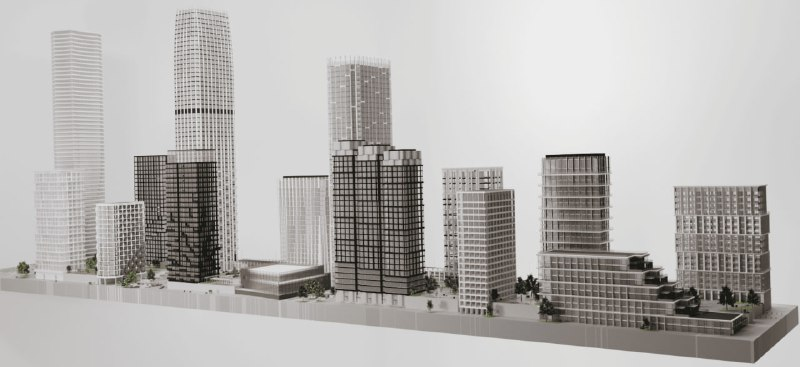
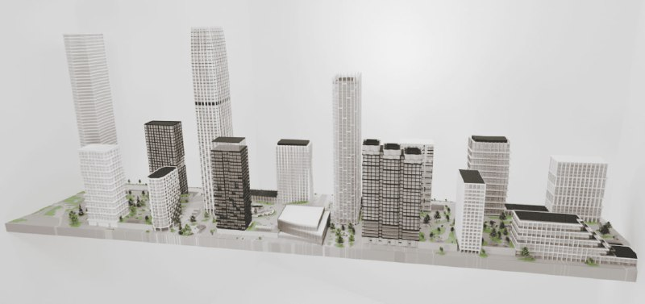

# «Мангазея на Речном» в Северном порту: цена с 364 до 584 тыс. ₽/м²

«Мангазея на Речном» — часть застройки Северного порта у Северного речного вокзала, проект бюро APEX. С начала продаж в мае 2024 года средневзвешенная цена выросла с 364,2 до 584,3 тыс. ₽/м², а срок сдачи на сайтах продаж сегодня указан как 2027 год.

## Коротко

- Застройщик — [«Мангазея»](/zastroyshchiki/mangazeya/); проект — часть территории Северного речного порта на Ленинградском шоссе, которую в 2023 году проектировало бюро APEX.
- Средневзвешенная цена: 364,2 тыс. ₽/м² на старте в мае 2024 года и 584,3 тыс. ₽/м² в декабре 2025 года (РБК). Рост — 61%, а в бизнес-классе Москвы за тот же период — 19%.
- На 14 октября 2026 года на Яндекс Недвижимости цена от 19,3 млн ₽, за м² — от 541,6 до 854,2 тыс. ₽, срок сдачи — III квартал 2027 года.
- Цифры «около 800 м² продаж в месяц» и «500 тыс. ₽/м² в июне 2025 года» мы подтвердить не смогли и не приводим.

## Что такое «Мангазея на Речном» и кто застройщик

«Мангазея на Речном» — проект у Северного речного вокзала на Ленинградском шоссе. Застройщик — компания «Мангазея»: она вошла в развитие территории Северного речного порта в августе 2023 года вместе с Legenda, «Кортросом» и Capital Group. Архитектором от бюро APEX называли Антона Бондаренко.

Территория Северного порта — это бывший проект с исходной концепцией Сергея Скуратова. По данным Moskvich Mag от 22 августа 2023 года, он отказался от дальнейшей работы, а «Мангазея», купив землю, взялась упрощать и удешевлять проект. Часть Legenda переделывало бюро Kamen. Подробнее о соседнем проекте — в [досье «Северный порт»](/obekty/severnyy-port/).

*(1) Макет проекта застройки «Мангазеи» в Северном порту, показан в июне 2025 года. Правообладатель уточняется*

*(2) Тот же макет с другого ракурса. Правообладатель уточняется*

## Что показали в июне 2025 года

В июне 2025 года появились детальные визуализации и макет одного из прорабатываемых вариантов застройки. На макете видны корпуса разной высоты вдоль набережной, несколько башен и общественное здание в центре. Официальных параметров этого варианта — этажности, площадей, очерёдности — мы не нашли, поэтому не приводим их.

## Сколько стоят квартиры в «Мангазее на Речном»

Цена за полтора года заметно выросла. По данным РБК Недвижимости от 10 декабря 2025 года, на старте продаж в мае 2024 года средневзвешенная цена составляла 364,2 тыс. ₽/м², минимальный бюджет — 12,7 млн ₽. К декабрю 2025 года минимальный бюджет вырос до 17,5 млн ₽, а средневзвешенная цена со скидками — до 584,3 тыс. ₽/м². Это рост на 61% против 19% по бизнес-классу Москвы за тот же период.

В материале РБК есть рекламная плашка застройщика. Прогноз аналитиков RedCat о росте стоимости квартиры на 12–17% к вводу мы считаем оценкой, а не фактом.

## Что с проектом сейчас

Положение дел на 14 октября 2026 года:

- **Цена.** На Яндекс Недвижимости квартиры начинаются от 19 326 384 ₽, цена за м² в объявлениях — от 541 640 до 854 200 ₽. Разброс отражает разные корпуса и этажи; это не средняя цена проекта.
- **Срок.** РБК в декабре 2025 года называл начало выдачи ключей в бизнес-классе с IV квартала 2027 года и писал, что монолитные работы почти завершены. Яндекс Недвижимость в октябре 2026 года указывает III квартал 2027 года. Расхождение стоит проверить в [проектной декларации](/slovar/proektnaya-deklaratsiya/).
- **Состав проекта.** По РБК, в проекте более 25 тыс. м² коммерческих площадей (около двух третей — гастрономия, спорт и развлечения), школа на 1000 мест и детский сад. Следующую очередь обещали вывести осенью 2026 года в премиум-классе; подтверждения выхода на дату проверки мы не нашли.
- **Транспорт.** На Яндекс Недвижимости указано 17 минут до метро «Беломорская». РБК называет 11 минут пешком до «Речного вокзала».

Полная история проекта — в [досье «Мангазея на Речном»](/obekty/mangazeya-na-rechnom/).

## Что это значит для покупателя и инвестора

Цена выросла быстрее рынка, и это главный факт: вход в проект подорожал примерно с 12,7 до 17,5 млн ₽ за полтора года. На наш взгляд, рост показывает спрос на набережную локацию, но не гарантирует дальнейшего удорожания: в декабре 2025 года цена уже была со скидками, а в октябре 2026 года в объявлениях встречаются лоты от 541,6 тыс. ₽/м², то есть ниже декабрьской средневзвешенной.

Риски, которые стоит учесть: сроки у источников расходятся, а следующие очереди и офисные проекты рядом пока не подтверждены документами. Что отслеживать: проектную декларацию, разрешения на строительство, выход премиальной очереди. Общий фон — в разделе про [цены на новостройки](/temy/ceny/) и в подборке [новостроек Москвы](/novostroyki/moskva/).

## Карточка объекта

- **Название:** «Мангазея на Речном» (часть территории «Северный порт»).
- **Адрес:** Москва, Ленинградское шоссе, у Северного речного вокзала.
- **Застройщик:** «Мангазея».
- **Архитектор:** бюро APEX (по сообщению 2023 года).
- **Стадия:** продажи, строительство.
- **Срок сдачи:** III квартал 2027 года (Яндекс Недвижимость); с IV квартала 2027 года (РБК, декабрь 2025).
- **Цена:** от 19,3 млн ₽; 541,6–854,2 тыс. ₽/м² (Яндекс Недвижимость, 14 октября 2026 года).

## Вопросы и ответы

**Кто застройщик ЖК «Мангазея на Речном»?**
Застройщик — компания «Мангазея». На площадках продаж проект указан за ней; архитектурным бюро проекта в 2023 году называлось APEX.

**Сколько стоят квартиры в «Мангазее на Речном»?**
По данным РБК Недвижимости на декабрь 2025 года, средневзвешенная цена со скидками — 584,3 тыс. ₽/м², минимальный бюджет — 17,5 млн ₽. На Яндекс Недвижимости 14 октября 2026 года цена начинается от 19,3 млн ₽, а за м² — от 541,6 до 854,2 тыс. ₽.

**Когда сдадут «Мангазею на Речном»?**
РБК в декабре 2025 года называл начало выдачи ключей в бизнес-классе с IV квартала 2027 года. На Яндекс Недвижимости в октябре 2026 года указан III квартал 2027 года. Точный срок по корпусам стоит сверить в проектной декларации.

**Где находится «Мангазея на Речном»?**
У Северного речного вокзала на Ленинградском шоссе. До метро «Беломорская» на Яндекс Недвижимости указано 17 минут, РБК называет 11 минут пешком до «Речного вокзала».

*Факты проверены по состоянию на 14 октября 2026 года.*

## Источники

1. [РБК Недвижимость, 10 декабря 2025 года — материал о ЖК «Мангазея на Речном»](https://realty.rbc.ru/amp/news/6937e6ee9a7947a8f7873d2b) — цены, сроки, состав проекта.
2. [Novostroy-M, 9 августа 2023 года — «Мангазея» построит жильё в Северном порту](https://www.novostroy-m.ru/novosti/kompaniya_mangazeya_postroit_jile) — застройщик, архитектор.
3. [Moskvich Mag, 22 августа 2023 года — застройка Северного речного порта](https://moskvichmag.ru/?p=314135) — история участка.
4. [ЖК «Мангазея на Речном» на Яндекс Недвижимости](https://realty.yandex.ru/moskva_i_moskovskaya_oblast/kupit/kvartira/zhk-mangazeya-na-rechnom-3953023/ryadom-s-vodokhranilishem/) — цена и срок на 14 октября 2026 года.

Материал не является инвестиционной рекомендацией.
