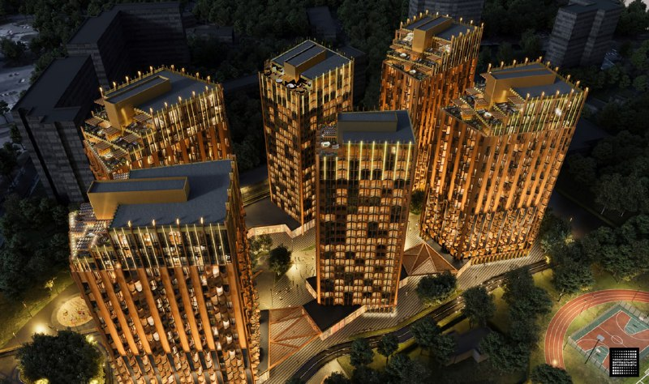
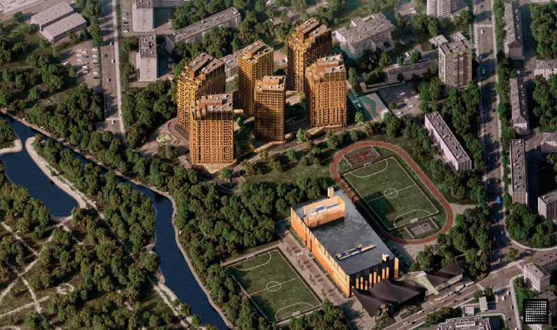

# Союз: как менялся проект на Сельскохозяйственной, 26 с 2021 по 2026

Площадку стадиона «Искра» в Ростокине в 2021 году описывали как гостиницы и апартаменты на 101 тыс. м², а в 2022-м [Родина](/zastroyshchiki/rodina/) начала строить на ней шесть жилых домов по 21 этажу и спортивный комплекс. К октябрю 2026 года каталог называет 23–24 этажа и 1 276 квартир, но первоисточник этих цифр мы не нашли.

## Коротко

- **Март 2021 года:** по данным «Москвича», согласован план из семи зданий: гостиницы на 101 тыс. м², офисы, торговля и общепит.
- **Апрель 2022 года:** на сайте застройщика показан жилой комплекс из шести домов, 128 тыс. м², завершение — 2025 год.
- **Июль 2022 года:** старт строительства — шесть жилых домов по 21 этажу, 956 квартир, спортивный комплекс.
- **Октябрь 2026 года:** по каталогу, 23–24 этажа, 1 276 квартир, срок — IV квартал 2026 года. Архитектора ни один из проверенных источников не называет.

Полная история проекта — в [досье «Союз»](/obekty/soyuz/). Район — [Ростокино](/novostroyki/rostokino/).

## С чего начинали

В марте 2021 года «Москвич» описал, что именно согласовано на участке у стадиона «Искра» на Яузе. План включал семь новых зданий: гостиницы для тренеров, инструкторов и спортсменов — 101 тыс. м², офисы — 4 тыс. м², торговлю — 6 тыс. м², общепит — почти 9 тыс. м². Спортивный объект на этом месте заменялся новой застройкой, а изменения градостроительных регламентов обсуждали на публичных слушаниях на портале «Активный гражданин».

Гостиницы задумывались без коммерческой недвижимости, но на сайтах объявлений их уже подавали как апартаменты с пометкой «Скоро в продаже». Какое именно решение и когда согласовало этот план, издание не указывает, архитектор в материале не назван.

## Что меняли

К апрелю 2022 года картина стала другой. На сайте застройщика появился жилой комплекс «Союз»: по данным «Москвича» от 27 апреля 2022 года, шесть многоэтажных домов общей площадью 128 тыс. м² и завершение в 2025 году. Местные жители, по тому же материалу, проект не поддерживают.

В июле 2022 года Родина объявила о начале строительства. По данным РБК Недвижимости, проект состоит из шести жилых домов премиум-класса по 21 этажу, внутреннего двора-бульвара, физкультурно-оздоровительного комплекса (ФОК) и общественно-делового центра. Квартир — 956, 27 вариантов планировок от 31,6 до 210 м², есть террасы 17–60 м² и пентхаусы. Жильё занимает меньше 2 га, то есть менее трети участка, остальное, около 7 га, отдано под инфраструктуру.

Почему апартаменты и гостиницы сменились жильём, источники не объясняют. Площадь жилой части шести домов тоже в проверенных материалах не названа: 101 тыс. м² в 2021 году относятся к гостиничной части, а 128 тыс. м² в 2022-м — к проекту целиком.

На наш взгляд, золотистые башни с террасами на верхних этажах — главная примета варианта 2022 года. Автора этого облика мы подтвердить не смогли.

*Шесть жилых домов «Союза» в варианте 2022 года. Визуализация: Родина, 2022*

## Каким проект стал

На октябрь 2026 года мы нашли только каталожные данные. По странице «Союза» в «Яндекс Недвижимости»:

- застройщик — специализированный застройщик «Искра» (Группа Родина);
- шесть корпусов, от 23 до 24 этажей;
- 1 276 квартир, из них в продаже 127;
- срок сдачи — IV квартал 2026 года, часть квартир уже сдана; в описании той же страницы указан I квартал 2026 года, так что данные противоречивы;
- квартиры — от 20,6 млн ₽; цена за квадратный метр на странице указана без привязки к типу квартир, поэтому мы её не приводим.

Сравнение с 2022 годом показывает расхождение: 21 этаж и 956 квартир тогда, 23–24 этажа и 1 276 квартир сейчас. Объяснения в источниках нет: возможно, разные данные относятся к разным очередям или способам подсчёта, но это наше предположение. Точные цифры можно взять в [проектной декларации](/slovar/proektnaya-deklaratsiya/) на наш.дом.рф.

Что не подтвердилось: разрешение на ввод первой очереди осенью 2025 года, сроки запуска спортивного кластера, а также концепция второй очереди на Сельскохозяйственной, 12Б. Поэтому в разбор они не вошли.

*Те же дома с высоты: рядом спортивные поля и физкультурно-оздоровительный комплекс. Визуализация: Родина, 2022*

## Было и стало

| Параметр | Март 2021 года | Апрель 2022 года | Июль 2022 года (старт строительства) | Октябрь 2026 года (каталог) |
|---|---|---|---|---|
| Функция | гостиницы (подавались как апартаменты), офисы, торговля, общепит | жилой комплекс | шесть жилых домов, ФОК, общественно-деловой центр | шесть корпусов |
| Зданий | семь | шесть | шесть жилых | шесть |
| Этажность | — | — | 21 | 23–24 |
| Площадь | гостиницы 101 тыс. м², офисы 4 тыс., торговля 6 тыс., общепит около 9 тыс. м² | 128 тыс. м² | — | — |
| Квартиры | — | — | 956 | 1 276 (127 в продаже) |
| Срок | — | 2025 год | — | IV квартал 2026 года |
| Архитектор | — | — | — | — |

## Карточка объекта

- **Название:** «Союз» (СОЮЗ), у стадиона «Искра»
- **Адрес участка:** Сельскохозяйственная, 26, Москва, [Ростокино](/novostroyki/rostokino/)
- **Застройщик:** [Группа Родина](/zastroyshchiki/rodina/)
- **Класс:** премиум (по данным РБК Недвижимости)
- **Состав:** шесть жилых корпусов, ФОК, общественно-деловой центр
- **Стадия:** строительство, часть квартир сдана (по каталогу)
- **Срок:** IV квартал 2026 года (по каталогу, данные противоречивы)

## Вопросы и ответы

**Кто застройщик «Союза» на Сельскохозяйственной, 26?**
Проект ведёт Группа Родина. По каталогу «Яндекс Недвижимости», застройщик — специализированный застройщик «Искра», входящий в Группу Родина.

**Сколько этажей в «Союзе» у стадиона «Искра»?**
В июле 2022 года при старте строительства называли шесть домов по 21 этажу. В каталоге «Яндекс Недвижимости» на октябрь 2026 года указано 23–24 этажа; причина расхождения в проверенных источниках не названа.

**Что планировали на месте стадиона «Искра» в 2021 году?**
По данным «Москвича» (март 2021 года), согласованный план включал семь зданий: гостиницы для тренеров, инструкторов и спортсменов на 101 тыс. м², офисы, торговлю и общепит. Их продавали как апартаменты.

**Когда сдадут «Союз» в Ростокине?**
В апреле 2022 года на сайте застройщика называли 2025 год. Каталог «Яндекс Недвижимости» на октябрь 2026 года даёт IV квартал 2026 года, но на той же странице указан и I квартал 2026 года, так что срок стоит сверить с проектной декларацией.

## Источники

1. [Спорта не будет: вместо гостиницы на месте стадиона «Искра» в Ростокине построят апартаменты — «Москвич», 1 марта 2021 года](https://moskvichmag.ru/gorod/sporta-ne-budet-vmesto-gostinitsy-na-meste-stadiona-iskra-v-rostokino-postroyat-apartamenty/)
2. [У стадиона «Искра» построят шесть многоэтажек — «Москвич», 27 апреля 2022 года](https://moskvichmag.ru/gorod/u-stadiona-iskra-postroyat-shest-mnogoetazhek-zhiteli-rostokino-v-uzhase/)
3. [Девелопер «Родина» начал строительство квартала «СОЮЗ» — РБК Недвижимость, 20 июля 2022 года](https://realty.rbc.ru/news/62c773c69a794783f1d3af71)
4. [ЖК «Союз» — каталог «Яндекс Недвижимости», данные на октябрь 2026 года](https://realty.yandex.ru/moskva_i_moskovskaya_oblast/kupit/novostrojka/soyuz-3001459/)

Материал не является инвестиционной рекомендацией.
