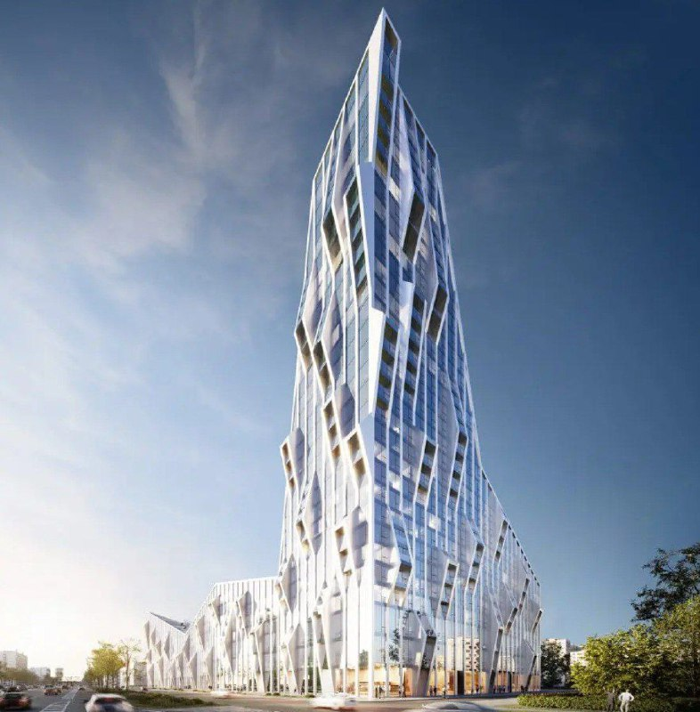
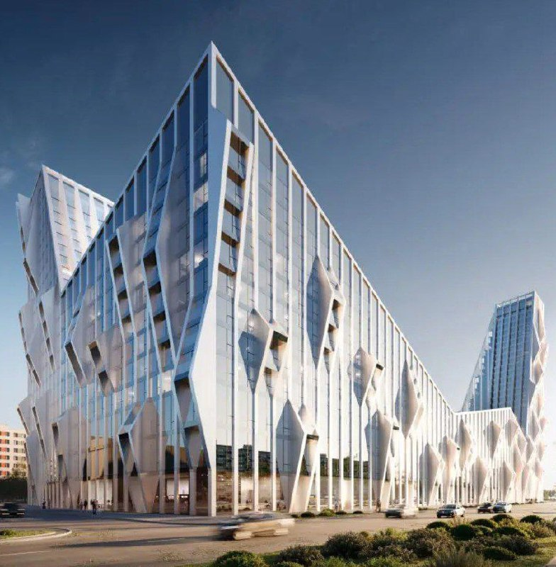

# «Трансюжстрой» на Каширке: кристалл на 123,5 тыс. м² вместо табачной фабрики

Табачная фабрика у метро «Домодедовская» уступает место жилью: здесь одобрено 123,5 тыс. кв. м недвижимости, из них 86,4 тыс. кв. м квартир. Строить, по данным Moskvich Mag от 15 июля 2025 года, будет не москвич, а белгородский «Трансюжстрой».

## Коротко

- Одобрено 123,5 тыс. кв. м, жильё — 86,4 тыс. кв. м (почти 70%).
- Застройщик — [белгородский девелопер «Трансюжстрой»](/zastroyshchiki/transyuzhstroy/).
- Архитектура — бюро «СПИЧ», фасад в виде кристалла, заострённого вверх.
- Цен, сроков и стадии на 14 октября 2026 года публично нет.

## От сигарет к квадратным метрам

Участок — бывшая табачная фабрика. О закрытии московской фабрики «Лиггетт-Дукат» компания JTI объявила 31 июля 2015 года, остановить производство собирались к середине 2016 года ([Интерфакс](https://www.interfax.ru/business/457245)). Судьбу земли JTI тогда обещала решить позже.

Решили. По данным [Moskvich Mag](https://moskvichmag.ru/gorod/na-meste-tabachnoj-fabriki-na-kashirskom-shosse-postroyat-kristallicheskij-zhk/), на участке одобрено 123,5 тыс. кв. м, и почти 70% из них — жильё. Кто именно и когда дал добро, издание не уточняет, так что держимся его формулировки: «одобрено».

*Башня проекта на Каширском шоссе. Визуализация (2). Визуализация: «Трансюжстрой»*

## Айсберг у Каширки

Проект разработало бюро «СПИЧ». Издание сравнивает фасад с айсбергом или огромным кристаллом, заостряющимся вверх. На наш вкус, заявка смелая — посмотрим, сколько граней доживёт до стройки. Высоту и этажность пока не называли.

*Низкая часть комплекса с гранёным фасадом. Визуализация (3). Визуализация: «Трансюжстрой»*

## Гость из Белгорода

Строить собирается не столичная компания, а белгородский девелопер «Трансюжстрой» — для него это выход на московский рынок. Как он поведёт себя в столице, покажет время: оценивать опыт и репутацию застройщика по одной новости мы не берёмся.

## Контекст

Каширское шоссе — одно из магистральных направлений редевелопмента, и проект здесь не одинок: рядом, например, [КРТ на Каширском шоссе, 76а](/novosti/kashirskoe-shosse-76a-krt-renovaciya/). Полная история участка — в [досье «Каширское, 61, корп. 4, стр. 1-9»](/obekty/kashirskoe-61-korp-4-str-1-9/), рыночный фон — в подборке [«Новостройки Москвы»](/novostroyki/moskva/).

## Что с проектом сейчас

На 14 октября 2026 года публично известно одно: строительство одобрено. Разрешения на строительство, старта продаж, цен и сроков ввода застройщик пока не объявлял. Как будет называться комплекс и в каком классе, тоже неизвестно.

## Что это значит для покупателя и инвестора

Сравнивать пока нечего: ни стартовой цены, ни класса, ни очередей. По-нашему, это заявка на объём, а не продукт, который можно положить рядом с соседями. Следите за проектной декларацией на [наш.дом.рф](https://наш.дом.рф), разрешением на строительство и итоговыми [ТЭП](/slovar/tep/) — именно они покажут, во что превратится кристалл с рендера.

## Карточка объекта

- Участок: Каширское, 61, корп. 4, стр. 1-9 (по данным досье «Шахматки»; в источнике номер дома не приведён)
- Прежнее использование: табачная фабрика «Лиггетт-Дукат»
- Застройщик: «Трансюжстрой» (Белгород)
- Архитектор: бюро «СПИЧ»
- Регион: Москва, Каширское шоссе, рядом с метро «Домодедовская»
- Площадь: 123,5 тыс. кв. м, из них жильё — 86,4 тыс. кв. м
- Стадия: строительство одобрено (формулировка источника)

## Вопросы и ответы

**Кто строит жилой комплекс на месте табачной фабрики на Каширском шоссе?**
Белгородская компания «Трансюжстрой» — так писал Moskvich Mag 15 июля 2025 года.

**Сколько недвижимости одобрено на участке?**
123,5 тыс. кв. м, из них 86,4 тыс. кв. м (почти 70%) — жильё.

**Кто автор проекта?**
Архитектурное бюро «СПИЧ». Фасад сравнивают с кристаллом, заостряющимся вверх.

**Когда начнутся продажи и какие будут цены?**
Пока неизвестно: на 14 октября 2026 года ни сроков, ни цен застройщик публично не называл.

## Источники

1. [Moskvich Mag, 15 июля 2025 года: на месте табачной фабрики на Каширском шоссе построят «кристаллический» ЖК](https://moskvichmag.ru/gorod/na-meste-tabachnoj-fabriki-na-kashirskom-shosse-postroyat-kristallicheskij-zhk/)
2. [Интерфакс, 31 июля 2015 года: JTI закроет фабрику «Лиггетт-Дукат» в Москве](https://www.interfax.ru/business/457245)

Материал не является инвестиционной рекомендацией.
