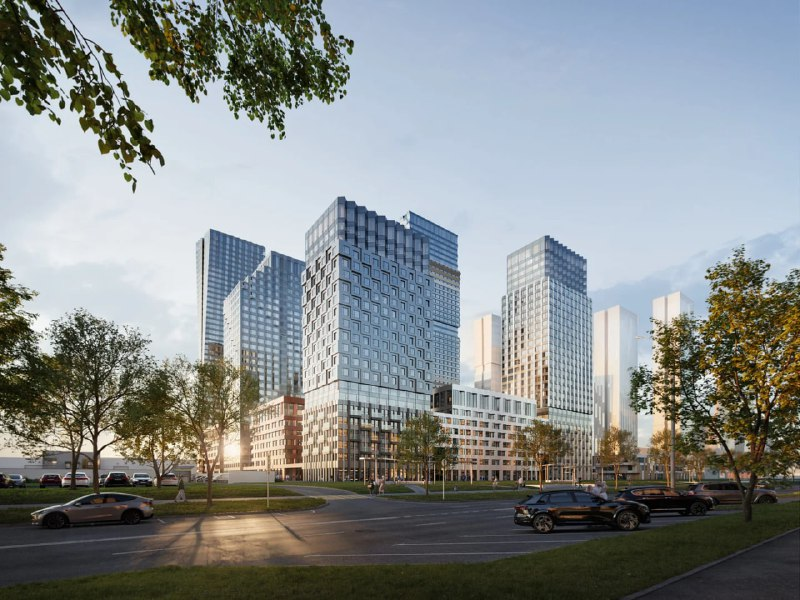
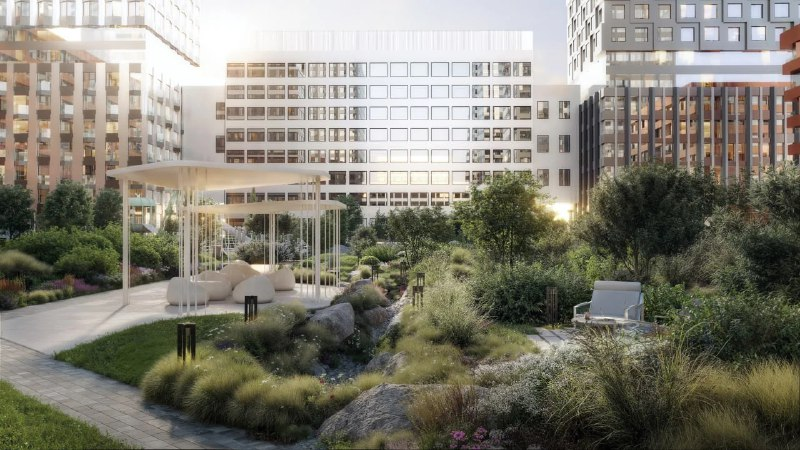

# ЖК «Акценты» в Восточном Дегунине: старт продаж, цены и сроки сдачи

Plus Development вывела на рынок ЖК «Акценты» на Дубнинской улице в Восточном Дегунине: продажи первой очереди начались в июле 2025 года. К октябрю 2026 года метр в объявлениях стоит от 539 до 598 тыс. ₽, а корпуса остаются на стадии котлована и фундамента.

*Общий вид комплекса с улицы. Визуализация: Plus Development*

## Коротко

- Продажи ЖК «Акценты» стартовали в июле 2025 года; в первую очередь вошли пять корпусов, квартиры от 28 до 89 м², минимальная цена лота на старте — от 11 млн ₽.
- Застройщик — Plus Development (проектная компания — ООО «СЗ «Дубнинская»).
- По состоянию на 13 октября 2026 года метр в объявлениях стоит от 539 до 598 тыс. ₽ в зависимости от отделки и корпуса.
- Срок сдачи корпусов 11–15 — 4 квартал 2027 года; стадия по каталогу — котлован и фундамент.

## Что произошло: старт продаж «Акцентов»

В июле 2025 года Plus Development открыла продажи в ЖК «Акценты» в Восточном Дегунине (САО). Об этом сообщает обзор стартов продаж за июль 2025 года, опубликованный 1 августа 2025 года. В первую очередь вошли пять корпусов, площадь квартир — от 28 до 89 м², самая дешёвая квартира стоила от 11 млн ₽.

Проектная декларация ([проектная декларация](/slovar/proektnaya-deklaratsiya/) — документ застройщика о проекте, цене и сроках) датирована 18 июля 2025 года.

Дома у проекта разной высоты: по каталогу, этажность корпусов — от 7 до 30 этажей. Предусмотрены подземный паркинг и учебно-воспитательный комплекс со школой и детским садом. Мощность комплекса и общее число корпусов в источниках расходятся, поэтому мы их не приводим.

## Сколько стоят квартиры в «Акцентах» сейчас

Цена за метр зависит от отделки и корпуса. В объявлениях каталога Novostroy-M в октябре 2026 года:

- 1-комнатная квартира в корпусе 14 с чистовой отделкой — 21,93 млн ₽, или 598 151 ₽/м² (на 12 октября 2026 года);
- 3-комнатная квартира в корпусе 12 под чистовую — 39,89 млн ₽, или 539 000 ₽/м² (на 1 августа 2026 года).

Это цены отдельных лотов, а не средняя по проекту. Тенденция при этом видна: цены в листингах растут. Двухкомнатная квартира площадью 57,7 м² подорожала с 29,6 до 30,9 млн ₽ с 1 августа по 12 октября 2026 года, то есть примерно на 4%.

Цену за метр на старте продаж в июле 2025 года мы подтвердить не смогли, поэтому сравнение «было → стало» не приводим.

*Двор с ландшафтным озеленением. Визуализация: Plus Development*

## Когда сдадут «Акценты» и что со стройкой

Для корпусов 11–15 каталог указывает срок сдачи в 4 квартале 2027 года. По состоянию на октябрь 2026 года стадия этих корпусов — котлован и фундамент; раздел о ходе строительства обновлялся 26 сентября 2026 года.

Покупатели по [ДДУ](/slovar/ddu/) (договору долевого участия) получают квартиру после ввода дома, поэтому за сроком стоит следить по проектной декларации и изменениям в ней.

## Кто застройщик и что вокруг

Проект ведёт [Plus Development](/zastroyshchiki/plyus-development/). Ближайшее метро по каталогу — «Лианозово» (10 минут пешком), рядом МЦД «Лианозово» и «Бескудниково». Район — [Восточное Дегунино](/novostroyki/vostochnoe-degunino/), каталог относит проект к [бизнес-классу](/novostroyki/biznes-klass/).

Подробности по участку и этапам проекта мы не приводим, пока они не подтверждены первоисточниками; полная история проекта — в [досье «Акценты»](/obekty/aktsenty/).

## Что это значит для покупателя и инвестора

На наш взгляд, главный вопрос по «Акцентам» — соотношение цены и стадии: при цене за метр выше 500 тыс. ₽ дома первой очереди остаются на нулевом цикле. Это повышает значимость срока сдачи: сдвиг срока ударит по покупателю, который уже заплатил такую цену.

Что отслеживать: изменения в проектной декларации (срок, цена, площади), темп роста цен в листингах, фактическую стадию строительства по фотофиксации и распроданность первой очереди. Данных о продажах в открытых источниках мы не нашли, поэтому судить о спросе по ним нельзя.

## Карточка объекта

- **Название:** ЖК «Акценты» (участок «Дубнинская, 83»; в каталоге адрес указан как ул. Дубнинская, вл. 79)
- **Застройщик:** Plus Development (ООО «СЗ «Дубнинская»)
- **Регион и район:** Москва, САО, Восточное Дегунино
- **Метро:** «Лианозово», 10 минут пешком (по данным каталога)
- **Класс:** бизнес (по каталогу)
- **Этажность:** 7–30 этажей (по каталогу)
- **Первая очередь:** пять корпусов, квартиры от 28 до 89 м²
- **Стадия:** котлован и фундамент (по каталогу, октябрь 2026 года)
- **Срок сдачи:** 4 квартал 2027 года (корпуса 11–15)
- **Цена:** 539–598 тыс. ₽/м² в объявлениях (август–октябрь 2026 года)

## Вопросы и ответы

**Когда начались продажи в ЖК «Акценты» в Дегунине?**
Проект вышел на рынок в июле 2025 года. В первую очередь вошли пять корпусов с квартирами от 28 до 89 м².

**Сколько стоит квадратный метр в «Акцентах» в октябре 2026 года?**
В объявлениях каталога метр стоит от 539 тыс. ₽ (3-комнатная под чистовую, на 1 августа 2026 года) до 598 тыс. ₽ (1-комнатная с чистовой отделкой, на 12 октября 2026 года). Это цены отдельных лотов, а не средняя по проекту.

**Когда сдадут ЖК «Акценты»?**
Для корпусов 11–15 указан 4 квартал 2027 года. По состоянию на октябрь 2026 года стадия — котлован и фундамент.

**Кто застройщик ЖК «Акценты»?**
Plus Development, проектная компания — ООО «СЗ «Дубнинская». Проектная декларация датирована 18 июля 2025 года.

## Источники

1. Novostroy-M, карточка ЖК «Акценты»: https://www.novostroy-m.ru/baza/jk_na_dubninskoy_79
2. Novostroy-M, обзор стартов продаж в Москве, июль 2025 года: https://www.novostroy-m.ru/analitika/starty_prodaj_iyul25msk
3. Novostroy-M, 1-комнатная квартира в ЖК «Акценты», корпус 14: https://www.novostroy-m.ru/kvartiry/odnokomnatnaya-kvartira-v-zhk-akcenti-dfeb552b43877ffd0b1eb0922203c9
4. Novostroy-M, 3-комнатная квартира в ЖК «Акценты», корпус 12: https://www.novostroy-m.ru/kvartiry/trehkomnatnaya-kvartira-v-zhk-akcenti-0400fb5465efb6cceec5870ad84c61

Материал не является инвестиционной рекомендацией.
