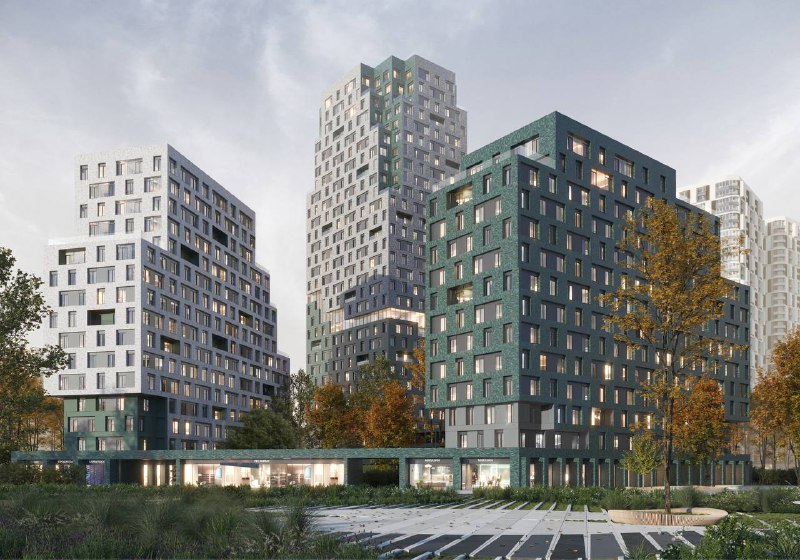
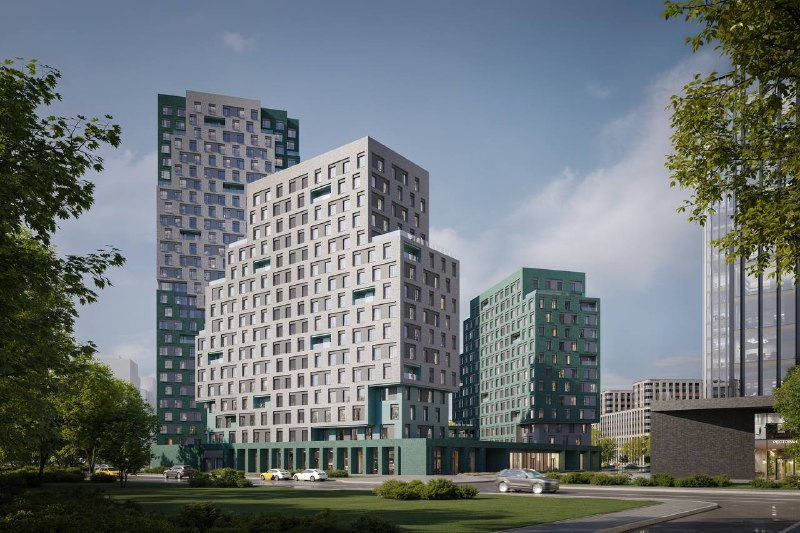
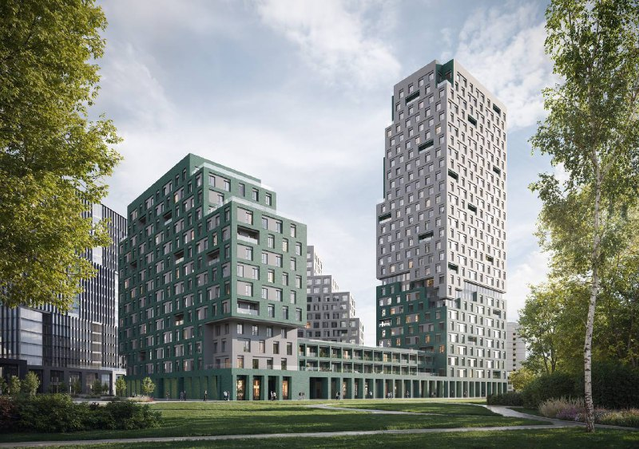

# Stone Rise на Золоторожском Валу: студии от 20,5 млн ₽, сдача в 2028 году

Stone вывел Stone Rise на Золоторожском Валу летом 2025 года: проектная декларация датирована 15 июля 2025 года. На 15 октября 2026 года студия здесь начинается от 20,5 млн ₽, а сдача обещана в четвёртом квартале 2028 года. Между этими датами — котлован и обещание «бизнес+».

## Коротко

- **Кто и где:** Stone (АО «СЗ «Золоторожский 11»), Золоторожский вал, вл. 11, у метро «Римская» и «Площадь Ильича».
- **Старт:** июль 2025 года, по дате проектной декларации.
- **Цены в октябре 2026 года:** студии от 20,5 млн ₽, 543–748 тыс. ₽/м² в объявлениях.
- **Сдача:** 4 квартал 2028 года; сейчас, по данным агрегатора, котлован и фундамент.

## Три станции и «бизнес+»

Stone Rise — комплекс класса «бизнес+» (так его записывает Яндекс Недвижимость) на Золоторожском Валу, вл. 11, в Лефортове (ЮВАО). Главный козырь — транспорт. По описанию на novostroy-m.ru, рядом сразу три станции: «Римская» и «Площадь Ильича» примерно в 3 минутах пешком и МЦД «Серп и Молот». Другой агрегатор до «Площади Ильича» насчитывает около 5 минут — но и так неплохо.

Застройщик — Stone, проектная компания — АО «СЗ «Золоторожский 11». В объявлениях встречаются дома до 28 этажей, квартиры — от 30 до 101 м². Архитектуру агрегатор по подписям к картинкам приписывает бюро «Волл» (WALL).

*Визуализация ЖК Stone Rise (1). Визуализация: Stone*

## Двадцать миллионов — только вход

Страница застройщика на novostroy-m.ru (данные на апрель 2026 года) даёт такую лестницу цен: студия от 20,5 млн ₽, однокомнатные от 25,4 млн ₽, двухкомнатные от 35,9 млн ₽, трёхкомнатные от 41,5 млн ₽, пятикомнатные от 75,8 млн ₽. В объявлениях на Яндекс Недвижимости — от 21,0 до 57,8 млн ₽ за квартиру и от 543 до 748 тыс. ₽ за метр.

Подорожал ли проект со старта — вопрос без честного ответа: стартовые цены июля 2025 года официально не раскрывали. Сравнивать можно только то, что видно сейчас, — а сейчас нижняя планка уже за 20 млн ₽.

## Пока — котлован

На 15 октября 2026 года, по данным агрегатора, дом на стадии котлована и фундамента. Срок сдачи — четвёртый квартал 2028 года. Дата старта продаж читается по проектной декларации: 15 июля 2025 года.

*Визуализация ЖК Stone Rise (2). Визуализация: Stone*

Полная история проекта — в [досье «Stone Rise»](/obekty/stone-rise/). О застройщике — на странице [девелопера Stone](/zastroyshchiki/stone/). Другие проекты на старте — в подборке [«Старт продаж»](/novostroyki/start-prodazh/).

## Что это значит для покупателя и инвестора

Stone Rise — это «бизнес+», где больше 20 млн ₽ платят прежде всего за точку на карте: метро и МЦД под боком. Дорого это или нет, покажет только сравнение с соседями по проверенным ценам, а гадать на кофейной гуще мы не будем.

Важнее другое: вы покупаете котлован. Значит, главный риск — срок. Дату сдачи (4 квартал 2028 года) сверяйте с [проектной декларацией](/slovar/proektnaya-deklaratsiya/) на наш.дом.рф и с условиями [ДДУ](/slovar/ddu/). Цены на агрегаторах живут своей жизнью, окончательную сумму фиксирует только договор.

*Визуализация ЖК Stone Rise (3). Визуализация: Stone*

## Карточка объекта

- Адрес: Москва, Золоторожский вал, вл. 11
- Названия: Stone Rise, «Стоун Райз»
- Застройщик: Stone (АО «СЗ «Золоторожский 11»)
- Район: Лефортово, ЮВАО
- Метро: «Римская», «Площадь Ильича»; МЦД «Серп и Молот»
- Класс: бизнес+
- Квартиры: студии — пятикомнатные, от 30 до 101 м² в объявлениях
- Стадия: котлован/фундамент (по данным агрегатора)
- Срок сдачи: 4 квартал 2028 года
- Цены: от 20,5 млн ₽, 543–748 тыс. ₽/м²

## Вопросы и ответы

**Сколько стоят квартиры в ЖК Stone Rise?**
На октябрь 2026 года — от 20,5 млн ₽ за студию (страница застройщика на novostroy-m.ru) и от 21 млн ₽ по объявлениям на Яндекс Недвижимости. Метр в объявлениях — 543–748 тыс. ₽.

**Когда сдадут Stone Rise?**
В четвёртом квартале 2028 года — так указано в объявлениях. На октябрь 2026 года, по данным агрегатора, стройка на стадии котлована и фундамента.

**Кто застройщик и где находится ЖК?**
Stone, юрлицо — АО «СЗ «Золоторожский 11». Адрес: Золоторожский вал, вл. 11, Лефортово; рядом метро «Римская» и «Площадь Ильича».

**Подорожал ли проект с начала продаж?**
Точно сказать нельзя: стартовые цены июля 2025 года официально не раскрывали. На октябрь 2026 года лоты начинаются от 20,5–21 млн ₽.

## Источники

1. [Яндекс Недвижимость: ЖК «СТОУН Райз», квартиры в высотке](https://realty.yandex.ru/moskva_i_moskovskaya_oblast/kupit/kvartira/zhk-stoun-rajz-4038350/v-vysotke/)
2. [novostroy-m.ru: двухкомнатная квартира в ЖК «Стоун Райз» (адрес, застройщик, метро)](https://www.novostroy-m.ru/kvartiry/dvuhkomnatnaya-kvartira-v-zhk-stone-rise-stoun-rais-8ced7158b8f388d793e2636b580549)
3. [novostroy-m.ru: однокомнатная квартира в ЖК «Стоун Райз» (стадия, проектная декларация от 15.07.2025)](https://www.novostroy-m.ru/kvartiry/odnokomnatnaya-kvartira-v-zhk-stone-rise-stoun-rais-1bf7563c09becf3130a35e8d69ce23)
4. [novostroy-m.ru: страница застройщика АО «СЗ «Золоторожский 11»](https://www.novostroy-m.ru/kompanii/ao_sz_zolotorojskiy_11)

Материал не является инвестиционной рекомендацией.
