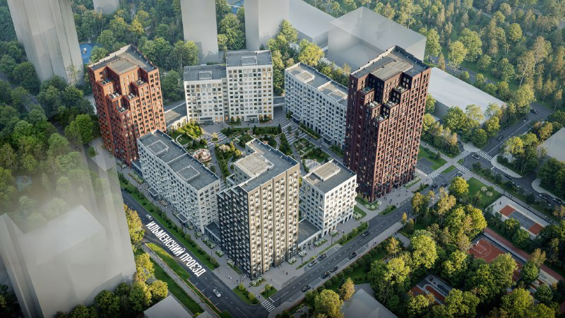
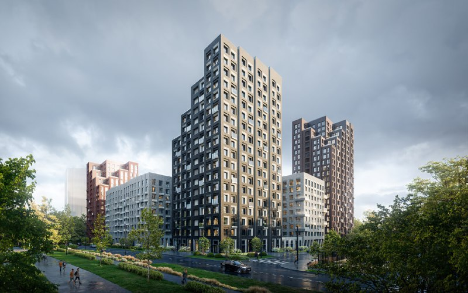

# ЖК «Онежский вал» от ПИК в Западном Дегунине: старт продаж, цены, сдача

ПИК вывела на рынок ЖК «Онежский вал» в районе [Западное Дегунино](/novostroyki/zapadnoe-degunino/) — это первая очередь комплексного развития территории (КРТ) «Дегунино-Лихоборы». Продажи квартир с отделкой стартовали в октябре 2025 года; цена 370 тыс. ₽/м², о которой говорили в августе 2025 года, не подтвердилась.

## Коротко

- **Старт:** предстарт в августе 2025 года, продажи — с октября 2025 года; проектная декларация датирована 24 октября 2025 года.
- **Состав:** семь корпусов (1.1.1–1.1.7), 8–23 этажа, квартиры с отделкой; метро «Селигерская» — около 10 минут пешком.
- **Цены на 15 октября 2026 года:** от 17,1 до 46,4 млн ₽; на старте минимальная цена была от 11,9 млн ₽.
- **Сроки:** сдача — IV квартал 2028 года; на 26 сентября 2026 года на всех корпусах монтировали нижние этажи.

## Что произошло: ПИК вывела «Онежский вал» в продажу

В заметке от 26 августа 2025 года говорилось, что ПИК выводит в реализацию проект «Онежский вал» в КРТ «Дегунино-Лихоборы». Каталог новостроек относит старт продаж к октябрю 2025 года: проект входит в линейку ПИК «Серия плюс», на старте предлагались квартиры с отделкой от студий около 28 м² до трёхкомнатных с кухней-гостиной 81,3 м². Минимальная цена тогда была от 11,9 млн ₽.

Цену 370 тыс. ₽/м², с которой, по заметке, ПИК выходит на рынок, подтвердить не удалось: в открытых источниках на старте названа только цена «от 11,9 млн ₽». Сравнение с ценами и темпами продаж соседних проектов мы по той же причине не приводим.

*Визуализация: ПИК. Корпуса ЖК «Онежский вал» вдоль Ильменского проезда (1).*

## Что за КРТ «Дегунино-Лихоборы»

[КРТ](/slovar/krt/) — механизм, при котором город отдаёт право перестроить промзону инвестору. 13 февраля 2023 года мэрия объявила аукцион на право заключить договор о КРТ бывшей промзоны «Дегунино-Лихоборы»: площадь — более 15 га, до 390 тыс. кв. м застройки, из них более 239 тыс. кв. м жилья; заявки принимали до 2 марта 2023 года, итоги планировались на 13 марта 2023 года.

В августе 2025 года Москва утвердила проект планировки территории 15,34 га между Ильменским проездом и путями МЦД-3. По данным РИАМО, он включает около 240 тыс. кв. м жилья (в том числе около 25 тыс. кв. м по программе реновации), 123,7 тыс. кв. м нежилых помещений, школу на 800 учеников и детский сад на 350 мест; завершить проект планируют к 2030 году. Договор с инвестором, ООО «СЗ «Прометейсити»», заключён в 2023 году. Кто победил на аукционе и за какую цену, мы не подтвердили.

Полная история проекта — в [досье «Онежский вал»](/obekty/onezhskiy-val/). Другие решения города по КРТ собраны в [теме КРТ](/temy/krt/); на наш взгляд, в таком механизме город по сути выступает как [мастер-девелопер](/slovar/master-developer/).

## Что с проектом сейчас

По состоянию на 15 октября 2026 года, по карточке проекта в каталоге новостроек:

- **Стадия.** На 26 сентября 2026 года на всех семи корпусах монтировали нижние этажи. Разрешение на строительство датировано 21 октября 2025 года.
- **Сроки.** Сдача всех корпусов указана на IV квартал 2028 года.
- **Цены.** Диапазон — от 17,1 до 46,4 млн ₽ (на старте минимальная цена была от 11,9 млн ₽). Студия около 28 м² стоит 17,892 млн ₽, это около 640 тыс. ₽/м² по расчёту редакции для одного лота. Цены в карточке обновлены 15 октября, до 31 октября указана акция.
- **Застройщик.** В карточке — ООО «Прометей Сити» из группы [ПИК](/zastroyshchiki/pik/).

*Визуализация: ПИК. Один из корпусов ЖК «Онежский вал» (2).*

## Что это значит для покупателя и инвестора

Квартиры с отделкой на старте — это возможность не тратить дополнительные деньги на ремонт, но и платить за него в цене. На наш взгляд, сравнивать «Онежский вал» с проектами без отделки по цене за метр без пересчёта на ремонт некорректно.

Рост минимального порога цены с 11,9 до 17,1 млн ₽ за год — сильный сдвиг, но он может отражать и смену набора доступных лотов: остались более дорогие. Надёжных данных о темпе продаж у нас нет.

Риски: срок сдачи — конец 2028 года, до него идёт строительство; проект — часть большого КРТ, где инфраструктура и транспорт ещё формируются. Что отслеживать: сроки по проектной декларации на наш.дом.рф, ввод школы и детского сада, динамику цен.

## Карточка объекта

- **Название:** Онежский вал (КРТ «Дегунино-Лихоборы»)
- **Адрес:** Москва, Ильменский проезд, район Западное Дегунино
- **Застройщик:** [ПИК](/zastroyshchiki/pik/) (по каталогу — ООО «Прометей Сити»)
- **Корпуса:** семь (1.1.1–1.1.7), 8–23 этажа
- **Отделка:** с отделкой
- **Стадия:** строительство и продажи
- **Ввод:** IV квартал 2028 года
- **Цена:** от 17,1 до 46,4 млн ₽ (октябрь 2026 года)

## Вопросы и ответы

**Когда начались продажи в ЖК «Онежский вал»?**
По данным каталога новостроек, продажи стартовали в октябре 2025 года; проектная декларация датирована 24 октября 2025 года. Заметка от 26 августа 2025 года описывала предстарт.

**Когда сдадут ЖК «Онежский вал»?**
По карточке в каталоге, все семь корпусов (1.1.1–1.1.7) сдаются в IV квартале 2028 года. По состоянию на 26 сентября 2026 года на всех корпусах монтировали нижние этажи.

**Сколько стоят квартиры в «Онежском вале»?**
На старте минимальная цена была от 11,9 млн ₽. В карточке на октябрь 2026 года диапазон — от 17,1 до 46,4 млн ₽.

**Кто застройщик «Онежского вала»?**
Проект ведёт группа ПИК; в каталоге застройщиком указано ООО «Прометей Сити». РИАМО называет инвестором КРТ ООО «СЗ «Прометейсити»».

## Источники

1. [Новостройки Москвы: старты продаж в октябре 2025 года](https://www.novostroy-m.ru/analitika/starty_prodaj_oktyabr_2025)
2. [Новостройки Москвы: карточка ЖК «Онежский вал»](https://www.novostroy-m.ru/baza/onejskiy_val)
3. [Mos.ru: аукцион на КРТ промзоны «Дегунино-Лихоборы», 13 февраля 2023 года](https://www.mos.ru/news/item/119795073/)
4. [РИАМО: проект планировки КРТ в Западном Дегунине, 9 августа 2025 года](https://riamo.ru/news/nedvizhimost/efimov-zhiloj-kompleks-vozvedut-na-severe-moskvy-v-ramkah-krt/)

Материал не является инвестиционной рекомендацией.
