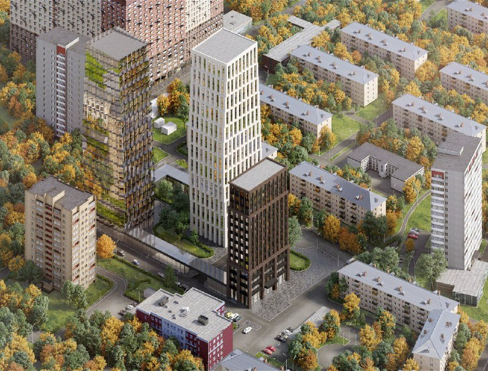
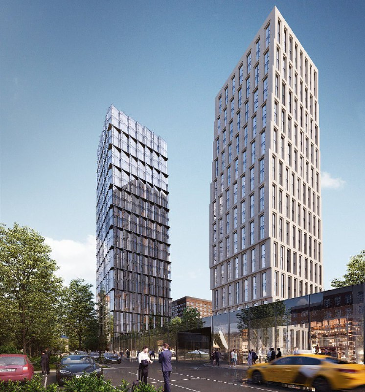

---
source:
  id: 31044
  date: '2025-09-10'
status: skip
skip_reason: duplicate
type: object
region: moscow
title: 'ЖК «Дом на Часовой» (DD:OO:MM) от Dar: СПИЧ, цены от 21,8 млн ₽'
title_alts:
- 'Часовая, 6/3 от Dar: «ДД:ОО:ММ» стал «Домом на Часовой», цены от 21,8 млн ₽'
- 'Dar у метро «Аэропорт»: проект СПИЧ на Часовой, 6/3 к октябрю 2026 года'
slug: dd-oo-mm-dar-chasovaya-6-start-prodazh
lead: 'Dar вывел на рынок проект на участке Часовая, 6/3 у метро «Аэропорт»: в сентябре 2025 года он готовился к старту под названием «ДД:ОО:ММ», а к октябрю 2026 года продаётся как ЖК «Дом на Часовой» от 21,8 млн ₽.'
developers:
- id: dar
  name: Dar
  role: main
objects:
- id: soul-yuzhnoportovaya-42
  names:
  - Соул
  - SOUL
  zu: Южнопортовая, 42
  main: true
  new: false
- id: dd-oo-mm
  names:
  - ДД:ОО:ММ
  - DD:OO:MM
  - Дом на Часовой
  zu: Часовая, 6/3
  main: false
  new: false
districts:
- aeroport
topics:
- ceny
- rynok
images:
- file: media/31044_2.jpg
  alt: 'Визуализация ЖК Dar на Часовой, 6/3 в районе Аэропорт: три разных по облику корпуса среди пятиэтажной застройки'
  caption: 'Проект на участке Часовая, 6/3: белый, тёмный и стеклянный корпуса'
  credit: 'Визуализация: Dar'
- file: media/31044_4.jpg
  alt: 'Визуализация корпусов ЖК Dar на Часовой, 6/3 в районе Аэропорт: светлая башня и стеклянный корпус'
  caption: Светлая и стеклянная башни проекта на Часовой, 6/3
  credit: 'Визуализация: Dar'
factcheck:
- claim: Застройщик проекта на Часовой, 6с3 — Dar; в строительстве указано также ООО «СЗ АРТСТРОЙ»
  status: confirmed
  source: https://realty.yandex.ru/moskva_i_moskovskaya_oblast/kupit/novostrojka/dom-na-chasovoj-4209791/
  checked: '2026-10-14'
- claim: Проект продаётся как ЖК «Дом на Часовой» (ранее DD:OO:MM), район Аэропорт, 255 квартир
  status: changed
  source: https://realty.yandex.ru/moskva_i_moskovskaya_oblast/kupit/novostrojka/dom-na-chasovoj-4209791/
  checked: '2026-10-14'
- claim: Архитектор концепции — СПИЧ
  status: confirmed
  source: https://www.novostroy-m.ru/baza/jk_na_chasovoy
  checked: '2026-10-14'
- claim: Разрешение на строительство от 27.11.2025, проектная декларация от 03.12.2025
  status: confirmed
  source: https://realty.yandex.ru/moskva_i_moskovskaya_oblast/kupit/novostrojka/dom-na-chasovoj-4209791/
  checked: '2026-10-14'
- claim: 'Цена: от 21,8 до 65,36 млн ₽, средняя 738 942 ₽/м² (прогноз заметки: не ниже 700 тыс. ₽/м²)'
  status: changed
  source: https://realty.yandex.ru/moskva_i_moskovskaya_oblast/kupit/novostrojka/dom-na-chasovoj-4209791/
  checked: '2026-10-14'
- claim: 'Срок: 2 кв. 2028 года, ключи в декабре 2028 года'
  status: changed
  source: https://realty.yandex.ru/moskva_i_moskovskaya_oblast/kupit/novostrojka/dom-na-chasovoj-4209791/
  checked: '2026-10-14'
- claim: 'Структура комплекса: 9 секций (7 пятиэтажных, 2 высотные 13 и 22 этажа) по Яндексу; три разновысотных корпуса по «Новостройкам Москвы»'
  status: changed
  source: https://www.novostroy-m.ru/baza/jk_na_chasovoy
  checked: '2026-10-14'
- claim: 'Forma ведёт «Соул» в районе Аэропорт: десять башен 18–35 этажей и 16 домов (рекламный материал)'
  status: confirmed
  source: https://realty.rbc.ru/news/69303b809a79472ac55da0f8
  checked: '2026-10-14'
- claim: Общая площадь 25 тыс. кв. м, высота 90 м
  status: unverified
  source: ''
  checked: '2026-10-14'
- claim: Forma подняла цены в «Соуле» с 520–540 до 680 тыс. ₽/м² с весны 2025 года, продажи упали ниже 1 тыс. кв. м в месяц
  status: unverified
  source: ''
  checked: '2026-10-14'
- claim: Бэсткон переименован в DAR
  status: unverified
  source: ''
  checked: '2026-10-14'
removed:
- 'Площадь 25 тыс. кв. м и высота 90 м: независимо не найдены, расходятся с данными агрегаторов о структуре комплекса.'
- 'Рост цен Forma до 680 тыс. ₽/м² и падение темпа продаж ниже 1 тыс. кв. м в месяц: не подтверждено (в рекламном материале Forma цен нет).'
- 'Переименование Бэсткона в DAR: не подтверждено.'
- 'Соседние проекты MR, Мангазеи и перспективные площадки: в заметке упомянуты без деталей, не проверялись.'
- 'Оценки архитектуры и названия («брендинг ради брендинга»): сохранён только мягкий вывод от редакции.'
data_points: []
seo:
  main_query: дом на часовой dar цены
  keywords:
  - жк дом на часовой
  - DD:OO:MM Dar
  - Часовая 6/3 Аэропорт новостройка
  - СПИЧ Часовая Dar
  - Dar сроки сдачи Часовая
  frequency_checked: false
  title: 'Дом на Часовой (DD:OO:MM) от Dar: цены, сроки, СПИЧ'
  description: 'ЖК «Дом на Часовой» (DD:OO:MM) от Dar на Часовой, 6/3 в районе Аэропорт: цены от 21,8 млн ₽, в среднем 739 тыс. ₽/м², сдача в 2028 году, архитектор СПИЧ.'
  canonical: https://шахматка.москва/novosti/dd-oo-mm-dar-chasovaya-6-start-prodazh/
internal_links:
- anchor: досье «Соул»
  url: /obekty/soul-yuzhnoportovaya-42/
- anchor: материал о Доме на Часовой
  url: /novosti/dom-na-chasovoy-dar-ceny-sroki/
- anchor: проектной декларации
  url: /slovar/proektnaya-deklaratsiya/
- anchor: ДДУ
  url: /slovar/ddu/
faq:
- q: Кто застройщик ЖК «Дом на Часовой» (DD:OO:MM)?
  a: Проект ведёт девелопер Dar. В строительстве на агрегаторе указано также ООО «СЗ АРТСТРОЙ».
- q: Сколько стоят квартиры в ЖК «Дом на Часовой»?
  a: На октябрь 2026 года цены начинаются от 21,8 млн ₽ за студию и доходят до 65,36 млн ₽; средняя цена по данным Яндекс Недвижимости — около 739 тыс. ₽/м².
- q: Когда сдадут ЖК «Дом на Часовой»?
  a: Агрегаторы указывают 2 квартал 2028 года, выдачу ключей — в декабре 2028 года. Разрешение на строительство выдано 27 ноября 2025 года.
- q: Кто архитектор проекта на Часовой, 6/3?
  a: Концепцию, по данным агрегатора «Новостройки Москвы», разработало бюро СПИЧ.
date_published: '2025-09-10'
date_modified: '2026-10-14'
author: Редакция Шахматки
editor_notes: 'Не тот объект: заметка о проекте Dar на Часовой, 6/3 (досье dd-oo-mm), а не о Соуле; главное досье soul-yuzhnoportovaya-42 (Южнопортовая, 42, Forma) стоит первым по правилу брифа, хотя главная сущность статьи — dd-oo-mm. Также в досье Соула адрес ЗУ Южнопортовая, 42, а в заметке и источниках Соул — на Часовой (район Аэропорт): возможна путаница в справочнике. Запись хронологии досье о росте цен Соула до 680 тыс. ₽/м² не подтверждена. Проверить человеку: (1) сверить структуру комплекса и срок по наш.дом.рф (Яндекс: 9 секций, 13 и 22 этажа; визуализации и другой агрегатор: три корпуса); (2) права на визуализации — подписаны как Dar по умолчанию, в заметке источник не указан; (3) slug застройщика dar новый, в пакете его нет; (4) почти тот же объект описан в опубликованной статье 32194-dom-na-chasovoy-dar-ceny-sroki (заметка от 26 ноября 2025 года), на неё стоит ссылка; решить, не слить ли материалы; (5) данные взяты с агрегаторов, наш.дом.рф и сайт Dar не открывались; (6) на фото 31044_1 — выкопировка с контуром участка (пометка редакции канала), не взята.'
schema: '{"@context": "https://schema.org", "@graph": [{"@type": "Article", "headline": "ЖК «Дом на Часовой» (DD:OO:MM) от Dar: СПИЧ, цены от 21,8 млн ₽", "description": "ЖК «Дом на Часовой» (DD:OO:MM) от Dar на Часовой, 6/3 в районе Аэропорт: цены от 21,8 млн ₽, в среднем 739 тыс. ₽/м², сдача в 2028 году, архитектор СПИЧ.", "datePublished": "2025-09-10", "dateModified": "2026-10-14", "author": {"@type": "Organization", "name": "Редакция Шахматки"}, "publisher": {"@type": "Organization", "name": "Шахматка"}, "about": [{"@type": "Residence", "name": "ЖК «Дом на Часовой» (DD:OO:MM)", "address": "Москва, Часовая улица, 6с3"}, {"@type": "Organization", "name": "Dar"}], "mainEntityOfPage": "https://шахматка.москва/novosti/dd-oo-mm-dar-chasovaya-6-start-prodazh/"}, {"@type": "FAQPage", "mainEntity": [{"@type": "Question", "name": "Кто застройщик ЖК «Дом на Часовой» (DD:OO:MM)?", "acceptedAnswer": {"@type": "Answer", "text": "Проект ведёт девелопер Dar. В строительстве на агрегаторе указано также ООО «СЗ АРТСТРОЙ»."}}, {"@type": "Question", "name": "Сколько стоят квартиры в ЖК «Дом на Часовой»?", "acceptedAnswer": {"@type": "Answer", "text": "На октябрь 2026 года цены начинаются от 21,8 млн ₽ за студию и доходят до 65,36 млн ₽; средняя цена по данным Яндекс Недвижимости — около 739 тыс. ₽/м²."}}, {"@type": "Question", "name": "Когда сдадут ЖК «Дом на Часовой»?", "acceptedAnswer": {"@type": "Answer", "text": "Агрегаторы указывают 2 квартал 2028 года, выдачу ключей — в декабре 2028 года. Разрешение на строительство выдано 27 ноября 2025 года."}}, {"@type": "Question", "name": "Кто архитектор проекта на Часовой, 6/3?", "acceptedAnswer": {"@type": "Answer", "text": "Концепцию, по данным агрегатора «Новостройки Москвы», разработало бюро СПИЧ."}}]}]}'
duplicate_of: dom-na-chasovoy-dar-ceny-sroki
---
# ЖК «Дом на Часовой» (DD:OO:MM) от Dar: СПИЧ, цены от 21,8 млн ₽

Dar вывел на рынок проект на участке «Часовая, 6/3» в районе Аэропорт. В сентябре 2025 года он готовился к старту под названием «ДД:ОО:ММ», к октябрю 2026 года продаётся как ЖК «Дом на Часовой»: студии от 21,8 млн ₽, сдача в 2028 году.

## Коротко

- Застройщик — Dar; архитектор концепции — бюро СПИЧ.
- Разрешение на строительство получено 27 ноября 2025 года, проектная декларация опубликована 3 декабря 2025 года.
- Цены на октябрь 2026 года: от 21,8 до 65,36 млн ₽, в среднем около 739 тыс. ₽/м².
- Срок: 2 квартал 2028 года, ключи в декабре 2028 года.

*Визуализация проекта на участке Часовая, 6/3: белый, тёмный и стеклянный корпуса. Визуализация: Dar*

## Что за проект на Часовой, 6/3 и кто его строит

Проект на участке «Часовая, 6/3» готовил Dar. Рабочее название «ДД:ОО:ММ» к осени 2026 года заменено на «Дом на Часовой», хотя часть объявлений ещё использует старое.

Архитектор концепции — бюро СПИЧ. Три корпуса на визуализациях различаются фасадами: светлый, тёмный и стеклянный.

*Визуализация: светлая и стеклянная башни проекта на Часовой, 6/3. Визуализация: Dar*

Структуру комплекса источники описывают по-разному. Яндекс Недвижимость называет девять секций: семь пятиэтажных и две высотные в 13 и 22 этажа. «Новостройки Москвы» в описании упоминают три разновысотных корпуса. Какая схема окончательная, надо сверять по проектной декларации ([что это](/slovar/proektnaya-deklaratsiya/)) на наш.дом.рф.

## Что с проектом сейчас

По состоянию на 14 октября 2026 года проект строится. В нём 255 квартир, в продаже около 50. Студии стоят от 21,8 млн ₽, однокомнатные от 27,6 млн ₽, двухкомнатные от 35,8 млн ₽, трёхкомнатные от 45,8 млн ₽. Средняя цена по Яндекс Недвижимости — 738,9 тыс. ₽/м².

В сентябре 2025 года оценка рынка предполагала вывод проекта не ниже 700 тыс. ₽/м²; фактическая средняя цена оказалась чуть выше. Срок — 2 квартал 2028 года, ключи в декабре 2028 года.

Полная история района и соседних проектов — в [досье «Соул»](/obekty/soul-yuzhnoportovaya-42/). Отдельная публикация о старте продаж — в материале о [Доме на Часовой](/novosti/dom-na-chasovoy-dar-ceny-sroki/).

## Что это значит для покупателя

- Цена входа — бизнес-класс с чеком от 21,8 млн ₽. Для оценки стоит сравнивать цену за метр, а не стартовую цифру лота.
- В том же районе продаёт квартиры Forma: «Соул» девелопер называет кварталом из десяти башен и 16 домов (рекламный материал компании). Цену по «Соулу» мы независимо не подтвердили и не используем.
- Риски обычные для стройки: срок ввода, условия бронирования и рассрочки. Покупать надо по [ДДУ](/slovar/ddu/) со сверкой декларации.
- Следить стоит за остатком: из 255 квартир в продаже около 50, и ценовая динамика будет зависеть от темпа продаж.

## Карточка объекта

- **Адрес ЗУ:** Часовая, 6/3 (Москва, Часовая улица, 6с3)
- **Названия:** «ДД:ОО:ММ», DD:OO:MM, «Дом на Часовой»
- **Застройщик:** Dar
- **Архитектор:** СПИЧ
- **Район:** Аэропорт, Северный округ
- **Стадия:** строительство, разрешение от 27 ноября 2025 года
- **Квартиры:** 255
- **Ввод:** 2 квартал 2028 года, ключи в декабре 2028 года
- **Цена:** от 21,8 до 65,36 млн ₽, в среднем около 739 тыс. ₽/м²

## Вопросы и ответы

**Кто застройщик ЖК «Дом на Часовой» (DD:OO:MM)?**
Проект ведёт девелопер Dar. В строительстве на агрегаторе указано также ООО «СЗ АРТСТРОЙ».

**Сколько стоят квартиры в ЖК «Дом на Часовой»?**
На октябрь 2026 года цены начинаются от 21,8 млн ₽ за студию и доходят до 65,36 млн ₽; средняя цена по данным Яндекс Недвижимости — около 739 тыс. ₽/м².

**Когда сдадут ЖК «Дом на Часовой»?**
Агрегаторы указывают 2 квартал 2028 года, выдачу ключей — в декабре 2028 года. Разрешение на строительство выдано 27 ноября 2025 года.

**Кто архитектор проекта на Часовой, 6/3?**
Концепцию, по данным агрегатора «Новостройки Москвы», разработало бюро СПИЧ.

## Источники

1. [ЖК «Дом на Часовой» — Яндекс Недвижимость](https://realty.yandex.ru/moskva_i_moskovskaya_oblast/kupit/novostrojka/dom-na-chasovoj-4209791/)
2. [ЖК «Дом на Часовой» — «Новостройки Москвы»](https://www.novostroy-m.ru/baza/jk_na_chasovoy)
3. [Рекламный материал Forma о «Соуле» — РБК Недвижимость](https://realty.rbc.ru/news/69303b809a79472ac55da0f8)

Материал не является инвестиционной рекомендацией.
