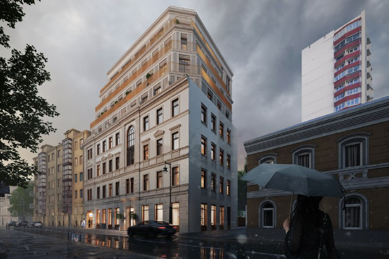
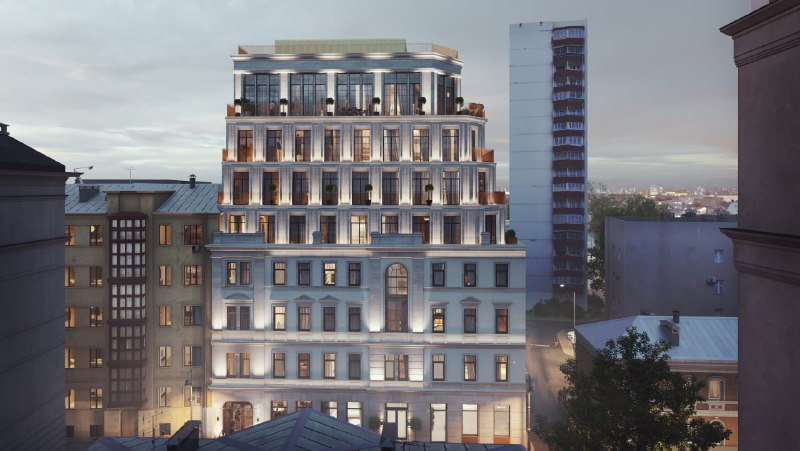

---
source:
  id: 31140
  date: '2025-09-17'
status: needs_review
skip_reason: null
type: object
region: moscow
title: 'Клубный дом «Левшинский, 19» от ТСИ: 16 квартир, цены от 200 млн ₽'
title_alts:
- 'Большой Левшинский, 19: клубный дом ТСИ на месте дома Духовских, от 200 млн ₽'
- 'Your MAJESTY на Левшинском: 16 квартир и 8 этажей, сдача в 2028 году'
slug: levshinskiy-19-tsi-klubnyy-dom-ceny
lead: 'Трансстройинвест (ТСИ) строит клубный дом на месте снесённого дома Духовских в Большом Левшинском переулке: в сентябре 2025 года проект готовился к продажам, к октябрю 2026 года квартиры предлагаются от 200 млн ₽.'
developers:
- id: transstroyinvest
  name: Трансстройинвест
  role: main
objects:
- id: your-majesty
  names:
  - Your MAJESTY
  - Левшинский, 19
  - доходный дом Духовских
  zu: Большой Левшинский, 19
  main: true
  new: false
districts:
- presnenskiy
topics:
- premium
- ceny
images:
- file: media/31140_2.jpg
  alt: 'Визуализация клубного дома на Большом Левшинском, 19 в Пресненском районе: восьмиэтажное здание с историческим фасадом'
  caption: Клубный дом на Большом Левшинском, 19, вид с улицы
  credit: 'Визуализация: Трансстройинвест'
- file: media/31140_3.jpg
  alt: 'Вечерняя визуализация клубного дома на Большом Левшинском, 19 в Пресненском районе: светлый фасад с террасами'
  caption: Клубный дом на Большом Левшинском, 19, вечерний вид
  credit: 'Визуализация: Трансстройинвест'
factcheck:
- claim: Застройщик — ООО «Трансстройинвест»; в характеристиках также СЗ «Смоленский бульвар»
  status: confirmed
  source: https://www.novostroy-m.ru/baza/jk_levshinskiy_19
  checked: '2026-10-14'
- claim: 16 квартир (в продаже 10), 8 этажей, один корпус, элит, ДДУ с эскроу
  status: confirmed
  source: https://www.novostroy-m.ru/baza/jk_levshinskiy_19
  checked: '2026-10-14'
- claim: Разрешение на строительство от 24.06.2025, проектные декларации от 16.09 и 17.09.2025
  status: confirmed
  source: https://www.novostroy-m.ru/baza/jk_levshinskiy_19
  checked: '2026-10-14'
- claim: 'Цена: от 200,28 млн ₽ (70,4 м²), диапазон 200–602 млн ₽ (прогноз заметки: около 3 млн ₽/м², 400+ млн средний чек)'
  status: changed
  source: https://www.novostroy-m.ru/baza/jk_levshinskiy_19
  checked: '2026-10-14'
- claim: Срок сдачи — 2 квартал 2028 года
  status: confirmed
  source: https://www.novostroy-m.ru/baza/jk_levshinskiy_19
  checked: '2026-10-14'
- claim: 'Здание снесено: почти полностью разрушено на выходных перед 21.07.2025'
  status: confirmed
  source: https://moskvichmag.ru/?p=441830
  checked: '2026-10-14'
- claim: Рендеры нового ЖК прошли экспертизу, предусмотрено частичное воссоздание фасада; 8 этажей
  status: confirmed
  source: https://moskvichmag.ru/?p=432955
  checked: '2026-10-14'
- claim: Дом Духовских построен в 1904 году по проекту Мейснера
  status: confirmed
  source: https://moskvichmag.ru/?p=432955
  checked: '2026-10-14'
- claim: Общая площадь проекта 2,3 тыс. кв. м; средняя площадь квартиры 142 кв. м; пентхаус увеличен (до 240 кв. м)
  status: unverified
  source: ''
  checked: '2026-10-14'
- claim: Участок перешёл от Palladio Group к ТСИ
  status: unverified
  source: ''
  checked: '2026-10-14'
- claim: Архитектор — HADAA
  status: unverified
  source: ''
  checked: '2026-10-14'
removed:
- 'Площадь проекта 2,3 тыс. кв. м, средняя площадь 142 кв. м и увеличенный пентхаус до 240 кв. м: независимо не подтверждены.'
- 'Переход участка от Palladio Group к ТСИ: независимо не подтверждён, в ownership_changes не вынесен; текущий застройщик ТСИ подтверждён агрегатором.'
- 'Авторство HADAA: источники называют бюро только в подписи к изображениям, не как архитектора.'
- 'Рассуждения заметки о финансовой модели элитных проектов и массовом сегменте: общие, без проверяемых фактов.'
- 'Прогноз цены 3 млн ₽/м² и бюджет 400+ млн: заменён фактическими ценами.'
data_points: []
seo:
  main_query: левшинский 19 клубный дом цены
  keywords:
  - Большой Левшинский 19 ЖК
  - Your MAJESTY Левшинский
  - Трансстройинвест клубный дом
  - дом Духовских снос
  - клубный дом Пресненский район сроки сдачи
  frequency_checked: false
  title: 'Левшинский, 19 от ТСИ: клубный дом, цены от 200 млн ₽'
  description: 'Клубный дом на Большом Левшинском, 19 от Трансстройинвеста: 16 квартир, 8 этажей, цены от 200 млн ₽, сдача во 2 квартале 2028 года. Что известно к октябрю 2026.'
  canonical: https://шахматка.москва/novosti/levshinskiy-19-tsi-klubnyy-dom-ceny/
internal_links:
- anchor: досье «Your MAJESTY»
  url: /obekty/your-majesty/
- anchor: карточка компании ТСИ
  url: /zastroyshchiki/transstroyinvest/
- anchor: премиум-класса
  url: /novostroyki/premium-klass/
- anchor: ДДУ
  url: /slovar/ddu/
faq:
- q: Кто застройщик клубного дома на Большом Левшинском, 19?
  a: Агрегатор «Новостройки Москвы» указывает ООО «Трансстройинвест»; в характеристиках также упомянуто СЗ «Смоленский бульвар».
- q: Сколько стоят квартиры в клубном доме «Левшинский, 19»?
  a: На октябрь 2026 года самое дешёвое предложение — двухкомнатная квартира 70,4 м² за 200,3 млн ₽; диапазон цен на странице агрегатора — 200–602 млн ₽.
- q: Когда сдадут клубный дом на Большом Левшинском, 19?
  a: По данным агрегатора, срок сдачи — 2 квартал 2028 года. Разрешение на строительство датировано 24 июня 2025 года.
- q: Что стало с домом Духовских на Большом Левшинском, 19?
  a: Здание 1904 года почти полностью разрушили на выходных 19–20 июля 2025 года; проект предусматривает частичное воссоздание исторического фасада.
date_published: '2025-09-17'
date_modified: '2026-10-14'
author: Редакция Шахматки
editor_notes: 'Проверить человеку: (1) основные данные (16 квартир, цены, срок, разрешение, застройщик) взяты с агрегатора «Новостройки Москвы», наш.дом.рф и сайт застройщика не открывались; стадия на агрегаторе противоречива (котлован и проектирование); (2) смена собственника Palladio → ТСИ не подтверждена, в ownership_changes не вынесена; (3) в одном источнике дом описан как «будет снесён», в другом — как уже снесённый 19–20 июля 2025 года, текст опирается на последний; (4) расчёт 2,85 млн ₽/м² — наш (200 283 072 ₽ / 70,4 м²); (5) визуализации подписаны Трансстройинвестом по подписи в «Москвич Mag», права подтверждает пресс-служба; (6) фото 31140_1 с красными пометками редакции канала не взято, 31140_4 (фасад с вывеской бренда) и 31140_5 не использованы; (7) «Your MAJESTY» — название из досье, в открытых источниках используется «Левшинский, 19».'
schema: '{"@context": "https://schema.org", "@graph": [{"@type": "Article", "headline": "Клубный дом «Левшинский, 19» от ТСИ: 16 квартир, цены от 200 млн ₽", "description": "Клубный дом на Большом Левшинском, 19 от Трансстройинвеста: 16 квартир, 8 этажей, цены от 200 млн ₽, сдача во 2 квартале 2028 года. Что известно к октябрю 2026.", "datePublished": "2025-09-17", "dateModified": "2026-10-14", "author": {"@type": "Organization", "name": "Редакция Шахматки"}, "publisher": {"@type": "Organization", "name": "Шахматка"}, "about": [{"@type": "Residence", "name": "Клубный дом «Левшинский, 19»", "address": "Москва, Большой Левшинский переулок, 19"}, {"@type": "Organization", "name": "Трансстройинвест"}], "mainEntityOfPage": "https://шахматка.москва/novosti/levshinskiy-19-tsi-klubnyy-dom-ceny/"}, {"@type": "FAQPage", "mainEntity": [{"@type": "Question", "name": "Кто застройщик клубного дома на Большом Левшинском, 19?", "acceptedAnswer": {"@type": "Answer", "text": "Агрегатор «Новостройки Москвы» указывает ООО «Трансстройинвест»; в характеристиках также упомянуто СЗ «Смоленский бульвар»."}}, {"@type": "Question", "name": "Сколько стоят квартиры в клубном доме «Левшинский, 19»?", "acceptedAnswer": {"@type": "Answer", "text": "На октябрь 2026 года самое дешёвое предложение — двухкомнатная квартира 70,4 м² за 200,3 млн ₽; диапазон цен на странице агрегатора — 200–602 млн ₽."}}, {"@type": "Question", "name": "Когда сдадут клубный дом на Большом Левшинском, 19?", "acceptedAnswer": {"@type": "Answer", "text": "По данным агрегатора, срок сдачи — 2 квартал 2028 года. Разрешение на строительство датировано 24 июня 2025 года."}}, {"@type": "Question", "name": "Что стало с домом Духовских на Большом Левшинском, 19?", "acceptedAnswer": {"@type": "Answer", "text": "Здание 1904 года почти полностью разрушили на выходных 19–20 июля 2025 года; проект предусматривает частичное воссоздание исторического фасада."}}]}]}'
---
# Клубный дом «Левшинский, 19» от ТСИ: 16 квартир, цены от 200 млн ₽

Девелопер ТСИ (Трансстройинвест) строит небольшой клубный дом на Большом Левшинском, 19. В сентябре 2025 года проект готовился к продажам, к 14 октября 2026 года самое дешёвое предложение стоит 200,3 млн ₽ за двухкомнатную квартиру.

## Коротко

- Дом на участке «Большой Левшинский, 19» (район Пресненский, ЦАО): 16 квартир, 8 этажей, один корпус.
- Разрешение на строительство датировано 24 июня 2025 года, проектные декларации опубликованы 16 и 17 сентября 2025 года.
- Цены на октябрь 2026 года: от 200,3 млн ₽ за 70,4 м², диапазон на странице проекта — 200–602 млн ₽.
- Срок сдачи: 2 квартал 2028 года.

*Визуализация клубного дома на Большом Левшинском, 19. Визуализация: Трансстройинвест*

## Что было на участке и что строят

На участке стоял доходный дом Духовских, построенный в 1904 году по проекту Ивана Мейснера. Проект реконструкции с надстройкой обсуждался ещё в 2023 году. В июне 2025 года «Москвич Mag» сообщил, что обновлённые рендеры нового клубного дома прошли экспертизу и предусматривают частичное воссоздание исторического фасада.

Дом разрушили на выходных 19–20 июля 2025 года (о сносе сообщили 21 июля). То есть реконструкция превратилась в снос с последующим строительством: фасад будет воссоздаваться, а не сохраняться. Новое здание — восемь этажей с подземными уровнями общей площадью около 3 тыс. м², объём по проекту вырастет вдвое.

*Вечерний вид клубного дома на Большом Левшинском, 19. Визуализация: Трансстройинвест*

## Сколько стоят квартиры

По данным «Новостроек Москвы», на сайте выставлено 10 из 16 квартир. Площади в предложениях — от 70,4 до 175,4 м². Самое дешёвое предложение — двухкомнатная квартира 70,4 м² на втором этаже за 200 283 072 ₽, то есть около 2,85 млн ₽/м² (наш расчёт). Верхняя граница диапазона — 602 млн ₽.

Для сравнения: в сентябре 2025 года рынок ожидал около 3 млн ₽/м². На наш взгляд, ориентир оказался близок к реальным ценам. Подробнее о сегменте — в подборке [премиум-класса](/novostroyki/premium-klass/).

## Что с проектом сейчас

По состоянию на 14 октября 2026 года проект продаётся по ДДУ с эскроу-счетами. Срок — 2 квартал 2028 года. Агрегатор указывает стадию «котлован/фундамент», а в описании — «проектирование», так что фактический этап стройки лучше проверять по наш.дом.рф.

Полная история участка — в [досье «Your MAJESTY»](/obekty/your-majesty/). Застройщика ТСИ можно посмотреть в [карточке компании](/zastroyshchiki/transstroyinvest/).

## Что это значит для покупателя и инвестора

- Чек очень высокий: от 200 млн ₽ даже за небольшую квартиру.
- Масштаб в 16 квартир означает, что один непроданный лот заметно меняет экономику проекта.
- Риски: срок ввода, воссоздание фасада по согласованному проекту, прозрачность условий сделки. Покупать стоит по [ДДУ](/slovar/ddu/) после проверки декларации.
- Что отслеживать: ход строительства на наш.дом.рф и изменение цен в течение продаж.

## Карточка объекта

- **Адрес ЗУ:** Большой Левшинский, 19 (ЦАО, Пресненский район)
- **Названия:** Your MAJESTY, «Левшинский, 19», доходный дом Духовских
- **Застройщик:** Трансстройинвест (ТСИ)
- **Класс:** элит
- **Этажность:** 8, один корпус
- **Квартиры:** 16 (в продаже 10)
- **Стадия:** строительство, разрешение от 24 июня 2025 года
- **Ввод:** 2 квартал 2028 года
- **Цена:** от 200,3 до 602 млн ₽ (по данным агрегатора, на октябрь 2026 года)

## Вопросы и ответы

**Кто застройщик клубного дома на Большом Левшинском, 19?**
Агрегатор «Новостройки Москвы» указывает ООО «Трансстройинвест»; в характеристиках также упомянуто СЗ «Смоленский бульвар».

**Сколько стоят квартиры в клубном доме «Левшинский, 19»?**
На октябрь 2026 года самое дешёвое предложение — двухкомнатная квартира 70,4 м² за 200,3 млн ₽; диапазон цен на странице агрегатора — 200–602 млн ₽.

**Когда сдадут клубный дом на Большом Левшинском, 19?**
По данным агрегатора, срок сдачи — 2 квартал 2028 года. Разрешение на строительство датировано 24 июня 2025 года.

**Что стало с домом Духовских на Большом Левшинском, 19?**
Здание 1904 года почти полностью разрушили на выходных 19–20 июля 2025 года; проект предусматривает частичное воссоздание исторического фасада.

## Источники

1. [Клубный дом «Левшинский, 19» — «Новостройки Москвы»](https://www.novostroy-m.ru/baza/jk_levshinskiy_19)
2. [Власти согласовали строительство клубного ЖК в Б. Левшинском переулке на месте дома Духовских — «Москвич Mag», 7 июня 2025](https://moskvichmag.ru/?p=432955)
3. [В Большом Левшинском снесли старейший доходный дом Духовских — «Москвич Mag», 21 июля 2025](https://moskvichmag.ru/?p=441830)
4. [Доходный дом Духовских в Большом Левшинском надстроят — «Москвич Mag», 23 декабря 2023](https://moskvichmag.ru/?p=337566)

Материал не является инвестиционной рекомендацией.
