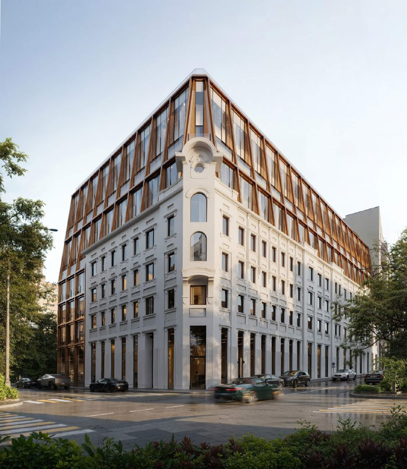
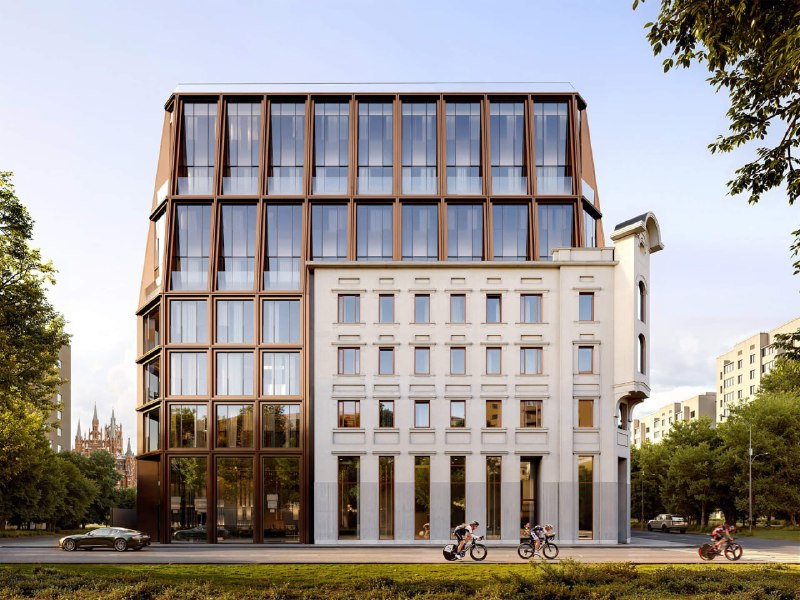
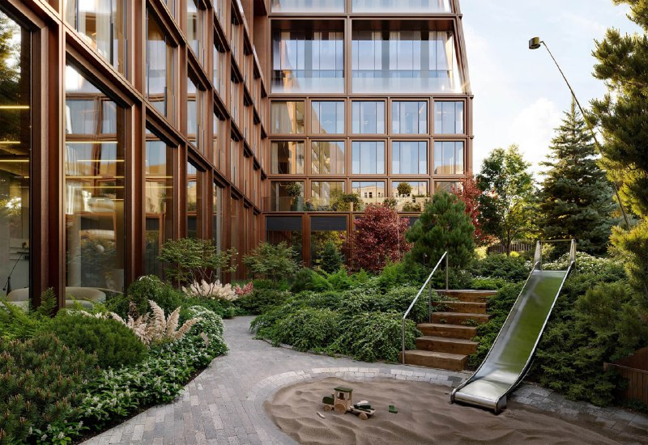

# Климашкина, 7/11 от MR Group: 46 резиденций за фасадом Нирнзее

Фасад дома Нирнзее на Климашкина больше десяти лет стоял без самого дома. Теперь за ним растёт клубный дом MR Group на 46 «резиденций» (у застройщика квартиры давно называются только так). Сдача — в IV квартале 2028 года, а метр в каталогах стоит от 1,8 до 2,45 млн ₽.

*Визуализация: MR Group. Старый фасад внизу, новый объём сверху.*

## Коротко

- **Что:** клубный дом К7/11 на Климашкина, 7/11 в [Пресненском районе](/novostroyki/presnenskiy/), монолитно-кирпичный, восемь этажей, 46 резиденций.
- **Кто:** [MR Group](/zastroyshchiki/mr-group/).
- **Когда:** сдача заявлена на IV квартал 2028 года.
- **Сколько:** однокомнатная на 50,2 м² — от 102,48 млн ₽, трёхкомнатная на 140,4 м² — от 248,63 млн ₽. Это примерно от 1,8 до 2,4 млн ₽ за м².

## Что строят на Климашкина, 7/11

К7/11 — название как из каталога парковочных мест: коротко, понятно, ничего лишнего. Остальное в проекте устроено тоньше. В доме 46 квартир, на этаже от двух до четырёх. Под домом паркинг на 55 машино-мест, во дворе сад от бюро L.BURO, внутри — SPA, фитнес и лобби с потолками до 5 м.

Снаружи — классический для Москвы приём: старый белый фасад внизу, новый стеклянный объём в бронзовых рамах сверху. Выглядит аккуратно. Фасад здесь не декорация для рендеров, а условие участка: от дома осталась только его часть.

*Визуализация: MR Group. Торцевой фасад с сохранённой угловой частью.*

## Откуда взялся фасад

Доходный дом на Климашкина построили в начале XX века по проекту архитектора Эрнста-Рихарда Нирнзее — того самого, который построил в Москве больше сорока зданий. В 2008 году дом закрыли на реконструкцию, во время сварочных работ случился пожар, а годом позже обрушились два верхних этажа и кровля. От здания осталась часть фасада, и она больше десяти лет просто стояла.

В феврале 2025 года стало известно о проекте восьмиэтажного клубного дома с двухуровневым паркингом и сохранением кирпичной стены. Тогда проект проходил государственную историко-культурную экспертизу. Полная история участка — в [досье «К7/11»](/obekty/k7-11/).

## Сколько стоят квартиры в К7/11

В каталогах на 15 октября 2026 года картина такая:

- однокомнатная, 50,2 м² — от 102,48 млн ₽, это около 2,04 млн ₽/м²;
- двухкомнатная, 109,9 м² — от 244,47 млн ₽, около 2,22 млн ₽/м²;
- трёхкомнатная, 140,4 м² — от 248,63 млн ₽, около 1,77 млн ₽/м²;
- конкретная «однушка» на 3 этаже из 8, без отделки: 122,99 млн ₽, то есть 2,45 млн ₽/м².

Разброс объясняется просто: «от» — это самая дешёвая квартира в линейке, а цена за метр зависит от этажа и вида. Для Пресни с историческим фасадом и 46 квартирами это не удивляет, но и не скромно.

*Визуализация: MR Group. Двор-сад: в каталогах он назван работой бюро L.BURO.*

## Что с проектом сейчас

По состоянию на 15 октября 2026 года дом продаётся: в каталоге у застройщика числятся 17 квартир. Срок сдачи — IV квартал 2028 года. Данные о ходе строительства и об архитекторе проекта в каталогах не приводятся.

## Что это значит для покупателя

Это покупка клубного формата: мало соседей, закрытый двор, история на фасаде. За это платят премию — и и она немаленькая.

Что учесть. Первое: до сдачи два года, а проект с реставрацией фасада — не самая быстрая стройка. Второе: цены в каталогах разнятся от квартиры к квартире, и «от» не означает, что вы получите именно такую. Третье: в проектной декларации на наш.дом.рф стоит смотреть срок, площадь и разрешение — а не только каталожные даты. Другие дома этого сегмента — в подборке [новостроек премиум-класса](/novostroyki/premium-klass/), общая картина — в разделе [«Премиум»](/temy/premium/).

## Карточка объекта

- Названия: К7/11, «Климашкина 7/11», дом Нирнзее.
- Адрес ЗУ: Климашкина, 7/11, Пресненский район, ЦАО, Москва.
- Застройщик: MR Group.
- Класс: премиум.
- Дом: монолитно-кирпичный, восемь этажей, 46 резиденций.
- Паркинг: 55 машино-мест.
- Сдача: IV квартал 2028 года.
- Цена в каталогах: примерно от 1,8 до 2,4 млн ₽/м² (октябрь 2026 года).

## Вопросы и ответы

**Где находится ЖК «Климашкина 7/11»?**
В Пресненском районе ЦАО, на Климашкина, 7/11. По данным каталога, до «Краснопресненской» около 12 минут пешком.

**Сколько квартир в клубном доме на Климашкина, 7/11?**
Всего 46 резиденций, на этаже от 2 до 4 квартир. Дом восьмиэтажный, монолитно-кирпичный, с сохранённым историческим фасадом.

**Сколько стоят квартиры в К7/11?**
В каталогах на октябрь 2026 года однокомнатная 50,2 м² — от 102,48 млн ₽, двухкомнатная 109,9 м² — от 244,47 млн ₽, трёхкомнатная 140,4 м² — от 248,63 млн ₽. Это примерно от 1,8 до 2,4 млн ₽ за м².

**Когда сдадут клубный дом на Климашкина, 7/11?**
Срок сдачи в каталогах — IV квартал 2028 года.

## Источники

1. ЦИАН, карточка квартиры в ЖК «Климашкина 7/11», октябрь 2026 года: https://www.cian.ru/sale/flat/323699240/
2. ЦИАН, новостройки премиум-класса от MR Group: https://www.cian.ru/novostroyki-premium-klassa-ot-zastroyschika-mr-group-6008-RLTM/
3. ЦИАН, новостройки у метро «Улица 1905 года»: https://www.cian.ru/novostroyki-s-vysokimi-potolkami-moskva-metro-ulica-1905-goda-134/
4. «Москвич Mag», 3 февраля 2025 года, о клубном доме на месте дома Нирнзее: https://moskvichmag.ru/gorod/na-ostatkah-dohodnogo-doma-nirnzee-na-ulitse-klimashkina-postroyat-klubnyj-dom/

Материал не является инвестиционной рекомендацией.
