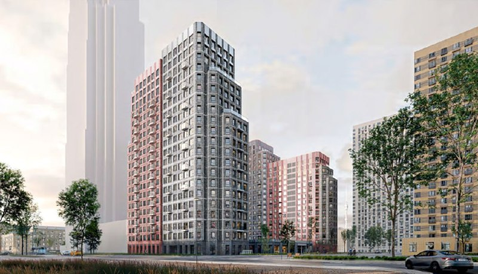

# «Руставели, 14» от ПИК: новая очередь, цены и сроки сдачи

ПИК продаёт новую очередь в ЖК «Руставели, 14» на улице Руставели, вл. 14, в Бутырском районе: корпуса 3.5–3.7 должны сдать в I квартале 2029 года. Одиннадцать домов предыдущих очередей к октябрю 2026 года уже введены.

*Визуализация корпусов новой очереди ЖК «Руставели, 14». Визуализация: ПИК*

## Коротко

- Застройщик — ПИК (юрлицо СЗ ПЛАМ); концепцию разработало бюро HADAA Architects.
- Введены корпуса 1.1–1.3 и 2.1–2.8; корпуса 3.5–3.7 строятся, сдача — I квартал 2029 года.
- В объявлениях на новую очередь цена около 556–600 тыс. ₽/м², отделка чистовая.
- До метро «Бутырская» около 3 минут пешком.

## Что за проект и где он находится

ЖК «Руставели, 14» — многоочередной проект ПИК на улице Руставели в СВАО. По [описанию каталога](https://www.novostroy-m.ru/baza/jk_na_rustaveli_14), в нём 14–33 этажа, а ближайшая станция метро — «Бутырская» (около 3 минут пешком); станция МЦД «Останкино» — 12–14 минут. В 2021 году [проект описывали](https://www.novostroy-m.ru/novosti/v_jk_rustaveli_14) как 16 корпусов высотой от 12 до 32 этажей с двумя детскими садами, школой и паркингом.

В июне 2021 года ПИК начал продажи корпуса 1.2 (32 этажа) от 7,9 млн ₽. Полная история проекта и хронология — в [досье «Руставели, 14»](/obekty/rustaveli-14/).

## Когда сдадут «Руставели, 14» и что уже построено

Корпуса 1.1–1.3 и 2.1–2.8, всего 11 домов, введены, ключи выдаются. Корпуса 3.5–3.7 строятся: срок сдачи по данным каталога и объявлений — I квартал 2029 года. [Проектная декларация](/slovar/proektnaya-deklaratsiya/) на эти корпуса датирована 2025 годом.

## Сколько стоят квартиры в «Руставели, 14»

В [объявлении на корпус 3](https://www.novostroy-m.ru/kvartiry/odnokomnatnaya-kvartira-v-rustaveli-14-ae288c00de442a7bdddffd3fa3f55c) цена составляла около 556 тыс. ₽/м² (последнее обновление истории цен — 27 июля 2026 года; сама страница на 13 октября 2026 года помечена как неактуальная). В [объявлении на корпус 3.7](https://www.cian.ru/sale/flat/328917452/) — около 600 тыс. ₽/м²: 21 этаж, чистовая отделка, сдача в I квартале 2029 года. Общий разброс цен квартир по каталогу — примерно от 18,4 до 40,4 млн ₽.

Объявления не заменяют прайс застройщика, поэтому ориентироваться стоит на диапазон, а не на одну цифру. Отдельно стоит учесть, что в объявлениях указана чистовая отделка: она входит в цену.

## Что это значит для покупателя и инвестора

Плюсы проекта по фактам: 11 домов уже введены, до метро — около 3 минут пешком. Риски обычные для очереди, которая ещё строится: срок ввода — I квартал 2029 года, то есть больше двух лет, и цена за метр выше 550 тыс. ₽ по объявлениям. [ТЭП](/slovar/tep/) корпусов и параметры окружения стоит уточнять в проектной декларации. Следить стоит за ходом стройки и за изменением цены в корпусах очереди.

Общую картину по ценам смотрите в разделе [цены на новостройки](/temy/ceny/) и в подборке [ЖК в продаже](/novostroyki/start-prodazh/).

## Карточка объекта

- Адрес: Москва, ул. Руставели, вл. 14, Бутырский район, СВАО
- Название: «Руставели, 14»
- Застройщик: [ПИК](/zastroyshchiki/pik/) (СЗ ПЛАМ)
- Архитектор концепции: HADAA Architects
- Метро: «Бутырская», около 3 минут пешком
- Стадия: корпуса 1.1–1.3, 2.1–2.8 введены; 3.5–3.7 строятся
- Ввод очереди: I квартал 2029 года
- Цена в объявлениях: около 556–600 тыс. ₽/м², отделка чистовая

## Вопросы и ответы

**Кто застройщик ЖК «Руставели, 14»?**
Проект ведёт ПИК, строительство — через юрлицо СЗ ПЛАМ. Концепцию разработало бюро HADAA Architects.

**Когда сдадут новую очередь «Руставели, 14»?**
Корпуса 3.5–3.7 строятся, срок сдачи — I квартал 2029 года. Корпуса 1.1–1.3 и 2.1–2.8 уже введены.

**Сколько стоят квартиры в «Руставели, 14» в 2026 году?**
В объявлениях на корпус 3 цена составляла около 556 тыс. ₽/м² (июль 2026 года) и около 600 тыс. ₽/м² (корпус 3.7). По каталогу квартиры стоят примерно от 18,4 до 40,4 млн ₽.

**Где находится ЖК «Руставели, 14»?**
На улице Руставели, вл. 14, в Бутырском районе СВАО. До метро «Бутырская» около 3 минут пешком.

## Источники

1. [Новостройки Москвы: ЖК на Руставели, 14 (каталог, сроки, корпуса)](https://www.novostroy-m.ru/baza/jk_na_rustaveli_14)
2. [Новостройки Москвы: объявление на корпус 3, цена, срок сдачи](https://www.novostroy-m.ru/kvartiry/odnokomnatnaya-kvartira-v-rustaveli-14-ae288c00de442a7bdddffd3fa3f55c)
3. [Циан: объявление на корпус 3.7, ЖК «Руставели 14»](https://www.cian.ru/sale/flat/328917452/)
4. [Новостройки Москвы: в ЖК «Руставели 14» начались продажи корпуса 1.2, 17 июня 2021 года](https://www.novostroy-m.ru/novosti/v_jk_rustaveli_14)

Материал не является инвестиционной рекомендацией.
