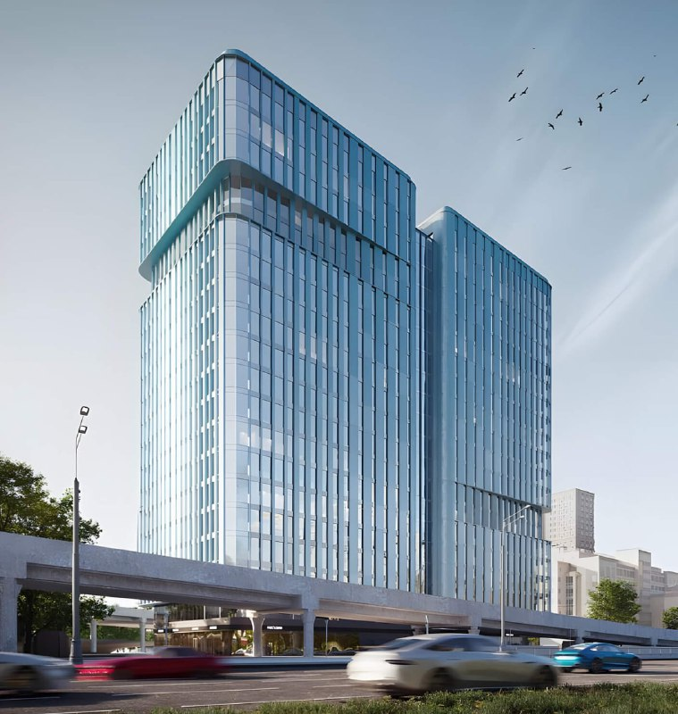
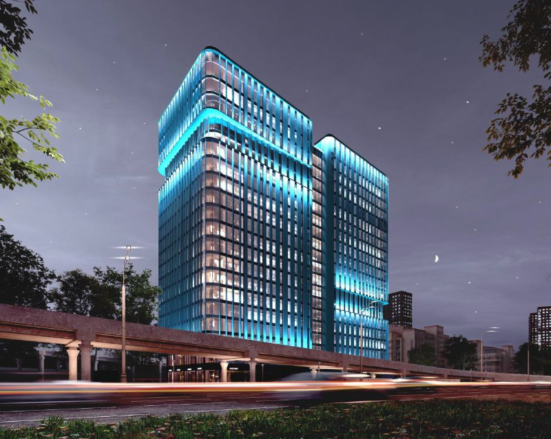
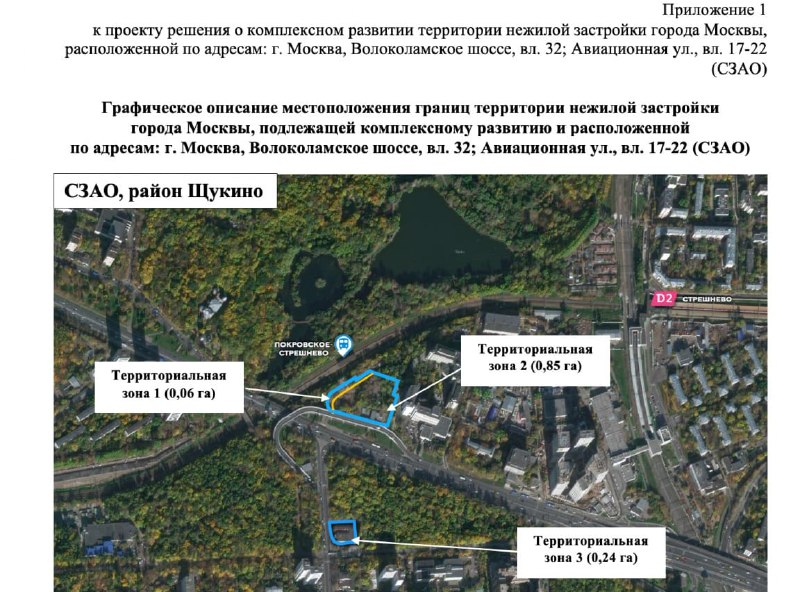

# Волоколамское, 32 в Щукине: офисная башня Forma вышла на продажи

Рендеры были бирюзовые, стеклянные и очень уверенные. Теперь у офисной башни на Волоколамском шоссе, 32 есть и согласованная городом концепция — 22 этажа и 67,3 тыс. м², — и цена: помещения от 17,9 млн ₽. Проект ведёт Forma, девелопер группы [ПИК](/zastroyshchiki/pik/), в рамках [КРТ](/slovar/krt/) (комплексного развития территории) в Щукине.

*Визуализация офисного здания в КРТ «Волоколамское, 32»: ступенчатая стеклянная башня у эстакады. Визуализация: Forma (ПИК)*

## Коротко

- **Где:** Волоколамское шоссе, 32 и Авиационная улица, 17-22, [Щукино](/novostroyki/shchukino/), СЗАО.
- **Что:** офисная башня, по концепции города — 22 этажа и 67,3 тыс. м², на месте газозаправочной станции.
- **Деньги:** 129 помещений от 57,88 до 558,61 м², самое доступное — от 17,9 млн ₽.
- **Когда:** первый корпус заявлен на IV квартал 2028 года.

## Что построят на Волоколамском, 32

Город согласовал архитектурную концепцию в марте 2026 года: 22 этажа, 67,3 тыс. м², автор — бюро Parsec. Первый этаж отдадут под ретейл, паркинг предусмотрен подземный и надземный. Участок — бывшая заправка, так что с «чистого поля» не начинают.

Стеклянный фасад, вертикальные рёбра, два объёма, сдвинутых друг относительно друга: на картинках получился узнаваемый офисник середины 2020-х. Запоминается, но не шокирует — как раз то, что любят в офисных проектах.

*Та же башня в вечерней подсветке: бирюзовый фасад — главный приём проекта. Визуализация: Forma (ПИК)*

Площадь, кстати, лучше проверять по документу. Город называет 67,3 тыс. м², а в карточке продаж на агрегаторе Novostroy-M указано около 61,7 тыс. м², причём этажей то 21, то 22. Чем объясняется разница, не раскрыто; общую, надземную и офисную площадь нередко считают по-разному.

## Сколько стоят офисы

В продаже, по данным Novostroy-M, 129 помещений от 57,88 до 558,61 м². Самое доступное стоит от 17,9 млн ₽. Класс заявлен А, срок для корпуса 1 — IV квартал 2028 года. Цену за квадратный метр там не раскрывают — считайте сами, исходя из площади конкретного лота.

Для офисного формата «от 58 м²» — это мелкая нарезка, на которой сейчас зарабатывают многие девелоперы. Покупатель здесь берёт не только метры, но и ставку на то, что к 2028 году спрос на небольшие офисы не остынет.

## Контекст: КРТ на трёх клочках

Территория КРТ складывается из трёх зон: 0,06, 0,85 и 0,24 га — всего около 1,15 га. Для Москвы это скромно: на таком пятне нужна не стройка века, а аккуратная плотная башня.

*Приложение к проекту решения о КРТ: три территориальные зоны площадью 0,06, 0,85 и 0,24 га. Документ: Правительство Москвы*

Полная история проекта — в [досье «Волоколамское, 32»](/obekty/volokolamskoe-32/). Как ПИК переводит проекты под бренд Forma — в материале [о переходе «Среды» в Forma](/novosti/sreda-pik-otkaz-ot-brenda-forma/).

## Что это значит для покупателя и инвестора

Плюсы очевидны: городская концепция согласована, застройщик крупный, КРТ — привычный и понятный механизм. Подвох в другом: цена входа от 17,9 млн ₽ за небольшой лот и срок 2028 года. Два года ожидания — срок, за который офисный рынок вполне может поменять настроение.

Следить стоит за тремя вещами: проектной декларацией и разрешением на строительство, ценой за метр на старте реальных продаж и итоговой площадью — сверьте её с документами, а не с рекламой. Другие проекты города — в теме [«КРТ»](/temy/krt/).

## Карточка объекта

- Названия: Волоколамское, 32; Авиационная, 17-22; КРТ «Волоколамское, 32».
- Адрес ЗУ: Волоколамское шоссе, вл. 32; Авиационная ул., вл. 17-22, Щукино, СЗАО, Москва.
- Застройщик: Forma (СЗ «КРТ Волоколамское»), ПИК.
- Площадь территории КРТ: около 1,15 га (0,06 + 0,85 + 0,24 га).
- Концепция: 22 этажа, 67,3 тыс. м², Parsec (март 2026 года).
- Продажи: 129 помещений от 57,88 до 558,61 м², от 17,9 млн ₽.
- Срок: IV квартал 2028 года (корпус 1).

## Вопросы и ответы

**Кто строит офис на Волоколамском шоссе, 32?**
Девелопер Forma, входящий в ПИК, через СЗ «КРТ Волоколамское»; проект — в границах КРТ в Щукине.

**Сколько этажей и какая площадь у проекта на Волоколамском, 32?**
По концепции, согласованной в марте 2026 года, — 22 этажа и 67,3 тыс. м²; в карточке продаж указано около 61,7 тыс. м².

**Сколько стоят офисы на Волоколамском шоссе, 32?**
В продаже 129 помещений от 57,88 до 558,61 м², самое дешёвое — от 17,9 млн ₽.

**Когда сдадут офисный центр на Волоколамском, 32?**
В карточке на Novostroy-M срок первого корпуса — IV квартал 2028 года.

## Источники

1. 360.ru, 25 марта 2026 года, о согласованной концепции делового центра на Волоколамском шоссе: https://360.ru/tekst/moskva/ovchinskij-rasskazal-o-vide-novogo-delovogo-tsentra-na-volokolamskom-shosse/
2. Novostroy-M, карточка бизнес-центра на Волоколамском шоссе: https://www.novostroy-m.ru/baza/biznestsentr_na_volokolamskom_shosse
3. Novostroy-M, страница продаж бизнес-центра: https://www.novostroy-m.ru/commerce/novostroyka/biznestsentr_na_volokolamskom_shosse/sale

Материал не является инвестиционной рекомендацией.
