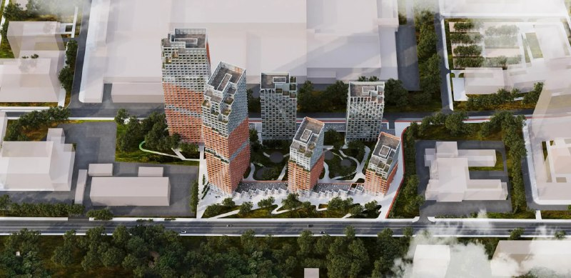
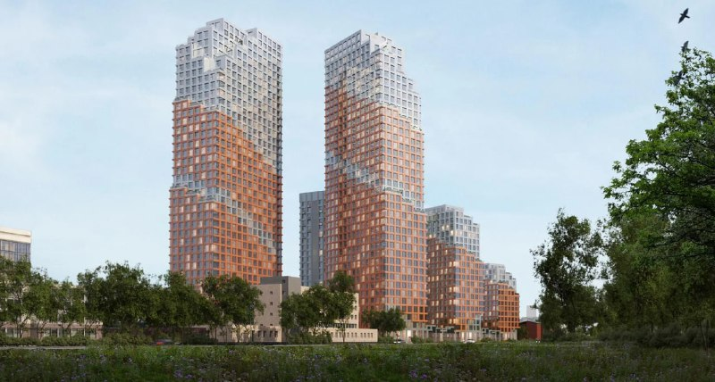

# Level Свободы в Южном Тушине: год в листе ожидания, а продаж всё нет

«Скоро!» у Level Group растянулось на год. Об открытии листа ожидания на жилой проект «Свободы» на ул. Свободы, 35 в Южном Тушине стало известно 22 октября 2025 года. На 13 октября 2026 года у квартир по-прежнему нет ни цен, ни срока сдачи, ни даты старта. Зато соседний light industrial уже вовсю продаётся.

## Коротко

- Жилой проект [Level Group](/zastroyshchiki/level-group/) «Свободы» на сайте застройщика — в статусе «Скоро!», с записью на «выгодное предложение на старте продаж».
- Ул. Свободы, 35, Южное Тушино (СЗАО). Класс — бизнес, до «Сходненской» 5 минут пешком (по данным застройщика).
- Цены, срок сдачи и очерёдность застройщик не публикует.
- По соседству, на том же адресе, уже продают light industrial Level work Свободы: от 56,7 млн ₽, сдача во II квартале 2028 года.

## Обещают «центр жизни», показывают башни

На странице проекта Level Group называет его «новым центром жизни, бизнеса и отдыха на северо-западе Москвы». Жилую часть при этом назвали просто «Свободы» — редкая для рынка сдержанность в нейминге. Площадь, этажность и число корпусов застройщик не раскрывает.

*Визуализация первой очереди жилого проекта «Свободы»: башни разной высоты вокруг общего двора. Визуализация: Level Group*

На визуализациях — башни с терракотовыми фасадами и светлыми верхними ярусами. Какие из них войдут в первую очередь и когда получат разрешение на строительство, застройщик пока не говорит.

*Визуализация жилого проекта «Свободы»: терракотовые фасады и светлые верхние ярусы. Визуализация: Level Group*

## Год на «Скоро!»

На 13 октября 2026 года картина такая:

- лист ожидания открыт, продаж нет;
- с тех пор как о записи стало известно, прошёл год;
- цену метра застройщик не называл. Всё, что гуляет по рынку о стартовой цене, — догадки, а не данные Level Group.

На наш взгляд, год ожидания без старта — повод внимательнее смотреть на разрешительные документы. И помнить: лист ожидания не фиксирует цену и не даёт никаких прав на квартиру. Это подписка на новости, а не бронь.

## Light industrial по соседству уже продают

С коммерцией застройщик не тянет. По данным сайта Level Group, Level work Свободы — проект формата light industrial (лёгкое производство и склады) на 189 тыс. м². Помещения — от 200 м², от 56,7 млн ₽ (от 164,8 тыс. ₽/м²), корпуса восьмиэтажные, сдача заявлена на II квартал 2028 года, расчёты через эскроу-счета. В справочнике «Новострой-М» у корпуса Г1 стоит IV квартал 2028 года и стадия «котлован/фундамент», архитектура — бюро ABOVE. Подробнее — в отдельном материале о [Level work Свободы](/novosti/level-work-svobody-light-industrial-tushino/).

Будущим жильцам это соседство стоит держать в голове: логистика, грузовики и шум будут зависеть от решений, которые застройщик пока не показал.

## Вместо промзоны — КРТ

Участок на Свободы, 35 входит в программу комплексного развития территории ([КРТ](/slovar/krt/)). В 2023 году город опубликовал проект решения о КРТ промзоны «Тушино»: 550 тыс. м² жилья, из них более 175 тыс. м² — под реновацию. Договор, торги и сроки разобраны в нашей статье [о КРТ на Свободы, 35](/novosti/level-svobody-35-tushino-krt/), вся история площадки — в [досье «Тушинский машиностроительный завод»](/obekty/tushinskiy-mashinostroitelnyy-zavod/).

## Что это значит для покупателя и инвестора

- Цены нет — сравнивать не с чем. Ориентир появится вместе с проектной декларацией и договором, а не со слухами о стартовом прайсе.
- Главный риск — неизвестность: ни старт, ни очерёдность, ни сдача жилья не названы.
- Что отслеживать: разрешение на строительство, проектную декларацию и первые цены на странице проекта. Другие проекты на старте — в разделе [старты продаж](/novostroyki/start-prodazh/).

## Карточка объекта

- **Адрес участка:** ул. Свободы, 35, Южное Тушино, СЗАО, Москва
- **Названия:** «Левел Свободы», «Свободы», Тушинский машиностроительный завод (по участку)
- **Застройщик:** [Level Group](/zastroyshchiki/level-group/)
- **Класс:** бизнес (по данным застройщика)
- **Метро:** «Сходненская», 5 минут пешком (по данным застройщика)
- **Стадия:** «Скоро!», запись в лист ожидания (на 13.10.2026)
- **Цена, срок сдачи:** не опубликованы

## Вопросы и ответы

**Когда начнутся продажи в ЖК «Левел Свободы»?**
Застройщик дату не называл. На 13 октября 2026 года проект на сайте Level Group висит со статусом «Скоро!» и предлагает записаться в лист ожидания.

**Сколько стоят квартиры в «Левел Свободы»?**
Пока никто не знает: застройщик цены не публикует. Известен только ценник коммерческого соседа — light industrial Level work Свободы от 56,7 млн ₽ за помещение (от 164,8 тыс. ₽/м²).

**Где находится проект и какое метро рядом?**
Ул. Свободы, 35, Южное Тушино, СЗАО. До метро «Сходненская», по словам застройщика, 5 минут пешком.

**Что такое light industrial в этом проекте?**
Отдельный коммерческий проект Level work Свободы: 8-этажные корпуса под производство и склады на 189 тыс. м², сдача заявлена на II квартал 2028 года.

## Источники

1. [Левел Свободы, сайт Level Group](https://level.ru/projects/svobody/)
2. [Level work Свободы, сайт Level Group](https://business.level.ru/projects/work-svobody/)
3. [Level work Свободы, справочник «Новострой-М»](https://www.novostroy-m.ru/baza/biznestsentr_level_work_svobody)
4. [В промзоне «Тушино» построят жилые кварталы, Novostroy-M, 29.05.2023](https://www.novostroy-m.ru/novosti/v_promzone_tushino_postroyat)

Материал не является инвестиционной рекомендацией.
