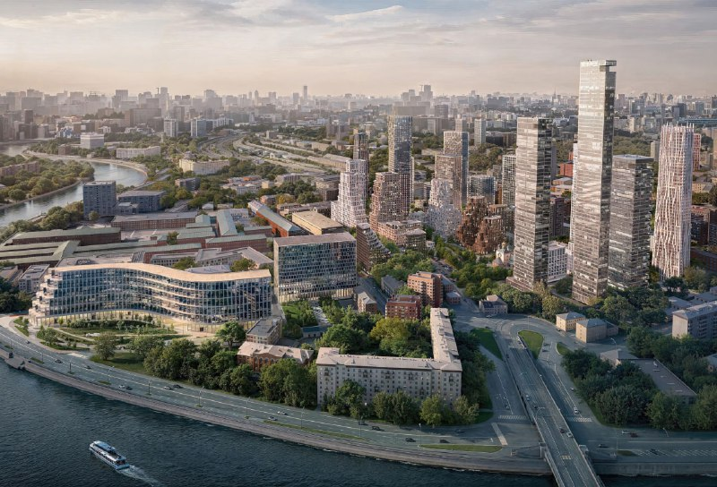
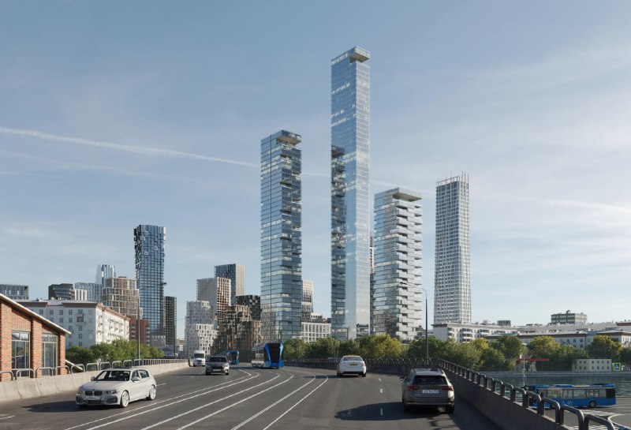

# КРТ «Дербеневская» у Павелецкой: «Пионер» строит 358 тыс. м² жилья

У метро «Павелецкая» Москва готовит одно из самых жилых КРТ центра. На 14,7 га «Пионер» должен построить свыше 358 тыс. м² жилья, школу на 1 тыс. мест и привести в порядок Дербеневскую набережную. Архитектурой занимается целая бригада бюро, а проект растянут до 2034 года.

## Коротко

- **Где:** [Даниловский район](/novostroyki/danilovskiy/), участок 14,7 га у Павелецкого вокзала и Дербеневской набережной.
- **Сколько жилья:** свыше 358 тыс. м² — это масштаб небольшого района.
- **Что ещё:** школа на 1 тыс. мест, парк, детские и спортивные площадки, нежилые помещения для офисов и сервисов.
- **Сроки:** по данным портала «Новострой-М», старт — 2027 год, завершение — 2034-й.

## Что известно о КРТ у метро «Павелецкая»

[КРТ](/slovar/krt/) — комплексное развитие территории: город и девелопер вместе перестраивают квартал, чаще всего бывшую промзону. Этот проект ведёт [«Пионер»](/zastroyshchiki/pioner/), и по размеру он тянет на главного героя центра Москвы: 14,7 га, жилья больше 358 тыс. м².

Портал «Новострой-М» называет проект КРТ «Павелецкая»; в нашем [досье «КРТ Дербеневская»](/obekty/krt-derbenevskaya/) он значится под вторым именем по названию набережной. Кроме квартир, в проекте нежилые помещения под офисы, сервисы и локальный бизнес, парк, обновлённая Дербеневская набережная и новая транспортная схема, которая должна связать квартал с соседними районами.

*Визуализация проекта КРТ у метро «Павелецкая»: башни и набережная. Визуализация: «Пионер»*

## Кто рисует квартал

Одним автором такие проекты давно не обходятся. По данным портала, здесь работают «Цимайло Ляшенко и партнёры», APEX, ADM, WALL и Kleinewelt Architekten. Пять бюро на один квартал — на наш взгляд, уже не роскошь, а правило жанра: на объёме в сотни тысяч квадратов один почерк быстро превращается в одну длинную коробку.

*Визуализация проекта: вид на квартал с проезжей части. Визуализация: «Пионер»*

## Что с проектом сейчас

По состоянию на 15 октября 2026 года проект остаётся в стадии проекта: старт запланирован на 2027 год, завершение — на 2034-й. Иначе говоря, застройка растянута почти на восемь лет, и дома будут появляться очередями. Ни цен, ни даты старта продаж пока нет — прикидывать выгоду рано.

## Что это значит для покупателя и инвестора

Для покупателя главное в цифре 358 тыс. м² не размах, а время. Чтобы продать такой объём, «Пионеру» понадобятся годы, и ценник будет зависеть не только от локации у Садового, но и от темпа продаж: когда на рынок выходит сразу столько метров, застройщик либо терпит, либо дробит проект.

Мы бы смотрели на три вещи. Первая — утверждённые параметры КРТ и проект планировки: именно в них будет окончательная жилая площадь. Вторая — разрешения на строительство первой очереди. Третья — цены на старте: ориентиров по новому кварталу пока нет. А рендерам верьте не больше, чем любому обещанию «в срок»: проверяйте по стройке.

## Карточка объекта

- Названия: КРТ «Дербеневская», КРТ «Павелецкая».
- Застройщик: «Пионер».
- Район: Даниловский, ЮАО, Москва.
- Площадь территории: 14,7 га.
- Жильё: свыше 358 тыс. м².
- Школа: на 1 тыс. мест.
- Сроки: старт — 2027 год, завершение — 2034-й.

## Вопросы и ответы

**Кто застройщик КРТ «Дербеневская» у метро «Павелецкая»?**
Проект ведёт «Пионер». Над архитектурой, по данным портала «Новострой-М», работают «Цимайло Ляшенко и партнёры», APEX, ADM, WALL и Kleinewelt Architekten.

**Сколько жилья построят в КРТ у Павелецкой?**
Свыше 358 тыс. м² жилья на участке 14,7 га. Кроме квартир — школа на 1 тыс. мест, парк и нежилые помещения для бизнеса и офисов.

**Когда начнётся и закончится строительство?**
По данным портала «Новострой-М», старт проекта запланирован на 2027 год, завершение — на 2034 год.

**Можно ли купить квартиру в КРТ «Дербеневская»?**
На октябрь 2026 года начало проекта ещё впереди: старт запланирован на 2027 год, так что до продаж квартир время есть.

Подробнее о механизме — в разделе [«КРТ»](/temy/krt/).

## Источники

1. «Новострой-М», о КРТ у метро «Павелецкая»: https://www.novostroy-m.ru/novosti/v_rayone_metro_paveletskaya
2. «Ведомости», 25 апреля 2024 года, о территории у Дербеневской набережной в Даниловском районе: https://www.vedomosti.ru/gorod/ourcity/articles/sobyanin-paveletskim-vokzalom

Материал не является инвестиционной рекомендацией.
