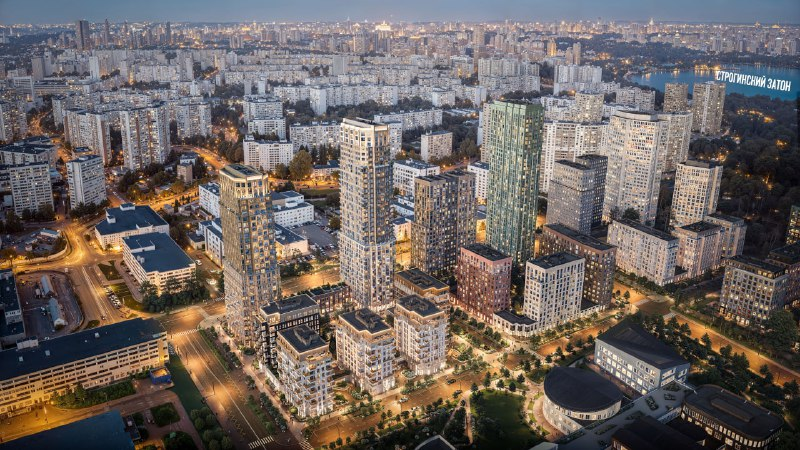
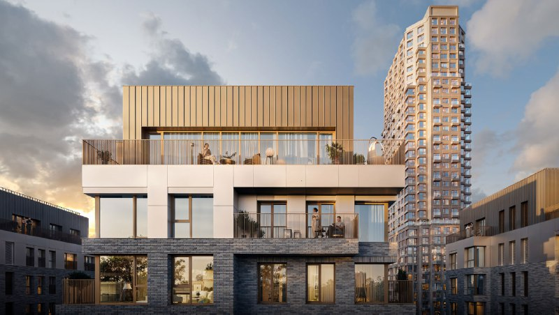
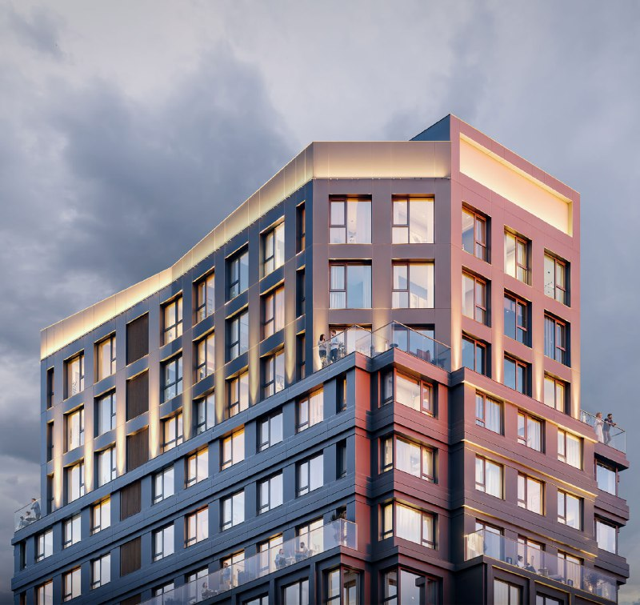

# «Строгино 360» от ПИК: квартиры от 17 млн ₽, сдача в 2028–2029 годах

ПИК продаёт в Строгине проект «Строгино 360»: бизнес-класс с террасами и отделкой, квартиры от 17 млн ₽, метр — от 450 тыс. ₽. Строгино получило новостройку с московским ценником — и теперь выяснит, готов ли район платить за террасы и вид на Строгинский затон.

## Коротко

- **Застройщик:** [ПИК](/zastroyshchiki/pik/), Строгино, метро «Строгино».
- **Цены на 15 октября 2026 года:** от 16,96 до 46,26 млн ₽ за квартиру, от 450 до 743,9 тыс. ₽/м².
- **Площади:** от 28,3 до 98,8 м².
- **Сдача:** от IV квартала 2028 до IV квартала 2029 года, в зависимости от корпуса.

## Что продают в «Строгино 360»

Проект собран из двух разных историй. Первая — малоэтажные корпуса: на визуализациях это кирпичные дома с террасами на верхних этажах и золотистой облицовкой. Вторая — башни-доминанты. Одна из них, корпус 1.3, — 35 этажей, квартиры от 28,5 до 92,3 м² с готовой отделкой.

Название запоминается: никаких «кварталов» и «парков» из брендбуков прошлого десятилетия, просто цифра. Что за ней стоит, зависит от корпуса и этажа.

*Визуализация «Строгино 360»: башни на фоне Строгинского затона. Визуализация: ПИК*

## Сколько стоят квартиры в «Строгино 360»

Вилка широкая: от 450 до 743,9 тыс. ₽/м². Разница в 1,65 раза — это не шум, а разные продукты. Студии в 35-этажных корпусах в объявлениях стоят около 17,7–19,9 млн ₽ и продаются с отделкой. Верхняя граница — 46,26 млн ₽.

Вывод простой: «средней цены по проекту» здесь не существует. Сравнивать нужно конкретный лот с конкретным соседом — по корпусу, этажу и сроку сдачи, а не по заголовку в рекламе.

*Визуализация «Строгино 360»: малоэтажный корпус с террасой и кирпичной кладкой на нижних этажах. Визуализация: ПИК*

## Когда сдадут «Строгино 360»

Единого срока нет: на текущий момент в продаже корпуса со сдачей от IV квартала 2028 до IV квартала 2029 года. Сдача в 2029-м — это три года ожидания, и вот здесь обещание «в срок» стоит проверять по стройплощадке, а не по рендерам. Подробности по конкретному корпусу смотрите в [проектной декларации](/slovar/proektnaya-deklaratsiya/) на «Наш.дом.рф».

## Что это значит для покупателя

Если вы смотрите на студию, закладывайте не 450 тыс. ₽/м² из заголовка, а 17–20 млн ₽ за лот в доминанте: «от» работает только для немногих квартир. Нижняя граница вилки — повод проверить, какой именно корпус и какой срок за ней стоят.

Главный риск — обычный для большого проекта: чем дальше очередь, тем больше от покупателя требуется веры. Поэтому выбирайте корпус с понятным графиком, а не самую красивую картинку. Полная история проекта — в [досье «Строгино 360»](/obekty/strogino-360/); другие проекты района — среди [новостроек Строгина](/novostroyki/strogino/). Как складываются [цены на новостройки](/temy/ceny/) в Москве — в соответствующем разделе.

*Визуализация «Строгино 360»: доминанта в золотистых тонах. Визуализация: ПИК*

## Что с проектом сейчас

На 15 октября 2026 года продажи идут: в продаже квартиры от 16,96 млн ₽, сдача — от IV квартала 2028 года.

## Карточка объекта

- Название: «Строгино 360».
- Застройщик: ПИК.
- Район: Строгино, СЗАО, Москва; метро «Строгино».
- Класс: бизнес.
- Площади квартир: 28,3–98,8 м².
- Цена: от 16,96 млн ₽, от 450 тыс. ₽/м².
- Стадия: продажи.
- Сдача: IV квартал 2028 – IV квартал 2029 года.

## Вопросы и ответы

**Кто застройщик «Строгино 360»?**
ПИК. Проект находится в Строгине, ближайшее метро — «Строгино».

**Сколько стоят квартиры в «Строгино 360»?**
На 15 октября 2026 года — от 16,96 до 46,26 млн ₽, или от 450 до 743,9 тыс. ₽ за м². Студии в 35-этажных корпусах — около 17,7–19,9 млн ₽.

**Когда сдадут «Строгино 360»?**
Сроки зависят от корпуса: от IV квартала 2028 до IV квартала 2029 года.

**Квартиры в «Строгино 360» с отделкой?**
Да, в объявлениях на студии и доминанты указана готовая отделка.

## Источники

1. Яндекс Недвижимость, «Строгино 360»: https://realty.yandex.ru/moskva_i_moskovskaya_oblast/kupit/kvartira/zhk-strogino-360-4208346/s-terrasoi/
2. Новострой-М, старт продаж «Строгино 360» (корпус 1.3): https://www.novostroy-m.ru/novosti/starty_prodaj_strogino_360
3. Циан, студии в «Строгино 360»: https://www.cian.ru/kupit-kvartiru-studiu-vozle-parka-krilatskii/

Материал не является инвестиционной рекомендацией.
