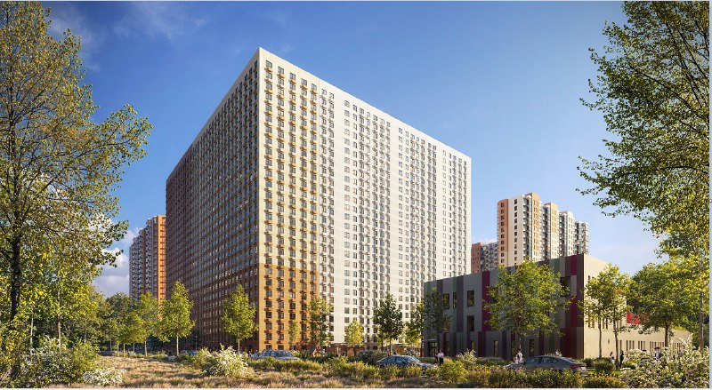
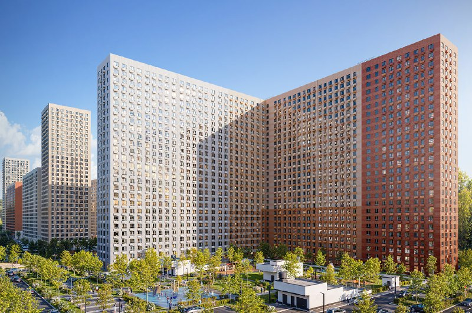

# «Митинский лес», корпус 14: студии от 10,9 млн ₽, сдача в IV квартале 2028-го

ПИК продаёт корпус 14 в «Митинском лесу»: 27 этажей, сдача в IV квартале 2028 года, студии от 10,9 млн ₽. Рядом, в том же Митине, у той же компании идёт «Квартал Мит». Получился почти лабораторный опыт: один девелопер, один район, два набора ценников — и покупателю решать, сколько стоят фасад и срок.

## Коротко

- **Корпус 14:** 27 этажей, сдача в IV квартале 2028 года, ключи — в ноябре 2028-го.
- **Студии 20,1 м²:** 10,9–11,0 млн ₽, это 540–548 тыс. ₽/м².
- **Двушки 48–57 м²:** 18,3–20,4 млн ₽, 327–386 тыс. ₽/м²; трёшки — около 22,9 млн ₽.
- **Сосед:** в «[Квартале Мит](/obekty/kvartal-mit/)» сдача во II квартале 2029 года, квартиры до 30 м² — от 12,3 млн ₽.

## Что продаёт ПИК в «Митинском лесу»

«[Митинский лес](/obekty/mitinskiy-les/)» — крупный проект [ПИК](/zastroyshchiki/pik/) на улице Муравской: 11 корпусов, продажи открыты в трёх, а корпуса 15 и 15.1 уже сданы. На 15 октября 2026 года в продаже около 270 квартир — от студий на 19,7 м² за 10,47 млн ₽ до четырёхкомнатной за 31,9 млн ₽.

Корпус 14 — один из тех, что ещё строятся: срок сдачи IV квартал 2028 года, ключи — в ноябре. Ближайшее метро — «Пятницкое шоссе».

*Визуализация «Митинского леса»: корпус с белым и оранжевым фасадом. Визуализация: ПИК*

## Сколько стоят квартиры в корпусе 14

Картина по объявлениям корпуса 14 на Яндекс Недвижимости такая:

- студии 20,1 м² — 10,86–11,01 млн ₽ (540–548 тыс. ₽/м²), студия 23,9 м² — 11,9 млн ₽;
- однушки 32,4–34,2 м² — 14,8–15,1 млн ₽ (442–458 тыс. ₽/м²);
- двушки 47,7–56,5 м² — 18,3–20,4 млн ₽ (327–386 тыс. ₽/м²);
- трёшки 75–77 м² — около 22,9 млн ₽ (298–305 тыс. ₽/м²).

Логика знакомая: чем меньше квартира, тем дороже метр. Студия 20 м² в пересчёте — почти вдвое дороже трёшки. Но и входной билет у неё самый низкий: 10,9 млн ₽ против 22,9 млн ₽. Это классическая ловушка «цены от»: она живёт в самых маленьких метрах.

## Чем «Митинский лес» отличается от «Квартала Мит»

Это два проекта ПИК в одном районе. «Квартал Мит» сдаётся на полгода позже — во II квартале 2029 года. Квартиры до 30 м² там стоят от 12,3 млн ₽, это 430–465 тыс. ₽/м².

Сравнение условное: студия 20 м² в корпусе 14 и 28–30 м² в «Квартале Мит» — разные квартиры. Но если смотреть на метры, то мелкая студия в «Митинском лесу» вовсе не дешевле. Мы бы смотрели на другое: срок. Корпус 14 сдаётся раньше, и это единственный аргумент, который не зависит от вкуса.

*Визуализация «Митинского леса»: протяжённый корпус с белым и кирпично-красным фасадом. Визуализация: ПИК*

## Что это значит для покупателя

Если вы присматриваетесь к студии в Митине, считайте не «от 10,9 млн ₽», а стоимость метра: 540 тыс. ₽/м² за 20 м² — это совсем другой разговор, чем 330–390 тыс. ₽ за двушку в том же доме. Для инвестора маленький лот может выглядеть выгоднее по бюджету и хуже по цене метра — выбирайте осознанно.

Проверьте срок по [проектной декларации](/slovar/proektnaya-deklaratsiya/): IV квартал 2028 года — это дата сдачи, а не заселения. Как менялись [цены на новостройки](/temy/ceny/) и что ещё строят вокруг — в разделе про [новостройки Митина](/novostroyki/mitino/).

## Что с проектом сейчас

На 15 октября 2026 года корпус 14 в продаже, срок сдачи — IV квартал 2028 года. Самая дешёвая студия корпуса — 10,9 млн ₽, самая дорогая из показанных квартира — трёшка за 22,9 млн ₽.

## Карточка объекта

- Название: «Митинский лес» (ранее — «Мир Митино»), корпус 14.
- Застройщик: ПИК.
- Район: Митино, Москва; ближайшее метро — «Пятницкое шоссе».
- Корпус 14: 27 этажей.
- Цены: студии от 10,86 млн ₽, двушки 18,3–20,4 млн ₽.
- Стадия: продажи.
- Сдача: IV квартал 2028 года.

## Вопросы и ответы

**Когда сдадут корпус 14 в «Митинском лесу»?**
В IV квартале 2028 года, ключи — в ноябре 2028 года.

**Сколько стоят квартиры в корпусе 14 «Митинского леса»?**
На 15 октября 2026 года в объявлениях студии 20,1 м² стоят 10,9–11,0 млн ₽, однушки 32–34 м² — 14,8–15,1 млн ₽, двушки — 18,3–20,4 млн ₽, трёшки — около 22,9 млн ₽.

**Чем «Митинский лес» отличается от «Квартала Мит»?**
Оба проекта ведёт ПИК в Митине. У «Квартала Мит» сдача во II квартале 2029 года, квартиры до 30 м² стоят от 12,3 млн ₽; в «Митинском лесу» срок — IV квартал 2028 года.

**Кто застройщик «Митинского леса»?**
ПИК.

## Источники

1. Яндекс Недвижимость, «Митинский лес»: https://realty.yandex.ru/moskva_i_moskovskaya_oblast/kupit/novostrojka/mitinskij-les-2292079/
2. Яндекс Недвижимость, квартиры в «Митинском лесу» (корпус 14): https://realty.yandex.ru/moskva_i_moskovskaya_oblast/kupit/kvartira/zhk-mitinskij-les-2292079/novostroyki/
3. Яндекс Недвижимость, «Квартал Мит»: https://realty.yandex.ru/moskva_i_moskovskaya_oblast/kupit/kvartira/zhk-kvartal-mit-4165663/malenkye-kvartiry/

Материал не является инвестиционной рекомендацией.
