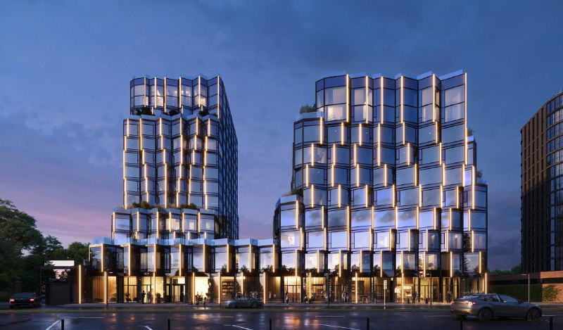
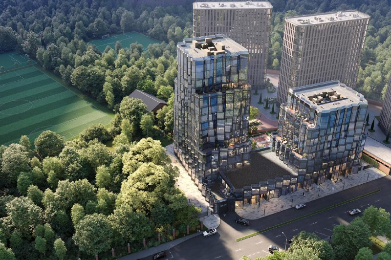

# «Новая, 11» от Element Development: цены и сроки — Петербург выходит на Яузу

Петербургская Element Development открыла продажи клубного дома «Новая, 11» на Новой дороге, 11Б в Басманном районе: 139 квартир в двух корпусах. Стартовали скромно — от 19,8 млн ₽ за квартиру. К октябрю 2026 года метр в объявлениях уже перевалил за 780 тыс. ₽, а на площадке всё ещё котлован. Сдача — II квартал 2029 года.

*Визуализация корпусов «Новая, 11»: 15-этажная секция «Яуза» и 9-этажная «Нева» на общем стилобате. Визуализация: Element Development*

## Коротко

- **Старт:** 11 декабря 2025 года, от 19,8 млн ₽ за квартиру.
- **Масштаб:** 139 квартир от 28 до 150 м², корпуса на 15 и 9 этажей.
- **Сроки:** сдача во II квартале 2029 года; на сентябрь 2026 года — котлован и фундамент.
- **Цена метра в объявлениях:** от 787 тыс. ₽ (февраль 2026 года) до 823 тыс. ₽ (октябрь 2026 года).

## Две реки на одном стилобате

Проект на Новой дороге, 11Б ведёт [Element Development](/zastroyshchiki/element-development/) — застройщик из Санкт-Петербурга. По [сообщению о старте продаж](https://news.rambler.ua/moscow_city/55749491-nachalas-realizatsiya-klubnogo-proekta-novaya-11-na-beregu-yauzy/), концепцию нарисовало бюро APEX, а дом стоит на первой линии Яузы в ЦАО.

Корпуса назвали по-петербургски дипломатично: 15-этажная «Яуза» и 9-этажная «Нева». Москва и Питер стоят на общем двухуровневом стилобате — и, судя по высоте, Москва всё-таки главнее. Квартиры продают с предчистовой отделкой.

## Три года, которые растянулись

Участок на Новой дороге, 11б — около 0,5 га. В июле 2023 года [«Деловой Петербург» писал](https://www.dp.ru/a/2023/07/20/peterburgskij-zastrojshhik-vihodit), что раньше он принадлежал Государственному научному центру лесопромышленного комплекса, а Element Development заходит с ним на московский рынок. Тогда девелопер обещал проект на 17 тыс. м²: стройку — с октября, завершение — через три года.

Сейчас в графике II квартал 2029 года. Полная история — в [досье «Новая, 11»](/obekty/novaya-11/).

*Визуализация: «Новая, 11» с высоты, внутренний двор на стилобате. Визуализация: Element Development*

## Сколько стоят квартиры в «Новая, 11»: метр подрос на котловане

На старте застройщик называл цены [от 19,8 млн ₽](https://www.novostroy-m.ru/novosti/start_prodaj_proekta_novaya) за квартиру. Цену метра в сообщениях о старте предусмотрительно не называли.

Объявления говорят сами за себя. В [февральском](https://www.novostroy-m.ru/kvartiry/trehkomnatnaya-kvartira-v-klubnii-dom-novaya-11-novaya-11-5b627640e774174609a2be1f1ad2be) 2026 года — 786 880 ₽/м², в [октябрьском](https://www.novostroy-m.ru/kvartiry/dvuhkomnatnaya-kvartira-v-klubnii-dom-novaya-11-novaya-11-00c4d6b70b4aea52e21e421977c8a8) — уже 822 908 ₽/м²: квартира на 3-м этаже за 56,7 млн ₽. В [каталоге](https://www.novostroy-m.ru/baza/novaya_11) на сентябрь 2026 года разброс — примерно от 32 до 224,5 млн ₽.

Оговорка важная: это отдельные объявления, а не прайс застройщика. Но направление движения они показывают честно.

## Когда сдадут «Новая, 11»

Срок для обоих корпусов — II квартал 2029 года. На сентябрь 2026 года, по данным каталога, на площадке нулевой цикл: котлован и фундамент. Иначе говоря, покупатель подписывает [ДДУ](/slovar/ddu/) на котлован и ждёт ключи ещё два с половиной года.

## Что это значит для покупателя и инвестора

Камерность здесь работает на застройщика: 139 квартир — не тот масштаб, где темп продаж решает судьбу проекта.

Риски тоже понятные. Стройка в самом начале. Для Element Development это, по её же словам из пресс-релиза, первый проект в Москве. А сроки уже уехали относительно планов 2023 года. Метро не под окнами: по объявлениям до «Электрозаводской» 16 минут пешком, до «Бауманской» 20.

На наш взгляд, за метр дороже 780 тыс. ₽ без сравнения с соседями платить не стоит. Сравнивайте с другими [новостройками Басманного района](/novostroyki/basmannyy/), загляните в [подборку с началом продаж](/novostroyki/start-prodazh/), а общую картину смотрите в разделе [цены на новостройки](/temy/ceny/).

## Карточка объекта

- Адрес: Москва, ул. Новая дорога, вл. 11б, Басманный район, ЦАО
- Название: клубный дом «Новая, 11»
- Застройщик: Element Development
- Архитектор: APEX
- Корпуса: «Яуза» (15 этажей), «Нева» (9 этажей), общий стилобат
- Квартиры: 139, площадь 28–150 м²
- Стадия: котлован и фундамент (сентябрь 2026 года)
- Ввод: II квартал 2029 года
- Цена: от 19,8 млн ₽ на старте (декабрь 2025 года); в объявлениях 787–823 тыс. ₽/м²

## Вопросы и ответы

**Когда начались продажи в ЖК «Новая, 11»?**
11 декабря 2025 года. На старте квартиры стоили от 19,8 млн ₽.

**Кто застройщик и архитектор «Новая, 11»?**
Застройщик — петербургская Element Development, архитектурную концепцию сделало бюро APEX.

**Когда сдадут «Новая, 11»?**
Оба корпуса — во II квартале 2029 года. На сентябрь 2026 года, по данным каталога, на площадке котлован и фундамент.

**Сколько стоят квартиры в «Новая, 11» сейчас?**
В объявлениях метр стоит от 787 тыс. ₽ (февраль 2026 года) до 823 тыс. ₽ (октябрь 2026 года); квартиры в каталоге — примерно от 32 до 224 млн ₽.

## Источники

1. [Рамблер: началась реализация клубного проекта «Новая, 11» на берегу Яузы](https://news.rambler.ua/moscow_city/55749491-nachalas-realizatsiya-klubnogo-proekta-novaya-11-na-beregu-yauzy/)
2. [Новостройки Москвы: старт продаж проекта «Новая, 11», 13 декабря 2025 года](https://www.novostroy-m.ru/novosti/start_prodaj_proekta_novaya)
3. [Новостройки Москвы: каталог «Новая, 11» (стадия, сроки, корпуса)](https://www.novostroy-m.ru/baza/novaya_11)
4. [Новостройки Москвы: объявление на февраль 2026 года](https://www.novostroy-m.ru/kvartiry/trehkomnatnaya-kvartira-v-klubnii-dom-novaya-11-novaya-11-5b627640e774174609a2be1f1ad2be)
5. [Новостройки Москвы: объявление на октябрь 2026 года](https://www.novostroy-m.ru/kvartiry/dvuhkomnatnaya-kvartira-v-klubnii-dom-novaya-11-novaya-11-00c4d6b70b4aea52e21e421977c8a8)
6. [Деловой Петербург: петербургский застройщик выходит на московский рынок, 20 июля 2023 года](https://www.dp.ru/a/2023/07/20/peterburgskij-zastrojshhik-vihodit)

Материал не является инвестиционной рекомендацией.
