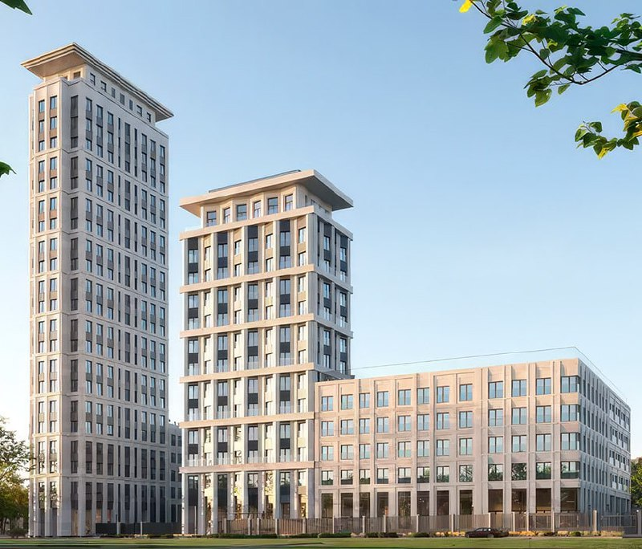
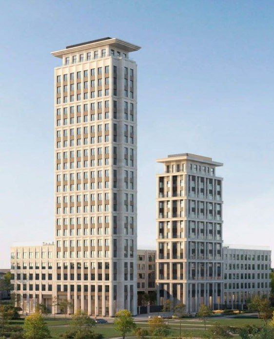

# «Дом на Часовой» (ДД:ОО:ММ) от DAR: неоклассика от СПИЧ, цены, сроки

В ноябре 2025 года для участка на Часовой, 6/3 показали неоклассический проект бюро СПИЧ: две башни и пятиэтажные секции вместо ранее предлагавшихся трёх башен. К октябрю 2026 года проект называется ЖК «Дом на Часовой», квартиры продаёт DAR, срок сдачи — второй квартал 2028 года.

## Коротко

- Автор проекта — бюро СПИЧ, стиль — неоклассика: пилоны, рустика, выразительные карнизы.
- Две башни в 22 и 13 этажей, пятиэтажные секции, 255 квартир, 149 машино-мест под землёй.
- На октябрь 2026 года квартиры стоят от 21,8 до 65,4 млн ₽, по отдельным лотам около 660–780 тыс. ₽/м².
- Сдача корпуса 1 — второй квартал 2028 года; стройка на стадии котлована и фундамента (по данным каталогов).

## Что за проект на Часовой, 6/3

Участок находится на месте бывшего хлебозавода №18, который закрыли в 2020 году. Проект вели под рабочим названием ДД:ОО:ММ, сейчас он продаётся как ЖК «Дом на Часовой». Застройщик — [DAR](/zastroyshchiki/dar/), по данным ЦИАН компания основана в 2024 году и пока не сдала ни одного дома.

Ранее для участка предлагали концепцию с тремя башнями, но город её не одобрил. Новый вариант в неоклассике показали в ноябре 2025 года.

*Визуализация проекта на Часовой, 6/3 (ДД:ОО:ММ): две башни и низкая секция. Визуализация: DAR*

## Как выглядит проект и что в нём изменилось

Башни в 22 и 13 этажей стоят на общей пятиэтажной части. Всего в проекте 255 квартир, студии и однокомнатные составляют менее 30%. Под землёй предусмотрено 149 машино-мест.

На наш взгляд, смена архитектуры мало что меняет для локации: ни четыре современных объёма, ни два неоклассических не задают облик района, а выбор стиля чаще определяется тем, что город готов согласовать. Здесь как раз случай, когда первую концепцию не одобрили. Что такое [архитектурно-градостроительное решение (АГР)](/slovar/agr/), объясняет наш словарь.

*Визуализация проекта на Часовой, 6/3: башни 22 и 13 этажей. Визуализация: DAR*

## Что с проектом сейчас

По состоянию на 14 октября 2026 года проект продаётся как ЖК «Дом на Часовой». По данным каталогов:

- адрес — Часовая улица, 6, корпус 3, район Аэропорт, САО; до метро «Аэропорт» около 10 минут пешком, до «Сокола» 22 минуты, до МЦД «Красный Балтиец» 17 минут;
- срок сдачи корпуса 1 — второй квартал 2028 года, стадия — котлован и фундамент;
- студии от 21,8 млн ₽, однокомнатные от 28 млн ₽, двухкомнатные от 35,8 млн ₽, трёхкомнатные от 50,4 млн ₽, максимум — 65,4 млн ₽;
- по отдельным лотам цена составляет около 660–780 тыс. ₽/м²; часть цен в каталоге актуальна на 1 февраля 2026 года, поэтому уточняйте их у застройщика.

В продаже находится около полусотни квартир из 255.

## Сколько стоят квартиры и что учесть покупателю

Это дорогой сегмент: цена входа выше 20 млн ₽ даже за студию. О том, как меняются цены на новостройки Москвы, — в разделе [«Цены»](/temy/ceny/).

Факторы риска, по нашей оценке:

- DAR — молодой застройщик без сданных домов, а срок сдачи привязан к стадии котлована;
- проект уже менял концепцию: итоговые параметры стоит сверять с проектной декларацией;
- покупка по [ДДУ](/slovar/ddu/) с эскроу-счётом защищает деньги, но не срок.

Следить стоит за разрешением на строительство, изменением срока сдачи и ценой следующих корпусов. Полная история проекта — в [досье «ДД:ОО:ММ»](/obekty/dd-oo-mm/).

## Карточка объекта

- Адрес ЗУ: Часовая, 6/3 (Часовая улица, 6, корпус 3), Москва
- Названия: «Дом на Часовой», ДД:ОО:ММ, Часовая, 6
- Застройщик: DAR
- Архитектор: СПИЧ
- Район, метро: Аэропорт (САО), метро «Аэропорт» около 10 минут пешком
- Квартиры: 255; машино-места: 149
- Этажность: 22 и 13 этажей (башни), 5 этажей (секции)
- Стадия: котлован и фундамент (по каталогам)
- Ввод корпуса 1: второй квартал 2028 года
- Цены: от 21,8 до 65,4 млн ₽

Другие проекты столицы — [новостройки Москвы](/novostroyki/moskva/).

## Вопросы и ответы

**Что за проект на Часовой, 6/3?**
Это ЖК «Дом на Часовой», в 2025 году известный как ДД:ОО:ММ. Застройщик — DAR, архитектор — бюро СПИЧ, стиль — неоклассика.

**Сколько этажей и квартир в ЖК «Дом на Часовой»?**
Две башни в 22 и 13 этажей и низкие пятиэтажные секции; всего 255 квартир и 149 машино-мест в подземной части.

**Сколько стоят квартиры и когда сдача?**
По данным каталога в октябре 2026 года квартиры стоят от 21,8 до 65,4 млн ₽, около 660–780 тыс. ₽/м² по отдельным лотам. Срок сдачи корпуса 1 — второй квартал 2028 года.

**Где находится ЖК и что рядом?**
Часовая улица, 6, корпус 3, район Аэропорт, САО. До метро «Аэропорт» около 10 минут пешком, до «Сокола» 22 минуты (по данным каталога).

## Источники

1. [Moskvich Mag: на Часовой улице в районе Аэропорт построят высотки в неоклассическом стиле](https://moskvichmag.ru/?p=466259), 27 ноября 2025 года.
2. [Новостройки-М: ЖК «Дом на Часовой»](https://www.novostroy-m.ru/baza/jk_na_chasovoy), данные на октябрь 2026 года.
3. [Новостройки-М: лот в ЖК «ДД:ОО:ММ — Дом на Часовой»](https://www.novostroy-m.ru/kvartiry/odnokomnatnaya-kvartira-v-zhk-ddoomm-dom-na-chasovoi-1339960184009ad8ac59f7f94f7051)
4. [ЦИАН: застройщик DAR](https://www.cian.ru/zastroishchik-dar-19190)

Материал не является инвестиционной рекомендацией.
