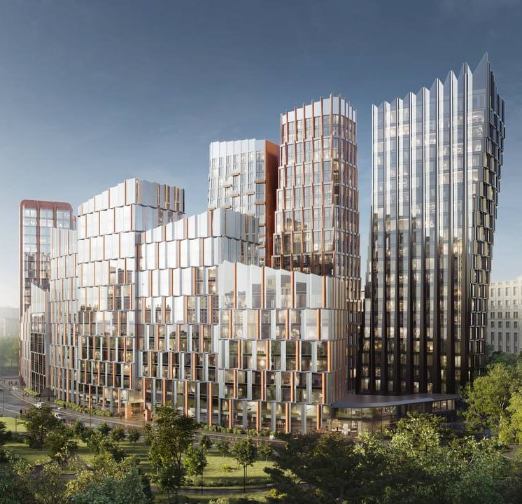

# «МАСТЕРС» от Capital Group у «Аэропорта»: продажи идут, прайса нет

Capital Group выводит премиальный «МАСТЕРС» на улице Викторенко, 16 сама. Архитектура — бюро GAFA, разрешение на строительство есть, продажи идут. А вот прайса застройщик так и не показал: о цене приходится судить по объявлениям — и одно из них уже даёт около 838,5 тыс. ₽ за метр.

*Визуализация корпусов проекта «МАСТЕРС» на улице Викторенко, 16. Визуализация: Capital Group*

## Коротко

- **Кто и что:** премиальный дом [Capital Group](/zastroyshchiki/capital-group/) на Викторенко, 16, архитектор — бюро GAFA.
- **Деньги:** инвестиции компания оценивает примерно в 35 млрд ₽; разрешение на строительство получено.
- **Цена и срок по объявлениям:** квартира 46,9 м² за 39,3 млн ₽ (около 838,5 тыс. ₽/м²), сдача — IV квартал 2029 года.
- **Оговорка:** официального прайса застройщик не публиковал, так что цифры пока ориентировочные.

## Разновысотный ансамбль вместо башни

По данным РБК Недвижимость от 17 февраля 2026 года, «МАСТЕРС» — ансамбль корпусов разной высоты: часть секций будет семиэтажной, квартир на этаже немного. Архитектурную часть сделало бюро GAFA, двор и территорию разрабатывает ландшафтное бюро DEREVO PARK.

Продажи компания обещала открыть в конце февраля 2026 года. Застройщиком в рекламной пометке материала значится АО «СЗ «Мастерс».

## Участок и компания

Участок на улице Викторенко, 16 — в [районе Аэропорт](/novostroyki/aeroport/). Capital Group ведёт проект сама, и это не единственная её крупная московская история — вспомните [мастерплан КРТ «МИГ» на Динамо](/novosti/mig-dinamo-masterplan-krt-capital-group/).

Как участок оказался у компании и что на нём собирались строить раньше, Capital Group публично не рассказывала. Полная история проекта — в [досье «МАСТЕРС»](/obekty/masters/).

## Что с проектом сейчас

По состоянию на 13 октября 2026 года:

- **Разрешение на строительство** получено — об этом РБК Недвижимость писала 17 февраля 2026 года.
- **Продажи.** Старт компания назначала на конец февраля 2026 года; квартиры предлагают в объявлениях на агрегаторе новостроек.
- **Цена.** Официального прайса нет. В одном из объявлений квартира 46,9 м² стоит 39,3 млн ₽ — около 838,5 тыс. ₽/м². Это цена конкретного лота, а не средняя по проекту.
- **Срок сдачи.** В том же объявлении — IV квартал 2029 года.

## Что это значит для покупателя и инвестора

Если цена из объявления отражает уровень проекта, «МАСТЕРС» играет в верхней лиге [премиальных новостроек](/novostroyki/premium-klass/) Москвы. На наш взгляд, сравнивать его стоит по цене метра и сроку сдачи, а не по красоте визуализаций — стекло и разновысотность сейчас рисует каждый второй премиум.

Где риски. От старта продаж до сдачи — почти четыре года. А ансамбль разновысотных корпусов строить и обслуживать сложнее, чем типовую башню. До сделки сверьте сроки и состав корпусов с [проектной декларацией](/slovar/proektnaya-deklaratsiya/) — объявление на агрегаторе не документ. Судебную историю проекта тоже стоит проверить самостоятельно.

## Карточка объекта

- **Адрес участка:** Москва, улица Викторенко, 16
- **Название:** МАСТЕРС
- **Застройщик:** [Capital Group](/zastroyshchiki/capital-group/) (АО «СЗ «Мастерс»)
- **Район:** [Аэропорт](/novostroyki/aeroport/)
- **Метро:** «Аэропорт»
- **Архитектор:** GAFA; благоустройство — DEREVO PARK
- **Стадия:** разрешение на строительство получено, продажи
- **Ввод:** IV квартал 2029 года (по объявлению)
- **Цена:** 838,5 тыс. ₽/м² в одном объявлении (46,9 м², 39,3 млн ₽)

## Вопросы и ответы

**Кто застройщик ЖК «МАСТЕРС» у метро «Аэропорт»?**
Проект ведёт Capital Group; в рекламной пометке РБК Недвижимость застройщиком значится АО «СЗ «Мастерс».

**Кто автор проекта «МАСТЕРС»?**
Архитектура — бюро GAFA, благоустройство — ландшафтное бюро DEREVO PARK.

**Когда сдадут ЖК «МАСТЕРС»?**
В объявлениях на агрегаторе новостроек — IV квартал 2029 года. Перед покупкой сверьте срок с проектной декларацией.

**Сколько стоят квартиры в «МАСТЕРС»?**
Официального прайса застройщик не публиковал. В одном из объявлений 46,9 м² стоят 39,3 млн ₽, это 838,5 тыс. ₽/м² — цена одного лота, а не средняя по проекту.

## Источники

1. [РБК Недвижимость: премиальный дом «МАСТЕРС» на Викторенко, 16, 17 февраля 2026 года](https://realty.rbc.ru/news/6981f75e9a7947823b1d53d3)
2. [Novostroy-M: объявление о квартире в ЖК «МАСТЕРС» (срок сдачи, цена)](https://www.novostroy-m.ru/kvartiry/odnokomnatnaya-kvartira-v-zhk-masters-4ab82620197a80c727daeac0c55abd)

Материал не является инвестиционной рекомендацией.
