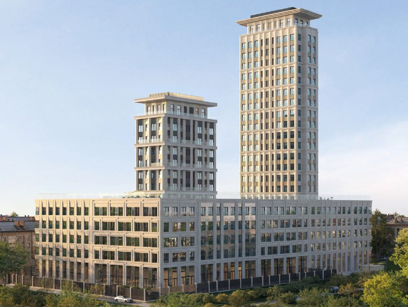

# ЖК «Дом на Часовой» (DD:OO:MM) от Dar: цены от 21,8 млн ₽, сдача 2028

Девелопер Dar продаёт квартиры в бизнес-классе на участке Часовая, 6/3 в районе Аэропорт. В ноябре 2025 года проект показали под названием DD:OO:MM, к 13 октября 2026 года он числится как «Дом на Часовой» с ценами от 21,8 млн ₽ за студию.

## Коротко

- Застройщик — Dar; проект на Часовой, 6/3 — это 255 квартир, из них в продаже 50 (по состоянию на 13 октября 2026 года).
- Цены: от 21,81 до 65,36 млн ₽, студии начинаются от 21,8 млн ₽.
- Срок: агрегатор указывает 2 квартал 2028 года и выдачу ключей в декабре 2028 года; в планировках застройщика от ноября 2025 года — IV квартал 2028 года.
- Структура: девять секций, семь пятиэтажных корпусов и два высотных (13 и 22 этажа).

*Визуализация проекта на Часовой, 6/3: две высотные секции над пятиэтажным основанием. Визуализация: Dar*

## Кто застройщик и что это за проект

Проект ведёт Dar. Компания основана в 2017 году, в августе 2024 года она объявила о выходе на московский рынок: пять проектов на участках общей площадью 12,6 га, один из них в районе Аэропорт. В портфеле, в частности, [две офисные башни Dar у метро ЦСКА](/novosti/bc-pole-leningradskiy-37-dar-ofisy/). На агрегаторе в участниках строительства указано также ООО «СЗ АРТСТРОЙ».

Адрес — Москва, Часовая улица, 6с3, район Аэропорт Северного административного округа. Дом сейчас продаётся как ЖК «Дом на Часовой»; название DD:OO:MM использовалось в материалах застройщика в ноябре 2025 года. Класс — [бизнес-класс](/novostroyki/biznes-klass/). Карточка участка есть в [досье проекта](/obekty/dd-oo-mm/).

## Сколько стоят квартиры

По состоянию на 13 октября 2026 года диапазон на агрегаторе — от 21,81 до 65,36 млн ₽, студии от 21,8 млн ₽. Цену за квадратный метр мы независимо подтвердить не смогли, поэтому её не приводим. Сопоставлять предложение с соседними проектами стоит по цене за метр и условиям оплаты, а не по стартовой цифре лота.

## Когда сдадут

В заметке ноября 2025 года называли конец 2028 года. Сейчас на агрегаторе указан 2 квартал 2028 года и выдача ключей в декабре 2028 года; в планировках застройщика — IV квартал 2028 года. Расхождение формулировок объясняется, по-видимому, разницей между окончанием строительства и выдачей ключей, но на наш взгляд, срок надо сверять с проектной декларацией на наш.дом.рф перед сделкой.

## Контекст: соседний проект на Часовой, 28

На той же улице, по адресу ЗУ Часовая, 28, находится квартал Soul. Его ведёт девелопер Forma, в нашем справочнике — [ПИК](/zastroyshchiki/pik/); по информации рекламного материала РБК Недвижимость, в проекте десять башен от 18 до 35 этажей и 16 камерных домов по 6–9 этажей, а отреставрированное здание 1930-х годов станет общественным центром. Третья очередь заявлена как «скоро» без даты. Полная история квартала — в [досье «Soul»](/obekty/soul/).

Сообщения о ценах новой очереди Soul в ноябре 2025 года мы не подтвердили и в материал не включаем.

## Что это значит для покупателя

- Цена входа — от 21,8 млн ₽; это сегмент бизнес-класса у метро «Аэропорт» с высоким чеком за студию.
- Риски стандартные для стройки: срок ввода, условия рассрочки и бронирования; покупать стоит только по [ДДУ](/slovar/ddu/) или эскроу-схеме с проверкой проектной декларации.
- Следить стоит за сроками на наш.дом.рф и динамикой остатка: в продаже 50 квартир из 255.

## Карточка объекта

- **Адрес ЗУ:** Часовая, 6/3 (Москва, Часовая улица, 6с3)
- **Названия:** DD:OO:MM, «Дом на Часовой»
- **Застройщик:** Dar
- **Район:** Аэропорт, САО
- **Класс:** бизнес
- **Квартиры:** 255 (в продаже 50)
- **Секции:** 9 (7 пятиэтажных, 2 высотных — 13 и 22 этажа)
- **Ввод:** 2 квартал 2028 года, ключи в декабре 2028 года (по данным агрегатора)
- **Цена:** от 21,81 до 65,36 млн ₽ (на 13 октября 2026 года)

## Вопросы и ответы

**Кто застройщик ЖК «Дом на Часовой» (DD:OO:MM)?**
Проект ведёт девелопер Dar. В участниках строительства на агрегаторе указано также ООО «СЗ АРТСТРОЙ».

**Сколько стоят квартиры в ЖК «Дом на Часовой»?**
По состоянию на 13 октября 2026 года цены начинаются от 21,8 млн ₽ за студию, весь диапазон — 21,81–65,36 млн ₽.

**Когда сдадут ЖК «Дом на Часовой»?**
Агрегатор указывает 2 квартал 2028 года и выдачу ключей в декабре 2028 года. В планировках застройщика от ноября 2025 года значилось окончание строительства в IV квартале 2028 года.

**Где находится проект Dar на Часовой, 6/3?**
В районе Аэропорт Северного округа Москвы, адрес на объявлениях — Часовая улица, 6с3. Рядом станция метро «Аэропорт».

## Источники

1. [ЖК «Дом на Часовой» — Яндекс Недвижимость](https://realty.yandex.ru/moskva_i_moskovskaya_oblast/kupit/novostrojka/dom-na-chasovoj-4209791/)
2. [Dar — компания и проекты, Новостройки Москвы](https://www.novostroy-m.ru/kompanii/dar)
3. [РБК Недвижимость: Dar выходит на московский рынок, 6 августа 2024 года](https://realty.rbc.ru/news/66b206e79a7947411c4394ff)
4. [РБК Недвижимость: жилой квартал SOUL (рекламный материал)](https://realty.rbc.ru/news/69303b809a79472ac55da0f8)

Материал не является инвестиционной рекомендацией.
