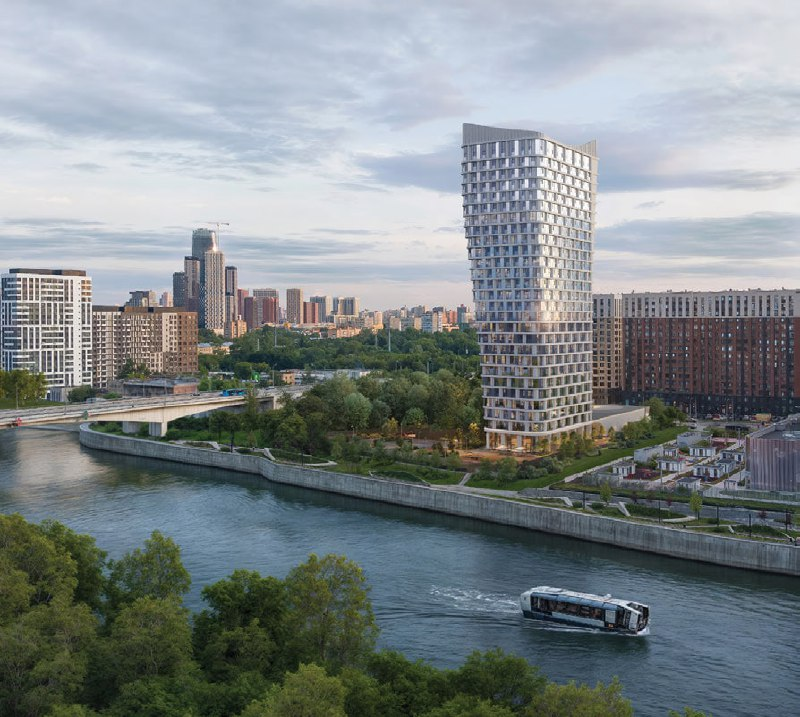
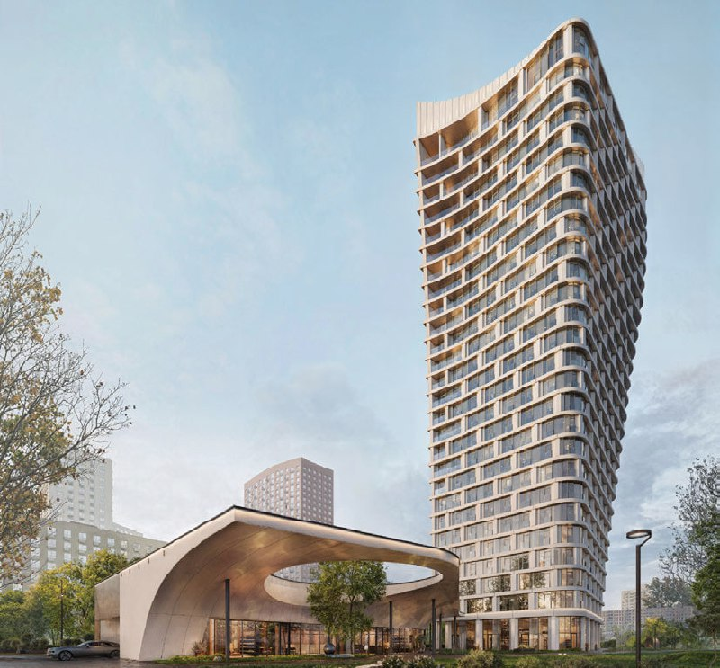
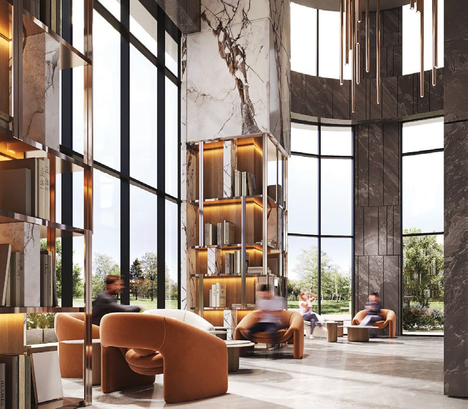

# «Гранд Фили» от Гранарда на Большой Филевской, 2Б: квартиры от 31 млн ₽

«Бизнес-класс» в Москве вышел из моды, а «премиум» и «клубный» не выходят из неё вообще. «Гранард» продаёт «Гранд Фили» — 27-этажную башню на Большой Филевской, 2Б: с лобби-библиотекой на рендерах и квартирами от 31 млн ₽. По каталогу метр здесь стоит около 0,8 млн ₽, а сам дом пока в котловане.

*Визуализация башни «Гранд Фили» на фоне реки. Визуализация: Гранард*

## Коротко

- **Что:** клубный дом «Гранд Фили», 27 этажей, высота 100 м, один подъезд.
- **Сколько квартир:** около 250 — каталог называет 241 квартиру и 3 пентхауса, эксперт — 244.
- **Цены:** от 31 млн ₽, диапазон 31–83,9 млн ₽, то есть примерно 0,79–0,83 млн ₽/м².
- **Сроки:** корпус 1 — II квартал 2029 года, сейчас стройплощадка на стадии котлована и фундамента.

## Что за дом на Большой Филевской, 2Б

Застройщик — АО «СЗ «ГРАНАРД», [«Гранард»](/zastroyshchiki/granard/), адрес — Большая Филевская улица, участок 2Б, район Филёвский Парк. До метро «Фили» и «Шелепиха» — по 15 минут пешком, по данным каталога. Архитектурой занималось бюро WALL, класс в каталоге — премиум.

Дом один, подъезд один, этажей 27. Слово «клубный» обычно обещает камерность, а здесь высота 100 м и около 250 квартир — клуб размером с небольшую деревню. На рендерах всё по канону: башня с «парящим» козырьком у входа и лобби с мрамором и высокими окнами.

*Визуализация: башня и входная группа с «парящим» козырьком. Визуализация: Гранард*

## Сколько стоят квартиры в «Гранд Фили»

По каталогу «Новострой-М» на октябрь 2026 года в продаже около 80 квартир: 54 однокомнатные, 20 двухкомнатных и 6 трёхкомнатных. Самый доступный лот — однушка 38,73 м² за 31,02 млн ₽, это примерно 0,8 млн ₽/м². Однокомнатная на 7 этаже площадью 50,28 м² стоит 41,24 млн ₽, то есть около 820 тыс. ₽/м². Верхняя граница диапазона — 83,9 млн ₽.

Ценник амбициозный даже для «премиалки»: в таких домах за метр платят не только за квадраты, но и за лобби с библиотекой. Вопрос в том, готов ли покупатель платить за стеллажи столько же, сколько за планировку.

*Визуализация лобби «Гранд Фили»: мрамор, стеллажи с книгами, высокие окна. Визуализация: Гранард*

## Что с проектом сейчас

На октябрь 2026 года, по данным каталога, дом на стадии котлована и фундамента, корпус 1 обещан во II квартале 2029 года. Эксперт каталога называет конец 2029 года. Разница в пару кварталов, но срок «в срок» стоит проверять не по рендерам, а по этажам на площадке.

Полная история участка и проекта — в [досье «Гранд Фили»](/obekty/grand-fili/).

## Что это значит для покупателя

Высота 100 м и мраморное лобби стоят дорого, а ключи будут только через два с лишним года. Если вы смотрите на «Гранд Фили», считайте три вещи. Первая — реальная цена за метр на вашей планировке, а не «от»: разброс по каталогу составляет десятки тысяч рублей. Вторая — сроки: проверяйте проектную декларацию и ход работ. Третья — альтернатива: сравните с другими [новостройками премиум-класса](/novostroyki/premium-klass/) рядом; больше про класс — в разделе [премиальные проекты](/temy/premium/), про динамику — в разделе [цены на новостройки](/temy/ceny/).

## Карточка объекта

- Название: «Гранд Фили».
- Адрес ЗУ: Большая Филевская, 2Б, район Филёвский Парк, ЗАО, Москва.
- Застройщик: «Гранард».
- Архитектура: бюро WALL.
- Класс: премиум (по каталогу).
- Этажность: 27 этажей, высота 100 м.
- Квартиры: около 250.
- Стадия: котлован и фундамент.
- Сдача: корпус 1 — II квартал 2029 года.
- Цена: от 31 млн ₽, около 0,79–0,83 млн ₽/м².

## Вопросы и ответы

**Кто застройщик «Гранд Фили»?**
Проект ведёт «Гранард» (АО «СЗ «ГРАНАРД»). Архитектура — бюро WALL.

**Сколько стоят квартиры в «Гранд Фили»?**
По каталогу «Новострой-М» на октябрь 2026 года квартиры продаются от 31 млн ₽ (однушка 38,73 м²), диапазон — 31–83,9 млн ₽, это около 0,79–0,83 млн ₽ за м².

**Когда сдадут «Гранд Фили»?**
Корпус 1 — во II квартале 2029 года, эксперт каталога называет конец 2029 года. На октябрь 2026 года дом на стадии котлована и фундамента.

**Сколько этажей и квартир в «Гранд Фили»?**
27 этажей, высота 100 м, около 250 квартир: каталог называет 241 квартиру и 3 пентхауса, эксперт — 244 квартиры.

## Источники

1. «Новострой-М», карточка клубного дома «Гранд Фили»: https://www.novostroy-m.ru/baza/klubnyy_dom_grand_fili
2. «Новострой-М», лот: однокомнатная квартира в клубном доме «Гранд Фили»: https://www.novostroy-m.ru/kvartiry/odnokomnatnaya-kvartira-v-klubnii-dom-grand-fili-7fe126f9cb9ab5f85f5189be65022b

Материал не является инвестиционной рекомендацией.
