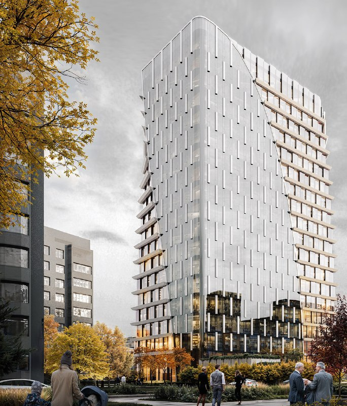
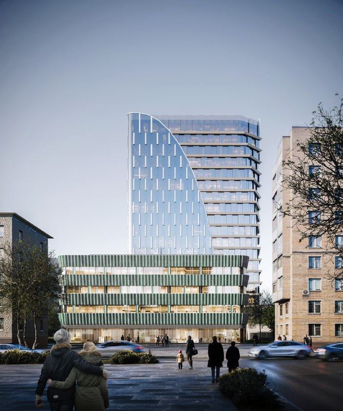
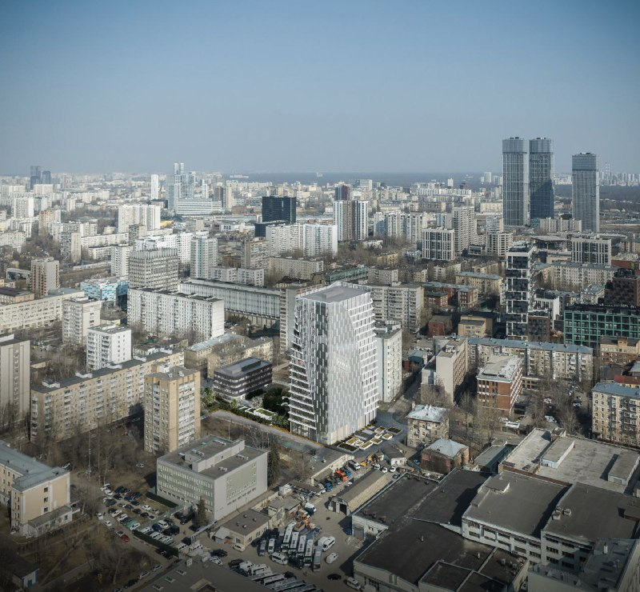

# Upside Ямская на 2-й Ямской, 9: офисы от 26,5 млн ₽, сдача в 2028-м

Офисная башня от бюро GAFA на 2-й Ямской в Марьиной Роще теперь продаётся как «Upside Ямская». Застройщик — Upside Development, офисы идут от 26,5 млн ₽, готовность обещана на IV квартал 2028 года. Название родилось по знакомой схеме: бренд девелопера плюс топоним. Зато адрес, этажность и цена — уже не рендер, а прайс.

## Коротко

- **Что:** бизнес-центр класса А на 2-й Ямской, 9, 18 этажей, архитектура — GAFA.
- **Кто:** Upside Development.
- **Сколько:** офисы от 64,57 до 1257,63 м², лоты от 26,5 млн ₽, в объявлениях — 393–474 тыс. ₽/м² с НДС 22%.
- **Когда:** по данным продавца, IV квартал 2028 года.

## Кто строит «Upside Ямскую» и что это за здание

Проект стоит в Марьиной Роще (СВАО), рядом метро «Марьина Роща»; до «Савёловской» около 18 минут пешком. Архитектуру делало бюро GAFA. По визуализациям это стеклянная башня с вертикальными ламелями и срезом, который играет роль фирменного жеста: объём будто надкусили. Стандартный набор московского офиса класса А, только исполненный чуть бойче обычного.

Застройщиком в объявлениях значится Upside Development — компания, у которой в портфеле уже есть «Апсайд Кунцево» и «Апсайд Останкино». Условия, на которых проект оказался у Upside, публично не раскрывали. Полная история участка — в [досье проекта на 2-й Ямской, 9](/obekty/takt/).

*Фасад башни со стеклянной «чешуёй» и вертикальными ламелями. Визуализация: Upside Development*

## Сколько стоят офисы в «Upside Ямской»

На октябрь 2026 года в продаже помещения от 64,57 до 1257,63 м². Самые маленькие лоты стартуют от 26,5 млн ₽, а крупный офис на 16-м этаже площадью 1258 м² оценён примерно в 571,5 млн ₽. Цена за метр — от 393 до 474 тыс. ₽ с НДС 22%; средний показатель по объявлениям — около 415 тыс. ₽/м².

Для офиса у Марьиной Рощи чек серьёзный. Это цены из объявлений о продаже, а не итог торга.

*Башня на невысоком стилобате с зелёными ламелями. Визуализация: Upside Development*

## Что с проектом сейчас

По состоянию на 15 октября 2026 года здание в продаже значится как строящееся, срок готовности — IV квартал 2028 года. На том же участке отдельно продают медицинское здание: 3 тыс. м², четыре надземных этажа, ввод во II квартале 2028 года, цена — 1,15 млрд ₽.

## Что это значит для покупателя и инвестора

Офис в строящейся башне — это ставка на два обстоятельства: на то, что здание сдадут вовремя, и на то, что в 2028 году арендаторы будут готовы платить за класс А рядом с ТТК. Первое проверяйте по стройке и документам застройщика, а не по рендерам (в таких документах считают [ТЭП](/slovar/tep/) — технико-экономические показатели). Общий [рынок](/temy/rynok/) офисов при этом живёт по своим законам. Второе — по рынку аренды вокруг: класс А у ТТК и «Савёловской» не единственный в округе.

Отдельный пункт — НДС 22%: цены в объявлениях указаны вместе с ним, и для физлица разница между «с НДС» и «без» может оказаться ощутимой. Уточняйте это в договоре.

*Башня среди пятиэтажек и девятиэтажек района. Визуализация: Upside Development*

Другие проекты района — в подборке [новостроек Марьиной Рощи](/novostroyki/marina-roshcha/).

## Карточка объекта

- Названия: Upside Ямская, ТАКТ.
- Адрес ЗУ: 2-я Ямская, 9, Марьина Роща, СВАО, Москва.
- Застройщик: Upside Development.
- Архитектор: GAFA.
- Класс: А.
- Этажность: 18.
- Стадия: строится, готовность — IV квартал 2028 года.
- Цена: от 26,5 млн ₽ за лот; 393–474 тыс. ₽/м² с НДС 22%.

## Вопросы и ответы

**Кто застройщик «Upside Ямская»?**
В объявлениях о продаже застройщиком указан Upside Development. Архитектор проекта — бюро GAFA.

**Когда сдадут «Upside Ямская»?**
В продаже указан срок готовности — IV квартал 2028 года.

**Сколько стоят офисы в «Upside Ямской»?**
Лоты от 26,5 млн ₽; цена за м² в объявлениях — 393–474 тыс. ₽ с НДС 22%.

**Где находится «Upside Ямская»?**
На 2-й Ямской улице, 9, в районе Марьина Роща СВАО. Ближайшая станция метро — «Марьина Роща».

## Источники

1. ЦИАН, бизнес-центр «Upside Ямская»: https://www.cian.ru/kupit-ofis-biznes-centr-na-ul2-ya-yamskaya9-moskva-339407/
2. ЦИАН, объявление об офисе в «Upside Ямская»: https://www.cian.ru/sale/commercial/326210894/
3. ЦИАН, страница продавца «Апсайд Ямская»: https://www.cian.ru/company/94501026/
4. Каталог новостроек, Upside Development: https://www.novostroy-m.ru/kompanii/upside_development_apsayd_development

Материал не является инвестиционной рекомендацией.
