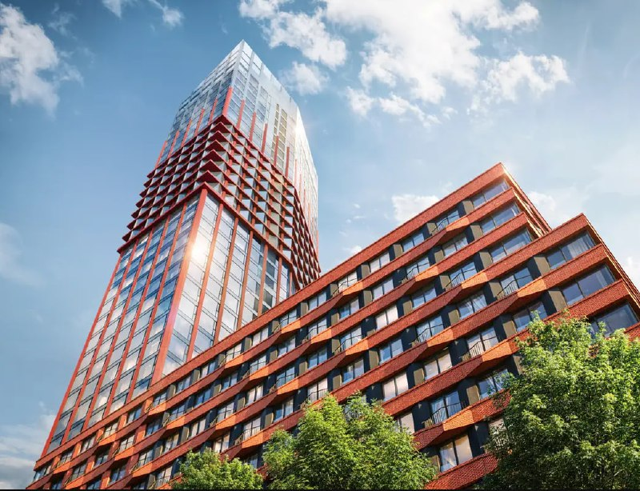

# Код Сокольники от «Новой Эры»: бизнес-класс на грузовом дворе, от 20,6 млн ₽

«Новая Эра» продаёт ЖК бизнес-класса «Код Сокольники» на месте грузового двора Митьково. Квартиры стоят от 20,6 млн ₽, корпуса 2.1 и 2.2 обещают сдать в IV квартале 2029 года. От грузового двора остались название участка и станция МЦД рядом, от промзоны в ценах — ничего.

*Высотный корпус «Кода Сокольники» на визуализации застройщика. Визуализация: Новая Эра*

## Коротко

- Застройщик — [«Новая Эра»](/zastroyshchiki/novaya-era/), в каталоге «Новострой-М» — дочерняя структура «РЖД-Недвижимость».
- Адрес — улица Шумкина, район Сокольники (ВАО); до станции МЦД-3 «Митьково» около 3 минут пешком.
- [Бизнес-класс](/novostroyki/biznes-klass/), корпуса от 6 до 39 этажей; корпуса 2.1 и 2.2 — IV квартал 2029 года.
- На 14 октября 2026 года вход — от 20,57 млн ₽ за студию 28,3 м².

## Грузовой двор под жильё

Проект встаёт на месте грузового двора Митьково — между улицами Русаковской, Шумкина, Маленковской и Лобачика. По материалам Градостроительно-земельной комиссии, которые в мае 2024 года цитировал «Москвич Mag», здесь должно появиться 317 тыс. м² недвижимости, из них 222 тыс. м² жилья. Владельцем участка тогда называли РЖД.

Концепцию, по данным каталога, сделало бюро «Остоженка». Строят в три очереди, в продаже сейчас корпуса 2.1 и 2.2.

## Чей застройщик — вопрос с подвохом

С владельцами «Новой Эры» не всё прозрачно. Каталог называет её дочкой «РЖД-Недвижимости». Коммерсантъ в декабре 2023 года писал со слов РЖД, что в ноябре 2022 года 100% «РЖД-Недвижимости» продали за пределы холдинга, а с октября 2023 года компания принадлежит закрытому паевому фонду «Территория развития» под управлением «ААА Управление капиталом». О «Новой Эре» в той публикации ни слова — так что связывать эти две истории напрямую рано.

## Метр по 727 тысяч и соседи подешевле

По данным Циан и «Новострой-М» на 14 октября 2026 года, квартиры начинаются от 20,57 млн ₽ за студию 28,3 м² — это около 727 тыс. ₽/м² в расчёте Циан по самой дешёвой студии. Студия 33,4 м² на 9 этаже корпуса 2.1 стоит 24,9 млн ₽, или 745,6 тыс. ₽/м². Площади — от 28,3 до 118,6 м².

Для сравнения, по тому же расчёту у соседнего «Солоса» от Dar выходит около 590 тыс. ₽/м², у «СТОУН Сокольники» — около 626 тыс. ₽/м². Цифры грубые: это самые дешёвые студии, а не средние цены. Сравнивать честнее конкретные лоты — но разрыв всё равно заметен.

*Башня и ступенчатый корпус комплекса на визуализации застройщика. Визуализация: Новая Эра*

## Монолит пошёл

На 14 октября 2026 года проект в продаже, а на странице застройщика в каталоге отмечено начало монолитных работ. Срок ввода корпусов 2.1 и 2.2 — IV квартал 2029 года. Когда именно стартовали продажи и с какой цены, застройщик публично не сообщал. Полная история проекта — в [досье «Код Сокольники»](/obekty/kod-sokolniki/).

## Что это значит для покупателя и инвестора

Сдача в 2029 году — это [договор долевого участия](/slovar/ddu/) почти на три года вперёд. На наш взгляд, на таком горизонте решают две вещи: как быстро на самом деле растут корпуса и удержит ли проект цену при соседях, которые сейчас дешевле, — см. [новостройки в Сокольниках](/novostroyki/sokolniki/).

Что проверить самому: проектную декларацию и разрешение на строительство на наш.дом.рф, срок именно вашего корпуса и этаж — от него зависит вид. Публичных цифр по темпам продаж нет, так что прогнозировать динамику цен мы не возьмёмся. Общий фон — в разделе [цены на новостройки](/temy/ceny/).

## Карточка объекта

- **Название:** «Код Сокольники» (по участку — Митьково).
- **Адрес:** Москва, улица Шумкина, район Сокольники (ВАО).
- **Застройщик:** «Новая Эра».
- **Класс:** бизнес.
- **Этажность:** от 6 до 39 этажей.
- **Квартиры:** от 28,3 до 118,6 м².
- **Стадия:** в продаже, строится.
- **Срок:** IV квартал 2029 года (корпуса 2.1 и 2.2).
- **Цена:** от 20,57 млн ₽.

## Вопросы и ответы

**Кто застройщик ЖК «Код Сокольники»?**
«Новая Эра». Каталог «Новострой-М» называет её дочерней структурой «РЖД-Недвижимость», а по данным Коммерсанта, сама «РЖД-Недвижимость» в 2022–2023 годах ушла из холдинга РЖД.

**Сколько стоят квартиры в «Коде Сокольники»?**
На 14 октября 2026 года — примерно от 20,6 млн ₽ за студию 28,3 м². Студия 33,4 м² на 9 этаже корпуса 2.1 стоит 24,9 млн ₽.

**Когда сдадут «Код Сокольники»?**
Корпуса 2.1 и 2.2 — в IV квартале 2029 года. Всего в проекте три очереди.

**Где находится «Код Сокольники»?**
В Москве, на улице Шумкина в районе Сокольники (ВАО), на месте грузового двора Митьково. До станции МЦД-3 «Митьково» около 3 минут пешком.

## Источники

1. [ЖК «Код Сокольники» — Новострой-М](https://www.novostroy-m.ru/baza/jk_kod_sokolniki) — застройщик, класс, этажность, срок.
2. [Новая Эра — Новострой-М](https://www.novostroy-m.ru/kompanii/ooo_novaya_era) — о компании и проекте.
3. [Студия в ЖК «Код Сокольники» — Новострой-М](https://www.novostroy-m.ru/kvartiry/studiya-v-zhk-kod-sokolniki-50c47da898ceab22e6013ee7dfe31a) — цена лота.
4. [Новостройки Сокольников — Циан](https://www.cian.ru/novostroyki-moskva-sokolniki-0471/) — цены «от» по соседним проектам.
5. [Проект застройки грузового двора РЖД в Сокольниках — «Москвич Mag», 3 мая 2024 года](https://moskvichmag.ru/?p=359639)
6. [«РЖД-Недвижимость» готовится застроить шесть грузовых дворов — Коммерсантъ, 4 декабря 2023 года](https://www.kommersant.ru/doc/6379789)

Материал не является инвестиционной рекомендацией.
