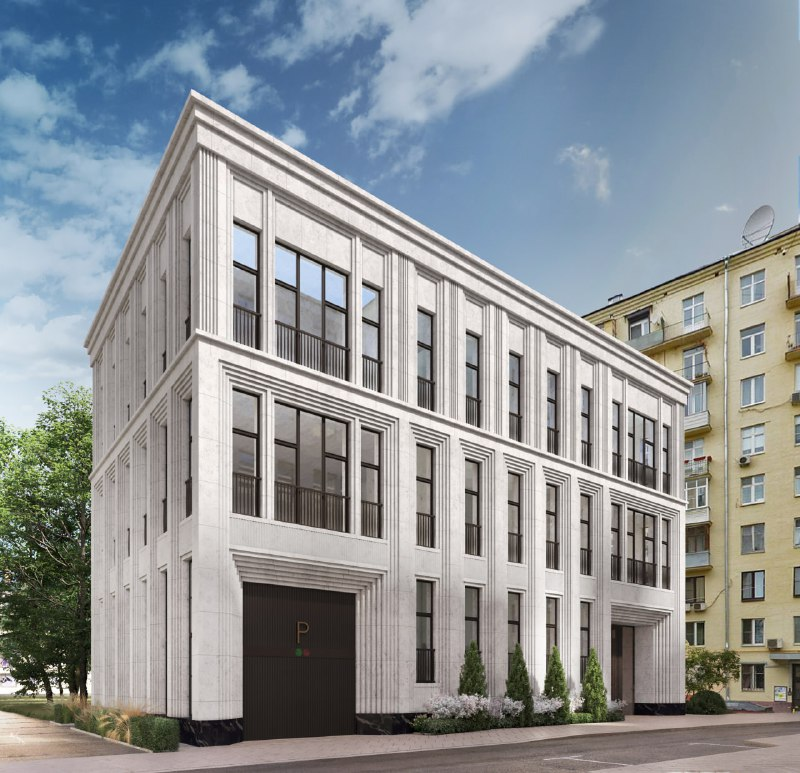
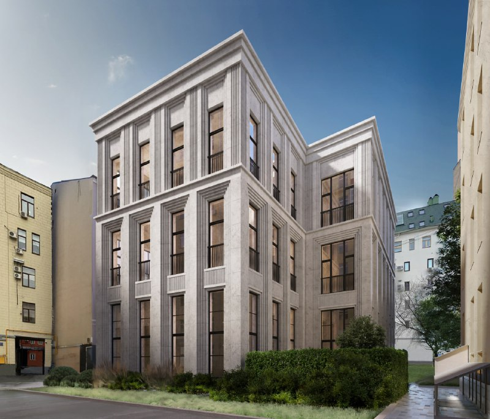

---
source:
  id: 32481
  date: '2025-12-15'
status: needs_review
skip_reason: null
type: object
region: moscow
title: 'Pentagram на Большом Козихинском, 31: четыре резиденции у Патриарших'
title_alts:
- 'Pentagram в Большом Козихинском: декларация есть, цен нет'
- 'Клубный дом Palladio Group на Патриарших: что известно о Pentagram на октябрь 2026'
slug: pentagram-bolshoy-kozihinskiy-31-palladio
lead: На Патриарших есть клубные дома, а есть Pentagram — дом от Palladio Group в Большом Козихинском переулке, 31 всего на четыре резиденции. Проектная декларация вышла ещё в декабре 2025 года, а к октябрю 2026-го цен так и нет, только обещание «скоро старт продаж».
developers:
- id: palladio-group
  name: Palladio Group
  role: main
- id: sminex
  name: Sminex
  role: main
objects:
- id: palashevskiy-11
  names:
  - Палашёвский 11
  zu: Большой Палашевский, 11-13
  main: true
  new: false
- id: pentagram
  names:
  - Pentagram
  zu: Большой Козихинский, 31
  main: false
  new: false
districts: []
topics:
- premium
- ceny
images:
- file: media/32481_1.jpg
  alt: 'Визуализация клубного дома Pentagram: светлый каменный фасад, въезд в паркинг, Большой Козихинский, Пресненский район'
  caption: (1) Фасад Pentagram с въездом в механизированный паркинг
  credit: 'Визуализация: Palladio Group'
- file: media/32481_3.jpg
  alt: 'Визуализация клубного дома Pentagram со стороны двора: каменный фасад с вертикальными лопатками, Большой Козихинский'
  caption: (3) Pentagram со стороны двора
  credit: 'Визуализация: Palladio Group'
factcheck:
- claim: Застройщик Pentagram — Palladio Group (ООО «СЗ Козихинский»), проектная декларация от 12.12.2025, срок — 4 квартал 2027, старт продаж «скоро», цены не опубликованы
  status: confirmed
  source: https://www.novostroy-m.ru/baza/jk_pentagram
  checked: '2026-10-13'
- claim: Архитектор — бюро «Спич», дом из трёх этажей на четыре резиденции, положительное заключение экспертизы, механизированный паркинг на шесть машин, камень в отделке (5 сентября 2025)
  status: confirmed
  source: https://moskvichmag.ru/?p=450702
  checked: '2026-10-13'
- claim: В каталоге Pentagram описан как вилла около 1200 м² или пять резиденций — расходится с четырьмя резиденциями
  status: changed
  source: https://www.novostroy-m.ru/baza/jk_pentagram
  checked: '2026-10-13'
- claim: 'Палашёвский 11: 52 лота (45 квартир и 7 пентхаусов), архитектор ADM'
  status: confirmed
  source: https://finance.rambler.ru/realty/56259775-sminex-postroit-zhk-palashevskiy-11-u-patriarshih-prudov/
  checked: '2026-10-13'
- claim: 'Палашёвский 11: 8 этажей, 1 кв. 2030, средняя цена 3 806 744 ₽/м², от 226,75 млн ₽, 88 м/мест, разрешение от 08.10.2025 (агрегатор)'
  status: confirmed
  source: https://realty.yandex.ru/moskva_i_moskovskaya_oblast/kupit/novostrojka/palashyovskij-11-4194373/
  checked: '2026-10-13'
- claim: Сбер выдал Sminex 23 млрд ₽ на проект на Патриарших, ввод в 2031 году (дата на странице без года)
  status: confirmed
  source: https://realty.rbc.ru/news/6abe81309a794731c6ae1cd6
  checked: '2026-10-13'
removed:
- 'Проектное финансирование 1,4 млрд ₽ и «4 квартиры» именно по декларации: саму декларацию на наш.дом.рф открыть не удалось (сайт закрыт для робота), по независимым источникам не подтверждено'
- 'Механизированная автостоянка «в количестве одна штука» по декларации и вывод про паркинг: не проверено; оставлено только «механизированный паркинг на шесть машин» по «Москвич Mag»'
- 'Цена от 3 млн ₽/м² для Pentagram (прогноз заметки 2025) и продажа квартиры на Левенсона по 2,7 млн ₽/м²: не подтверждены'
- 'Снос на участке «Большой Палашевский, 11-13» (позиция досье) : источников о сносе не найдено'
- 'Упоминания проектов Сытинский тупик, 6; Большой Козихинский, 22; Большая Бронная, 23; Спиридоньевский, 9, слухи о Coldy и Dominanta, редевелопмент отеля «Марко Поло»: слухи, без досье, не проверялись'
- 'Мутации проекта в сентябре 2025 (вынос въезда в паркинг, отказ от террасы): не проверено'
- 'Оценки заметки об архитектуре («безликий», «жирный жир» и т. п.): мнение, не используется'
data_points: []
seo:
  main_query: pentagram большой козихинский 31 palladio
  keywords:
  - жк pentagram патриаршие
  - клубный дом большой козихинский переулок
  - palladio group pentagram цены
  - pentagram сроки сдачи
  - палашёвский 11 sminex
  frequency_checked: false
  title: 'Pentagram в Большом Козихинском, 31: что известно'
  description: 'Pentagram, Большой Козихинский, 31: клубный дом Palladio Group на четыре резиденции у Патриарших, декларация от 12.12.2025, а цен всё нет. Итог на октябрь 2026.'
  canonical: https://шахматка.москва/novosti/pentagram-bolshoy-kozihinskiy-31-palladio/
internal_links:
- anchor: досье «Палашёвский 11»
  url: /obekty/palashevskiy-11/
- anchor: отдельной карточке Pentagram
  url: /obekty/pentagram/
- anchor: Sminex
  url: /zastroyshchiki/sminex/
- anchor: Пресненском районе
  url: /novostroyki/moskva/
- anchor: премиум-класса
  url: /novostroyki/premium-klass/
- anchor: проектная декларация
  url: /slovar/proektnaya-deklaratsiya/
faq:
- q: Кто застройщик клубного дома Pentagram в Большом Козихинском переулке?
  a: Palladio Group (через ООО «СЗ Козихинский»). Проектировало бюро «Спич».
- q: Сколько квартир в Pentagram?
  a: 'По данным «Москвич Mag» от 5 сентября 2025 года — четыре резиденции. Каталог новостроек описывает проект иначе: вилла около 1200 м² или пять резиденций. Точное число лотов сверяйте с проектной декларацией.'
- q: Сколько стоят квартиры в Pentagram?
  a: 'Пока никто не знает: на 13 октября 2026 года цены не опубликованы, есть только обещание скорого старта продаж.'
- q: Когда сдадут Pentagram?
  a: В каталоге новостроек указан четвёртый квартал 2027 года. Срок ориентировочный, его стоит сверить с проектной декларацией.
date_published: '2025-12-15'
date_modified: '2026-10-13'
author: Редакция Шахматки
schema: '{"@context": "https://schema.org", "@graph": [{"@type": "Article", "headline": "Pentagram на Большом Козихинском, 31: клубный дом Palladio Group", "description": "Pentagram, Большой Козихинский, 31: клубный дом Palladio Group на четыре резиденции, декларация от 12.12.2025, цены не объявлены. Что известно на октябрь 2026.", "datePublished": "2025-12-15", "dateModified": "2026-10-13", "author": {"@type": "Organization", "name": "Редакция Шахматки"}, "publisher": {"@type": "Organization", "name": "Шахматка"}, "about": [{"@type": "Residence", "name": "Pentagram", "address": "Москва, Большой Козихинский переулок, 31"}, {"@type": "Organization", "name": "Palladio Group"}], "mainEntityOfPage": "https://шахматка.москва/novosti/pentagram-bolshoy-kozihinskiy-31-palladio/"}, {"@type": "FAQPage", "mainEntity": [{"@type": "Question", "name": "Кто застройщик клубного дома Pentagram в Большом Козихинском переулке?", "acceptedAnswer": {"@type": "Answer", "text": "Застройщик — Palladio Group (структура ООО «СЗ Козихинский»). Архитектор проекта — бюро «Спич»."}}, {"@type": "Question", "name": "Сколько квартир в Pentagram?", "acceptedAnswer": {"@type": "Answer", "text": "По публикации «Москвич Mag» от 5 сентября 2025 года, дом рассчитан на четыре резиденции. В каталоге новостроек проект описан иначе: вилла около 1200 м² или пять резиденций, поэтому точное число лотов уточняйте в проектной декларации."}}, {"@type": "Question", "name": "Сколько стоят квартиры в Pentagram?", "acceptedAnswer": {"@type": "Answer", "text": "Цены не опубликованы: по состоянию на 13 октября 2026 года в источниках указан только скорый старт продаж."}}, {"@type": "Question", "name": "Когда сдадут Pentagram?", "acceptedAnswer": {"@type": "Answer", "text": "В каталоге новостроек указан срок — четвёртый квартал 2027 года. Подтверждения из проектной декларации мы не получили, поэтому срок ориентировочный."}}]}]}'
editor_notes: 'Не тот объект: заметка о Pentagram (Большой Козихинский, 31, Palladio Group), а досье в пакете — «Палашёвский 11» (Sminex, Большой Палашевский, 11-13); по правилу брифа досье стоит первым в objects, Pentagram — из other_objects (main: false). Решить, нужно ли главным ставить Pentagram. Пакет не содержит слуга для Palladio Group, slug palladio-group придуман; Sminex в developers — по досье. Проектную декларацию Pentagram на наш.дом.рф открыть не удалось (robots), число квартир, 1,4 млрд ₽ и паркинг по ней не подтверждены. Каталог новостроек и агрегатор — вторичные источники; в статье срок и параметры Палашёвского даны со ссылкой на них. Дата РБК о кредите Сбера 23 млрд ₽ — «2 октября» без года на странице. Авторство визуализаций (Palladio) предположено по заметке. Не проверено, снесён ли участок на Палашёвском. Файл 32481_4.jpg отсутствует в media.'
---

# Pentagram на Большом Козихинском, 31: четыре резиденции у Патриарших

На Патриарших хватает клубных домов, но Pentagram мельче почти всех: дом от Palladio Group в Большом Козихинском переулке, 31 рассчитан на четыре резиденции. Проектная декларация появилась в декабре 2025 года — а цен к октябрю 2026-го так и не показали.

*Визуализация: Palladio Group. (1) Фасад Pentagram с въездом в механизированный паркинг.*

## Коротко

- Проектная декларация Pentagram — от 12 декабря 2025 года; дом в [Пресненском районе](/novostroyki/moskva/) ЦАО строит Palladio Group.
- Дом камерный: три-четыре этажа и, по данным «Москвич Mag», четыре резиденции. Архитектор — бюро «Спич».
- Цен нет: на 13 октября 2026 года старт продаж всё ещё «скоро».
- Ориентир по вводу в каталоге — четвёртый квартал 2027 года.

## Камень, шесть машиномест и музей напротив

Участок — Большой Козихинский переулок, 31, строение 1, напротив музея Людмилы Гурченко. По данным «Москвич Mag» от 5 сентября 2025 года, проект прошёл экспертизу с положительным заключением. Фасад облицуют светлым натуральным камнем, под землёй — механизированный паркинг на шесть машин. Для дома на четыре семьи — с запасом.

[Проектная декларация](/slovar/proektnaya-deklaratsiya/) — это документ застройщика о проекте, который публикуют на наш.дом.рф. В каталоге новостроек её дата — 12.12.2025. Точное число квартир, схему финансирования и устройство паркинга стоит смотреть именно в ней, а не в пересказах.

*Визуализация: Palladio Group. (3) Pentagram со стороны двора.*

## Декларация есть, прайса нет

По состоянию на 13 октября 2026 года:

- **Стадия.** Стройка и продажи официально не начались: в каталоге по-прежнему «скоро старт продаж». Разрешение на строительство в карточке указано.
- **Цены.** Не опубликованы. В этом сегменте цены до закрытого старта нередко называют узкому кругу покупателей — на наш взгляд, ориентироваться на такие цифры пока рано.
- **Сроки.** Четвёртый квартал 2027 года — это данные каталога; в декларации их стоит перепроверить.
- **Паркинг.** На визуализациях — въезд с буквой P. В публикациях паркинг механизированный, а его параметры лучше сверить с декларацией.

## Патриаршие собирают клубные дома: сосед от Sminex

Pentagram — часть волны новых клубных домов вокруг Патриарших прудов. Сосед по кварталу — «Палашёвский 11» от [Sminex](/zastroyshchiki/sminex/) в Большом Палашёвском переулке. По данным агрегатора «Яндекс Недвижимость», это восьмиэтажный дом на 52 лота (45 квартир и 7 пентхаусов — это подтверждает и «Рамблер»), сдача — первый квартал 2030 года, средняя цена около 3,8 млн ₽/м², лоты — от 226,75 млн ₽. «РБК Недвижимость» писала о кредите Сбера на 23 млрд ₽ и вводе в 2031 году. История соседа — в [досье «Палашёвский 11»](/obekty/palashevskiy-11/), а Pentagram ведём в [отдельной карточке](/obekty/pentagram/).

## Что это значит для покупателя и инвестора

Pentagram — штучная вещь: несколько резиденций, каждая по сути отдельный дом. Сравнивать его с рынком [премиум-класса](/novostroyki/premium-klass/) по цене метра можно лишь условно — здесь всё решают конкретный лот и условия сделки.

Риски понятные. Число квартир и паркинг описаны в разных источниках по-разному, сроки пока известны только по каталогу, цены — не известны вовсе.

Что отслеживать: открытый прайс или объявленный старт продаж, текст декларации на наш.дом.рф и любые изменения в паркинге и фасадах. Говорить о доходности при таком объёме данных рано — и мы не будем.

## Карточка объекта

- **Название:** Pentagram («Пентаграм»).
- **Адрес участка:** Москва, Большой Козихинский переулок, 31, строение 1.
- **Застройщик:** Palladio Group.
- **Архитектор:** бюро «Спич».
- **Район:** Пресненский, ЦАО.
- **Класс:** элитный.
- **Квартиры:** четыре резиденции (по «Москвич Mag»); по каталогу — вилла или пять резиденций.
- **Стадия:** до старта продаж; декларация от 12 декабря 2025 года.
- **Ввод:** четвёртый квартал 2027 года (по каталогу).
- **Цены:** не опубликованы.

## Вопросы и ответы

**Кто застройщик клубного дома Pentagram в Большом Козихинском переулке?**
Palladio Group (через ООО «СЗ Козихинский»). Проектировало бюро «Спич».

**Сколько квартир в Pentagram?**
По данным «Москвич Mag» от 5 сентября 2025 года — четыре резиденции. Каталог новостроек описывает проект иначе: вилла около 1200 м² или пять резиденций. Точное число лотов сверяйте с проектной декларацией.

**Сколько стоят квартиры в Pentagram?**
Пока никто не знает: на 13 октября 2026 года цены не опубликованы, есть только обещание скорого старта продаж.

**Когда сдадут Pentagram?**
В каталоге новостроек указан четвёртый квартал 2027 года. Срок ориентировочный, его стоит сверить с проектной декларацией.

## Источники

1. [ЖК «Пентаграм», Большой Козихинский пер., 31с1 — Новостройки Москвы](https://www.novostroy-m.ru/baza/jk_pentagram) — застройщик, декларация от 12.12.2025, срок, статус продаж.
2. [Власти согласовали строительство клубного дома на месте пустыря в Б. Козихинском переулке — «Москвич Mag», 5 сентября 2025 года](https://moskvichmag.ru/?p=450702) — архитектор, этажность, четыре резиденции, экспертиза, паркинг.
3. [Дом «Палашёвский 11» — Яндекс Недвижимость](https://realty.yandex.ru/moskva_i_moskovskaya_oblast/kupit/novostrojka/palashyovskij-11-4194373/) — параметры и цены соседнего проекта.
4. [Sminex построит ЖК «Палашёвский 11» у Патриарших прудов — «Рамблер», 3 апреля 2026 года](https://finance.rambler.ru/realty/56259775-sminex-postroit-zhk-palashevskiy-11-u-patriarshih-prudov/)
5. [«Сбер» выдал Sminex 23 млрд руб. на создание клубного дома на Патриарших — «РБК Недвижимость»](https://realty.rbc.ru/news/6abe81309a794731c6ae1cd6)

Материал не является инвестиционной рекомендацией.
