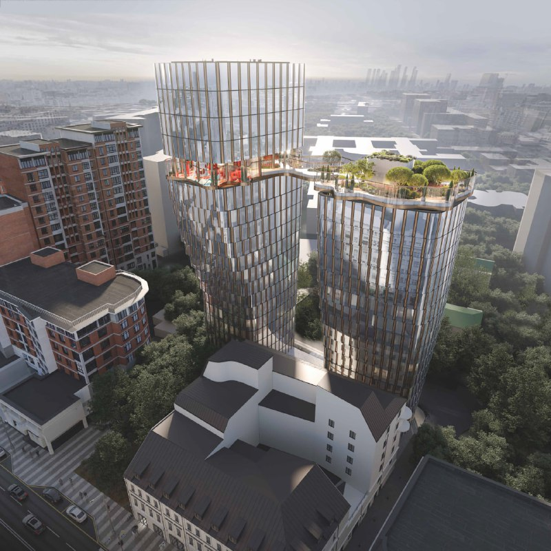
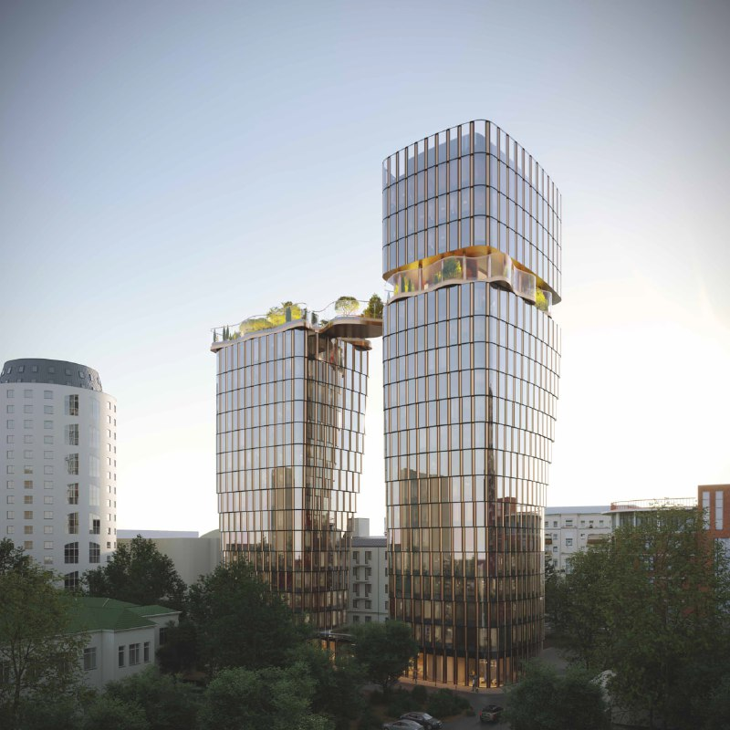
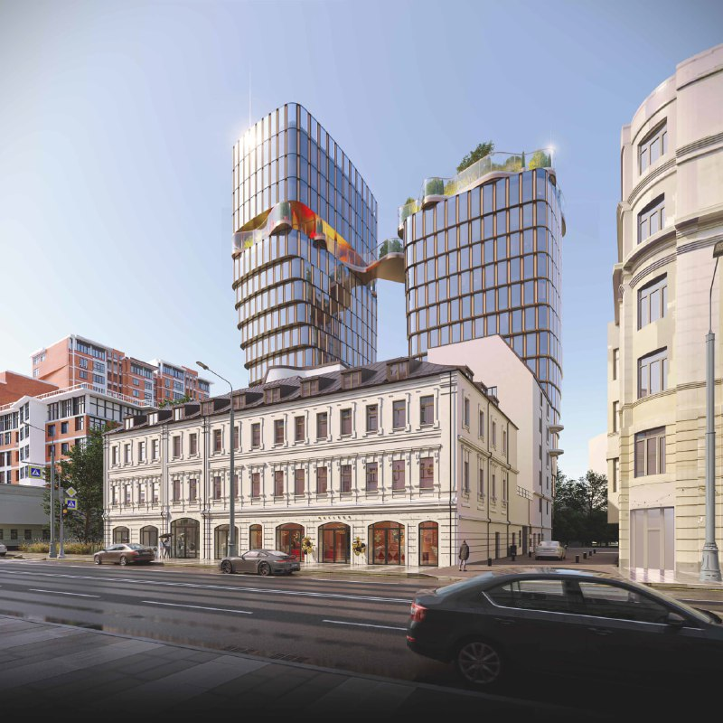

# ЖК «Энигмия» на Новослободской: цены от 81 млн ₽, сдача в 2028 году

Upside Development вывела на рынок клубный дом «Энигмия» на Новослободской улице: продажи стартовали в январе 2026 года, а к 14 октября 2026 года квартиры предлагают от 81 млн ₽. Ввод обоих корпусов заявлен на III квартал 2028 года.

## Коротко

- Застройщик — [Upside Development](/zastroyshchiki/upside/), проект находится в Тверском районе (ЦАО), метро «Новослободская» и «Менделеевская» — примерно по 3 минуты пешком.
- Два корпуса высотой до 19 этажей, 92 квартиры по проекту; в продаже на октябрь 2026 года, по разным страницам справочника, 35–37 квартир.
- Цена входа — примерно 81–84 млн ₽ за однокомнатную квартиру, верхняя граница — около 277–285 млн ₽ за четырёхкомнатную.
- Стадия — котлован и фундамент, срок сдачи — III квартал 2028 года.

## Что такое «Энигмия» и кто застройщик

«Энигмия» — клубный дом из двух корпусов, которые соединены стеклянным мостом с садом на высоте около 16 этажа. Проект в досье значится на участке «Новослободская, 19». Застройщик — Upside Development, до 2023 года компания называлась «СМУ-6 Инвестиции».

Дом продают как элитный: в январе 2026 года он попал в подборку стартов продаж в Москве. Тогда квартиры площадью от 57,6 до 173,4 м² предлагали от 79,8 млн ₽. Планировки, по данным карточки проекта, разработал Олег Клодт.

*Визуализация двух корпусов «Энигмии» с садом на мосту. Вид сверху. Визуализация: Upside Development*

## Сколько стоят квартиры в «Энигмии»

Справочник «Новострой-М» на 11–14 октября 2026 года даёт близкие, но не совпадающие цифры. По карточке проекта квартиры стоят от 81,2 до 276,9 млн ₽, по странице отзывов, где данные обновлены 14 октября, — от 83,7 до 285 млн ₽. По типам квартир там получается так:

- однокомнатные, 57,6–60,6 м² — 83,7–99,6 млн ₽;
- двухкомнатные, 76,2–82,0 м² — 115,6–131,0 млн ₽;
- трёхкомнатные, 120,6–157,0 м² — 171,3–277,7 млн ₽;
- четырёхкомнатные, 164,7–171,9 м² — 269,0–285,5 млн ₽.

В одном из объявлений однокомнатная квартира площадью 63,2 м² на 3 этаже стоила 85 831 920 ₽, то есть 1 358 100 ₽ за м². Это объявление на 14 октября 2026 года в справочнике помечено как неактивное, так что ориентируйтесь на порядок цифры, а не на точную цену. Квартиры продают по [договору долевого участия](/slovar/ddu/) с эскроу-счётом и без отделки.

*Визуализация клубного дома «Энигмия»: два корпуса, соединённые мостом. Визуализация: Upside Development*

## Когда сдадут «Энигмию»

В карточке проекта срок для обоих корпусов — III квартал 2028 года. Этажность в источниках указана по-разному: 15 и 19 этажей в материале о январских стартах, 16–19 этажей в карточке. Стадия на октябрь 2026 года — котлован и фундамент. В проекте заявлен подземный паркинг; число машино-мест в источниках не названо.

## Что с проектом сейчас

Положение дел на 14 октября 2026 года, по данным справочника «Новострой-М»:

- **Продажи.** Начались в январе 2026 года.
- **Стройка.** Стадия — котлован и фундамент. Отзыв на странице справочника упоминает «начало стройки», но дату и номер разрешения на строительство мы подтвердить не смогли.
- **Цена.** От 81 до 84 млн ₽ за вход; в январе 2026 года заявляли от 79,8 млн ₽. Это данные разных страниц справочника, поэтому динамику прайса по ним оценивать нельзя.
- **Застройщик.** Upside Development, он же указан на всех страницах проекта. В январе 2026 года компания также закрыла сделку по покупке бизнес-центра «Авиатор» на Ленинградском проспекте через СЗ «Дегунинская 5А».

## Контекст: коротко об истории проекта

История участка на Новослободской у нас описана в [досье «Энигмия»](/obekty/enigmiya/). Ключевое, что мы смогли подтвердить: в 2026 году проект вышел в продажу под названием «Энигмия», застройщиком по всем источникам указана Upside Development. Сведения о прежних владельцах участка по открытым источникам мы подтвердить не смогли, поэтому их здесь нет.

*Визуализация: «Энигмия» со стороны улицы, на переднем плане существующее здание. Визуализация: Upside Development*

## Что это значит для покупателя и инвестора

Это [премиальный](/novostroyki/premium-klass/) проект в центре с ценой входа выше 80 млн ₽ и сроком в 2028 году. На наш взгляд, главные вопросы для покупателя такие:

- **Стадия.** Дом на нулевом цикле, до сдачи почти два года. Проверьте проектную декларацию на наш.дом.рф и разрешение на строительство.
- **Сроки и эскроу.** Расчёты идут через эскроу-счёт, это снижает риск для покупателя, но не отменяет риск переноса сроков.
- **Окружение.** Метро рядом, но транспорт и среду лучше оценить лично, в разное время суток.
- **Цена.** Сравнивайте не с «новостройками Москвы» вообще, а с другими [проектами Москвы](/novostroyki/moskva/) в центре. О динамике цен и темпах продаж независимых данных у нас нет.

Общий фон по сегменту — в теме [премиум](/temy/premium/).

## Карточка объекта

- **Название:** клубный дом «Энигмия».
- **Адрес участка:** Новослободская, 19 (в справочнике — Новослободская ул., корп. 1 и 2).
- **Застройщик:** Upside Development.
- **Район:** Тверской, ЦАО; метро «Новослободская» и «Менделеевская».
- **Класс:** элитный (по описанию справочника).
- **Корпуса:** два, 16–19 этажей.
- **Квартиры:** 92 по проекту; площадь 57,6–173,4 м².
- **Стадия:** котлован и фундамент.
- **Срок сдачи:** III квартал 2028 года.
- **Цена:** от 81 млн ₽ (данные «Новострой-М» на 11–14 октября 2026 года).

## Вопросы и ответы

**Кто застройщик ЖК «Энигмия» на Новослободской?**
Upside Development (до 2023 года — «СМУ-6 Инвестиции»), по карточке проекта и объявлениям в справочнике «Новострой-М» на октябрь 2026 года.

**Сколько стоят квартиры в «Энигмии»?**
По данным «Новострой-М» на 11–14 октября 2026 года, от 81–84 млн ₽ за однокомнатную до 277–285 млн ₽ за четырёхкомнатную. В одном из объявлений цена составляла 1 358 100 ₽ за м².

**Когда сдадут «Энигмию»?**
Срок — III квартал 2028 года для обоих корпусов. На октябрь 2026 года стадия — котлован и фундамент.

**Где находится «Энигмия» и какое метро рядом?**
На Новослободской улице в Тверском районе (ЦАО). Станции метро «Новослободская» и «Менделеевская» — примерно по 3 минуты пешком.

## Источники

1. [Клубный дом «Энигмия» — карточка проекта, Новострой-М](https://www.novostroy-m.ru/baza/arhitekturnyy_proekt_enigmiya) — застройщик, срок, стадия, этажность, цены.
2. [Страница отзывов о проекте «Энигмия», Новострой-М](https://www.novostroy-m.ru/baza/arhitekturnyy_proekt_enigmiya/otzyvy) — цены по типам квартир на 14 октября 2026 года.
3. [Квартиры в московских новостройках по стартовым ценам от 9,4 млн рублей, Новострой-М, 2 февраля 2026 года](https://www.novostroy-m.ru/analitika/starty_prodaj_moskva_yanvar26) — январские старты, цена от 79,8 млн ₽.
4. [Объявление: однокомнатная квартира в клубном доме «Энигмия», Новострой-М](https://www.novostroy-m.ru/kvartiry/odnokomnatnaya-kvartira-v-klubnii-dom-ienigmiya-a0c0bcc56740cea01e5996259117a6) — адрес, метро, срок, цена за м².
5. [Upside Development — профиль компании, Новострой-М](https://www.novostroy-m.ru/kompanii/upside_development_apsayd_development) — история названия, портфель.
6. [Созданная «Сбером» и владельцем Azimut Hotels компания продала актив, «Ведомости», 19 января 2026 года](https://www.vedomosti.ru/realty/articles/2026/01/19/1170055-sozdannaya-sberom-i-vladeltsem-azimut-hotels-kompaniya-prodala-aktiv) — покупка БЦ «Авиатор» компанией Upside.

Материал не является инвестиционной рекомендацией.
