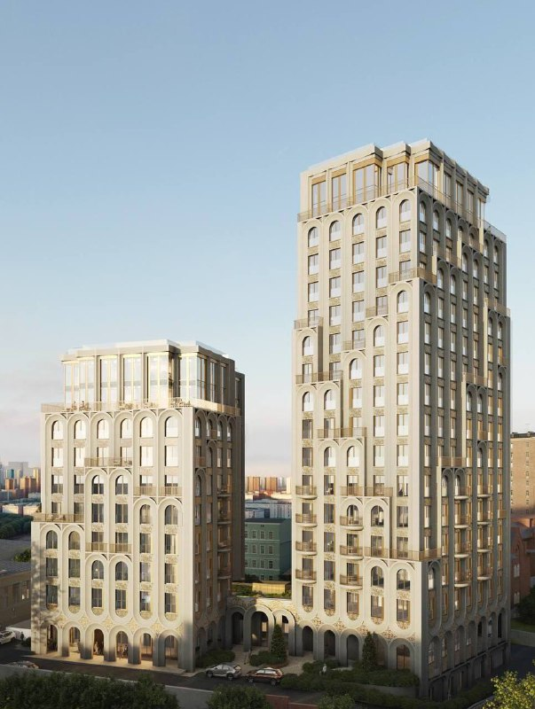
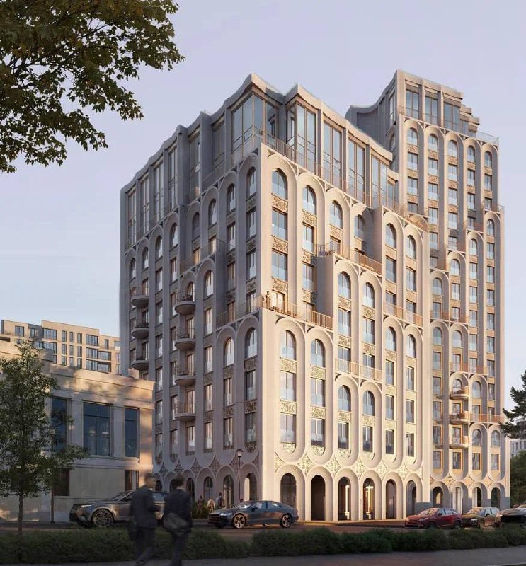

# «Воронцовъ» на Обуха, 3: Sun Development передала проект ГК «Развитие»

Проект «Воронцовъ» на ЗУ (земельном участке) «Обуха, 3» в Таганском районе сменил хозяина, не успев выйти из котлована: в конце 2025 года его у [Sun Development](/zastroyshchiki/sun-development/) забрала ГК «Развитие». На 14 октября 2026 года дом продаётся, на площадке — котлован, сдача по-прежнему во II квартале 2028 года.

## Коротко

- Был Sun Development, стала ГК «Развитие»: по данным отраслевого портала, проект выкупили в конце 2025 года.
- Проект не перекраивали: два корпуса и ввод во II квартале 2028 года — как при старте продаж в 2025 году.
- На 14 октября 2026 года 2-комнатная от 92,24 м² — от 156,6 млн ₽; метр — 1,67–1,73 млн ₽.
- Документы сделки публично не раскрывали — переход известен по отраслевому порталу.

## Новый хозяин и ещё одно юрлицо

В сентябре — октябре 2025 года проект выходил в продажу под брендом Sun Development. По данным портала Novostroy-M, в конце 2025 года его выкупила ГК «Развитие». В карточке ЖК застройщиком значится ООО «ГК «Развитие», а в характеристиках — ещё и специализированный застройщик (СЗ) «У2-ДЕВЕЛОПМЕНТ». Как они связаны, источник не объясняет.

Цену сделки стороны не называли. Поэтому формулировка пока осторожная: «по данным портала».

## Два корпуса на одном стилобате у «Чкаловской»

Адрес — Москва, ЦАО, Таганский район, переулок Обуха, вл. 3, до метро «Чкаловская» около 7 минут пешком. Два корпуса переменной этажности (10–16 этажей) стоят на едином стилобате; в описании 2025 года — 75 квартир. Архитектор, по описанию портала, — бюро BLANK.

*Два корпуса «Воронцовъ» на Обуха, 3 (визуализация проекта бюро BLANK). Визуализация: Sun Development*

На портале дом теперь называется «Резиденции Воронцова». Почему твёрдый знак уступил место резиденциям, застройщик не объяснял.

## Котлован, декларации и 1,7 млн за метр

По состоянию на 14 октября 2026 года:

- **Стадия.** На 26 сентября 2026 года — котлован и фундамент. [Проектные декларации](/slovar/proektnaya-deklaratsiya/), по данным портала, обновлялись 15 апреля, 10 мая, 14 июля и 30 сентября 2026 года.
- **Срок.** II квартал 2028 года — тот же, что при выходе в продажу в 2025 году.
- **Цены.** На 1 сентября 2026 года 2-комнатная квартира за 206,1 млн ₽ стоила 1,73 млн ₽ за м². На 14 октября 2026 года: 1-комнатная от 63,55 м² — 106,1 млн ₽ (около 1,67 млн ₽/м² по нашему расчёту), 2-комнатная от 92,24 м² — 156,6 млн ₽, 3-комнатная от 152,46 м² — 307,7 млн ₽.

Обещание «ничего в проекте менять не будут» пока выполняется: корпуса и срок прежние.

## Клубный, «делюкс» — и цена, которая говорит сама за себя

Портал и продавцы называют дом клубным и «делюкс». Это маркетинг, а не официальный класс. Но метр от 1,67 млн ₽ ставит проект в премиум убедительнее любого эпитета. Полная история — в [досье «Воронцовъ»](/obekty/vorontsov/), другие проекты — в разделе [новостроек столицы](/novostroyki/moskva/).

*Корпус «Воронцовъ» с видом с переулка (визуализация проекта бюро BLANK). Визуализация: Sun Development*

## Что это значит для покупателя и инвестора

Смена застройщика на стадии котлована — это смена того, кто отвечает за сроки. На наш взгляд, прежде чем подписывать ДДУ (договор долевого участия), стоит попросить у продавца документы о переходе проекта и проверить, на какое юрлицо оформляется договор.

Где риск. Опыт нового застройщика со сданными домами в Москве стоит проверить отдельно. Стройка в самом начале, и срок 2028 года пока подтверждают рендеры, а не ход работ. А цена около 1,7 млн ₽/м² оставляет мало запаса, если премиум просядет. Следите за проектной декларацией на наш.дом.рф и графиком строительства. Похожие дома — в подборке [премиальные проекты](/novostroyki/premium-klass/).

## Карточка объекта

- Название: «Воронцовъ» («Резиденции Воронцова»).
- Адрес ЗУ: Москва, ЦАО, Таганский район, переулок Обуха, вл. 3; метро «Чкаловская», 7 минут пешком.
- Застройщик: ГК «Развитие» (СЗ «У2-ДЕВЕЛОПМЕНТ»); ранее — Sun Development.
- Архитектор: бюро BLANK.
- Корпуса: два, 10–16 этажей.
- Квартиры: 75 (по описанию 2025 года).
- Стадия: продажи, котлован и фундамент (на 26 сентября 2026 года).
- Ввод: II квартал 2028 года.
- Цена: 2-комнатная от 156,6 млн ₽ (14 октября 2026 года).

## Вопросы и ответы

**Кто застройщик ЖК «Воронцовъ» на Обуха, 3?**
ГК «Развитие»: по данным отраслевого портала, она выкупила проект у Sun Development в конце 2025 года. В карточке ЖК застройщик — ООО «ГК «Развитие», в характеристиках указан и СЗ «У2-ДЕВЕЛОПМЕНТ».

**Когда сдадут «Воронцовъ» на Обуха, 3?**
По данным портала — во II квартале 2028 года, как и обещали при старте продаж в сентябре — октябре 2025 года. На 26 сентября 2026 года на площадке были котлован и фундамент.

**Сколько стоят квартиры в «Воронцовъ»?**
На 14 октября 2026 года на портале: 1-комнатная от 63,55 м² — 106,1 млн ₽, 2-комнатная от 92,24 м² — 156,6 млн ₽, 3-комнатная от 152,46 м² — 307,7 млн ₽. Для 1-комнатной это около 1,67 млн ₽ за м².

**Где находится ЖК «Воронцовъ»?**
В переулке Обуха, вл. 3, Таганский район ЦАО. До метро «Чкаловская» около 7 минут пешком.

## Источники

1. [ЖК «Резиденции Воронцова» (пер. Обуха) — Novostroy-M, карточка ЖК](https://novostroy-m.ru/baza/jk_v_per_obuha)
2. [Старты продаж, сентябрь 2025 года — Novostroy-M](https://www.novostroy-m.ru/analitika/starty_prodaj_sentyabr_2025)
3. [2-комнатная квартира в ЖК «Резиденции Воронцова» — Novostroy-M](https://www.novostroy-m.ru/kvartiry/dvuhkomnatnaya-kvartira-v-zhk-rezidencii-voroncova-3eeb685a1b0732940d2445d9e43bd2)
4. [СЗ «У2-ДЕВЕЛОПМЕНТ» — Novostroy-M](https://www.novostroy-m.ru/kompanii/sz_u2development)

Материал не является инвестиционной рекомендацией.
