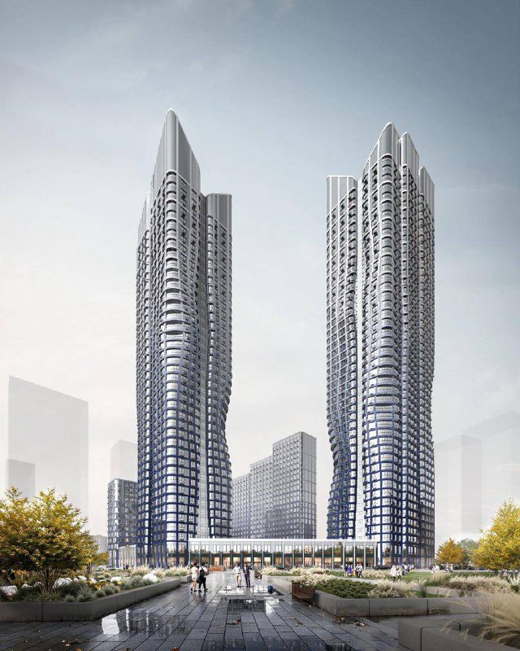
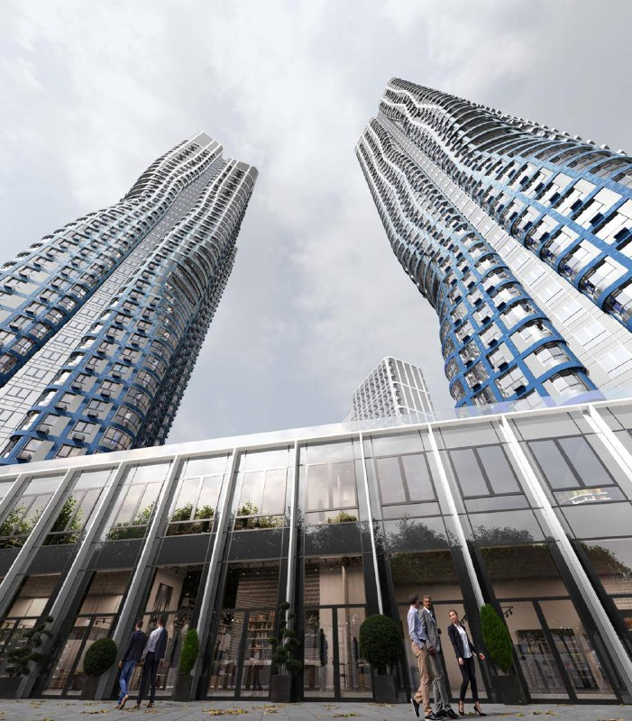

# ЖК «Адмирал» от «Галса»: башни в Южном порту пустили волну

«Галс» переодел башни ЖК «Адмирал» на Шоссейной, 4: вместо прямых линий и белых фасадов — волна и градиент от синего к голубому. Для проекта с морским названием логично, для покупателя — повод помнить, что облик дома на рендере не высечен в камне.

*Визуализация башен «Адмирала» с волнистым фасадом и градиентом (1). Визуализация: «Галс»*

## Коротко

- Башни показали в волнистой версии с градиентом от синего к голубому и белому — пока это концепция в визуализациях, о ней в декабре 2025 года написал Techinsider.
- Первый квартал: четыре корпуса от 13 до 47 этажей, 1489 квартир, продажи с декабря 2024 года (данные застройщика).
- Корпуса 1.1–1.4 на октябрь 2026 года обещают в III квартале 2028 года; в 2025 году говорили о IV квартале 2027 и IV квартале 2028 года.
- Квартиры в каталоге на 12 октября 2026 года — от 17,8 до 42,2 млн ₽.

## Было строго, стало волнисто

«Адмирал» строится в кластере «Южный порт» на юго-востоке Москвы, в Печатниках, около 300 м от метро «Печатники». Застройщик — «Галс-Девелопмент» из группы ВТБ.

Раньше башни выглядели сдержанно: прямые линии, белые фасады. На новых визуализациях фасады изгибаются волнами — привет названию, — а цвет плавно стекает от синего к голубому и белому.

*Визуализация башен «Адмирала» над стилобатом (2). Визуализация: «Галс»*

Архитектора башен Techinsider не называет и оговаривается: волна случится, только если застройщик получит все разрешения. Зачем понадобился новый облик, «Галс» публично не объяснял. Какие фасады достанутся остальным корпусам первого квартала, официально тоже не сообщали.

## Строят, но уже к 2028-му

По состоянию на 13 октября 2026 года:

- **Стадия.** По пресс-релизу застройщика от 26 июня 2026 года, комплекс строится: три квартала свяжет пешеходный бульвар, вместе с первой очередью появятся школа и детский сад.
- **Сроки.** Весной 2025 года застройщик обещал два корпуса в IV квартале 2027 года и два — в IV квартале 2028 года. В каталоге на октябрь 2026 года для корпусов 1.1–1.4 стоит III квартал 2028 года. Первые корпуса, выходит, сдвинулись почти на год.
- **Цены.** На 12 октября 2026 года — от 17,8 до 42,2 млн ₽. Однокомнатная квартира 28,5 м² в одном объявлении стоит 17,78 млн ₽, это около 624 тыс. ₽/м² (по нашему расчёту по одному объявлению, не средняя цена проекта).
- **Офисы.** По данным 360.ru от 6 марта 2026 года, [архитектурно-градостроительное решение (АГР)](/slovar/agr/) офисного здания утвердили: 45 этажей, около 97 тыс. м², четыре объединённые секции, архитектор — бюро Ariada.

## Южный порт: промзона на 633 га

«Южный порт» — бывшая промзона, которую Москва перестраивает с 2021 года. Весь кластер занимает 633 га, застройка — 7,4 млн м². У «Адмирала» своя доля: по данным застройщика, на 15 га за восемь лет появятся три жилых квартала, школа, детский сад и бизнес-центр. Полная история — в [досье «Адмирал»](/obekty/admiral/).

Соседи по Печатникам тоже не простаивают — например, [Ultima City от «Кортроса»](/novosti/yuzhnyy-port-ultima-city-ceny-sroki/).

## Что это значит для покупателя и инвестора

Главный урок «Адмирала»: фасад на визуализации — это обещание, а не пункт договора. Облик дома может поменяться и до, и после старта продаж. Перед покупкой сверьте фасадное решение с проектной декларацией и ДДУ.

Где риски. Первые корпуса уже уехали с 2027 на 2028 год. Сложные фасады обычно дороже в исполнении — отразится ли это на цене, «Галс» не говорил, и гадать мы не будем.

Что отслеживать: официальное подтверждение фасадов от [«Галса»](/zastroyshchiki/gals/), сроки в проектной декларации и ход стройки корпусов 1.1–1.4. Судебные споры по проекту проверьте отдельно до сделки.

## Карточка объекта

- **Адрес участка:** Шоссейная, 4 (Москва, Южный порт)
- **Название:** Адмирал
- **Застройщик:** [«Галс-Девелопмент»](/zastroyshchiki/gals/) (ООО «СЗ «Галс-Шоссейная»)
- **Район:** [Печатники](/novostroyki/pechatniki/), метро «Печатники» около 300 м
- **Первый квартал:** 4 корпуса, 13–47 этажей, 1489 квартир 28–99 м² (по данным застройщика)
- **Стадия:** строительство и продажи
- **Ввод:** корпуса 1.1–1.4 — III квартал 2028 года (по каталогу)
- **Цена:** квартиры от 17,8 до 42,2 млн ₽ (12 октября 2026 года)

## Вопросы и ответы

**Как изменился облик башен ЖК «Адмирал»?**
Прямые линии и белые фасады сменились волнистыми фасадами с градиентом от синего к голубому и белому. Пока это концепция в визуализациях.

**Сколько стоят квартиры в ЖК «Адмирал»?**
По данным каталога на 12 октября 2026 года — от 17,8 до 42,2 млн ₽. Средней цены за квадратный метр каталог не даёт.

**Когда сдадут ЖК «Адмирал»?**
Корпуса 1.1–1.4 первого квартала — в III квартале 2028 года, по каталогу. В 2025 году застройщик называл IV квартал 2027 и IV квартал 2028 года.

**Кто застройщик ЖК «Адмирал» и где он находится?**
«Галс-Девелопмент», по документам — ООО «СЗ «Галс-Шоссейная». Комплекс стоит на Шоссейной, 4 в Южном порту, около 300 м от метро «Печатники».

## Источники

1. [Techinsider: в «Южном порту» появятся волнистые небоскрёбы, 19 декабря 2025 года](https://www.techinsider.ru/news/news-1719227-v-yujnom-portu-poyavyatsya-ko-volnistye-neboskreby/)
2. [Каталог новостроек: ЖК «Адмирал», Шоссейная, 4Д, цены на 12 октября 2026 года](https://www.novostroy-m.ru/baza/jk_shosseynaya_ulitsa_4d)
3. [РБК Недвижимость: первый квартал ЖК «Адмирал», 3 марта 2025 года (реклама застройщика)](https://realty.rbc.ru/news/67bd92799a79473e8be38ead)
4. [Ведомости: пресс-релиз Галс-Девелопмента об «Адмирале», 26 июня 2026 года (реклама)](https://www.vedomosti.ru/press_releases/2026/06/26/v-zhk-admiral-poyavitsya-dvuhyarusnaya-paluba-s-10-stsenariyami-dosuga-erid-2Vfnxvr9VQo)
5. [360.ru: об офисной части «Адмирала», 6 марта 2026 года](https://360.ru/tekst/moskva/ovchinskij-rasskazal-ob-oblike-novogo-biznes-tsentra-admiral-v-juzhnom-portu/)

Материал не является инвестиционной рекомендацией.
