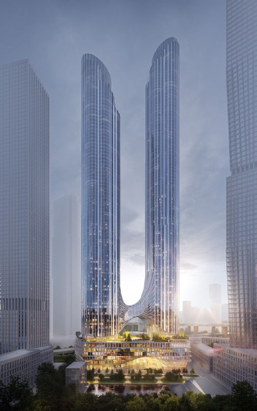
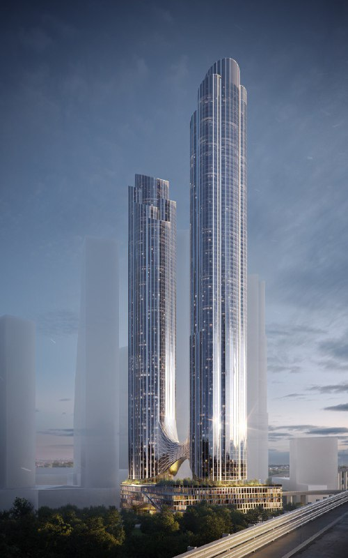
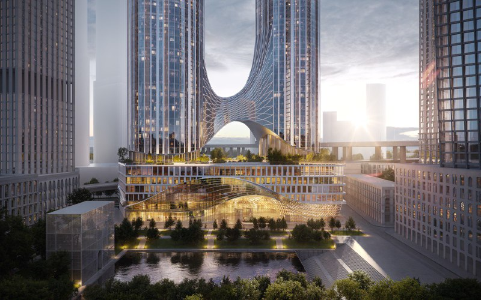

# Сити-2: Страна Девелопмент согласовала АГР двух башен до 384 м — пока без цен

30 декабря 2025 года «Страна Девелопмент» объявила: для её проекта в «Сити-2», по соседству с Москва-Сити, согласовано [архитектурно-градостроительное решение (АГР)](/slovar/agr/). Две жилые башни на 83 и 96 этажей, самая высокая — 384 м. Облик утверждён, а вот цен и старта продаж на 14 октября 2026 года застройщик так и не объявил.

## Коротко

- О согласовании объявили 30 декабря 2025 года; дату самого решения не называли.
- Две башни разной высоты на общем стилобате: от 83 до 96 этажей, до 384 м, пять подземных уровней.
- Больше 280 тыс. м², архитектор — бюро Apex.
- Участок «Страна Девелопмент» взяла на аукционе весной 2024 года за 18,6 млрд ₽.

## Две башни на одном стилобате

Проект стоит в Пресненском районе, на территории будущего «Сити-2», у 2-го Красногвардейского проезда. Обе башни вырастают из общего стилобата. Внутри застройщик обещает общественные, деловые и рекреационные помещения, бизнес-центр, культурные и досуговые пространства, коммерческую инфраструктуру и подземный паркинг.

Площадь — более 280 тыс. м²; [ТЭП](/slovar/tep/) (технико-экономические показатели) застройщик пока раскрыл только крупными мазками. Над землёй 83 и 96 этажей, под землёй — пять уровней.

Застройщик заявляет, что комплекс претендует на звание самого высокого жилого в России и Европе. Это слова компании — рекорд пока существует в пресс-релизе, а не в бетоне.

*Две башни проекта в «Сити-2» (1). Визуализация: Страна Девелопмент*

*Башни разной высоты, вид со стороны трассы (2). Визуализация: Страна Девелопмент*

## От аукциона до АГР — минус один этаж

Участок на 2-м Красногвардейском проезде город продавал с торгов. Весной 2024 года их выиграла «Страна Девелопмент» — за 18,6 млрд ₽. Подробности — в [отдельной статье об аукционе](/novosti/siti-2-strana-development-aukcion/).

Дальше события шли так:

- 14 мая 2025 года застройщик показал визуализации двух башен на 83 и 97 этажей, около 281 тыс. м², из них около 232 тыс. м² жилья; архитектура — бюро Apex;
- 30 декабря 2025 года объявили согласование АГР: 83 и 96 этажей, 384 м, более 280 тыс. м².

Итог согласований: одна башня потеряла этаж — было 97, стало 96.

Полная история проекта — в [досье «Сити-2»](/obekty/siti-2/).

*Стилобат и общественное пространство у воды (3). Визуализация: Страна Девелопмент*

## После АГР — тишина

На 14 октября 2026 года последняя официальная новость по проекту — то самое объявление об АГР от 30 декабря 2025 года. Разрешение на строительство, сроки ввода, проектную декларацию и старт продаж застройщик публично не показывал. Цен на квартиры тоже нет.

Ставки, срок стройки, цена на старте — всё это пока открытые вопросы.

## Что это значит для покупателя и инвестора

Пока это проект на бумаге: облик согласован, продаж нет. Для покупателя важна не картинка, а следующие документы — разрешение на строительство и проектная декларация на наш.дом.рф.

На наш взгляд, земля за 18,6 млрд ₽ и башни такой высоты почти наверняка означают жильё в верхнем ценовом сегменте — это наша оценка, а не данные застройщика. Риски очевидны: 96 этажей — сложная стройка, в землю уже вложены большие деньги, а сроков пока нет вовсе. Для сравнения — [премиальные проекты](/temy/premium/) и другие [новостройки Москвы](/novostroyki/moskva/).

## Карточка объекта

- Название: «Сити-2» (в архиве также «Сити 4»).
- Расположение: Москва, Пресненский район, 2-й Красногвардейский проезд.
- Застройщик: [Страна Девелопмент](/zastroyshchiki/strana/).
- Проект: две жилые башни на 83 и 96 этажей, до 384 м, пять подземных уровней.
- Площадь: более 280 тыс. м².
- Архитектор: Apex.
- Стадия: АГР согласован, продаж нет (на 14 октября 2026 года).

## Вопросы и ответы

**Что согласовали для проекта Страны Девелопмент в «Сити-2»?**
Архитектурно-градостроительное решение (АГР): две жилые башни на общем стилобате, от 83 до 96 этажей, самая высокая — 384 м. Объявили об этом 30 декабря 2025 года.

**Кто архитектор башен в «Сити-2»?**
Бюро Apex.

**Какая площадь проекта в «Сити-2»?**
Более 280 тыс. м². Весной 2025 года застройщик называл около 281 тыс. м², из них около 232 тыс. м² жилья.

**Когда начнутся продажи квартир в «Сити-2»?**
На 14 октября 2026 года застройщик не объявлял ни старт продаж, ни цены.

## Источники

1. [АГР для проекта Страны Девелопмент в «Сити-2» — сообщение от 30 декабря 2025 года, Normacs](https://www.normacs.info/news/78110)
2. [В Москве утвердили проект самого высокого жилого комплекса в России и Европе — Inc. Russia, 30 декабря 2025](https://incrussia.ru/news/v-moskve-utverdili-proekt-samogo-vysokogo-zhilogo-kompleksa-v-rossii-i-evrope/)
3. [Власти утвердили проект башен до 96 этажей в «Сити» — «Москвич Mag», 30 декабря 2025](https://moskvichmag.ru/?p=472604)
4. [83 и 97 этажей: два небоскрёба в «Сити-2» — «Вокруг света», 14 мая 2025](https://www.vokrugsveta.ru/news/83-i-97-etazhei-posmotrite-kakimi-budut-dva-neboskreba-v-novom-delovom-centre-siti-2-v-moskve-id6350759/)

Материал не является инвестиционной рекомендацией.
