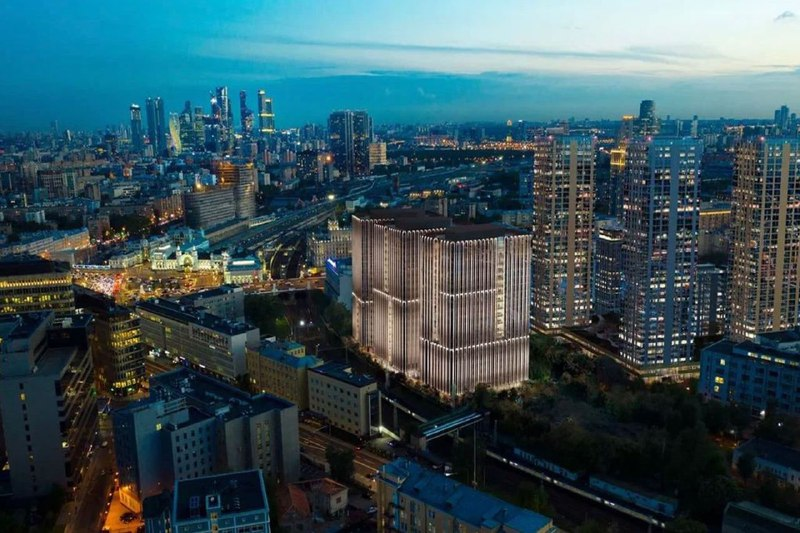
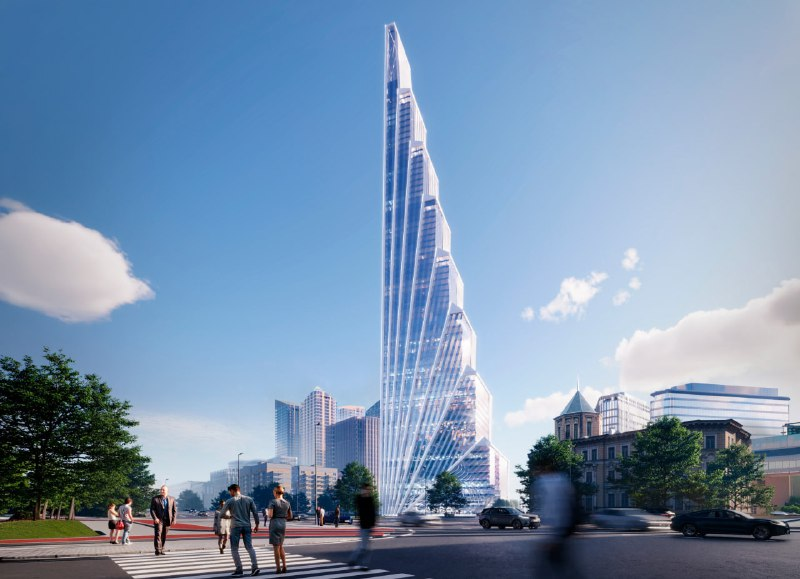

---
source:
  id: 32785
  date: 2026-01-13
status: needs_review
skip_reason: null
type: architecture
series: evolution
region: moscow
title: 'Slava на Ленинградском проспекте, 8: от 17 этажей к 310 метрам за четыре года'
title_alts:
- 'Slava у Белорусской: апартаменты, квартиры, офисы ЦБ и башня в 310 метров'
- 'Проект Slava: на каждую очередь — свой архитектор, а доминанта всё выше'
slug: slava-kak-menyalsya-proekt
lead: Slava у Белорусского вокзала начинался в 2022 году скромно — апартаменты до 17 этажей и 40-этажная башня в пятой очереди. В январе 2026-го рядом рисуют доминанту около 310 метров. Рассказываем, как проект рос и что в нём уже точно.
developers:
- id: mr-group
  name: MR Group
  role: main
objects:
- id: slava
  names:
  - Slava
  - Слава
  zu: Ленинградский проспект, 8
  main: true
  new: false
districts:
- tverskoy
topics:
- arhitektura
- premium
images:
- file: media/10448_1.jpg
  alt: Офисная часть проекта Slava у Белорусского вокзала в Москве, визуализация Nikken Sekkei, 2021
  caption: 'Визуализация: MR Group, 2021'
  credit: MR Group
- file: media/32785_2.jpg
  alt: Башня около 310 метров проекта Slava у Белорусского вокзала в Москве, визуализация 2026 года
  caption: 'Визуализация: MR Group, 2026'
  credit: MR Group
factcheck:
- claim: '19 декабря 2022 года: первая очередь SLAVA — три корпуса от 8 до 17 этажей, максимальная высота 66,8 м, архитектор Dyer, апартаменты; всего пять очередей, в пятой — 40-этажная башня (офисы класса А, апартаменты, гостиница)'
  status: confirmed
  source: https://realty.rbc.ru/news/6380ab7d9a79474428aef71a
  checked: 2026-10-14
- claim: '30 ноября 2023 года: вторая очередь — четыре башни на общем стилобате (Хельмут Ян), четвёртая очередь — три 20-этажные офисные башни (Nikken Sekkei)'
  status: confirmed
  source: https://realty.rbc.ru/news/6568b1f09a7947224e64bb06
  checked: 2026-10-14
- claim: '27 ноября 2025 года: вторая очередь — четыре корпуса 34–41 этаж, 144 тыс. м², 1 245 квартир, 774 машино-места, ввод во II квартале 2027 года; Studio Jahn и Nikken Sekkei (с 2023 года, редизайн); первая очередь введена в 2023 году'
  status: confirmed
  source: https://realty.rbc.ru/news/69245cea9a794705c184ab45
  checked: 2026-10-14
- claim: В 2024 году Центральный банк приобрёл строящийся бизнес-центр Slava
  status: confirmed
  source: https://realty.rbc.ru/news/6890ca029a79474dfa608c81
  checked: 2026-10-14
- claim: '14 января 2026 года: доминанта около 310 м и около 65 этажей, в составе Slava, MR Group; стадия — предложение, разрешения нет; макет показан на АРХ Москве весной 2025 года'
  status: confirmed
  source: https://msk1.ru/text/gorod/2026/01/14/76214298/
  checked: 2026-10-14
- claim: 'Дом G второй очереди: 37 этажей, II квартал 2027 года, лот 80,2 м² за 77 968 836 ₽ (972 180 ₽/м²), застройщик MR Group'
  status: confirmed
  source: https://www.novostroy-m.ru/kvartiry/dvuhkomnatnaya-kvartira-v-zhk-slava-92eda98f724897ae421e6564275755
  checked: 2026-10-14
- claim: Авторы доминанты (KAMEN, Кузнецов), экспертиза 110-метровой офисной башни, решения Архсовета 2020 года, перевод второй очереди из апартаментов в квартиры в 2023 году
  status: unverified
  source: https://msk1.ru/text/gorod/2026/01/14/76214298/
  checked: 2026-10-14
removed:
- 'Решения Архсовета ноября 2020 года (двор «слишком маленький»): независимо не подтверждены, этап убран.'
- 'Разрешение на строительство 2019 года на 65 тыс. м² и открытие закрытых продаж 2020 года: не проверялись.'
- 'Авторы доминанты (KAMEN и Кузнецов): источник январской публикации архитектора не называет, в текст не включены.'
- 'Положительное заключение экспертизы на 110-метровую офисную доминанту (август 2024 года) и сделка по офису ЦБ на 100 тыс. м²: подтверждена только покупка бизнес-центра в 2024 году, без площади.'
- 'Перевод второй очереди из апартаментов в квартиры (апрель 2023 года) и замена «скосов» на «уголки» (март 2024 года): дат и причин в источниках не найдено; приведён только итог 2025 года.'
- Оценочные суждения заметок о ТЭП и об «Эффекте Five» — мнение автора заметки, не включены.
data_points:
- metric: slava_dom_g_price_rub_per_m2
  value: 972180
  date: '2026-10-14'
seo:
  main_query: slava mr group как менялся проект
  keywords:
  - жк slava белорусская
  - slava небоскреб 310 метров
  - слава ленинградский проспект 8 mr group
  - slava вторая очередь сроки
  frequency_checked: false
  title: 'Slava от MR Group у Белорусской: как проект вырос'
  description: 'Slava на Ленинградском проспекте, 8: от апартаментов до 17 этажей в 2022 году до башни около 310 м в 2026-м; во второй очереди 1 245 квартир. Что поменялось.'
  canonical: https://шахматка.москва/novosti/slava-kak-menyalsya-proekt/
internal_links:
- anchor: досье «Slava»
  url: /obekty/slava/
- anchor: MR Group
  url: /zastroyshchiki/mr-group/
- anchor: Тверской район
  url: /novostroyki/tverskoy/
- anchor: премиум-класса
  url: /novostroyki/premium-klass/
- anchor: архитектурно-градостроительного решения
  url: /slovar/agr/
- anchor: архитектура
  url: /temy/arhitektura/
faq:
- q: Сколько этажей будет у башни Slava у Белорусского вокзала?
  a: Около 65 этажей при высоте около 310 м — по публикации от 14 января 2026 года. На тот момент это было предложение без разрешения на строительство.
- q: Сколько квартир во второй очереди Slava?
  a: 1 245 квартир площадью от 30 до 201 м² в четырёх корпусах на 34–41 этаж, по данным РБК Недвижимости на 27 ноября 2025 года. Ввод — II квартал 2027 года.
- q: Кто архитектор Slava?
  a: Первая очередь — британское бюро Dyer, вторая — Хельмут Ян (Studio Jahn) с редизайном Nikken Sekkei, офисная очередь — Nikken Sekkei.
- q: Купил ли Центробанк офис в Slava?
  a: 'Да: по данным РБК Недвижимости, в 2024 году Центральный банк купил строящийся бизнес-центр Slava. Площадь и цену не раскрывали.'
date_published: 2026-01-13
date_modified: 2026-10-14
author: Редакция Шахматки
editor_notes: Опорные источники — материалы РБК Недвижимости (декабрь 2022, ноябрь 2023, август и ноябрь 2025 года) и публикация msk1.ru от 14 января 2026 года; ЕИСЖС и сайт застройщика не открывались, лимит WebFetch исчерпан. Авторов доминанты (в заметке — KAMEN и Кузнецов) подтвердить не удалось. Неясно, что именно приобрёл Центробанк (площадь, продавец) — проверить по раскрытию. Цена 972 180 ₽/м² — один лот, страница агрегатора отмечена как обновлённая 14 октября без года. Подпись года у фото 2021 — по дате заметки архива, из заметки известно, что это офисная часть (3 фаза) от Nikken Sekkei; 2026 — рендер той же заметки.
schema: |-
  [
    {
      "@context": "https://schema.org",
      "@type": "Article",
      "headline": "Slava на Ленинградском проспекте, 8: как менялся проект с 2022 по 2026",
      "description": "Slava на Ленинградском проспекте, 8: от апартаментов до 17 этажей в 2022 году до башни около 310 м в 2026-м; во второй очереди 1 245 квартир. Что менялось.",
      "datePublished": "2026-01-13",
      "dateModified": "2026-10-14",
      "author": {
        "@type": "Organization",
        "name": "Редакция Шахматки"
      },
      "publisher": {
        "@type": "Organization",
        "name": "Шахматка"
      },
      "about": [
        {
          "@type": "Residence",
          "name": "Slava",
          "address": "Москва, Ленинградский проспект, 8"
        },
        {
          "@type": "Organization",
          "name": "MR Group"
        }
      ],
      "mainEntityOfPage": "https://шахматка.москва/novosti/slava-kak-menyalsya-proekt/"
    },
    {
      "@context": "https://schema.org",
      "@type": "FAQPage",
      "mainEntity": [
        {
          "@type": "Question",
          "name": "Сколько этажей будет у башни Slava у Белорусского вокзала?",
          "acceptedAnswer": {
            "@type": "Answer",
            "text": "По публикации от 14 января 2026 года, около 65 этажей при высоте около 310 м; на тот момент это предложение, разрешения на строительство нет."
          }
        },
        {
          "@type": "Question",
          "name": "Сколько квартир во второй очереди Slava?",
          "acceptedAnswer": {
            "@type": "Answer",
            "text": "По данным РБК Недвижимости на 27 ноября 2025 года — 1 245 квартир площадью от 30 до 201 м² в четырёх корпусах на 34–41 этаж; ввод — II квартал 2027 года."
          }
        },
        {
          "@type": "Question",
          "name": "Кто архитектор Slava?",
          "acceptedAnswer": {
            "@type": "Answer",
            "text": "Первую очередь проектировало британское бюро Dyer, вторую — Хельмут Ян (Studio Jahn) с редизайном Nikken Sekkei, офисную очередь — Nikken Sekkei."
          }
        },
        {
          "@type": "Question",
          "name": "Купил ли Центробанк офис в Slava?",
          "acceptedAnswer": {
            "@type": "Answer",
            "text": "По данным РБК Недвижимости, в 2024 году Центральный банк приобрёл строящийся бизнес-центр Slava; площадь и цена в источнике не названы."
          }
        }
      ]
    }
  ]
---

# Slava на Ленинградском проспекте, 8: от 17 этажей к 310 метрам за четыре года

Slava у Белорусского вокзала в 2022 году был скромным: апартаменты до 17 этажей и план из пяти очередей. В январе 2026-го рядом с ним уже рисуют доминанту около 310 метров. Разбираем, как за это время менялись очереди, архитекторы и сама функция зданий.

**Коротко**

- Декабрь 2022 года: первая очередь — три корпуса от 8 до 17 этажей (архитектор Dyer), в пятой очереди задумана 40-этажная башня.
- Ноябрь 2025 года: вторая очередь — четыре корпуса на 34–41 этаж, 144 тыс. м², 1 245 квартир, ввод во II квартале 2027 года.
- 2024 год: Центральный банк купил строящийся бизнес-центр Slava.
- Январь 2026 года: на столе — доминанта около 310 м и около 65 этажей; разрешения нет.

## Начало: апартаменты на месте часового завода

[MR Group](/zastroyshchiki/mr-group/) и «ПроГород» (группа ВЭБ.РФ) строят Slava на месте бывшего часового завода «Слава» — Ленинградский проспект, вл. 8, [Тверской район](/novostroyki/tverskoy/). По данным РБК Недвижимости от 19 декабря 2022 года, первая очередь — апартаменты в трёх корпусах от 8 до 17 этажей, не выше 66,8 м. Концепцию нарисовало британское бюро Dyer. Ввод обещали в 2023 году — и в 2023 году первую очередь действительно ввели.

Пятая очередь из пяти тогда выглядела как 40-этажная башня: офисы класса А, апартаменты, гостиница.

## Что поменяли по дороге

**2023 год: звёздные архитекторы.** По данным РБК Недвижимости от 30 ноября 2023 года, вторую очередь задумал Хельмут Ян — четыре башни на общем стилобате, а офисную четвёртую очередь — бюро Nikken Sekkei: три 20-этажные башни. В том же году, как РБК написал в ноябре 2025-го, Nikken Sekkei взялось и за редизайн второй очереди.

**Вторая очередь к 2025 году.** Четыре башни на общем стилобате с пешеходной улицей остались. «Короны»-карнизы сменились наклонными кровлями, а этажность стала переменной — 34–41 этаж. По данным РБК от 27 ноября 2025 года: 144 тыс. м², 1 245 квартир (от 30 до 201 м²), 774 машино-места, ввод — II квартал 2027 года.

**2024 год: офисы покупает ЦБ.** РБК Недвижимости сообщает, что в 2024 году Центральный банк купил строящийся бизнес-центр Slava. Площадь, продавца и цену РБК не называет.

*Визуализация: MR Group, 2021*

**Январь 2026 года: доминанта.** По публикации msk1.ru от 14 января 2026 года, рядом с Белорусским вокзалом в составе Slava может появиться башня около 310 м и около 65 этажей. Макет впервые показали весной 2025 года на АРХ Москве. Внизу — офисы и магазины, выше — жильё, на высоте 45 м — смотровая площадка. Стеклянный пешеходный мост над железной дорогой должен связать комплекс с Тверским и Беговым районами. Но это пока предложение: ни решения об [АГР](/slovar/agr/), ни разрешения на строительство нет. Авторов проекта публикация не называет.

*Визуализация: MR Group, 2026*

Важная оговорка. В 2022 году для пятой очереди называли 40 этажей, в 2026-м — около 65. Одно ли это здание — нигде прямо не сказано. Поэтому перед нами две версии доминанты проекта, а не доказанная история роста одной башни.

## Где проект сейчас

На 14 октября 2026 года Slava живёт несколькими очередями. Первая введена в 2023 году. Вторая строится: по карточке лота на агрегаторе «Новострой-М», дом G — 37 этажей, срок — II квартал 2027 года, застройщик — MR Group. Двухкомнатная квартира 80,2 м² стоит 77,97 млн ₽ (972 180 ₽/м²); страница обновлена 14 октября. Для [премиум-класса](/novostroyki/premium-klass/) центра Москвы это ориентир по одному лоту, а не средняя цена.

Доминанта на момент январской публикации оставалась предложением; о её согласовании официально не объявляли. Полная история — в [досье «Slava»](/obekty/slava/).

## Было и стало

| Параметр | Декабрь 2022 | Ноябрь 2023 | Ноябрь 2025 | Январь 2026 |
|---|---|---|---|---|
| Первая очередь | 3 корпуса, 8–17 этажей, до 66,8 м | — | введена в 2023 году | — |
| Вторая очередь, этажность | — | 4 башни на стилобате | 34–41 этаж | — |
| Вторая очередь, площадь | — | — | 144 тыс. м² | — |
| Вторая очередь, квартиры | — | — | 1 245 | — |
| Офисная очередь | — | 3 башни по 20 этажей | — | — |
| Доминанта | 40 этажей (пятая очередь, план) | — | — | около 65 этажей, около 310 м (предложение) |
| Архитектор | Dyer (1-я очередь) | Хельмут Ян, Nikken Sekkei | Studio Jahn и Nikken Sekkei | — |

Прочерк — данных для этого этапа нет.

## Что это значит для покупателя и инвестора

На наш взгляд, Slava — проект, где слово «очередь» каждый год значит что-то новое: апартаменты, квартиры, офисы и доминанта сменяют друг друга быстрее, чем выходят документы. Покупателю второй очереди стоит смотреть не на рендеры 310-метровой башни, а на проектную декларацию своего корпуса и срок ввода.

Что отслеживать: решение по доминанте, сроки второй очереди (II квартал 2027 года) и судьбу офисной части после сделки с Центробанком.

## Карточка объекта

- **Адрес участка:** Ленинградский проспект, 8, Москва
- **Названия:** Slava, «Слава»
- **Застройщик:** MR Group
- **Район:** Тверской, ЦАО
- **Первая очередь:** 3 корпуса, 8–17 этажей, введена в 2023 году
- **Вторая очередь:** 4 корпуса, 34–41 этаж, 144 тыс. м², 1 245 квартир, ввод — II квартал 2027 года
- **Стадия:** продажи, строительство
- **Цена:** лот 80,2 м² — 77,97 млн ₽ (972 180 ₽/м²)

## Вопросы и ответы

**Сколько этажей будет у башни Slava у Белорусского вокзала?**
Около 65 этажей при высоте около 310 м — по публикации от 14 января 2026 года. На тот момент это было предложение без разрешения на строительство.

**Сколько квартир во второй очереди Slava?**
1 245 квартир площадью от 30 до 201 м² в четырёх корпусах на 34–41 этаж, по данным РБК Недвижимости на 27 ноября 2025 года. Ввод — II квартал 2027 года.

**Кто архитектор Slava?**
Первая очередь — британское бюро Dyer, вторая — Хельмут Ян (Studio Jahn) с редизайном Nikken Sekkei, офисная очередь — Nikken Sekkei.

**Купил ли Центробанк офис в Slava?**
Да: по данным РБК Недвижимости, в 2024 году Центральный банк купил строящийся бизнес-центр Slava. Площадь и цену не раскрывали.

## Источники

1. [РБК Недвижимость: SLAVA, 19 декабря 2022 года](https://realty.rbc.ru/news/6380ab7d9a79474428aef71a)
2. [РБК Недвижимость: тренды в строительстве, 30 ноября 2023 года](https://realty.rbc.ru/news/6568b1f09a7947224e64bb06)
3. [РБК Недвижимость: Slava и известные архитекторы, 27 ноября 2025 года](https://realty.rbc.ru/news/69245cea9a794705c184ab45)
4. [РБК Недвижимость: деловой район у «Белорусской», 11 августа 2025 года](https://realty.rbc.ru/news/6890ca029a79474dfa608c81)
5. [msk1.ru: небоскрёб у Белорусского вокзала, 14 января 2026 года](https://msk1.ru/text/gorod/2026/01/14/76214298/)
6. [Новострой-М: карточка лота в ЖК «Слава»](https://www.novostroy-m.ru/kvartiry/dvuhkomnatnaya-kvartira-v-zhk-slava-92eda98f724897ae421e6564275755)

Материал не является инвестиционной рекомендацией.
