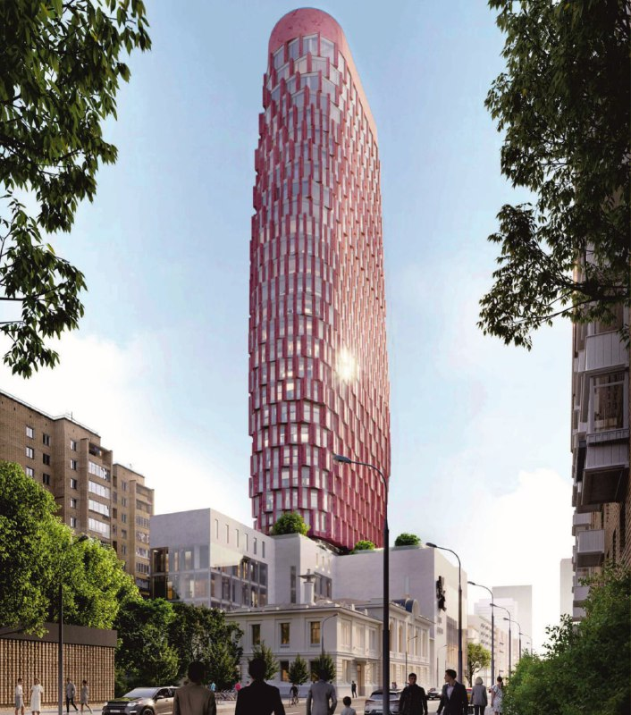
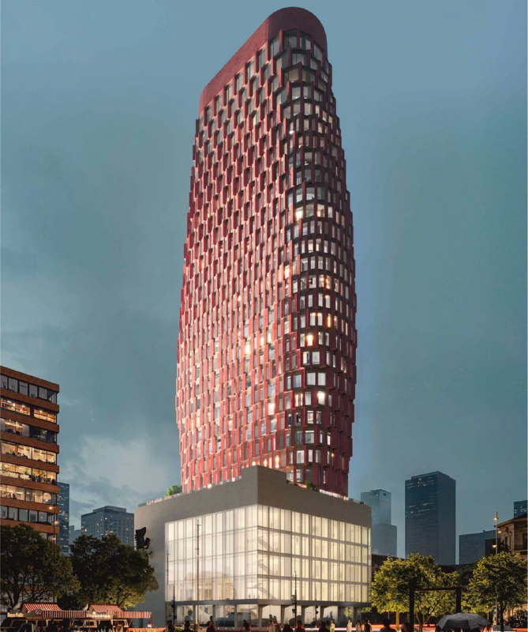
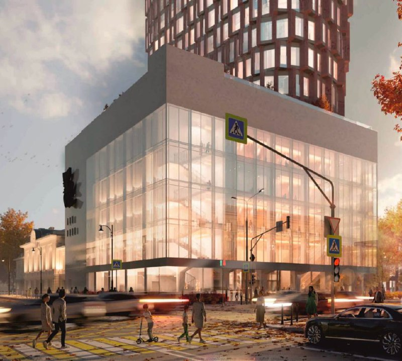

# «Дом кино» на Васильевской, 13: 28 этажей, 135 м и цены от 1,7 млн ₽/м²

Центральный дом кинематографистов на Васильевской, 13 снесли, а на его месте строят жилую башню на 135 м с терракотово-розовым фасадом. Проект бюро Kleinewelt Architekten выходит на рынок: 79 квартир, цены от 1,7 млн ₽/м², завершение — 2029 год. Кино тут оставят внизу, а виды на центр Москвы продадут наверху.

## Коротко

- **Что:** жилая башня 135 м и новый Дом кино с залами для Союза кинематографистов.
- **Кто:** застройщик — «Первый девелопер», архитектор — Kleinewelt Architekten.
- **Сколько:** 79 квартир от 85 до 342 м², цены от 1,7 млн ₽/м².
- **Когда:** по данным брокера Whitewill, завершение строительства — 2029 год.

## Что строят на месте Дома кино

Проект находится на ЗУ «Васильевская, 13, стр. 1» в Пресненском районе ЦАО, около шести минут пешком от метро «Белорусская». Старое здание Дома кино снесли. Рядом сохраняется и реставрируется Алексеевский народный дом — исторический особняк, который остаётся частью комплекса.

Новый Дом кино — это стеклянный объём у перекрёстка с залами. По данным «Москвич Mag», в нём будет зал на 707 мест, камерный зал на 68 мест, выставочные пространства и творческие кабинеты Союза кинематографистов. На 8,2 тыс. м² нежилой части, по данным Архи.ру, приходятся Союз кинематографистов и кинозалы. А над всем этим — башня.

*Башня на 135 м над реставрируемым Алексеевским народным домом. Визуализация проекта бюро Kleinewelt Architekten*

Фасад — отдельный разговор. Объёмные «воксели» цвета розового мрамора ложатся на стекло в шахматном порядке: получается нечто среднее между терракотовой армией и пиксельным принтом. На наш вкус, смело и узнаваемо. Спорить, красиво ли это, будут и без нас; важнее, что башня в плотной застройке у Белорусской будет видна издалека.

## Сколько стоят квартиры в «Доме кино»

По данным Whitewill на 27 августа 2026 года, в жилой части 28 этажей и 79 квартир площадью от 85 до 342 м², в среднем около 130 м². Потолки 3,9 м, у пентхаусов — до 7,3 м, четыре квартиры на этаже, подземный паркинг на 84 машины и «природный сад» на седьмом этаже. Цены на старте — от 1,7 млн ₽/м². Простая арифметика: средняя квартира в 130 м² обойдётся порядка 220 млн ₽.

Это уровень, где покупатель выбирает не квадратные метры, а адрес и имя. И то и другое у проекта есть: центр, Союз кинематографистов в основании, архитектурный жест.

*Вечерний вид: башня стоит на стеклянном объёме с кинозалами. Визуализация проекта бюро Kleinewelt Architekten*

## Как менялся проект

Начиналось всё с реконструкции Дома кино под апартаменты, затем формат сменили на полноценное жильё, а метров по пути прибавили. Этажность гуляла вместе с концепцией: от 23 жилых этажей над общественным блоком до 28 в итоговой версии продавца. Проект, по данным Архи.ру, одобрил мэр Москвы Сергей Собянин 15 апреля 2026 года. Полная история проекта — в [досье «Дом кино»](/obekty/dom-kino/).

## Что с проектом сейчас

На 15 октября 2026 года старое здание снесено, проект одобрен, квартиры выходят на продажу. Завершение строительства заявлено на 2029 год: до готовности три года. Цены и состав квартир указаны со слов брокера, официальный прайс застройщика стоит запросить отдельно.

## Что это значит для покупателя и инвестора

Здесь вы покупаете не просто квартиру в центре, а участие в проекте со сложной архитектурой и памятником культурного наследия на соседнем участке. Риски понятны: сроки (реставрация исторического здания всегда живёт по своему календарю), стоимость владения и ликвидность лотов на 200+ млн ₽. Плюсы тоже: редкая площадка у Белорусской, ограниченное число квартир и застройщик, у которого в каталоге пока единственный проект, а значит, вся репутация поставлена на этот адрес.

Если присматриваетесь, считайте не только цену за метр, но и график ввода, и условия по эскроу. Сравнить с другими проектами сегмента можно в подборке [премиум-класса](/novostroyki/premium-klass/). О застройщике — на странице [«Первого девелопера»](/zastroyshchiki/pervyy-developer/).

*Общественная часть комплекса — стеклянный объём у перекрёстка. Визуализация проекта бюро Kleinewelt Architekten*

## Карточка объекта

- Названия: Дом кино, «терракотовый небоскрёб».
- Адрес ЗУ: Васильевская, 13, стр. 1, Пресненский район, ЦАО, Москва.
- Застройщик: «Первый девелопер».
- Архитектор: Kleinewelt Architekten.
- Высота: 135 м, 28 этажей.
- Квартиры: 79, от 85 до 342 м².
- Стадия: проект одобрен, начало продаж.
- Завершение строительства: 2029 год.
- Цена: от 1,7 млн ₽/м² (по данным Whitewill).

## Вопросы и ответы

**Кто застройщик «Дома кино» на Васильевской?**
В каталоге новостроек застройщиком указан «Первый девелопер»; здание строят совместно с Союзом кинематографистов.

**Сколько этажей и какая высота у новой башни?**
По данным Whitewill, 28 этажей; высота — 135 м. Архитектор — Kleinewelt Architekten.

**Сколько стоят квартиры в «Доме кино»?**
По данным Whitewill на 27 августа 2026 года, цены стартуют от 1,7 млн ₽ за м²; площади — от 85 до 342 м².

**Когда сдадут «Дом кино»?**
Завершение строительства запланировано на 2029 год.

## Источники

1. Архи.ру, проект нового Дома кино от Kleinewelt Architekten (12 мая 2026 года): https://archi.ru/en/102219/kinogologramma
2. «Москвич Mag», о проекте и сносе Дома кино (12 апреля 2026 года): https://moskvichmag.ru/?p=491616
3. Whitewill, старт продаж «Дома кино» (27 августа 2026 года): https://whitewill.ru/en/news/novye-proekty/dom-kino-start-prodaj
4. Каталог новостроек, «Первый девелопер»: https://www.novostroy-m.ru/kompanii/pervyy_developer

Материал не является инвестиционной рекомендацией.
