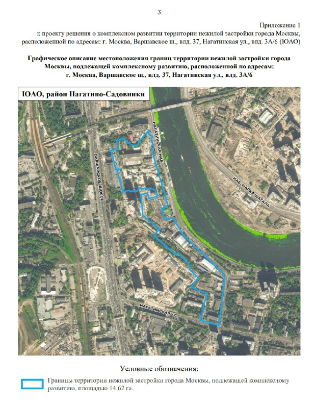
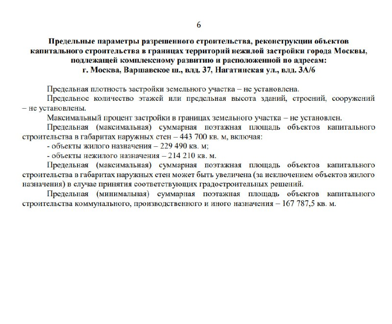

# Варшавское, 37 и Нагатинская, 3А/6: КРТ на 443,7 тыс. кв. м выставили на торги

Москва подготовила комплексное развитие территории (КРТ) на 14,62 га в Нагатино-Садовниках: по предельным параметрам там можно построить до 443,7 тыс. кв. м, из них 229,5 тыс. кв. м жилья. В августе 2026 года право на КРТ выставили на аукцион со стартом более 2,4 млрд ₽.

## Коротко

- Территория: 14,62 га по адресам Варшавское шоссе, влд. 37 и Нагатинская ул., влд. 3а/6.
- Объём: до 443,7 тыс. кв. м, из них жильё около 229,5 тыс. кв. м, нежилые объекты около 214,2 тыс. кв. м.
- Торги: стартовая цена более 2,4 млрд ₽, задаток 20%, участнику нужен опыт ввода не менее 44,37 тыс. кв. м за пять лет.
- Итоги аукциона на 15 октября 2026 года мы в открытых источниках не нашли.

## Что такое КРТ на Варшавском шоссе, 37 и Нагатинской, 3А/6

Участок в районе [Нагатино-Садовники](/novostroyki/nagatino-sadovniki/) Южного округа расположен вблизи метро «Нагатинская», МЦК «Верхние Котлы» и Павелецкого направления железной дороги. Территория относится к нежилой застройке, которую город передаёт под [комплексное развитие (КРТ)](/slovar/krt/).

В проекте решения предельная высота и плотность застройки не установлены. Максимальная поэтажная площадь в габаритах наружных стен — 443,7 тыс. кв. м; минимальная площадь коммунальных, производственных и иных объектов — 167,8 тыс. кв. м.

*Границы территории КРТ площадью 14,62 га: приложение к проекту решения. Скан официального документа. Источник: Правительство Москвы.*

## Что построят: жильё, школа и детский сад

По данным мэрии, в проекте около 229,5 тыс. кв. м жилья и около 214,2 тыс. кв. м нежилых объектов, включая детский сад на 350 мест, школу на 1000 учеников и коммунальные объекты. Город заявляет 4,9 тыс. рабочих мест — это даёт инвестору право на городскую льготу.

На наш взгляд, пропорция «половина на половину» делает проект ближе к деловому кварталу с жильём, чем к привычному жилому комплексу. Но состав нежилой части определит победитель торгов: параметры задают только пределы.

*Предельные параметры разрешённого строительства из проекта решения. Скан официального документа. Источник: Правительство Москвы.*

## Что с проектом сейчас

По состоянию на 15 октября 2026 года известно, что в августе город объявил аукцион на право заключить договор о КРТ. Стартовая цена — более 2,4 млрд ₽. Подтверждённого победителя и итоговой цены мы не нашли, поэтому не называем ни исполнителя, ни застройщика.

Это один из шести проектов КРТ в Нагатино-Садовниках: по данным мэрии на 19 июня 2026 года, речь о почти 38 га и более чем 1 млн кв. м недвижимости. Полная история проекта — в [досье «Варшавское, 37»](/obekty/varshavskoe-37/); о других решениях города — в [теме КРТ](/temy/krt/).

## Что это значит для покупателя и инвестора

Покупать здесь пока нечего: сначала нужно определить оператора КРТ, затем утвердить проект планировки и получить разрешения (так устроена процедура КРТ). Сроки реализации в источниках не названы, поэтому ориентироваться на конкретные даты рано.

Что отслеживать: протокол итогов торгов на torgi.mos.ru, имя победителя, проект планировки территории и первые [технико-экономические показатели (ТЭП)](/slovar/tep/) конкретных корпусов.

## Карточка объекта

- **Адрес ЗУ:** Москва, Варшавское шоссе, влд. 37; Нагатинская ул., влд. 3а/6
- **Район:** Нагатино-Садовники
- **Площадь территории:** 14,62 га
- **Объём строительства:** до 443,7 тыс. кв. м (жильё около 229,5 тыс., нежилое около 214,2 тыс. кв. м)
- **Стадия:** торги на право заключить договор о КРТ (объявлены в августе 2026 года)
- **Старт торгов:** более 2,4 млрд ₽

## Вопросы и ответы

**Что такое КРТ на Варшавском шоссе, 37 и Нагатинской, 3А/6?**
Это проект комплексного развития территории 14,62 га в Нагатино-Садовниках: до 443,7 тыс. кв. м недвижимости, из них около 229,5 тыс. кв. м жилья.

**Сколько стоит право на КРТ в Нагатино-Садовниках?**
Начальная цена аукциона, объявленного в августе 2026 года, — более 2,4 млрд ₽. Итоги торгов мы в открытых источниках не нашли.

**Что построят в КРТ у Нагатинской набережной?**
Жильё, нежилые объекты, детский сад на 350 мест и школу на 1000 учеников. Город заявляет 4,9 тыс. рабочих мест.

**Кто будет застройщиком КРТ на Варшавском, 37?**
Подтверждённого победителя торгов на 15 октября 2026 года мы не нашли. Право на КРТ получает участник, выигравший аукцион.

## Источники

1. [Mos.ru: аукцион на право заключить договор о КРТ в Нагатино-Садовниках, август 2026 года](https://www.mos.ru/news/item/174924073)
2. [Mos.ru: шесть проектов КРТ в Нагатино-Садовниках, 19 июня 2026 года](https://www.mos.ru/news/item/171620073/)
3. [Novostroy-M: в Нагатино-Садовниках по проекту КРТ построят около 443,7 тыс. кв. м](https://www.novostroy-m.ru/novosti/v_nagatinosadovnikah_po_proektu)

Материал не является инвестиционной рекомендацией.
