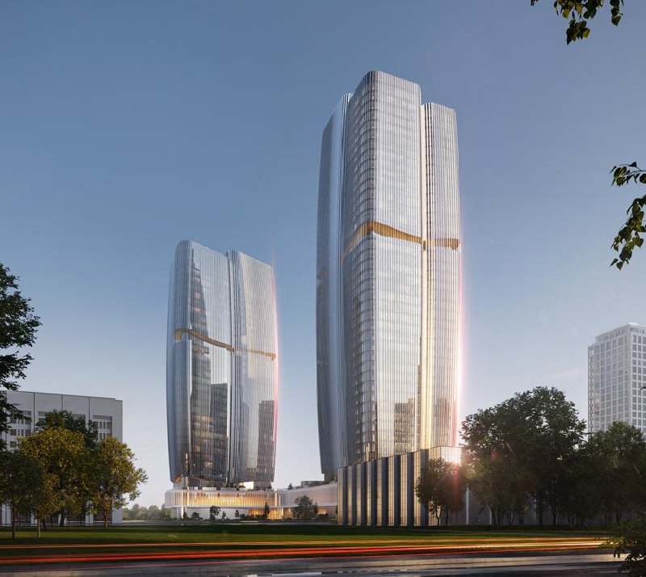
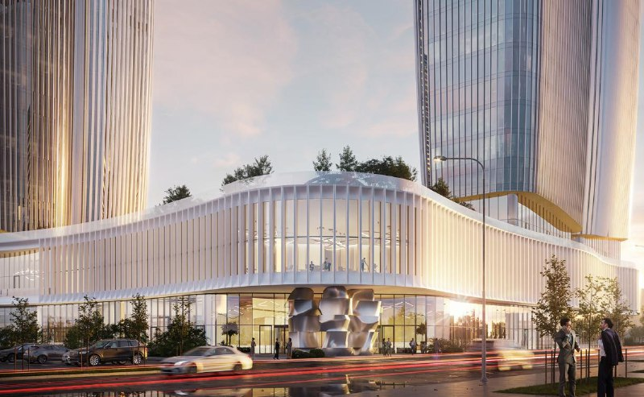
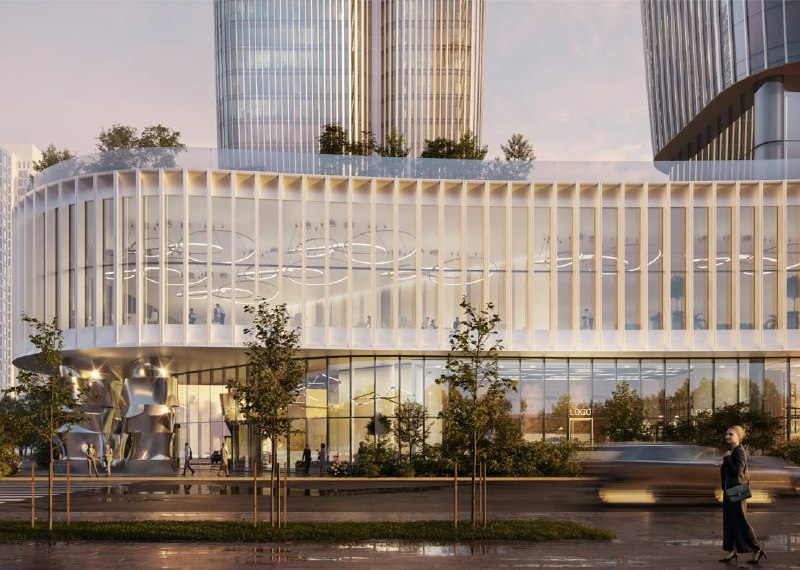

# БЦ «Поле» на Ленинградском, 37: две офисные башни Dar у метро ЦСКА

Девелопер Dar строит офисный комплекс «Поле» на месте ТЦ «Старт» на Ленинградском проспекте, 37 в Хорошевском районе (САО) Москвы. К 13 октября 2026 года площадку расчищают под две башни на 33 и 43 этажа, а офисы значатся как «скоро в продаже».

## Коротко

- Бизнес-центр «Поле» строит Dar, входящий в холдинг [«Бэсткон»](/zastroyshchiki/bestkon/); участок — 1,8 га на месте ТЦ «Старт».
- Две башни на 33 и 43 этажа, пятиэтажный стилобат с парком на кровле, более 200 тыс. м², из них офисы — 119 тыс. м².
- Срок в карточке агрегатора — квартал 2029 года; стадия на момент проверки — котлован и фундамент.
- Цены на офисы не опубликованы.

*Визуализация: Dar. Общий вид двух башен комплекса «Поле»*

## Что строят на Ленинградском проспекте, 37

«Поле» — бизнес-центр класса A на Ходынском поле. По данным агрегатора, в нём 271 офисный блок площадью до 2,3 тыс. м², подземный паркинг на 586 машино-мест и ещё 69 наземных. До метро «ЦСКА» около 10 минут пешком, до «Динамо» и «Аэропорта» — около 13.

Москва согласовала архитектурно-градостроительную концепцию комплекса в феврале 2026 года (сообщение от 16 февраля). Башни в 43 и 33 этажа соединяет стилобат площадью около 7 тыс. м² с парком на кровле, на нижних этажах — торговые и общественные зоны, медицинский центр. Фасад стилобата — волнообразный, башни — со скруглённым силуэтом.

*Визуализация: Dar. Волнообразный фасад стилобата и входная группа*

## Кто застройщик и чей участок

Застройщик — Dar. По публикации от 7 февраля 2026 года, эта «премиальная» компания появилась в структуре «Бэсткона» в 2024 году. Здание ТЦ «Старт» было выкуплено в 2023 году у Евгения Гинера, бывшего основного акционера ЦСКА; сейчас собственник — ООО «Премиум Эстейт». Заказчиком на баннере указано ООО «СЗ Старт-Авиацентр».

По сообщению РБК, разрешение на строительство выдал Мосгосстройнадзор, а проект идёт по программе создания мест приложения труда ([МПТ](/slovar/mpt/)).

*Визуализация: Dar. Стилобат с озеленённой кровлей*

## Контекст: от ТЦ «Старт» к офисным башням

ТЦ «Старт» работал на участке с 2003 года, в феврале 2026 года его уже сносили: работы шли почти две недели, фасад в основном разобрали. Полная история проекта — в [досье «Поле»](/obekty/pole/).

## Что с проектом сейчас

На 13 октября 2026 года в карточке агрегатора указаны стадия «котлован/фундамент», срок — квартал 2029 года для обоих корпусов и статус «скоро в продаже». Цены на офисы не опубликованы; цифры 500–600 тыс. ₽ за м² из рыночных обсуждений подтверждения не нашли и мы их не используем. Официальной даты старта продаж мы не нашли.

## Что это значит для покупателя и инвестора

Цен и договора пока нет, поэтому оценивать доходность рано. Перед покупкой офиса в «Поле» стоит проверить, какой договор предложит Dar и есть ли на момент старта опубликованная документация. Основные риски — срок (2029 год по данным агрегатора, не застройщика) и конкуренция других офисных проектов [рынка](/temy/rynok/) Ходынки. Остальные проекты Москвы — на странице [новостроек Москвы](/novostroyki/moskva/).

## Карточка объекта

- Название: бизнес-центр «Поле» (бывший ТЦ «Старт»).
- Адрес участка: Москва, Ленинградский проспект, 37 (в карточке — 37Б), Хорошевский район (САО).
- Застройщик: Dar (холдинг «Бэсткон»).
- Класс: A; 271 офисный блок.
- Площадь: более 200 тыс. м², участок — 1,8 га.
- Этажность: две башни, 33 и 43 этажа, стилобат — 5 этажей.
- Паркинг: 586 подземных и 69 наземных машино-мест.
- Стадия: котлован/фундамент (по данным агрегатора).
- Срок: квартал 2029 года (по данным агрегатора).
- Цена: не опубликована.

## Вопросы и ответы

**Кто строит бизнес-центр «Поле» на Ленинградском проспекте, 37?**
Застройщик — Dar, появившийся в структуре холдинга «Бэсткон» в 2024 году. Здание ТЦ «Старт» холдинг выкупил в 2023 году у Евгения Гинера.

**Что построят на месте ТЦ «Старт»?**
Офисный комплекс «Поле»: две башни на 33 и 43 этажа на пятиэтажном стилобате с парком на кровле. Общая площадь — более 200 тыс. м².

**Когда сдадут бизнес-центр «Поле»?**
В карточке агрегатора указан квартал 2029 года для обоих корпусов; официальная дата ввода не подтверждена. Стадия на момент проверки — котлован и фундамент.

**Сколько стоят офисы в «Поле»?**
Цены не опубликованы: на 13 октября 2026 года офисы значатся как «скоро в продаже».

## Источники

1. [Карточка бизнес-центра «Поле» — novostroy-m.ru](https://www.novostroy-m.ru/baza/biznestsentr_pole)
2. [Проект «Поле» на Ходынском поле: концепция согласована — m24.ru, 16 февраля 2026](https://www.m24.ru/news/16022026/874265)
3. [Общественно-деловой комплекс «Поле» — РБК](https://www.rbc.ru/rbcfreenews/6ab6554e9a7947a27caf4f4f)
4. [«Как музей нулевых». На севере Москвы сносят торговый центр — msk1.ru, 7 февраля 2026](https://msk1.ru/text/gorod/2026/02/07/76237165/)

Материал не является инвестиционной рекомендацией.
